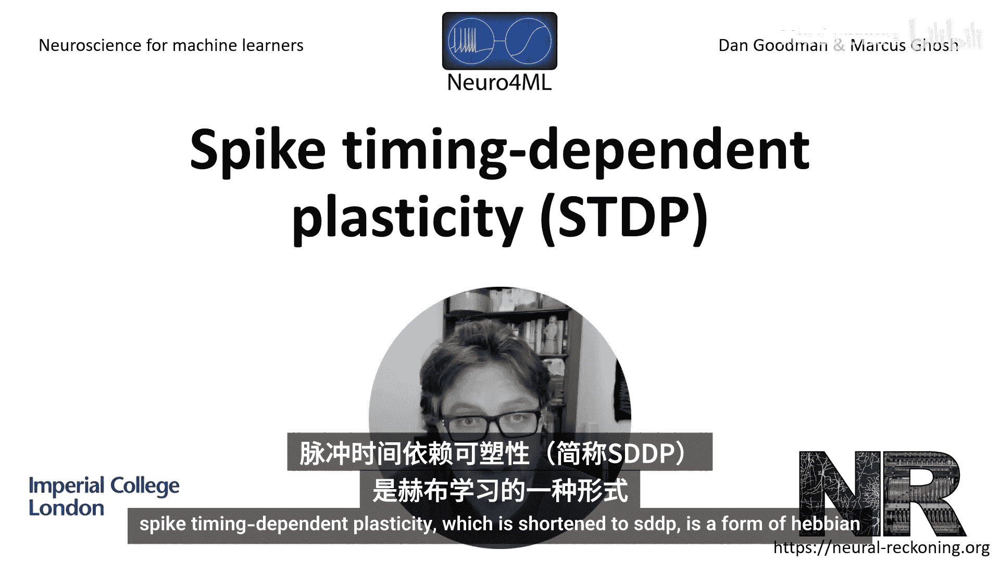
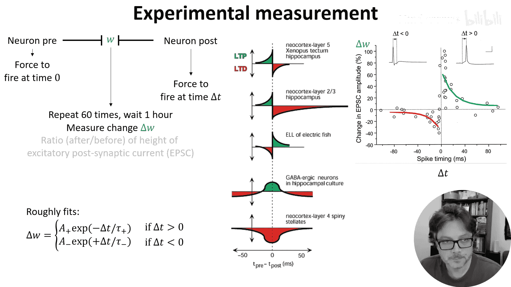
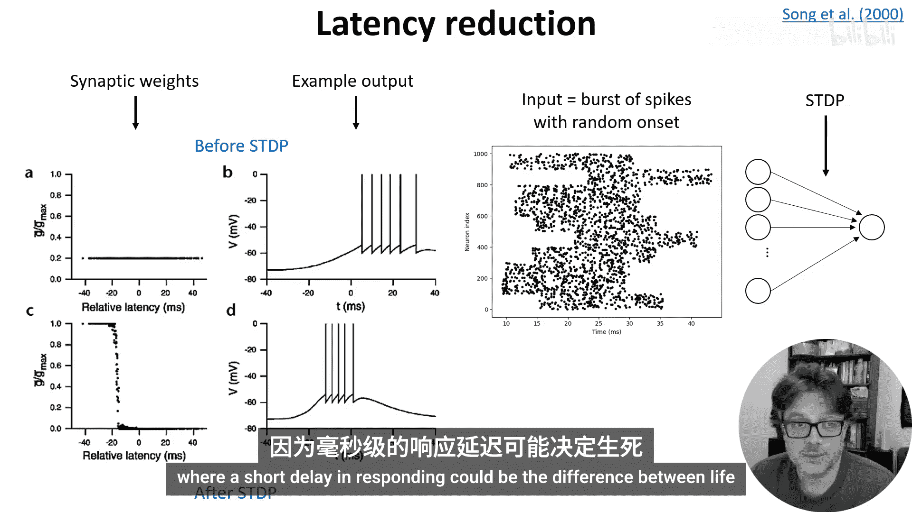
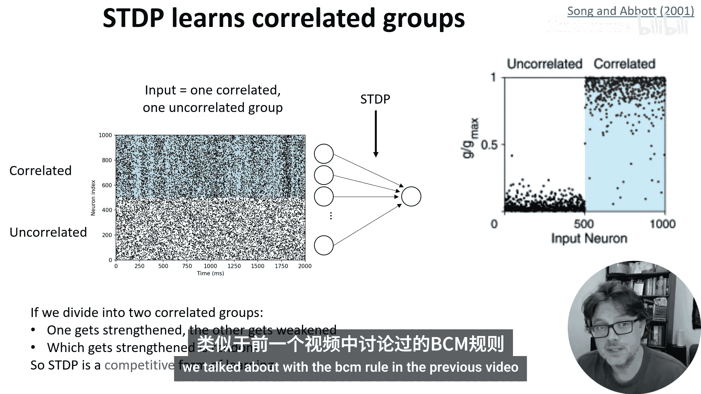
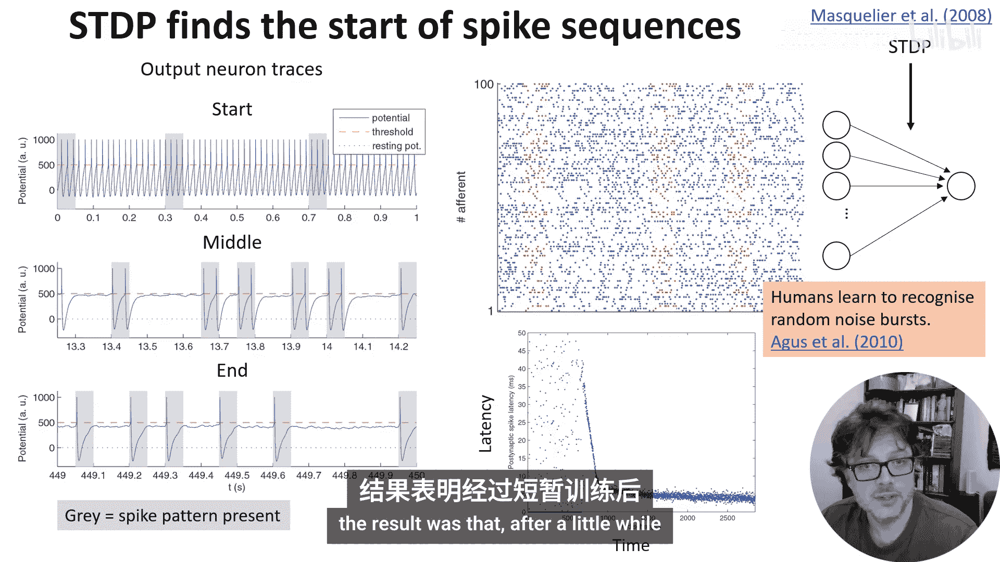
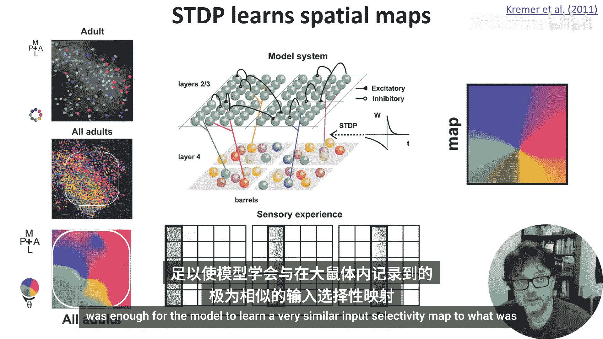
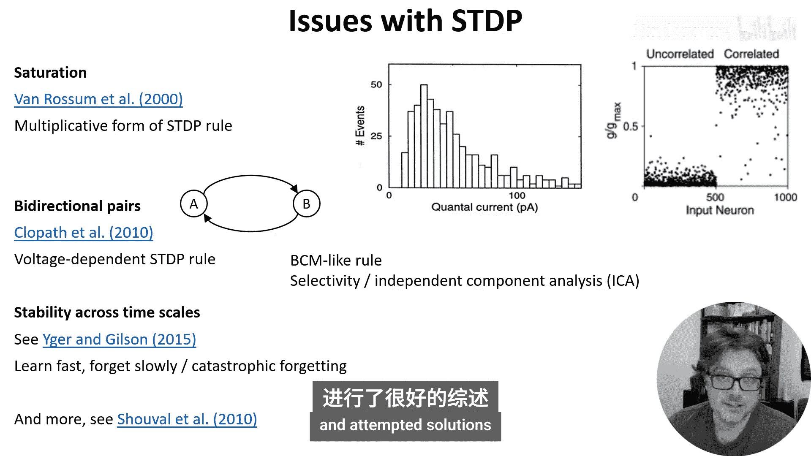
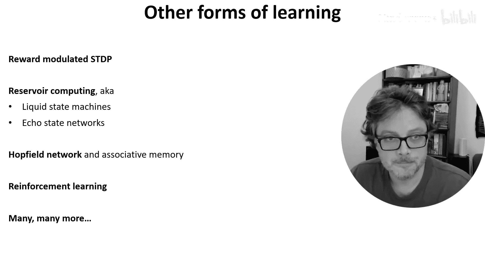

# 机器学习人员的神经科学 ｜ Neuroscience For Machine Learners p21 P21_W4_V2-STDP -BV1MiawzJExR_p21-

Spike timing dependent plasticity， which has shortened to SDDP。

 is a form of heavy unlearning that takes the timing of individual spikes into account。

Let's start by talking about how it's measured experimentally。

Refind a pair of neurons connected by a synapse。Reforce the preseptic neuron to th spike at time 0。

And the proynaptic neuron to fire a spike at time， Delta T。We then repeat this pairing， say 60 times。

Wait around an hour and measure the change at the synapse。

And we measure this by computing the height of a postlyptic current from a single excitatory bike before and after the pairing。

And we get results that look a bit like this。 It's a bit nicey。

 but you can generally see that if the postsynapptic neuron fires after the presaptic neuron。

 the weight goes up。 And if the postsynaptic neuron fires before the preynaptic neuron。

 the weight goes down。 and the closer in time， the stronger the effect。😊。

We can roughly fit this with a pair of exponentials with different heights and time constants。

We've talked before about he and learning， what flies together， wises together。

 but this is actually closer to what hep originally suggested。

He suggested that when a presaptic neuron repeatedly contributes to the firing it by synaptic neuron。

 the synapse will get stronger。And STDP realizes that idea because if the postynaptic neuron fires before the preynaptic neuron。

 of course， it couldn't be that the preynaptic neuron contributed to that firing。Similarly。

 if the timing of the spikes is far apart， it's unlikely they were related。Alright， so so far。

 this looks like a very neat story of discovering experimental evidence for an intuitive theoretical idea and then finding a simple way to fit the data with a model。

But the brain never makes it that easy on us。As well as finding the shape that headb would have predicted。

 we also find the opposite， as well as synapses that get stronger if the spikes are close in time。

 regardless of signine and so on， many different shapes。With that said。

 the pre before post shape is the one we're normally talking about。

 And that's what I'll focus on in this video。

So how do we model this？ Well， the simplest thing would be just as sum the weight change over all of the spike pairs。

The issue is that this is computationally expensive。

Suppose we have N neurons or to or connected to N other neurons。

And each neuron fires around our spikes。In that case。

 computing this sum takes around n squared R squared operations。

 and each operation contains a core to the exponential function， which is itself very heavy。😊。

But there's a trick using the fact that it's exponentials of linear sums that can simplify this。

For each presynaptic neuron， we introduce what is called a trace variable， A pre。

 and we do the same with the postsynaptic neurons and a trace variable， A post。

Now we update them according to these rules。In the absence of a spike。They decay exponentially。

 like we've seen in the leaky integrated fire neuron。

The preynaptic trace with a time constant ta plus and the postsynaptic neuron with a time constant tau minus。

When a presapptic spike arrives， A p is increased by this constant A plus。

And then W is increased by a post post not。And similarly， for when a proynaptic spike a。

 but with pre and post and plus and minus swamped。Now。

 it's a good exercise at this point to try and work out why this gives the same results。

 So what you should do is try checking what happens for a single pair of spikes first。

Say a presapric neuron firing a spike at time 0 and a postsapptic spike at time Delta T greater than 0。

Draw a plot of what happens to both A pre and a post。 And each spike time， what happens to W。Now。

 do the same when the postfinatic spike happens first。

 and this should give you the single pair weight change equation at the top。

Now use the fact that all of the equations are linear to some overall possible spike pairs and you'll get the all pairs weight change role。

Computationitionally， we now only have to do n squared R operations。 And rather than exponentials。

 they're now all arithmetic， which is much quicker and more efficient。Not only that。

 but it's actually essentially free because we had to do this mining operations anyway。😊。

For each spike at a preynaptic neuron， we have to add a value to each postynaptic neuron it's connected to。

There are N neurons affected by each bike， and there are N R presynaptic neurons。

 So that's n squared our operations we would have had to do anyway。

One thing that's worth pointing out is that the models slightly differ from the experimental data here in the experimental data。

 it takes around an hour before you see the full weight change with it slowly increasing over time。😊。

With the first implementation， we could run the weight change rule an hour after the spikes we want to learn。

 but even that doesn't match the slow change you see in experiments。With the second implementation。

 it's automatically updated immediately after each spike。

It's also worth noting that there are some subtleties with delays here。

 You should do a slightly different thing， depending on whether delays are dendritic。

 axonal or some combination of the two。In any case， the experimental data is less clear about delays。

 So it's not even obvious there is a right thing to do here。Now that we know how to model to D。

 let's start looking at some of the things that can learn。

So what'll up a model with a layer of input neurons。

Connected to a single output neuron with SDP on the synaptic weights。

Now we make those input neurons or fire a burst of spikes for 20 milliseconds。

 but with a random latency and look at what the network learns。

What we see is that the neurons with a low latency have their synaptic weight strengthened to the maximum level。

So here， this is before all of the latencies have the same weight。Afterwards。

 the low latency neurons have a high weight， and the high latency neurons have a low weight。

The output neuron also now spikes earlier than before learning。So， here is before learning。

You can see it spikes late and after learning， spike early。

One way of interpreting this would be that if there were multiple sources of information available to an animal。

 it would respond preferently to the one that arrived earliest。

Which would clearly be advantages and advantageous in an environment where a short delay in responding could be the difference between life and death for an animal being hunted。

In this next model， we divide input neurons into two groups。

 One group with a white background are firing uncorrelated spikes。

The other group with the blue background are firing correlated spikes。After SDDP。

 the weights of the neurons in the uncorrelated group go to0。

 while the weights in the correlated group go to the maximum value。

And this makes sense biologically because being able to pick up on input correlations in your environment is very useful。

😊，We can also do the same thing， but where both groups of neurons are correlated with other neurons in their group。

 but not with neurons in the other group。And we find that SDP will learn to pick one of the two groups。

 But which one of the two groups is random。In other words。

 STDP has some aspects of competition in what it learns。

 and you can think this as a bit like the selectivity we talked about with the BM role in the previous video。

The next model combines the ideas from these two previous papers to learn to respond to repeated sequences of spikes。

We have the same setup with a group of neurons connected via SDDP capses to a single output neuron。

In this case， the input is random uncorrelated spikes that have repeated patterns。诶。

Repeated at random times。Here the blue dots are the uncorrelated spikes， and these red dots。

 which you see intermittently， are the correator， are the patternss。The repeated patterns。

What happens here is that the output neuron initially fires at random times。 So here。

 the gray is where the pattern is presented， and these blue vertical lines is where the output neuron fires the spike。

But eventually， it learns to fire only once the spike。It's present。And in fact， by the end。

 it learns to fire at the beginning of the presentation of the spike pattern。

And if you look more carefully， what's happening is that at first。

 it learns to pick a random subset of the neurons in the spike pattern group that happened fire at the same time。

This is the correlation and competition mechanism from the previous slide。

 and it leads to the output spike happening at some random point in the sequence here。

 about 2 thirds，3 quarters of the way through。And it could be early or it could be late because it's entirely random where which neurons it pickeds to do that。

But then SDP's preference for lower latency kicks in。

 and it shifts towards the neurons of the pattern that fire earlier until it reaches the beginning of the pattern。

Interestingly， a later study found that humans can indeed learn random patterns in noise。

Specifically， what they did was to play pairs of bursts of random noise to human listeners。

 and they had to indicate whether it was the same noise burst repeated or two different ones。

Unknown to them， sometimes the repeated bursts of noise were the same as the ones they'd heard before。

And the result was that after a little while， listeners learnt to recognize repeated bursts of noise more accurately for the ones they had heard before than for fresh bursts of noise。

Even though all of the bursts were entirely meaningless samples of white noise。

In week two's videos on network models， we saw this example of a spatial map in the barrel cortex of the ra。

As a reminder， that's the system that processes inputs from the rats whiskers。

What we saw is that these neurons have a preference for motion in a particular direction。

And that preference has a spatial structure。To model this。

 we used a slightly more complicated setup than the previous studies designed to match the structure of layers 2 through 4 of the barrel cortex。

The inputs to merely were waves of activity that moved across the whiskers in a linear pattern。

 with the direction chosen randomly each time。And this input structure。

 together with the SDDP synapsis was enough for the model to learn a very similar input selectivity map to what was recorded in the RAs。

Okay， so SDDP is pretty cool and it can learn some fun stuff， but there are some problems too。😊。

We saw in the video when rate based models that without some careful control。

 weights tend to go to the extremes。 And earlier in this video。

 you can see the same thing happening with STDP。 The weights will push down towards the minimum or maximum allowed values。

😊，And that doesn't match what you say experimentally， which is a more even distribution。

So this problem you can fix with a noisy multiplicative version of the SDDP learning role。

 although it's harder to get strong competition and specialization with this form of STDP。

Another issue is that STDP will always force soaptic connections between neurons to be unidirectional。

 You can't have a situation where A excites B and B excites A。However。

 this is really common in cortex。Now， again， you can fix this with a more complicated SDDP rule。

 In this case， one that takes voltage into account。

And the properties of these sorts of models are still being investigated。

It's structurally similar to the BM rules we saw in the last video and also gives rise to selectivity in something like independent component analysis。

😊，A more fundamental problem that has not yet been solved is how to handle stability of learning across multiple time scales。

And this paper has a nice review of many models from a dynamical systems point of view。

 showing that when you combine different forms of learning at different time scales。

 all sorts of problems start to occur like oscillations that disrupt memories。In general。

 we know that it's important to combine multiple times kills because we went about to learn fast。

 but forget slowly。But this seems to be hard to achieve。

 and this is related to the similar problem of catastrophic forgetting founded machine learning。

And solutions to this problem in either neuroscience or machine learning may prove helpful in the other field。

This isn't a complete list of all of the issues with SDP。

 And if you're interested in taking it further， this paper has quite a nice review of some of the problems and attempted solutions。

Okay， that's the end of the videos for this week on Learning rules。

 There's a lot more stuff that could be covered here， and I might add later。

In case you're interested on this slide are some of the keywords look up to take it further。

This includes reward modulatorulated STDP that lets you combine STDP with rewards to learn more interesting tasks。

There's reservoir computing that applies a linear reddoub layer to a random network with or without SDDP。

 and it turns out to be capable of learning arbitrarily complex functions with some assumptions。

There's the famous Hotfield Network， and associative memory。Of course。

 there's reinforcement learning and there's many， many more than that。

