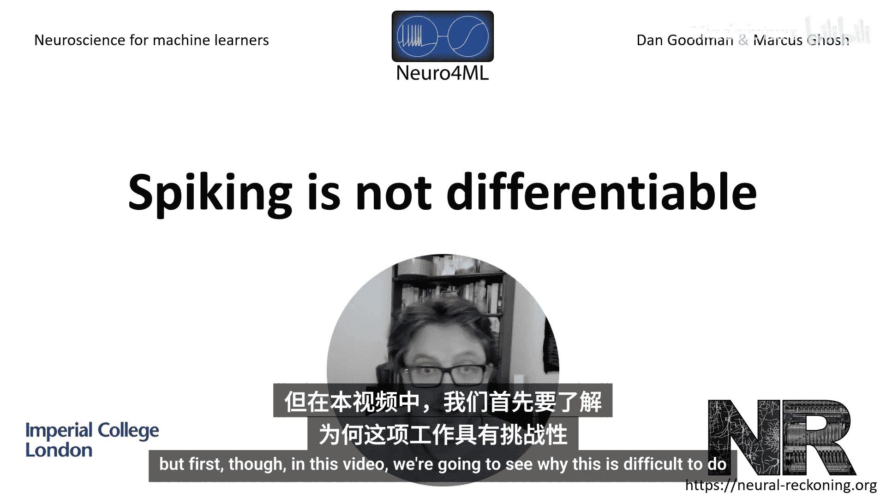
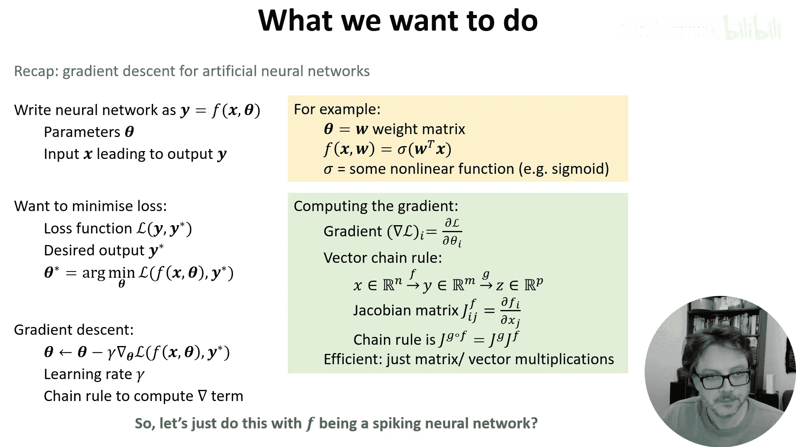
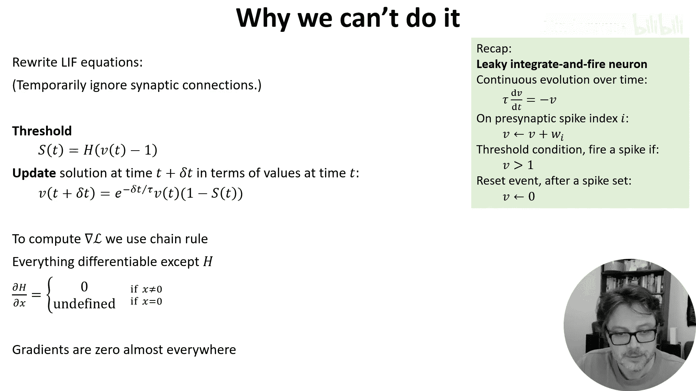
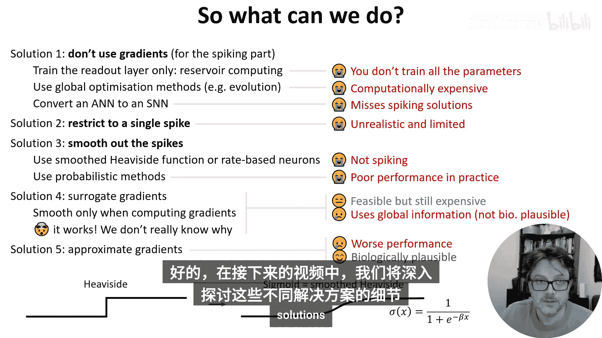

# 机器学习人员的神经科学 ｜ Neuroscience For Machine Learners p22 P22_W5_V0-Spiking_is_not_differentiable -BV1MiawzJExR_p22-

This week， we're going to talk about how to train spiking neural networks。 But first， though。

 in this video， we're going to see why this is difficult to do。

What we'd like to do is to use the methods developed for artificial neural networks because we know they work really well。

So let's quickly recap how that goes。 This isn't going to be a complete or comprehensive guide。

 So if you haven't encountered this before， stop now and read an introduction。

 I've put some recommendations in the reading list。First。

 we write the neural network as a fraction of inputs and parameters。For example。

 for a one layer neuraln network， the parameters could be the weights。

 and the function could be a sigmma it applied to theductt product of the weights and input vector。

We want to minimize some loss function that tells us how far the output of the network is from the desired output。

To do that， we apply gradient descent moving in the reverse direction of the gradient of the loss function with respect to the parameters。

We can compute the gradient efficiently using vector and matrix modplies using the vector chain rule。

So can we just do this for a sp in neural network， Well， it's not quite so easy and let's see why。

To see what goes wrong here， let's start with a recap of the leaky integrated fire neuro we've seen before。

Over time， it evolves according to a differential equation with instantaneous effects when a spike arrives。

Whenever the membrane potential V crosses the threshold V greater than one。

 you fire a spike and instantly reset to 0。I're going to rewrite those equations。

 temporarily ignoring the synaptic connections for simplicity。

 You get the same problem in solution with that， but it makes the notation more complicated。

The threshold'll write is S of T， and that's the hebide function of V of T -1。

So this would be equal to one if the neuron has spiked， otherwise zero。

Now we replace the differential equation with a discrete update rule。To get V at time T plus delta T。

 we multiply V at time T with this exponential term。

We are also going to fold in handling the spike reset by then multiplying this value by one minus S of T。

So what that means is that we multipied by zero if it's spiked。Otherwise， we multiply by one。

 and this is equivalent to setting it to0 after a spike。Now， if we wanted to use gradient descent。

 we'd have to compute the gradient using the chain rule。

 and that's unproblematic for every part of these equations except for the heavy side function。

But this function has derivative 0 at every point， except 0， where it's undefined。

And that means that the gradients are zero almost everywhere。😊。

Which means that gradient descent will never change any parameters。

 Ma it completely useless for spiking neural networks。

So how do we solve this problem？Well， there's a lot of different approaches that have been tried and that we'll talk about in the remaining videos this week。

There's no ideal solution， so in the final slide of this video。

 I'm going to quickly talk about the general purchase people have tried and some of their different issues。

The first idea is just not to use gradients， or at least not to use them for the spiking part of the network。

One example of this is reservoir computing。 You have a spikeiking neural network that you don't train with gradients and a trainable readout layerer。

This actually works surprisingly well， but it's not an efficient way to learn because you're not using all of the available parameters。

Alternatively， you can use global optimization methods like evolutionary algorithms。This works。

 but you have to throw a lot of compute at it。You can try taking an artificial neural network and converting it to a spiking neural network。

 And again， this works reasonably well， but it doesn't find solutions that make use of spiking。

 And so it's not using the spiking neurons efficiently。

Another type of solution is to insist that each neurons inspires precisely one spike and they take the derivatives with respect to the time of that spike。

 which is a nicely differentiable quantity。嗯。This is a clever solution that works surprisingly well in practice。

 The downside is that it's unrealistic to assume only one spike pun you're on。

 And that really limits what you can do with it。A clever trick is to take the non differentiable heavy side function and smooth out to a sigmoid that you can differentiate。

And this has been shown to work in at least some cases。

 but it's another spike in your network if you do that。

A related trick is to look at probabilistic neuron models。

 and then the premises of their distributions are differentiable。This is theoretically nice。

 but in practice it doesn't seem to scale very well。😊。

A more generally applicable approach is a method called surrogate gradients。

 And I'm going to talk about more about this in a later video。

 But the key idea is that we do the same smoothing。

But only when we're computing gradients and not for the forward pass。It's a bit surprising。

 but this works。 We're providing gradients to a different function from the one we're optimizing。

 but it gives us good solutions。 We have some ideas of why this works。

 but it's not a fully rigorous explanation。This method is still quite computationally expensive。

 but it is feasible to use it for networks of a few thousand neurons， at least。

One downside is that it is this global information that wouldn't be available to a neuron in a biological setting。

That's fine if we just want to know what a good solution would look like。

 but makes it a bad model for how the brain learns。😊，To address both these issues。

 people use approximations that reduce the computational complexity and make the learning rules only use local information。

Performance does tend to be worse， but on the upside， these rules are more biologically plausible。

Okay， in the next video， we'll dive into some of the details of these different solutions。

