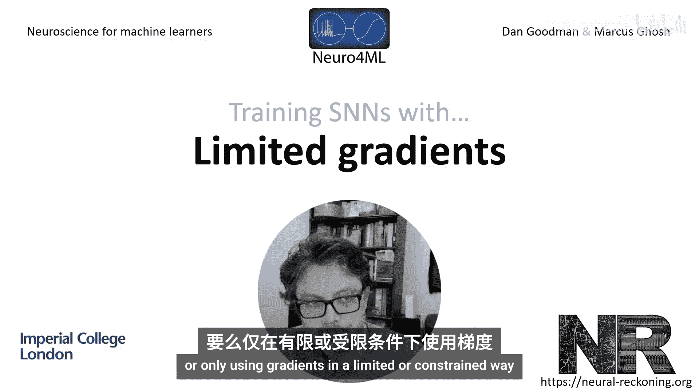
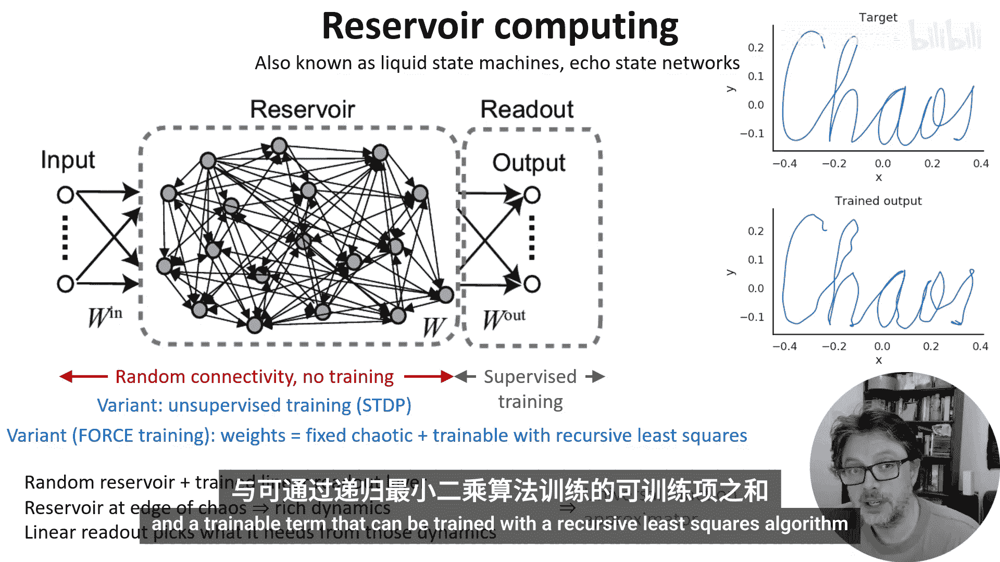
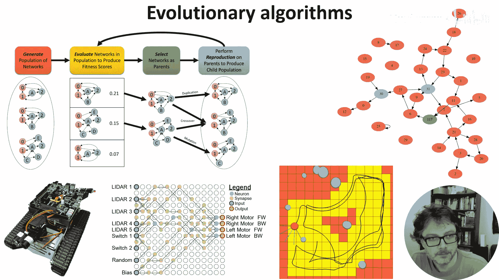
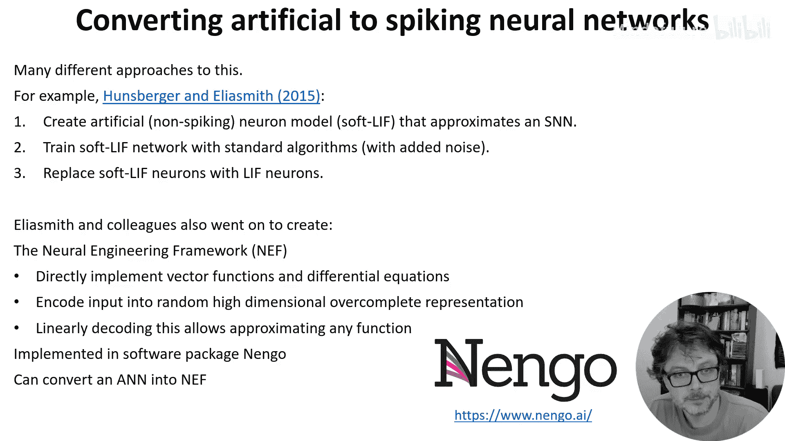
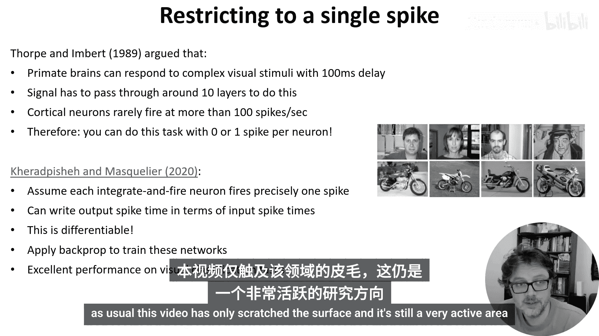

# 机器学习人员的神经科学 ｜ Neuroscience For Machine Learners p23 P23_W5_V1-Limited_gradients -BV1MiawzJExR_p23-

In this video， we'll look at some of the many methods for training spik in neural networks with either no attempt to use gradients or are only using gradients in a limited or constrained way。

Let's start with reservoir computing， which is also known as liquid state machines and echostate networks in different contexts。

In this setup， we start with some time going input sequence connected to a randomly recurrently connected group of neurons。

These random connections are not trained。The recountant group is connected to a linear reddoub layer。

 which is trained with a supervised algorithm to reproduce a desired time varying output。

You initialize the recurrent neurons with weights which put the network dynamics into a near chaotic state。

The idea is that near chaos， you will find a rich set of trajectories in the dynamics of these neurons。

 and by doing a linear readout， you can approximate any dynamics you lack。And this works。

 You can prove that this setup allows you to approximate any time varying function with enough neurons neurons。

Here's an example of a target trajectory and a reconstruction using reservoir computing。

There's lots of variants of this。 For example， with spik in neural networks。

 you could add unsupervised training to the reservoir neurons using SDDP。

A particularly interesting variant is force training。

 where you write the recurrent weights as a sum of a fixed term that induces chaos and a trainable term that can be trained with a recursively squares algorithm。

Another approach is to use global optimization algorithms that don't require derivatives。

A particularly successful approach pioneered by Katie Schumann is to use evolutionary algorithms。

In these algorithms， you generate a population of networks， evaluate them。

 and then create new networks by mixing up the most successful networks。

 repeating until you get a good performance。😊，Here's an example network involved with this method to classify breast cancer images。

The advantage of this method is that it can finds surprising architectures like this one that you might never otherwise have found。

But it does tend to be computationally demanding and limited to fairly small networks like this。

It's also been used to train neuromorphic hardware that we'll talk about later in this course。

 for example， a controller for this stellar robot。You can see an example of the sort of network at Fs。

 and another advantage here is that you can easily adapt it to the type of hardware available。

In this case， a field programmable Gator A or FPGA。

And here's an example of a trajectory showing that this robot was able to learn to drive around。

 avoid obstacles， etca。

Rather than trying to work with spiking neural networks directly。

 we can start by doing something we know how to do， like training an artificial neural network。

 and then convert the result into a spiking neural network。There's a huge literature on this。

 but I'm just going to mention two approaches from Chris Elis Smith and colleagues。

The first starts by creating a non spiking artificial neuron called a soft lift。

That approximates the input output behavior of a spiking neuro。

You then train this soft lift network with standard algorithms。

 possibly adding training noise to make it more noise robust。

Then just replace those soft Ly neurons with real lymph neurons， but it works fairly well。

Alas Me and colleagues later took this sort of approach much further。

 creating a very general method called the neural engineering framework。In this approach。

 you can directly implement vector functions and differentials。

By encoding input values into a random， high dimensional overcomplete representation。

And then linearly decoding this， which they show allows you to approximate almost any function。

They implemented this in a comprehensive software package Ngo。

 So it's easy to try it out if you're interested。Once you have these building blocks。

 it's easy to then convert an NNN that is composed of these building blocks into their framework and implement it with biikking neurons。

The last method we'll look at today is making the network differentiable by limiting each neuron to only be able to fire a single spike。

This might seem like a crazy limitation， but there's actually a good reason to try this coming from Simon Thorpe and colleagues。

They noted that primate brains are able to classify and respond to quite complicated visualsostimy。

 like distinguishing between food and not food， with as little as 100 millisecond delay。😊。

From studying the anatomy， they knew that to go from the visual system to the motor system that registered the response。

 the signal would have to go through around 10 layers。

And since critical neurons usually only fire at most around 100 spikes per second。

 that means that in the 10 milliseconds that each layer has to process。

 it likely only fires 0 or 1 spikes。And so it must be possible to do quite complex tasks with each neuron firing only 0。

01 spikes。Tim Muskelllia and colleagues implemented this idea。

 They set up a network of in and fire neurons， Note， not leaky integrated file。

 and only allowed them to file one spike per stimulusim presented。With that limitation in place。

 they could write the output spike time of a neuron analytically in terms of the input spike times and widths。

And this function is differentiable。😊，And that means that we can apply back to train these networks。

And they found that this gave excellent performance at the same types of visual classification tasks that Simon Thorpe had earlier studied in prims。

For example， they could very reliably distinguish between faces and motorcycles in this data。😊，Okay。

 that's enough for these limited gradient approaches。

 as usual this video has only scratched the surface and it's still a very active area of research。😊。

