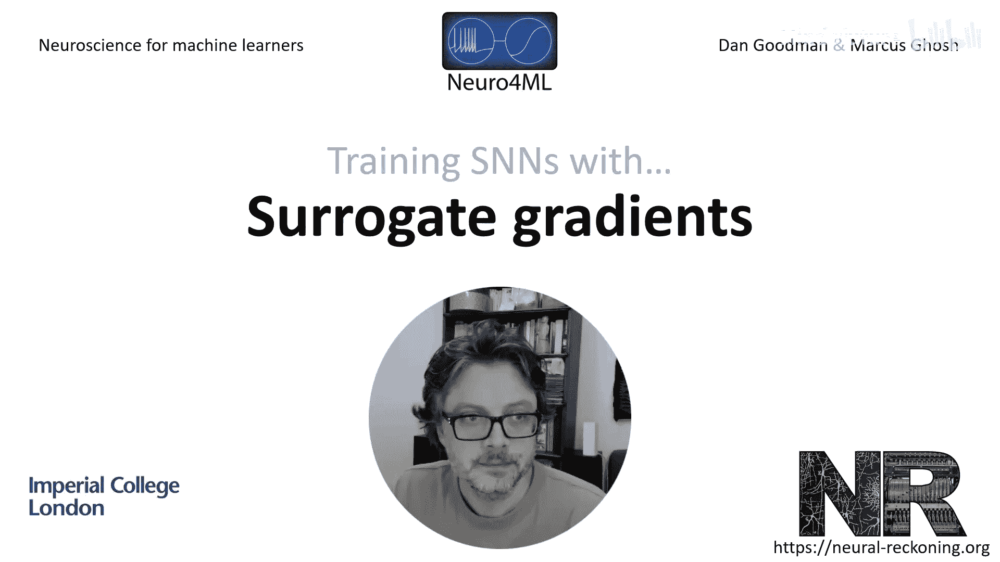
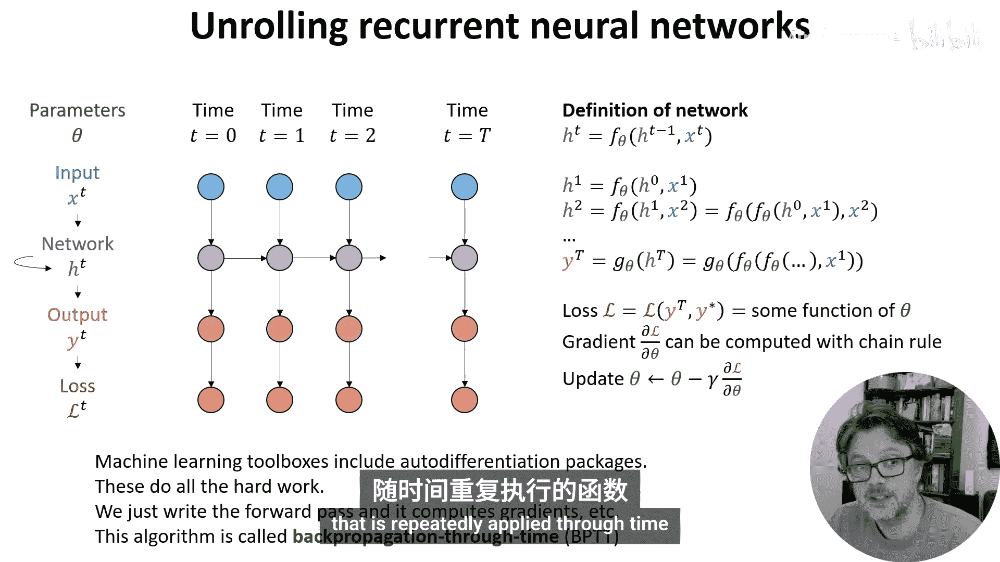
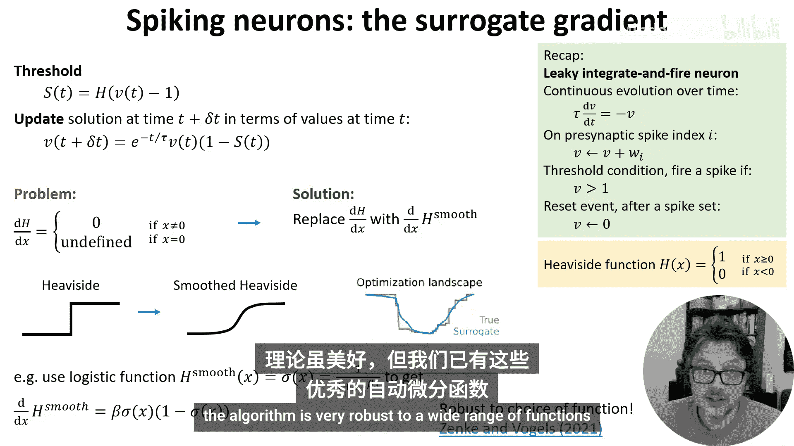
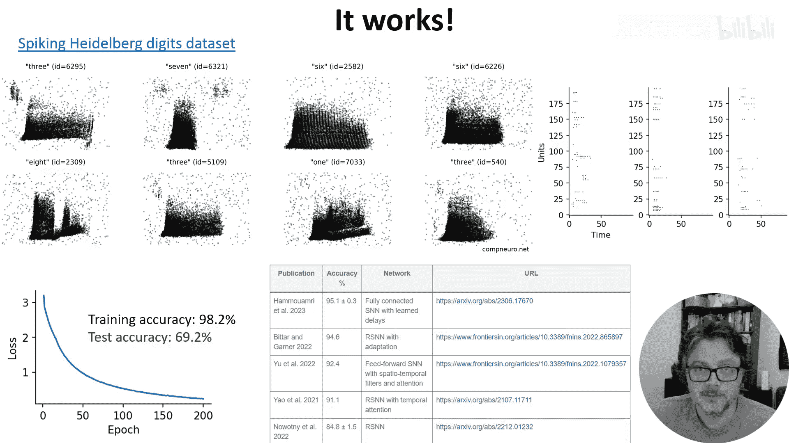
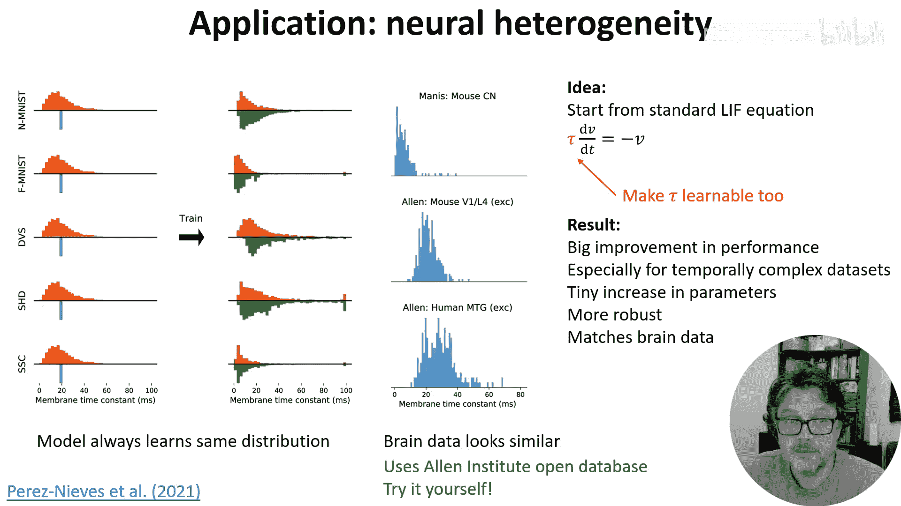
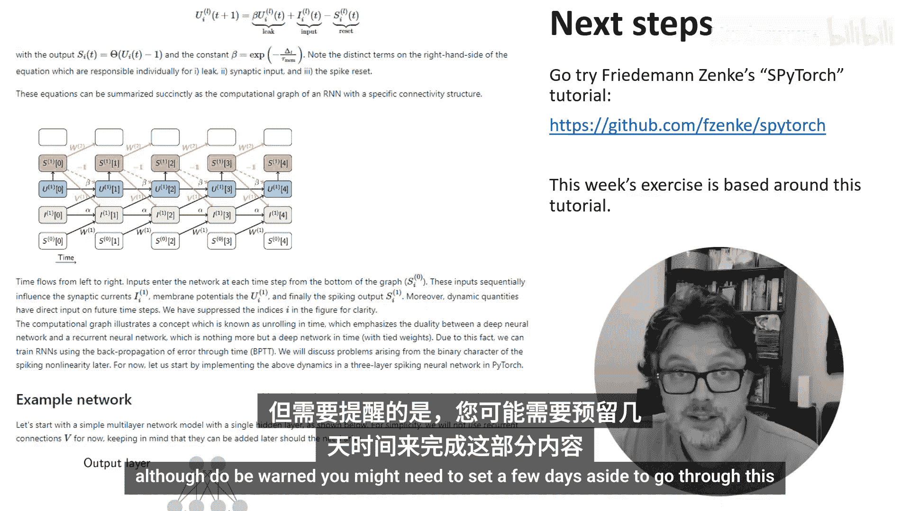

# 机器学习人员的神经科学 ｜ Neuroscience For Machine Learners p24 P24_W5_V2-Surrogate_gradients -BV1MiawzJExR_p24-

In this video， I'm going to explain how to train spiking neural networks with the surrogate gradient method。

This method isn't perfect， and I will talk about some of its drawbacks later， but at the moment。

 it does seem to be a very good balance of flexibility and efficiency。

There's a lot of research going on in this area at the moment。

 and there's likely to be big advances in the next few years。

The surrogate gradient method treats a spiking neural network as a very particular sort of recurrent neural network。

That's true。 Even if the spikking neural network doesn't have recurrent connections。

 because the fact that the internal state of a neuron at one time step depends on its internal state at a previous time step。

 makes it implicitly recurrent。With that in mind， let's quickly look at how you can train your recurrent neural network。

First， we define the neural network like this。 We have peri theta that could be weights or biases。

 etc cetera。We have a time varying input X fed into a recurrent network whose internal state is H。

That then gets fed into an output layer Y， which has an associated loss function L。Now。

 we unroll this through time to see the dependencies more clearly。

 You can see that the network state at time T equals1， for example。

 is affected by the inputs at time T equals 1， but also the network state at time t equals 0 and so on。

We can write a mathematical definition of the network by the equation。

 H T is F subtheta of H T -1 and X T。Here F subtheta is the function that takes the network state。

 input and parameters and returns the updated network state。

This function could be the application of a single layer。

 or it could be the result of applying multiple layers or anything else really。

We can expand this function out to get a feel for what happens in the first time step。

 you just get the definition above。For the second time step。

 we can expand out the H1 to get the result only in terms of theta。

 the initial state H 0 and the inputs。And we can continue like that for all other time steps。

In the final time step we apply another function G Theta。

And then we have an expression for the loss only in terms of the parameters， theta and the inputs。

And that means that we can compute a gradient of the loss with respect to the parameters using the chain rule。

And with that， we can write a gradient toscent update rule， as we've seen before。Now。

 that all looks complicated， but actually modern machine learning toolbox do all the work for us with their auto differentiation packages。

We just write the forward pass， and it handles efficiently computing the gradients using the chain rule。

 applying the update role and so on。This algorithm is called be propagation through time because it's the standard bet propagation algorithm applied to a function that is repeatedly applied through time。

Now let's take this idea and apply it to a spikking neural network。

 I'm starting from the same recap of the leaky integrated fire neuron from the first video this week。

 so make sure to watch that first if you haven't already。

The key point here is that we can write equations to update the internal network state from one time step to the next。

 like the function F Theta from the previous slide。😊。

This is entirely composed of nicely differentiable functions， with one exception。

 the heavy side function， which is used in computing whether or not a neuron has crossed a threshold and fired a spike。

This function is discontinuous and has a derivative that is 0 everywhere except x equals 0。

 which means that when we compute gradients using the chain rule or an auto differentiation package。

 we'll just get zeros and no updates will happen。The solution， which is a little strange。

 is to keep the function H as it is in the forward pass。 But whenever we see a derivative of H。

 we replace it with the derivative of a smoothed version of the heavy side function。

The intriition here is that we have， if， if we have a lost landscape with discontinuous jumps corresponding to an a change in gradient causes there to be one more or fewer spikes。

 then smoothing the heavy side function will smooth out the jumps in the lost landscape。

An example function we can use is the logistic Sed function。And this has a nice simple derivative。

But actually， it turns out that the choice of smoothing function doesn't actually matter that much。

 The algorithm is very robust to a wide range of functions。

Now， that all sounds nice in theory， but we have these lovely auto differentiation functions and implementing this idea looks like it'll be a nightmare。

😊，But actually， it's not as bad as it seems。Ptorrch and other libraries allow you to overwrite the default implementation of the gradient computation。

I don't think this is designed for implementing sro gradients， but it does the job nicely。

 Let's have a look at the code。We start by defining a class surrogate heavyside。

 This derives from the Plytoch Autograd function class to make it compatible with Pytoch。😊。

We'll use this to create a new magic surrogate version of the heavy side function that will do exactly what we want。

😊，Pytorch requires you to implement two methods。The first is， what happens for the forwardd pass。

We just wanted to return the standard heavy side function。 And for our purposes。

 this context save for backward is just boiler plate to make it plain nicely with bytorrch。

The second method is the backward pass。 It starts in the same way with some boilerplate that lets us get the input and the gradient of the output。

 because we're going backwards。Then we compute our new derivative。

 We set a parameter beta which specifies how steep the sigmmaoid function is。

 and then compute the derivative using the formula from the previous slide。

Note that we multiply the derivative by the output gradient， which was given us by Poytoch。

And that's it。We instantiate this class and just use that instead of the heavy side function。And now。

 by magic， our spikking neural network can be used with auto differentiation。

 and we can use any optimization algorithm like stochastic gradient descent。

 the atom learning role and so on。😊，And it works。Here's an example using the Spikking Heidelberg digits dataset。

 This is a database constructed by having several different speakers read the digits 039 in English and German。

Taking the sand waves and feeding them into a fairly detailed model of how the early auditory system processes sounds to produce spike rest of plots like these。

On each figure， the Y axis is the neuron index with the bottom rows corresponding to low sound frequencies and the upper rows to high frequencies。

The X axis is time。If you've seen spectrograms of sound before。

 this should look somewhat familiar because at a very rough level。

 that's what the early part of the auditory system is doing。

We can train a spik in neural network model to take these as input and ask it to classify the digit and it's able to do the task。

 Here are some of the intermediate spike trains for model neurons after training。😊。

You can see that with training the loss curve has a familiar shape。

 and at the end we get a test accuracy of about 70%。

 which isn't too bad for a classification task with a chance accuracy of 5% and only 200 spiking neurons。

Friom and Zenka， who built this data set， keeps a table of the best performers。

 and at the time of recording， the best was around 95%。

The key innovation there was to allow for trainable delays between neurons。That's great performance。

 but I'm pretty sure it'll go higher。 Maybe one of you can beat that score。😊。

And before we get too excited， there are some issues with this method。

 The first is that despite making it feasible of train spiking neural networks at complex tasks。

 it is still quite resource hungry。To get a feeling for this。

 let's say we have N neurons fully connected to each other。 and we run the network for T time steps。

😊，The algorithm will use O of N squared computation time per time step。And O of N T storage space。

 And this is the real killer。 because if you want to run these algorithms fast。

 you want to run them on a GPU。 And that means you are very limited in terms of how much RAm you have available。

You're essentially making a copy of the complete network state for every time step of the simulation。

 which racks up fast。😊，For a time step of 1 millisecond。

 you are making 1000 copies of the network state per second of simulated time。

Another issue is that it's hard to initialize these networks well。

You want an initial state with a couple of key properties。First。

 it should produce a reasonable number of spikes at every layer， not too much and not too little。

 or it will be hard to find a good solution。Secondly。

 you want the network to be initialised in a state where gradients neither vanish nor explode。

Which is a common problem with training deep or recurrent neural networks。

Various ideas have been proposed for this， including but not limited to initializing in a brain like state and analytically computing the variances in both the forward and backwards pass。

I should say the mass for this gets very hairy， very fast and is highly specific to the type of neurons you are using。

 which means this analytical solution is harder to deploy and practice than we might like。

A final issue I wanted to mention is that like any backdrop through time algorithm。

 it uses non local information that wouldn't be available to real neurons in the brain。

 meaning that without some additional work， it's not a good candidate for how the brain itself does learning。

That doesn't mean it's not a good way to train spiking neural networks in the abstract however。

 and doesn't stop us from using it to model what the brain is doing in other ways。On that note。

 I'd like to finish with a bit of self advertising by talking about a study done by one of my PhD students using surrogate gradientcent to tell us something about how the brain might work。

The idea was to start from the standard leaky integrated fire neuron equations。

 but instead of just training the synaptic weights， we also make these time constants tau trainable2。

😊，In terms of implementation in Pytoch that's almost as simple as a single line modification of the code。

 although there is some work to do to stop the algorithm getting stuck or running into numerical integration issues。

😊，And the results from this were really neat。We get a big performance improvement。😊。

Especially for temporarily complex dataset sets like the Heidelberg digits dataset set we saw before。

And we get this for a tiny increase in the number of parameters because we've only added one new trainable parameter per neuron。

 which is O N parameters。And not increase the number of synaptic weights。

 of which there are our events squared。We also found this method was more robust when tested out of the distribution of the training set。

And the time constants we learned match what we see in experimentally recorded brain data。

Specifically， regardless of how we initialize the time constants for each data set。

 they always found their way to a characteristic distribution that is roughly log norm more or gamma distributed。

And that's exactly what you see in the brain across multiple different regions and animal types。

 including humans。😊，It's not conclusive， but we think that this suggests that having neurons that aren't all the same can allow the brain to do much more without a big increase in required resources。

Instantly， these experimentally recorded distributions were obtained from the Allen Institute database。

 which is openly and freely available to explore and has a nice Python API。

 So you should have a play around with that。

Okay， that's all for this video on surrogate gradientant Descent。

 I strongly advise you to spend some time getting to descriptionure it in more detail。

 starting from Freedom and Zzen's Excelence by Torch tutorial。

 which builds up the code to run this step by step from scratch until you have a network that can solve the Spikking Heidelberg digits dataset set。

This week's exercise starts by going through the first part of this territorial and then applying it to a different problem。

I've also included some reading material if you want to get a bit deeper into the maths of sarogate gradient descent。

 although do be warned you might need to set a few days aside to go through this。😊。

