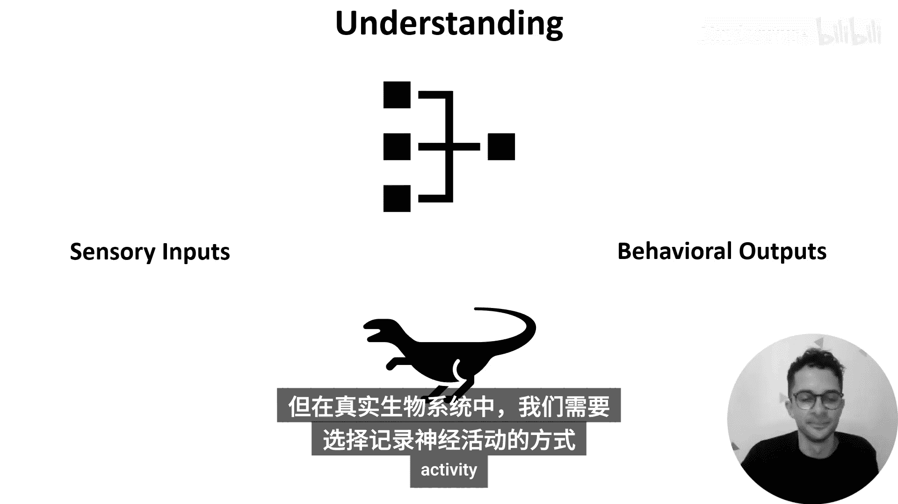
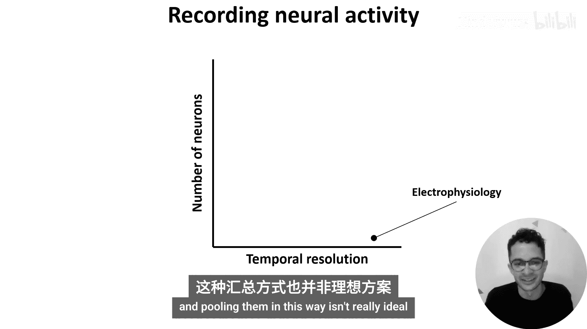
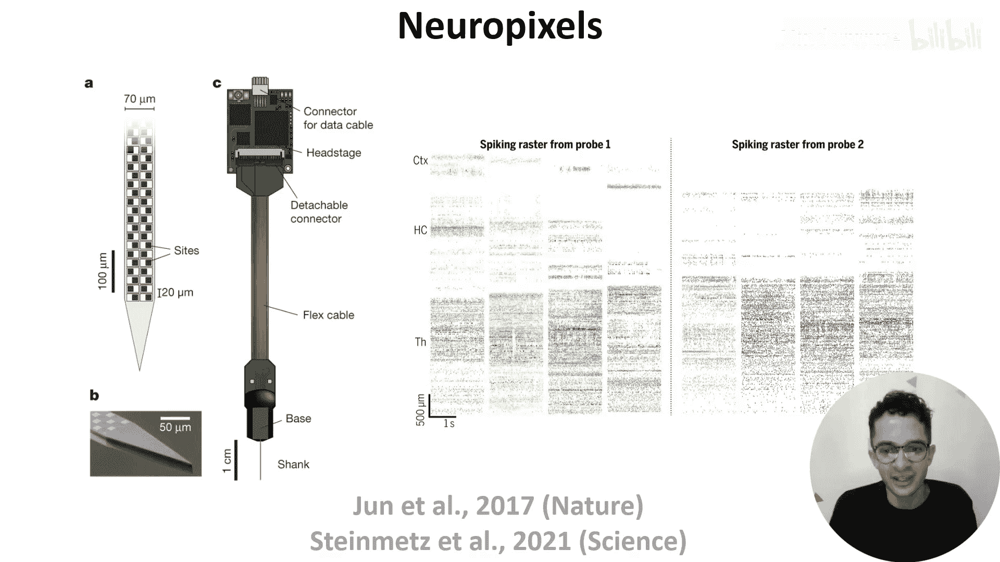
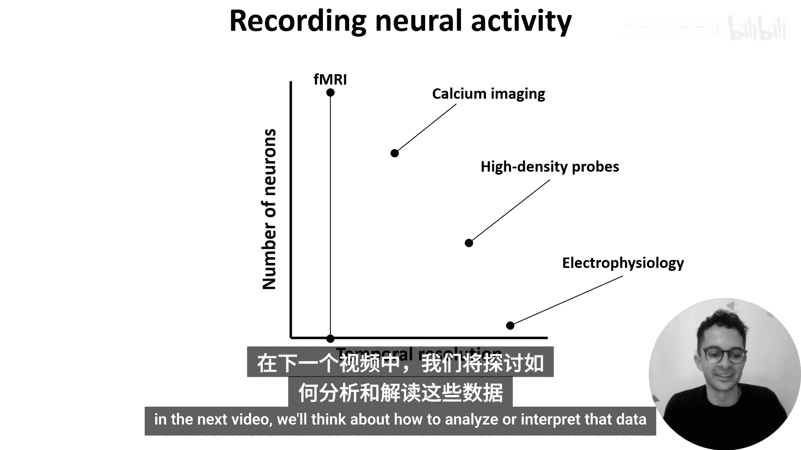

# 机器学习人员的神经科学 ｜ Neuroscience For Machine Learners p25 P25_W6_V0-Observing -BV1MiawzJExR_p25-

Hi， this week， we're going to explore how researchers try to understand neural networks。 but first。

 let's think about what that actually means。

Again， we can think of both artificial neural networks and brains as computing input output transformations from sensory stimuli to behavior。

But how do all of a network's features like its unit properties。

 architecture and activity patterns combine to implement these transformations？

Both neuroscientists and machine learning researchers are interested in this question for a variety of reasons like using knowledge from biology to improve artificial neural networks or building brain machine interfaces which record neural activity and use it to control various devices。

This week's videos will cover three topics related to understanding neural networks。

 we'll cover how to observe neural activity， how to analyze it， and how to manipulate it。

So how can we observe activity？Well， in an artificial neural network。

 it's as simple as running a forward pass through the network and calculating the unit activations。

In a Spiking neural network， we can pass spikes into the network and record its hidden units。

 membrane voltages or spiking outputs。But in a real biological system。

 we need to choose how we're going to record neural activity。

There are many different methods for recording neural activity with different pros and cons。

 but one way to describe them is on a 2D axis where the X axis shows the methods temporal resolution and the Y axis shows the number of neurons the method can record simultaneously。

In previous videos we introduced electrophysiology。

 a technique which lets you record single neuron with high temporal resolution。

 though that would sit here on this graph。To get data from more neurons with this approach。

 studies will often record different neurons sequentially over different trials and then pull the data over trials and subjects。

 but even so you are often limited to tens to hundreds of neurons and cooling them in this way isn't really ideal。

 so how can we record more neurons simultaneously。

One approach is to use high density probes like the Nepixels probe shown in panel C。

The main part of this probe is its extremely thin shng。

 which is inserted into the brain surgically and is covered with hundreds of recording sites which have shown schematically in panel A and in a microscope image in panel B。

These sites record nearby electrical activity and so each site's signal results from the combined activity of many neurons。

However， from this data， it's possible to infer the underlying spiking activity of individual neurons by using spike sorting algorithms。

 which make use of the fact that different neurons have distinct spike shapes and a few other features too。

So these probes allow you to record activity from hundreds to thousands of neurons simultaneously。

For example， in the rest of plots on the right， the Y axis shows the recording sites along the shank。

The X axis shows time in seconds， and the colored blocks show different trials。

These probes represent a huge technological advance。

 but it's worth keeping in mind that they still only let us record from a small selection of all neurons in a brain。

For example， they are often used mice which have around 70 million neurons。

And even if we can record 100 neurons simultaneously， that's still only around 0。

001% of the full mouse brain。So how can we get more comprehensive coverage？

One alternative is calcium imaging。Remember that when an action potential reaches the axon terminal。

 it causes voltage gated calcium channels to open and calcium to flow into the cell。

 so we can use changes in calcium concentration to infer neural activity。Using this approach。

 we can measure neural activity in very roughly four steps。First， we need a calcium indicator。

 something which changes its fluorescence in the presence of calcium。Second。

 we need to put this indicator inside neurons and we can do this by injecting them or by genetically modifying them so that they produce the indicator themselves。

😊，Third， we need to put our specimen under a microscope and measure each neurons's change in fluorescence over time。

Then finally， we can analyze either the continuous changes in fluorescence or we can infer the underlying spikes using what are known as Dconvolution algorithms。

The end result of this is shown here in a larval zebrafish。

 The brain is shown from a top down or dorsal view， as well as from the front and side。

The brain structure is shown in gray and then calcium activity is overlaid in red to yellow and the video which we willll play in a second。

 is played at about 20 times real time。So while you can use this technique in any animal model。

 it works particularly well in larval zebrafish that they're small and dense dense man。

Which obviously， humans are not。So how can we image neural activity in humans？In humans。

 one of the most commonly used methods is functional magnetic resonance imaging， or FMRI。

 which measures changes in blood flow through regions of the brain。

As more active areas require more oxygen and vice versa。

 this serves as another proxy for neural activity。FMRI is widely used as it's non invasive。

 in other words we don't need to implant electrodes or inject dye into subjects。

It provides whole brain information。And it has reasonable spatial and temporal resolution on the order of millimeters and sunkins。

Though it's worth keeping in mind that it is a proxy measure of neural activity。

And even though the spatial resolution is on the order of millimeters， U or voxal。

 the smallest measured spatial unit in FMI will still contain around a million neurons。Okay。

 stepping back a bit， let's approximately map these techniques onto our axis。

H densitysity probes like neuropixels， have high temporal resolution and can record from hundreds to thousands of neurons。

Hbra calcium imaging has medium temporal resolution。

 but can record from thousands to tens of thousands of neurons。

The MRIRI has slow temporal resolution， so it's hard to place in terms of number of neurons NAA records a whole brain signal that can't resolve individual neurons。

Before moving on， I just want to mention two more things。First。

 there are many other methods to record neural activity， for example。

 EEG uses external electrodes to measure the brain's electrical activity and voltage imaging uses indicators whose fluorescence changes with the neuro's membrane potential。

It's thought that voltage indicators will be the next big thing in neuroscience and if you'd like to learn more。

 Mark Humphreries has a great blog post on that， which I've put in this week's reading material。

Second， there are lots of other things to consider beyond a methods temporal and spatial resolution for example。

 most neural recordings are done on static subjects， fixed under a microscope or lying in a scanner。

 but those increasing interest in methods which allow neural activity to be recorded during free movement。

Okay， so hopefully that gave you some insight into how we can record neural activity in the next video we'll think about how to analyze or in that data。

😊。

