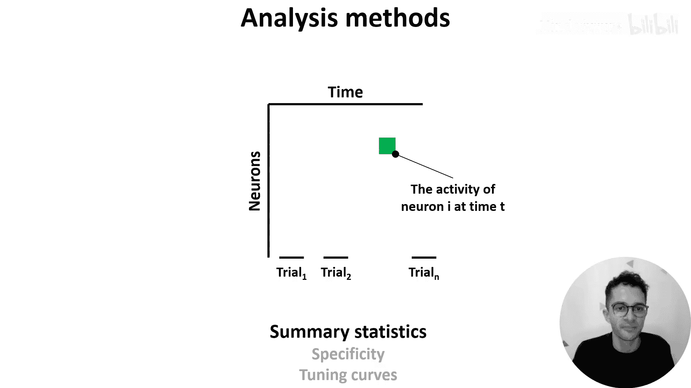
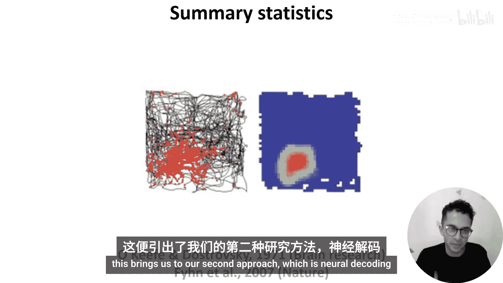
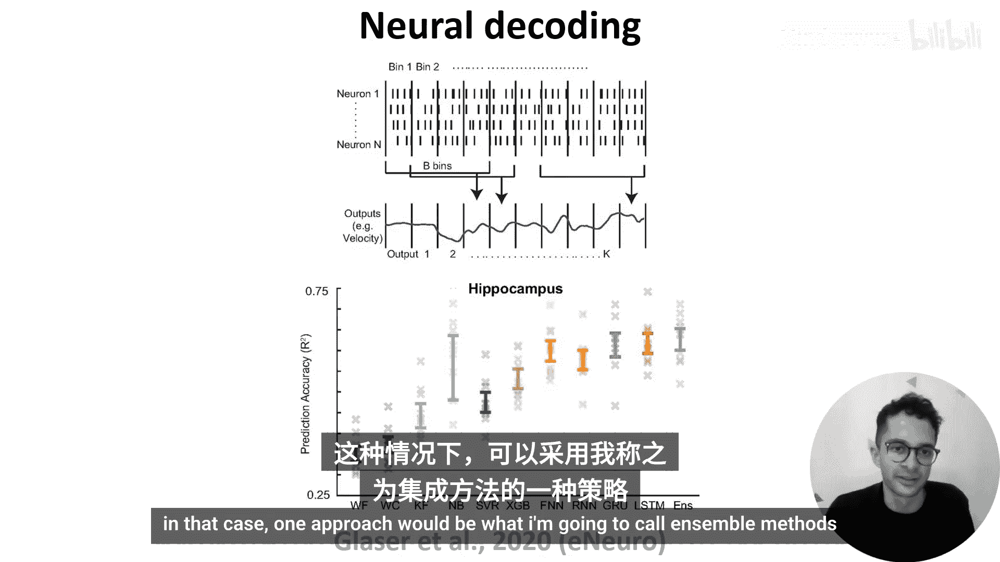
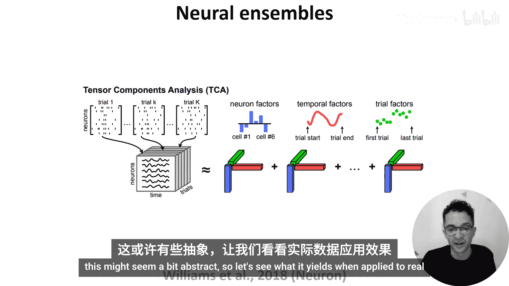
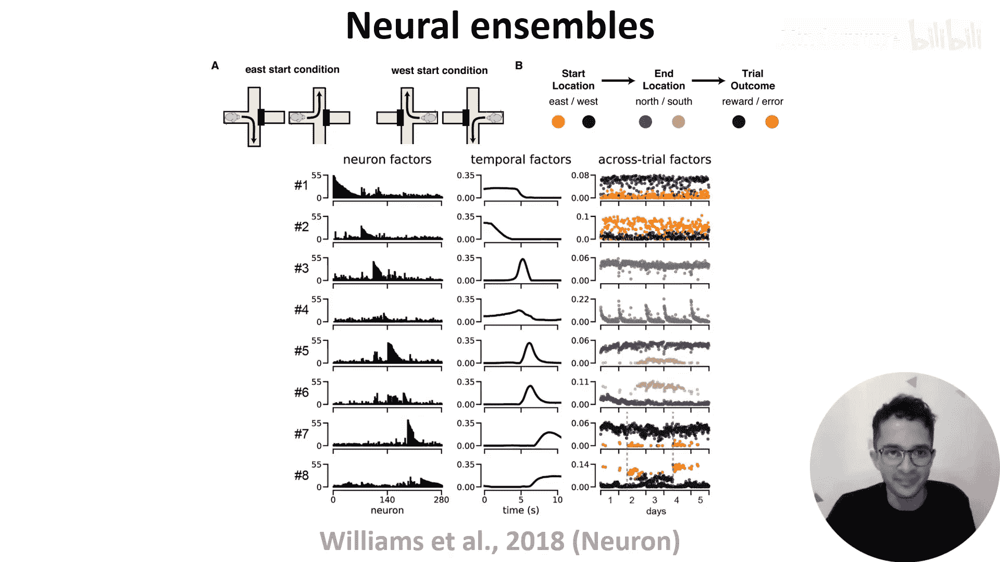
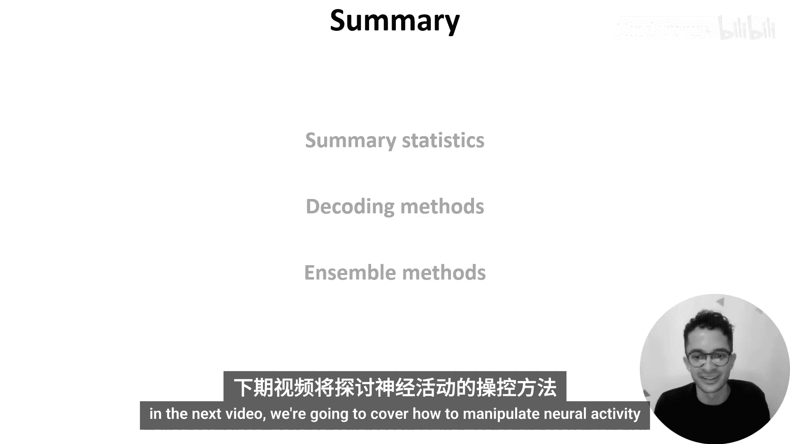

# 机器学习人员的神经科学 ｜ Neuroscience For Machine Learners p26 P26_W6_V1-Analysing -BV1MiawzJExR_p26-

Okay， in the last video， we learned about how we can acquire neural data。Now。

 we're going to think about how we can interpret or analyze that data。

Regardless of what method we used to collect our data。

 we're going to end up with a matrix like this where one dimension is time and the other is neurons。

Then each cell denotes the activity of one neuron at one time point。

Activity here could be binary in the case of spikes or continuous in the case of calcium imaging data or spikes bend into spike rates by the number of spikes per time window。

One thing to note is that rather than recording neural activity continuously。

 experimentalists will often conduct multiple trials with a fixed lens， so time may be discontinuous。

For example， an experiment could be composed of trials where a subject is shown images which they asked to classify with ras in between images。

With this sort of data there are lots of different questions which we could ask like how of different neurons behave。

 are there neurons which are only active on some trials or some plants of a trial。

 does this change over trials， for example maybe as the animal learns the task or gets bored。

And if we have some information about where the neurons are in the brain， which we've recorded from。

Then we can see if neurons with different response properties are located in different spatial locations。

If we're working with data from an artificial neural network。

 an equivalent approach would be to compare the units in different layers。

Once we have a question or questions in mind， we can then decide on an appropriate analysis method。

There are lots of different approaches to analyzing neural data。

 so I'm just going to highlight three in this video。

One simple approach is to calculate summary statistics， for example。

 in a classification task we could compute how strongly each neuron responds to each class and then see how specific its responses across classes。

Or as we were varying a stimulus parameter continuously， like the brightness of a screen。

 we could see how tuned to this parameter neuron is。😊，In other words。

 foul activity changes as a function of this parameter。

So what's this analysis look like？In this paper， the authors let a rat freely move around the square arena while recording the activity of neurons in part of the brain known as the hippocampus。

In the left panel， the black lines showed the animal's path through the environment。

 and the red dots show the locations in space where one neuron spiked。

Then the right panel shows a heat map of this neurons firing rate with red being high。

So this heat map is equivalent to a 2D tuning curve。

 and we can see that this neuron is tuned to a specific location in this environment。

Neurons with responses like these are known as place cells， and they were first discovered in 1971。

 but are still a really active and exciting area of research。However。

 many neurons aren't so clearly tuned to specific environmental features。

And rather than thinking of single neurons as encoding variables。

 it may be better to try to understand what information cuulations of neurons encode。

 This brings us to our second approach， which is neural decoding。

The aim of neural decoding is to use neural activity to estimate something about the environment or subject for example。

 if we think about the rat on the last slide， we could take its neural activity and try to estimate its velocity or position in the environment。

To do that， we could start from our matrix of neurons by time。

Bin the spikes into bins to get continuous firing rates， which are easier to work with。

 and then use the data from multiple bins to predict our variable interest at and specific time points。

As this essentially becomes a regression problem， there are many different approaches we could use to it。

 like using filters or even neural network models， and the paper which I mentioned at the bottom of the slide compares these methods in detail。

For example， in the lower panel here， each point on the X axis represents a different decoding approach。

 and then the y axis shows how accurately each method candecode a rat's location。

And you can see that some methods can do this quite accurately。

 even though the data set only has recordings from 50 neurons。

But if we tried to decode location from another population of neurons somewhere else in the brain。

 like visual cortex or auditory cortex， our results would be much worse。

And so we can use decoding accuracy to estimate what information is present in different brain areas。

However， coding relies on having a variable or variables of interest to estimate。

 and sometimes we might not have that。😊，For example。

 if we're just recording spontaneous brain activity， in other words， brain activity at rest。

In that case， one approach would be what I'm going to call ensemble methods。

So these methods try to identify groups of neurons with correlated patterns of activity over time。

One approach to this would be to use a clustering algorithm who groups neurons into clusters which have similar activity patterns。

Another is the method shown here， which is called Tensor component analysis。

Here we take our 2D matrix of neurons recorded over time and trials and reshape it to a 3D tensor of neurons by time by trials。

Then we describe this tensor using a set of ensembles。

 each of which is composed composed of three vectors， which are shown in red， green and blue。

A neuron factor notes how strongly associated each neuron is with that ensemble。

A temporal factor notes how that ensemble's activity changes over the course of a trial and a trial factor which shows how the activity of the ensemble changes over trials。

This might seem a bit abstract， so let's see what it yields when applied to real data。

This experiment is still focused on spatial navigation。

 but we switch to mice and what we call a plus maze， which you can see in panel A。Essentially。

 the mouse starts in either the east or west arm and has to navigate to either the north or south。

 and then if it's correct， it receives a reward。So what does applying tensor component analysis to the neural data recorded during this experiment reveal？

Here， each row shows one of eight ensembles and then each column shows that ensemble's neuron。

 temporall and across trial factors。Working through these in the neuron factors column。

 the X axis shows all of the 280 recorded neurons and then each Y axis shows how strongly associated each neuron is with each ensemble。

So you can see that different neurons are associated with different ensembles。

In the temporal factors column， the X axis shows time across each trial and each y axis shows the activity of each ensemble。

 so you can see that different ensembles are active at different points during the trial。Finally。

 in the A across trials column each dot shows a single trial。

 the x axis shows the order of the trials， and then each y axis shows how active each ensemble was on a given trial and the dots are colored by the different trial properties shown in Re B。

For example， if we focus on ensemble 2， its temporal factor shows us that these neurons are mostly active at the start of a trial。

And its trial factor shows that these neurons are more active on trials when the mouse starts in the east than the west arm of the maze。

Compare the yellow to the purple dots。Now I'd encourage you to pause the video and try to interpret the other ensembles yourself。

Okay。

Hopefully this video has taught you a little bit about how we can analyze neural activity data using summary statistics。

 Ecoding methods， and ensemble methods。😊，But there are many other methods too。

 and so I would encourage you to read around about these。In the next video。

 we're going to cover how to manipulate neural activity。

