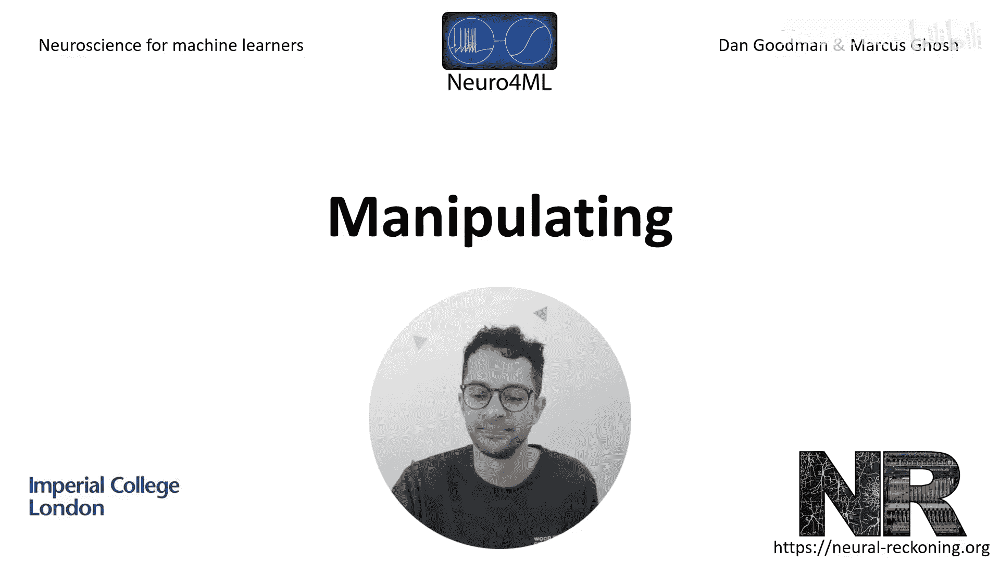
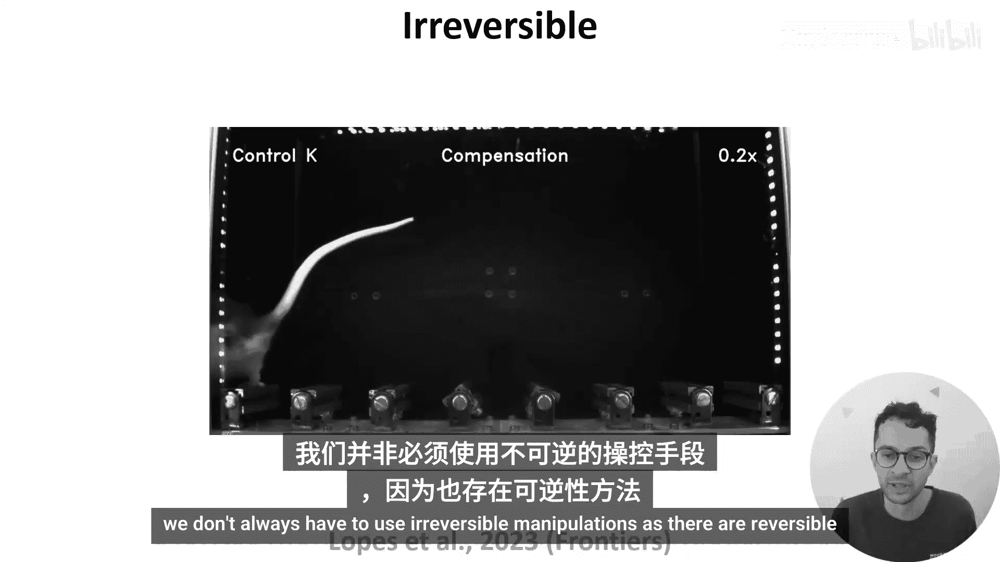

# 机器学习人员的神经科学 ｜ Neuroscience For Machine Learners p27 P27_W6_V2-Manipulating -BV1MiawzJExR_p27-

In the last two videos， we've looked at how we can record and analyze neural activity。

 but to some extent these methods simply correlate neural activity with different variables and we can't really be sure that our findings are causally relevant。

In other words， once we found neurons that respond to stimulus or perceived a behavior。

 we would like to know if disrupting those neurons would have any effect on the animal's ability to respond to that stimulus or implement that behavior。

We can do this by manipulating neural activity， and these manipulations can be either irreversible or reverssible。

In humans irreversible changes usually result from accidents disease disease processes or surgical interventions。

 for example， earlier in the course I mentioned in paper which used FMRI and studied two patients with damage to their corpus callosums。

But in animal models， we can irreversibly destroy single neurons or even whole parts of the brain and study the effect。

For example， this paper used rats to study the role of motor cortex are part of the brain where many studies have observed neural activity correlated with movement。

In this paper the authors took a group of rats， destroyed or lesioned motor cortex in half of the animals and left the other half ass controls with no motor cortex damage they then trained all of the rats to cross the steps as you can see in the video。

Video shows one animal with a motor cortex lesion learning the task。

 it's labeled in brackets as lesion A， and then one control animal。

Itally can see how similar the two animals movement patterns are。

 and surprisingly the authors found no difference between the two groups。

One conclusion from this result could be that motor cortex isn't needed for a simple task like this。

对对。So the authors increased the difficulty of the task by making more and more of the steps unstable。

Surprisingly， again， they didn't see any difference between the two groups。😊。

Until they looked at their data really carefully。😊。

What they found was that when the animals first encountered an unstable step。

 they responded in one of three ways which are shown in this video。

Some controls stopped to investigate the unstable step。

Some controls compensated by adjusting their movement。But the animals with motor cortex lesions。

Doocked moving for several seconds。Which suggests that the main role of this brain area may be to help the animal to adapt its behavior to unexpected situations。

 So more broadly in the context of this video， I think this paper nicely illustrates that while we may assign roles to neurons or brain areas based onnerving their activity。

 we can only really confirm or refute their roles by manipulating them。However。

 we don't always have to use irreversible manipulations as there are reversible methods available to。

😊。

In humans， one approach is called transcranial magnetic stimulation， or TMS。

 which uses the magnetic fields to alter the activity of brain regions。

But in animal models we can control neural activity more precisely。

 and one great method for doing this is  optgenetics。

 which uses light gated proteins to control neural activity。😊。

Some of these light gateated proteins are genetically engineered。

 but some occur naturally in things like algae， For example。

 channel redopin shown on the left of this figure， is an iron channel which when exposed to blue light。

 changes its structure and allows positive ions to flow into neurons。

 increasing their membrane potential and their spiking activity。In contrast。

 the proteins shown on the left respond to yellow light by either moving chloride ions into the neuron or by moving hydrogen ions out。

Both of which will decrease the neurons's membrane potential and spikking activity。

So by expressing these channels in neurons and then triggering them with light。

 we can study neurons roles by reversibly activating or silencing them。😊。

While this might seem a little bit detached from machine learning。

 we can actually use the same types of manipulations to interrogate artificial neural networks as well。

😊，For example， in this paper， the authors studied an artificial neural network by lesioning it extensively to create their artificial neural network。

 the authors used an evolutionary algorithm called Me to evolve a network which could play the arcade game space invaders。

The evolved network is shown in the diagram here。On the left are the network's 12 input nodes which receive a compressed version of the video game。

On the right are the network six output nodes which include actions like move left， moveve right。

 and fire， and then in between is a single hidden node and many connections whose weights are color coded。

To manipulate the network， they then silenced each node one by one and checked how well the network performed with each node silenced individually。

This figure shows their results E Y axis shows the network's score with higher being better。

 for comparison， the blue stripe shows the network's normal performance and the red stripe shows its performance if you shuffle its weights so a lower bound。

On the left of the figure， each point on the X axises corresponds to silencing a single node。

 and you can see that ablating different nodes leads to different scores。

 which implies that some nodes are more important for the game than others。And interestingly。

 you can see that obblating two nodes increases the network score。

 suggesting that these nodes actually hinder the network。😊，On the right of the figure。

 the authors also silence every weight in turn and study the effect on performance。And interestingly。

 their results suggest that many weights could be removed without much effect。However。

 the results from single element manipulations like these could be misleading。😊，For example。

 imagine if two units in this network perform the same function in parallel。

Then silencing either one on its own may not result in a change to a network score。

 and we could wrongly conclude that neither of these units are important。Taking this further。

 because of the complex interactions between elements in a network， either artificial or biological。

 there are likely many variants of this sort of problem。So how can we overcome that issue？Well。

 one solution， which the authors propose is to use a multi element lesioning approach。

In this multi element approach， you sample combinations of lesions， for example。

 you silence node1 and check the network score， then silence node 1 and two together， one。

 two and three together etc， and then you calculate each node's importance by comparing the network score with and without the node in fruit combinations。

The results are shown as before in Plan B。And in panel C on the right。

 you can see that the single and multin ablations can different importance to the different nodes。

This and other results lead the authors to conclude that even small artificial neural networks can be really challenging to interpret。

And so we should perhaps be cautious when interpreting manipulation results on larger and more complex systems。

If you'd like to learn more about this approach and these results。

 I would highly recommend the paper， which is shown at the bottom below。Okay。

 thankful that's given you an overview of how we can manipulate neural activity。In the next video。

 I'm going to outline this week's exercise， which will challenge you to observe and manipulate an artificial neural network yourself。

😊。

