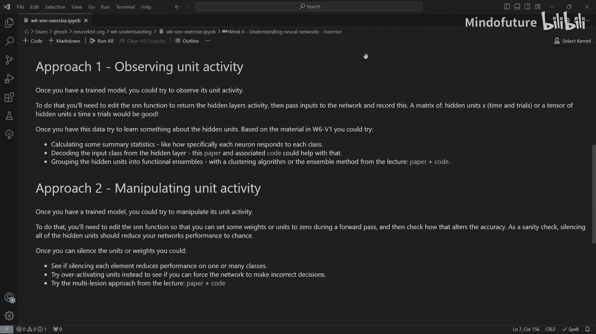

# 机器学习人员的神经科学 ｜ Neuroscience For Machine Learners p28 P28_W6_V4-Exercise -BV1MiawzJExR_p28-

In this week's videos， we looked at how we can try to understand neural networks by observing。

 analyzingna and manipulating their activity。In this exercise。

 the idea is to apply the same techniques to an artificial neural network to see what we can learn。

To do that， we need to start by training a model。And the model we're going to use is a spiking neural network reed on a sound localization task。

The coabab notebook here has all the code which you'll need to do that。Once you have a trained model。

 your aim is to learn something about how the model works。

And we've outlined two different approaches to doing this。

 you could observe the model's unit activity or manipulate it。

You can try these in any order or combination you like or even take a totally different approach if you have some ideas。

Just to go through each quickly。😊，If you want to observe the model's unit activity。

 you'll need to edit a little bit of the code so that you can record the model's hidden layer。

You'll then need to pass input to the network and record that。And then once you have that data。

 you can try some of the approaches which I outlined in the lecture W6 V1。For example。

 you could calculate some summary statistics like how specifically each and neuro own responds to each class。

 you could try to decode the input class from the hidden layer activity and I've linked you to a paper and code which could help you with that。

You could try grouping the hidden units into functional ensembles。

 using a clustering algorithm or the ensemble method which I talked about in the paper and again I've linked you to the paper and code for them。

Alternatively， if you're interested in manipulating neural activity。

 you'll need to edit the code so that you can set some weights or units to zero during a forward pass and then see how this alters the accuracy。

Once you can do that， you can see if silencing each element so each node or weight reduces performance on one or many classes。

You could try overactivating the units instead to see if you can force the network to make incorrect decisions and if you're feeling ambitious。

 you could also try the multi lesion approach which I outlined in the lecture and again there's paper and code for that。

If you're in the class， at impmerial at the end of the class。

 we'll talk a little bit about what you manage to find。If you're online。

 please feel free to share your findings on Discord， we'd be really excited to see what you find。

唔追。