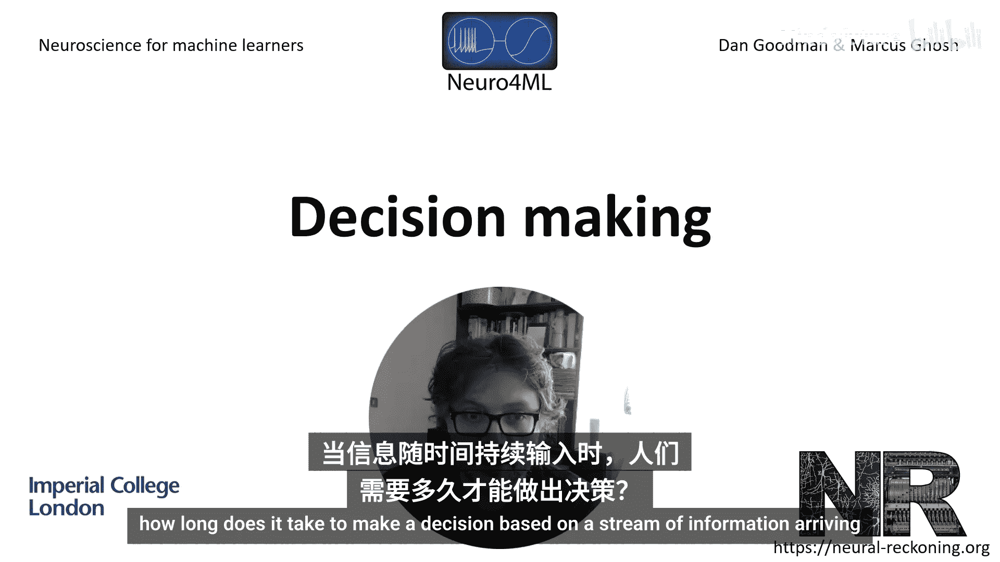
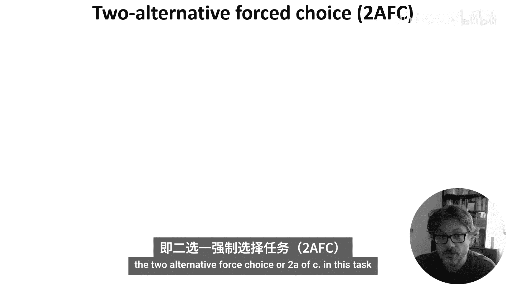
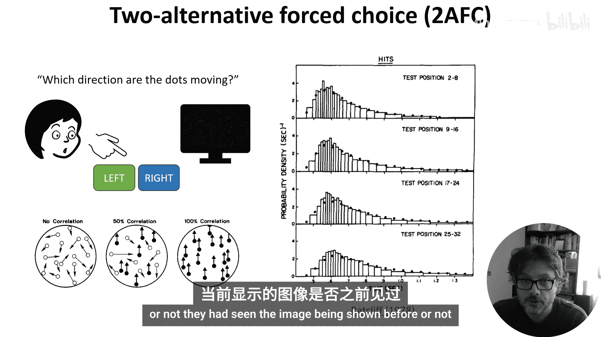
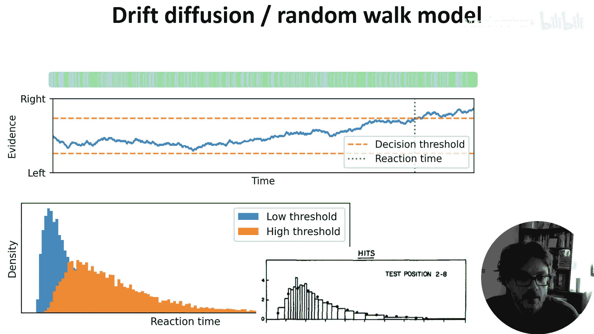
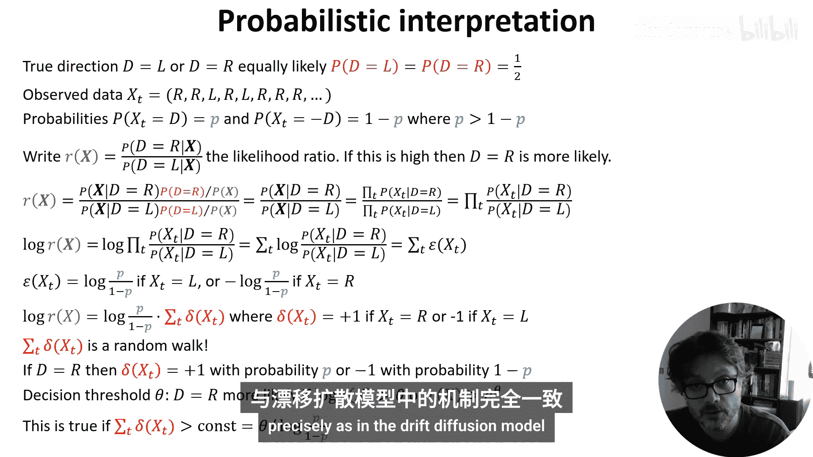
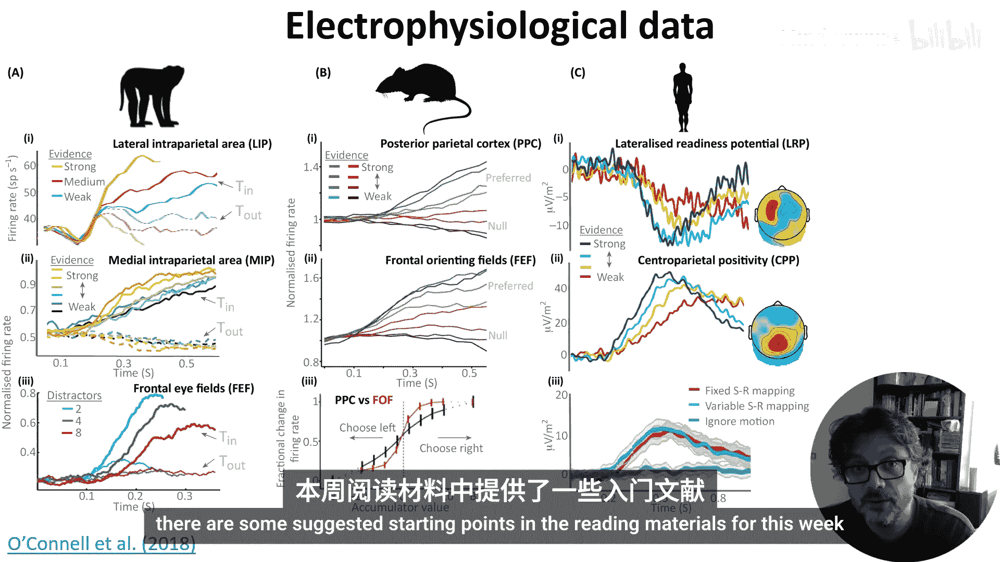

# 机器学习人员的神经科学 ｜ Neuroscience For Machine Learners p29 P29_W7_V0-Decision_making -BV1MiawzJExR_p29-

This week's videos don't cover a single theme Instead。

 we'll look at a few different strands of work in neuroscience that could be of interest to people with a machine learning or quantitative background。

We may also add more videos in future years。The first topic is decision making。

 and this is a really broad topic of course because in a way you can think of everything the brain has to do is about making decisions。

Do I work on my slides or go and make myself another cup of tea。Instead。

 we're going to focus on one particular aspect of decision making that hass been studied a lot in neuroscience and lesson machine learning。

 reaction times。That is， how long does it take to make a decision based on a stream of information arrivinging continuously over time？

Let's make this even more complete with a very specific sort of task。

 the two alternative force choice or two AFCC。

In this task， participants are shown some sort of image or movie and asked to decide between two options。

A common one is the random dot kinematicogram with random dots on the screen。

 some of which are moving coherently either to the left or right， and some moving randomly。

The participants have to determine which direction the coherent dots are moving。

 and sometimes they're asked to make their decision as quickly as possible。

The reaction time is the time between the start of the video and the moment when they press the button。

If you run this experiment， you see characteristically skewed distributions of reaction times。

 The station was actually from a slightly different task where participants were asked whether or not they had seen the image being shown before or not。

There's a beautifully simple theory for how we make these decisions。

 which can account for these reaction times。Imagine that as time goes by。

 sometimes a bit of evidence arrives that on its own is unreliable。

 but it's suggestive that the dots are moving right rather than left。Then another。

 followed by one that suggests that the left is more likely and so on。

We keep track of a running total of how much evidence we've received that suggests right versus left。

And once it crosses some threshold， we make our decision。

This is a biased random walk where it's more likely we take a step in the correct direction than the wrong direction。

As we increase the number of time points from 10 to 30。Then， from 30 to 100。

And all the way up to 1000。This random walk looks more and more like Brownian motion with a drift。

This gives us a mathematical theory that lets us analytically compute expressions for the reaction time distributions。

😊，Or we can just numerically block them here with either a low decision threshold or a high decision threshold。

And sure enough， we get something that looks very much like the data from experiments。

That's nice。 But still， this model might seem a bit ad hoc。 Fortunately。

 it turns out that there's a neat probabilistic interpretation of this model。😊。

Let's set up a probabilistic model of the task。 We'll say that there's a true direction T that can be either L or R。

 and both options are equally likely。You can actually modify this to make the options have different probabilities。

 too。Now we have the data observed at time T is a series of symbols X T， each of which is R or L。

The probability you observe the correct symbol is P。

 and the probability you observe the incorrect symbol 1 minus P。Now。

 given we know the observed data and we want to infer the unknown value of D。

 we compute which of those two options is more likely。

We'll write that as R of x equals the ratio over the probability that D equals R。

 given the observations X divided by the probability that D is equal to L。If this ratio is high。

 then D equals R is much more likely， and if it's lower， then D equals L is more likely。

We use basis theorem to rewrite the probability that D equals R given x in terms of the probability of x given D equals R times the probability d equals R divided by the probability of x。

 and the same thing for the probability that D equals L on the bottom。

The P of x cancels and both the prior probabil is D equals R and D equals L are both a half。

 so they cancel too。The observations at different time points are independent。

 so we can expand these as a product of the probabilities each time point。

And this product is the same at the top and bottom。 so we can pull it out。

Now to see what's going on more clearly， we take the log of this ratio to get the log likelihood ratio。

😊，The log of a product is the sum of the logs。And will' write the individual terms as the evidence at time T。

 Epsilon of X T。This evidence will be equal to log of P over 1 minus P when x t equals L。

 If x t equals R， it's log of 1 minus P over P。 but this is just negative the log of P over 1 minus P。

With that， we can write the log likelihood ratio as a constant term multiplied by the sum of terms delta of xt。

 which are plus1 of xt is R and minus1 F x t equals L。😊。

But this sum is precisely the random walk we saw on the previous slide。When d equals R。

 the sum increases by one with probability P and decreases by one with probability 1 minus P and vice versa of d equals L。

We can understand the decision threshold in terms of probability。 Now。

 we wait until the log likelihood ratio is bigger than some threshold theta。

 or equivalently that the likelihood ratio is bigger than either to the theta。

And this happens when some of the deltas is bigger than some threshold。

 precisely as in the drift diffusion model。

And finally， perhaps the best thing about this theory is that having come up with a model based on fitting behavioral observations and then finding a rigorous probabilistic interpretation。

😊，Electtrophysiological experiments find traces of these evidence accumulation processes across multiple different brain regions in multiple species。

Of course， it's never quite as clean cut as the theory and all sorts of modifications have been proposed。

 like adaptive thresholds that get closer to the origin over time to represent the increasing urgency of making some sort of decision or thresholds that adapt to wider context in various ways。

There are also much more comprehensive Bayesian theories of decision making in which this model is just one special case and so on。

If you're interested in reading more， there are some suggested starting points in the readinging materials for this week。

😊。

