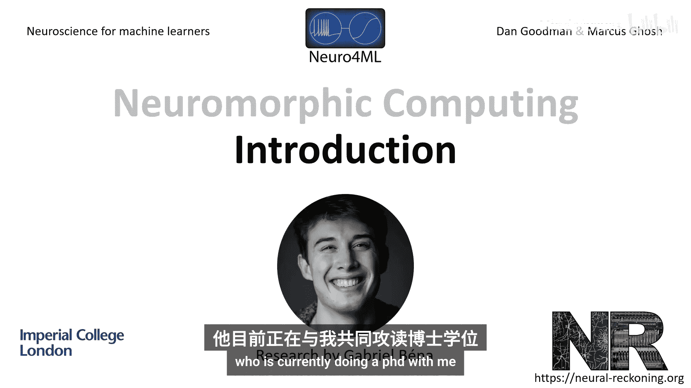
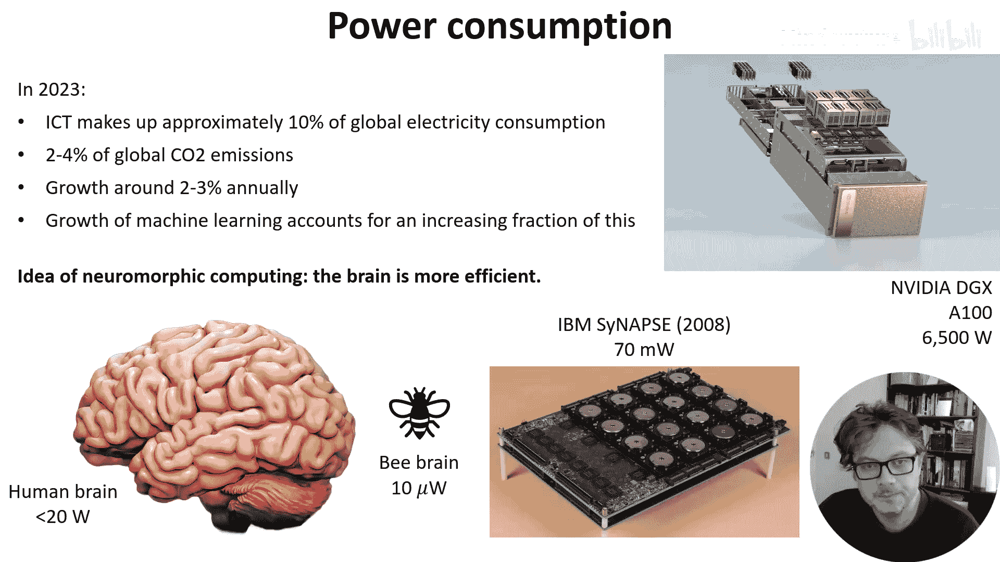
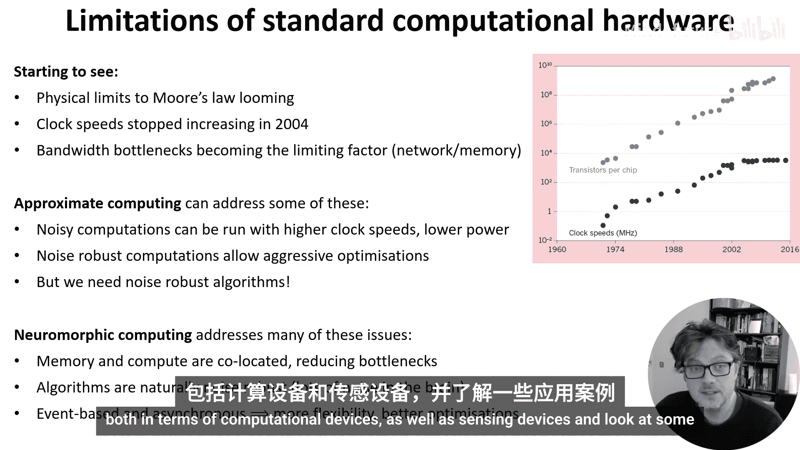

# 机器学习人员的神经科学 ｜ Neuroscience For Machine Learners p30 P30_W8_V0-Introduction_to_neuromorphic_devices -BV1MiawzJExR_p30-

This week， we're going to be talking about neuromorphic computing。

 which is the use of specialized hardware that either directly mimics brain function or is inspired by some aspect of the way the brain computes。

A lot of the research for this week's videos was done by Gabriel Mayner。

 who is currently doing a PhD Ph T with me。 Thanks， Gabriel。

So let's start by talking about one of the major reasons why neuromorphic computing is capturing a lot of attention at the moment。

 electrical power consumption。In 2023， I C T is estimated to be using around  10% of the world's electricity supply。

 leading to around 2% to 4% of global CO OT emissions。

And that's growing at an average rate of around 2% to 3% annually。 And so clearly， at some point。

 something is going to have to give。Part of the growth is due to the increasing demands of machine learning applications。

 You can see here this Nvi G G， D G X GP server running 8， a 100 GP draws around 6。5 kW of power。Now。

 the idea of neuromorphic computing is to take inspiration from the brain。

 which we know is very power efficient。The human brain uses at most around 20 ws。

 probably a lot less than that， because that includes the energy required to keep the head warm and things like that。

With that 20 W， it can do a lot of very sophisticated computation。

 including many tasks at a much higher level of performance than machine learning systems that require orders of magnitude and more power。

Or consider the brain of a honeybee， which uses around 10 microW enough to let it do sophisticated navigation。

 pattern recognition and social communication。As an example of how neuromorphic hardware can reduce power consumption。

 you can see here IBM synapse chips from 2009 that did a video processing task using only 70 mW。

But it's not only power consumption we can improve on。

 The standard paradigm of computing is beginning to show its limitations。

 So neuromorphic computing is one of several ideas that have been proposed to address some of the issues。

One thing we're already starting to see is the physical limits to the exponential growth in computing power encapsulated in the famous Moore's law。

Indeed， clock speeds， which used to be the key metric of computational power stalled in 2004。

Were also seeing very often。 the bottleneck for accelerating code is memory bandwidth rather than compute。

😊，If you've done any GPU coding， you'll know that the whole game is about making sure that the massive number of cores get fed with enough data。

 so they aren't just waiting around。You can also think about mobile devices that don't have the power budget to run full scale machine learning models。

 In that case， they become limited by the network bandwidth to communicate with a more powerful server。

Approximate computing is an interesting development that can solve some of these issues。

 The idea is that if you allow for noise in your computations。

 you can do some things that would otherwise not be possible。 For example。

 if you don't mind random V flips where a one randomly changes to a 0 or vice versa。

 then you can hugely reduce the voltage and therefore。

 the power consumption and run at much higher clock speeds。If you have noise， robust computations。

 there are many clever optimization tricks you can play in terms of both hardware and algorithm design。

But the key is to enable all that。 You need to have nice， robust computation。

 And that's very often difficult or un naturalt for us。

Neurmorphic computing is a nice approach to some of these issues。Firstly。

 since memory and compute are physically co located， some of the bottleneck issues can be reduced。

 This is both through on device and for mobile devices。

 you can run some computations locally to avoid sending data to a server。

Algorithms are naturally noise robust because their brain inspired and the brain is incredibly noisy and therefore no robust。

This allows for many of the approximate computing aims to be realized。And finally。

 the whole system is naturally event based and asynchronous， which， again。

 allows for all sorts of clever optimizations that wouldn't be possible on a system that guarantees operations are carried out in a fixed and deterministic order。

In the next videos this week， we'll look at the current state of neuromorphic hardware。

 both in terms of computational or devices， as well as sensing devices。

 and look at some applications。

