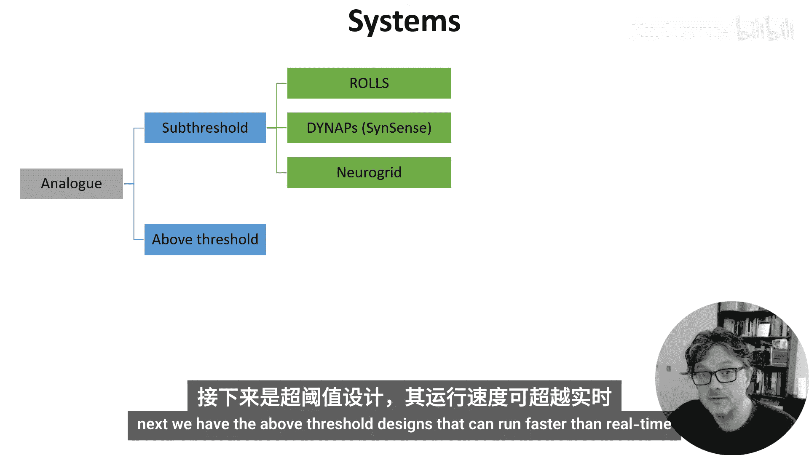
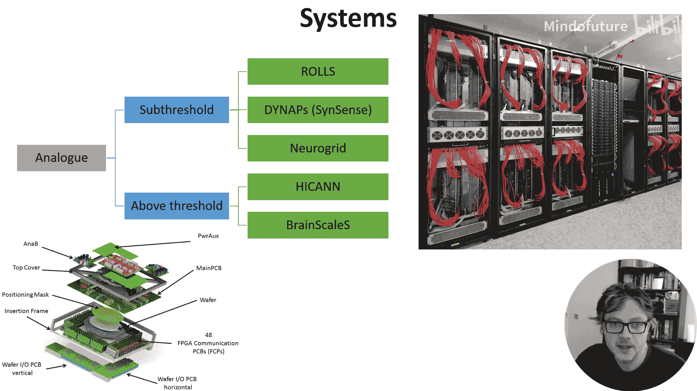
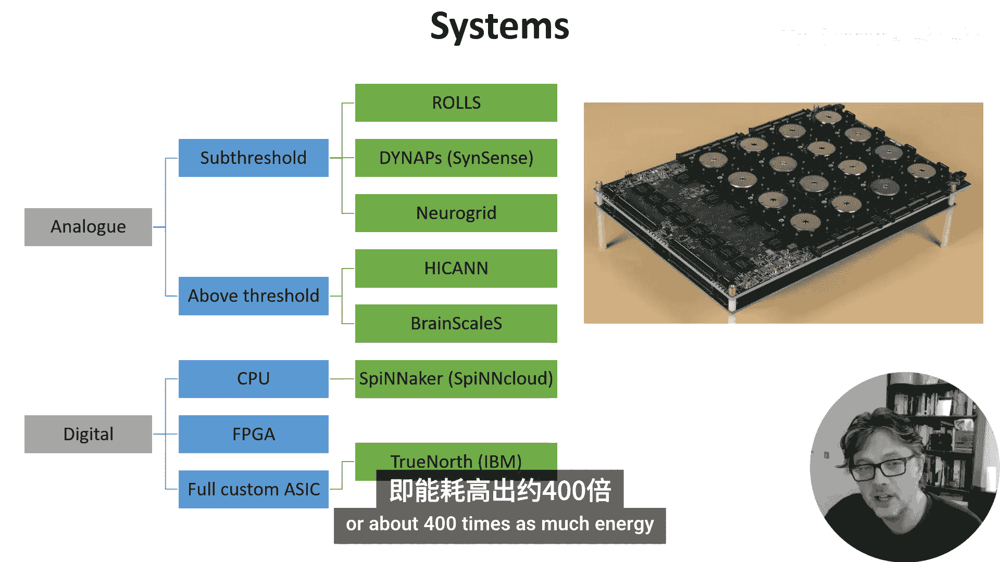
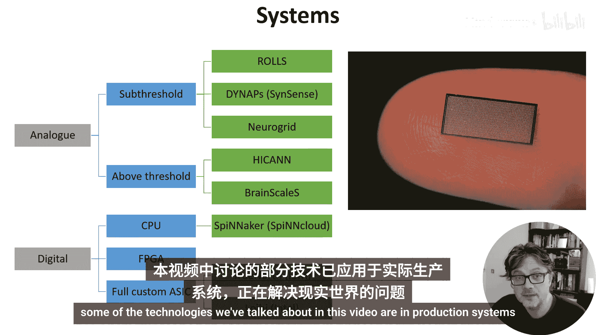

# 机器学习人员的神经科学 ｜ Neuroscience For Machine Learners p31 P31_W8_V1-Neuromorphic_computing -BV1MiawzJExR_p31-

In this video， I'm gonna talk in a bit more detail about neuromorphic computing。

That is non standard computational architectures。That mimics some aspect of the way the brain works。

That doesn't have to mean spiking， but a lot of roosing approaches do use spiking in some form。

There have been an awful lot of approaches to designing yourmorphic computing devices。

 One review paper I read while preparing for this included 2700 references。

66 pages out of an 88 page paper。 The longest reference list I've ever seen in the paper。

So there's no way I can cover everything that has been tried。

 instead I'm going to give an overview of some of the most common features highlighting a few examples So suggesting you go take a look at the extensive literature if you want to know more。

Let's start with a rough outline of some of the parts that tend to be involved。At its core。

 there is some technology to emulate the function of neurons。

That could be an analog process where new materials or circuits are designed that can mimic the dynamics of neurons。

Or it could be a digital process based either on traditional CPUs or on newer hardware。

 fully or partially customized to handle simulating neuroerodynamics and spikes。

 And it can also involve a combination of both approaches。

This hardware has to have a way of processing a potentially very large number of incoming spikes。

 And a common approach is the meist to crossb array that I'll talk about later。

There also needs to be a way for a neuron to communicate its spikes to other neurons。

 There's a standard protocol for that， The address event representation and a few different approaches to routines。

 wakingking events sufficiently to their targets。And finally， there's learning。 Idely。

 this should be done on the neuromorphic device itself for maximum efficiency。

 but that's not always easy to arrange。 And so often training has to be done inefficiently off chip with only the forward or inference passed down on the chip。

As with all learning， there are supervised and unsupervised approaches。

 and both have been tried with different types of of neuro amorphic device。

The first step is simulating the neuron or components of the neuron。

A very traditional approach that goes back to the beginning of neuromorphic computing is some threshold analog approaches。

In these， you design an electrical circuit that behaves like in your own model with time constants that are comparable to biological ones so that it can operate in real time。

This paper shows a series of increasingly complicated circuits built with transistors and capacitors that。

 over time， more and more closely emulate synaptic dynamics。😊。

There are also above threshold analog approaches that are thousands to hundreds of thousands of times faster than biology。

 And so they can be used for accelerating simulations。 On the downside。

 they tend to have higher currents and more complicated circuit design。

It's worth noting that these analog circuits are nois。 For example。

 you can see here how conductance has change over time with one of these technologies。

This is something we have to take into account， but it may not be a problem if the underlying network is noise robust。

 like the brand。Let me get to digital approaches。 The symptom of these is just to use a standard CPU。

 For example， a reduced instruction set processor like an app。

The clever part is in connecting these together。This approach tends to be very flexible in terms of what you can simulate。

 but less power efficient than more customized approaches。

Field programmable gate arrays or F PGs are a first step towards full customization。

 They allow for partial configuration of the hardware。 They are a bit less flexible than a CPU。

 but can also be more efficient in terms of speed and power。And finally。

 you can go all the way to fully customised chips。 These are the least flexible and the most expensive to develop。

 but they can be much more efficient。And， of course。

 there are also hybrid approaches that combine these elements in different ways。

Once weve emulated the neuro， we need a way to receive and then process incoming spikes。

The key problem here， which is common to both artificial and spik neural networks。

 is the matrix vector multiplication。This is typically the most expensive part of a neural network simulation。

 So speeding that up or reducing its power consumption is a critical part of the design of a neuromorphic system。

A common solution is the mem to crossbar array。A memoister is an electrical component with a programmable conductance。

 If you connect them in a grid， like in these diagrams。

 you can use it to implement this matrix vector modificationplication。

The rows V I are the inputs represented as voltages。

 and the columns I J are the outputs represented as currents。At each grid point。

 you can have a memister whose conductance represents the synaptic weight。

The current at a grid point is the product of the input voltage and the memoister conductance。

And the total current output of a column is the sum of the grid point currents。

 which is exactly the computation you need for matrix vector multis。

In addition to processing spikes that have been received， we also need two sense spikes。

The way the brain does that is simply to have one wire from each input to each output。

 Can we just do the same。Well， yes。 But if you have N inputs and N outputs。

 you might need up to add N squared wires， which is expensive。

 especially when chips are limited to 2D， unlike the 3D brand。

Another way of doing it is the address event representation scheme。In this scheme。

 each input event is first decod in binary binary。 and this needs log to end bits。😊。

Those events are communicated by multiplex in time on a very fast digital bus。

 A routing table allows you to dispatch these events to their targets。

 which can then reconstruct the input bike trains。This only needs a number of wires proportion to log to N。

 which is much better。However， because multiple events may happen simultaneously。

 you either have to queue simultaneous events， introducing an error in time or drop them entirely。

This is theoretically problematic if your aim is a perfect simulation。

 but not necessarily a big issue。 If you have trained a noise。

 robust network using some form of temporal jitter and synaptic dropout。

This A E R scheme is therefore very widely used in neurourmorphic systems。

The final ingredient we need is learning。The easiest thing to do is just do the learning off the neuromorphic device and copy the seiptic weights and other parameters across。

This is very flexible because you can do any learning room to like with this approach。

 but it does mean you lose the benefits of simulating it on the neuromorphic device。

 And that often puts a limit to scaling。The other approach is to do the learning on the chip itself。

 This is ideal from the point of view of efficiency， but it does have some downsides。

We can't use global gradient information， which rolls out learning roles like backdrop through time used in surrogate gradient descent。

Anyway， this shouldn't be a problem because the brain also doesn't have access to that information and must use a local learning role。

 But even if the brain knows how to do learning with local information only。

 we don't yet know how to do it， as well as with global information。And also。

 this local information needs to be managed and transmitted to the right places。

 And so this has to be incorporated into the hardware design， limiting flexibility。In practice。

 we often use SDDP or an approximation of it or a variant called SDSP or spike dependence cantic plastic。

These rules are unsupervised， which is the limitation if you want to train on a classification or agion task。

 but you can restore an element of supervision using eligibility traces， which I won't go into here。

In some ways， learning is the big missing part of the neuromorphic computing story。

 and probably for the same reason that we don't yet understand how the brain does learning with only local information。

I wna finish this video with a quick look at some of the products available today and how they use some of the components we've seen so far。

😊，As before， this isn't an exhaustive list。We'll start with the analog sub threshold systems that run in real time。

The first is roles and Daps， now commercialised by Sense。

The basic Ros chipp has 256 adaptive exponential integrated fire neurons per chip。

 with 64K synapses with short term plasticity and 64K using the SDSB learning rule。

That goes up to tens of thousands of neurons in Dynas with a spike roing architecture。

There's also neurogrid， which has a million neurons， but the synaptic weights are stored off yet。

 adding latency。Next， we have the above threshold designs that can run faster than real time。

There's the high can chip with 512 adaptive exponential In fight neurons and 112 K STDP synapses with 4 Bs per synapse。

Brain scales consist of 352 of those chips。 So 180 K neurons and 40 million synapses per wafer。Next。

 we have the digital designs starting with CPU based。

Spinker was originally designed by Steve Furber in Manchester。 Yep， the same Steve Furber。

 who designed the BBC micro and the arm 32 B risk chip。Given that background。

 it's perhaps unsurprising that spinnaker works by combining a very large number of arm chips connected by a clever。

 high capacity event roing system。Because it uses general purpose CPU， It's very customizable。

 although that does come at a relatively high energy cost。

 The first spinnaker system was scaled up to a million core，7 TB of RA。

 and could simulate a billion neurons in real time。 About 1% of the human brain。Unfortunately。

 it did also draw about 100 kilowaWts of power。It's being followed up by spinnaker2。

 commercialised by spin cloud， which aims to build a system 100 times larger。 In other words。

 able to simulate as many neurons as the human brain。I won't mention any of the FPGA based systems。

 although this has been investigated including by researchers here at Imperial College。Finally。

 there's the fully customized chips being invested in by big chip companies。

 IBM system Tru north can simulate  a million neurons and 256 million binary non plastic synapses per chip with a fixed neuron to sign。

😊，Just to give an idea of the energy efficiency he gained of the custom chips versus general purpose。

 Tru North uses about 25 picojos per connection， whereasas spinna key is around 10 nanojoules。

 or about 400 times as much energy。

Intel's lawyer has 1 80 K neurons per chips， and synapses can be from 1 14 K with 9 B per synapse to 1 million with 1 B per synapse。

They have a configurable neuro model and an open source toolbox called lava that has encouraged many researchers to try it out。

There are many more systems out there， but I just wanted to give a quick run through of some of how some of the technologies we've talked about in this video are in production systems being applied to real world problems。

