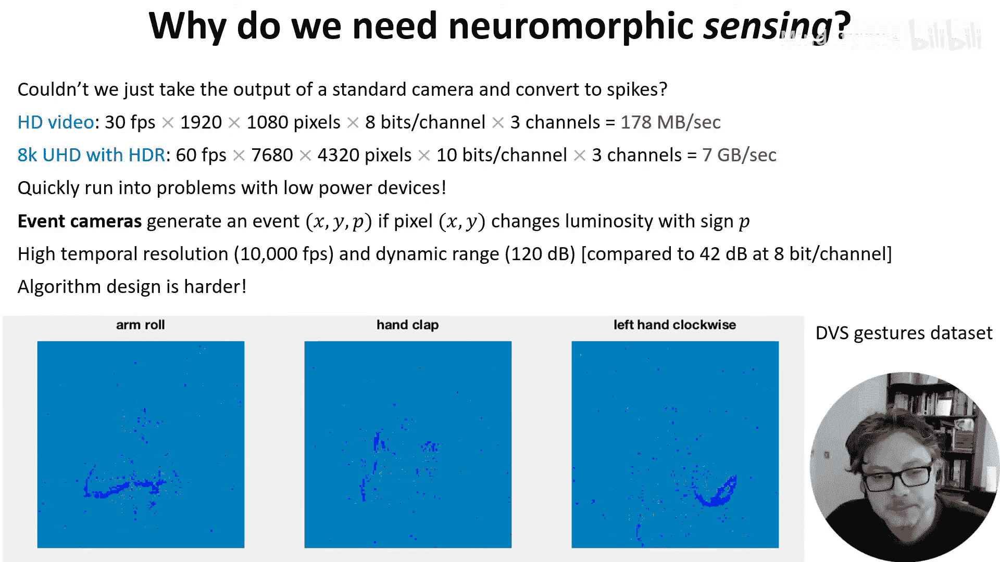
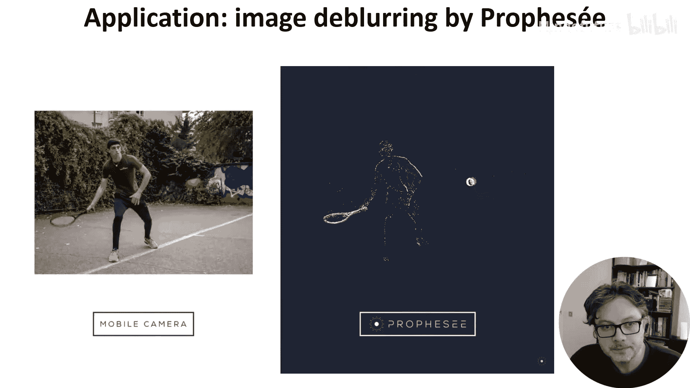
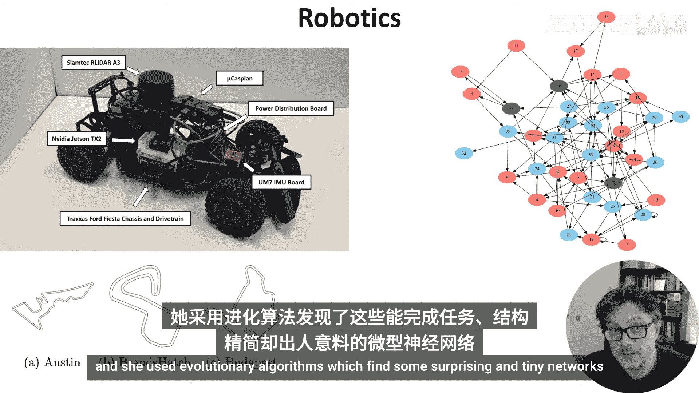

# 机器学习人员的神经科学 ｜ Neuroscience For Machine Learners p32 P32_W8_V2-Neuromorphic_sensing_and_applications -BV1MiawzJExR_p32-

In this video， we're just gonna do a very quick introduction to some of the neurourmorphic sensor devices and how they enable unique low power applications。

😊，So let's start by asking， why would we even need specific neuromorphic sensing devices。

 Couldn't we just take the output of a standard camera， for example。

 convert that to spikes and then feed it into a neuromorphic computing device。Well， yes。

 But if we start thinking about the amount of data transfer involved， we can start to see a problem。

High definition video at 30 frames per second generates about 178 MB per second of data。

That's not too bad， but when we move to ultra Hydeff with high dynamic range。

 we're now talking about 7 gig per second。On low power devices， that's very problematic。

Event cameras are one solution to this problem。 They noted that most pixels don't change very much in a scene from frame to frame。

 and that's also the basis of video compression algorithms。

Event cameras take this to the level of sensing。 They only transmit an event when the underlying pixel changes。

These images are from the dynamic vision sensor gesture data set and give you an idea of what the output of these cameras looks like。

In addition to hugely reducing the amount of data transmitted， it also has another nice effect。

 Instead of running at 60 frames per second， we can run at the equivalent of thousands of frames per second with a much larger dynamic range。

The bad side is that the algorithm design is much harder as wefting throughout this course。

We just wanted to show you one nice， recent example of this from the French company Prohecy。

 who are using a hybrid of standard cameras and event cameras on a mobile phone to remove blur from fast moving images。

😊，You can see in this video how the high frame rate of the event camera allows you to see the motion at a much higher temporal resolution。

 and they then use this to remove blur from the pixels that change fastest and get a much nicer image as a result。

😊。

Fsion isn't the only sense that has a corresponding neuromorphic version。 There are auditory sensors。

 for example， you can see here some of the spikes produced by this system。

And there are also olfactory sensors， the sense of smell and tactile senses， the sense of touch。

I'm going finish this week with one nice robotics application from Katie Schumman。

She used this robotic car controlled with the Mu Caspian neuromorphic computing device。

It was trained on a simulator of miniaturized formula on tracks like these。

 And she used evolutionary algorithms， which find some surprising and tiny networks that are able to do the task。

And finally， having trained it in a simulated environment。

 they tested it in this previously unseen real world environment。

 and it was able to drive around the course。 Well， some other time。😊，In these videos。

 I've only touched the surface of the field of neuromorphic devices。

 but I hope that gives you some idea of the sort of research that is being done in this field。

