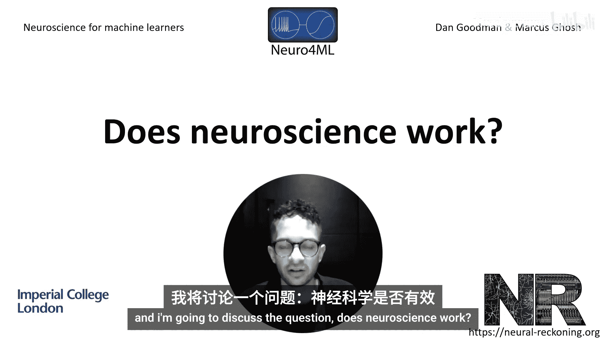
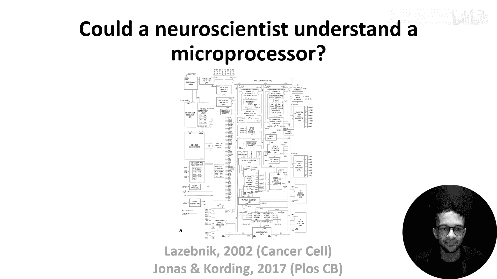
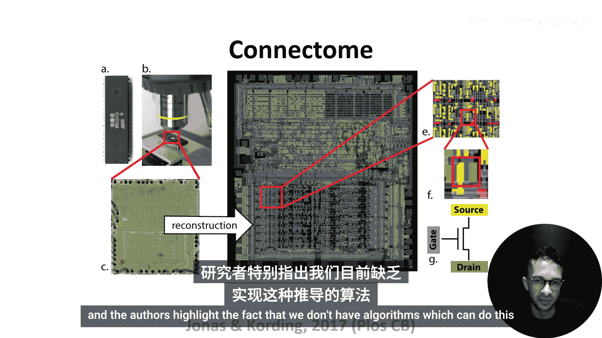
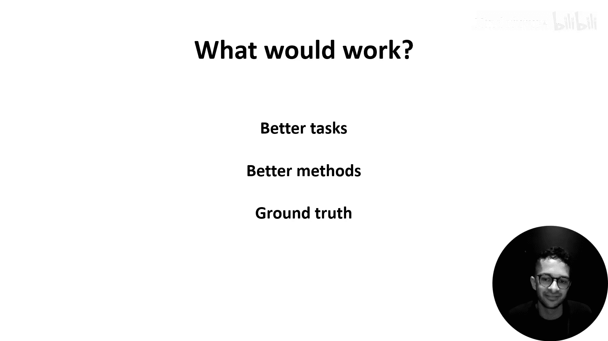

# 机器学习人员的神经科学 ｜ Neuroscience For Machine Learners p33 P33_W9_V0-Does_neuroscience_work -BV1MiawzJExR_p33-

This week we're going to cover what we consider to be open issues in neuroscience。

 and I'm going to discuss the question， does neuroscience work and how could we know？😊。

Through most of the course， we've shown you how neuroscientists are collecting increasinglyly large data sets of neuron morphology and activity。

 and we've discussed what we can learn from these dataset sets。😊，To some extent。

 an implicit assumption behind these efforts is that with more data will become more understanding and that given enough data we would understand the brain。

But is this true？This is the question tackled by a paper calledDid a neurouroscientist Understand a microprocessor which was inspired by an earlier paper called Fibiologist F a radio In this paper。

 the authors take an old microprocessor which runs three video games and try to understand how it works by applying methods from neuroscience。

Pritically， we know how the micro process works， so we can test how well these methods do at recovering that information。

While this might seem like an odd idea， the microprocessor is in some ways not that different from the brain。

For example， its transistors and their connections resemble neurons and the time varying activity of these transistors transforms its inputs to outputs。

Also， while there are many differences， like the fact that the transors are deterministic and easy to observe。

 manipulate。These differences should actually make the microprocesor easier to interpret than biological data。

If you followed the rest of the course， I would encourage you to pause the video at this point and try to think about how you would approach understanding the microprocessor。

What data could you collect or experiments could you conduct to learn something about how it works？

Otherwise， let's see what the authors tried first， the authors obtained the microprocesss connectome Ie map describing how every transistor nexts to every other transistor and they did some analysis of this map while they find some interesting results。

 it's difficult to see how you could go straight from a network structure to understanding its function and the authors highlight the fact that we don't have algorithms which can do this。

So， next。They simulate the microprocessor and observe the activity patterns of its transistors。

 much like a neuroscientist might record and analyze neural activity。

Figure on the left shows the off to on transitions of 10 transistors over time。

 which look surprisingly like spikes in a raster plot。With these data。

 the authors then try to analyze the tuning properties of individual transistors。In this case。

 how their activity changes as a function of pixel luminance。

The middle plot shows some of the results from this analysis with luminance on the X axis。

Each transistor's mean response on the Y axis， and then different colored lines representing five different transistors。

Like neurons in the brain， some transistors seem to have simple tuning and are correlated with single luminance values。

 while others seem to have more complex tuning。So does this help us to understand how the microprocessor works？

Not really， as in truth， none of these transistors directly control exuminance。

 so maybe instead of analyzingna individual transistors。

 we should try to identify functional ensembles。Groups of transistors with correlated temporal dynamics。

To do that， the authors record the activity of all 3，510 transistors simultaneously over time。😊。

During the three different video games。The data is shown in the rightmost plot with time on the X axis and trans resistors on the Y axis per game。

And again， you can see that it resembles large scale neural data。

 They then analyze this data with non negative matrix factorization。

This time they find dynamics which match features of the microprocessor like the clock and Readwrite signal。

 but again， this falls short of providing us with some substantial understanding of how the microprocessor works。

So， maybe。Instead of just observing the system， we should try to manipulate it。To do that。

 the authors silence each transistor in turn and check if each of the three video games will boot or not。

As the left of the figure shows， removing 1，565 of the transistors had no impact。Removing 1。

560 of them stop the microprocessor from booting any games。😊。

AndThen small subsets of the transistors prevented one or two games from booting。

The locations of the transistors which were specific to one game。

 are mapped onto the chip on the right of the diagram。

It's tempting to label these transistors as Donki Kongong or space invaders transistors。

 much like we might label in neuron as being visual or auditory。But this is misleading here。

 as the transistors are not specific to single games and instead implement simple functions like full add。

 which might be involved in other games we haven't considered or even these games if we looked beyond booting。

😊，So what would help us to understand the microprocessor？

One suggestion from the authors is that they could have better designed their experiments to isolate individual behaviors or computations。

😊，For example， if you just recorded and manipulated the transistors while the player tried to move to the left。

You could try to figure out how the microprocessor transforms a left controller input into a leftwood movement on the screen。

Another suggestion is that meta methods could help for example。

 in week six we covered why multi elementement lesions may be more informative than single element lesions but really how to understand complex networks is an open issue in neuroscience。

😊，So coming back to my question， does neuroscience work？😊。

This paper suggests that the current approaches might not so we need better methods and we need ground truth systems like the microprocessor in which we can validate the new approaches With that thought I'll leave you to Dan in the next video。

