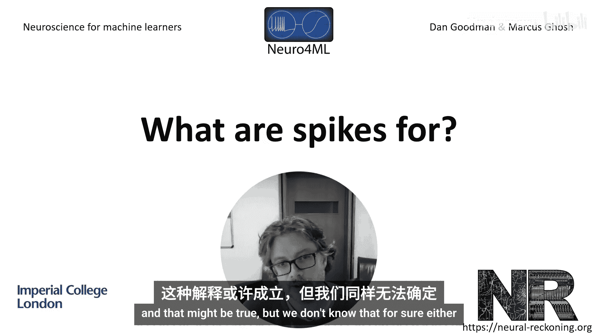
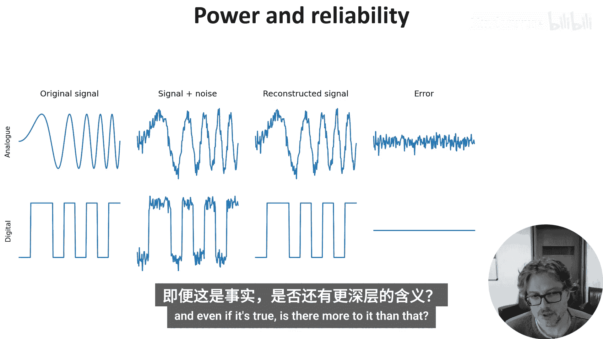
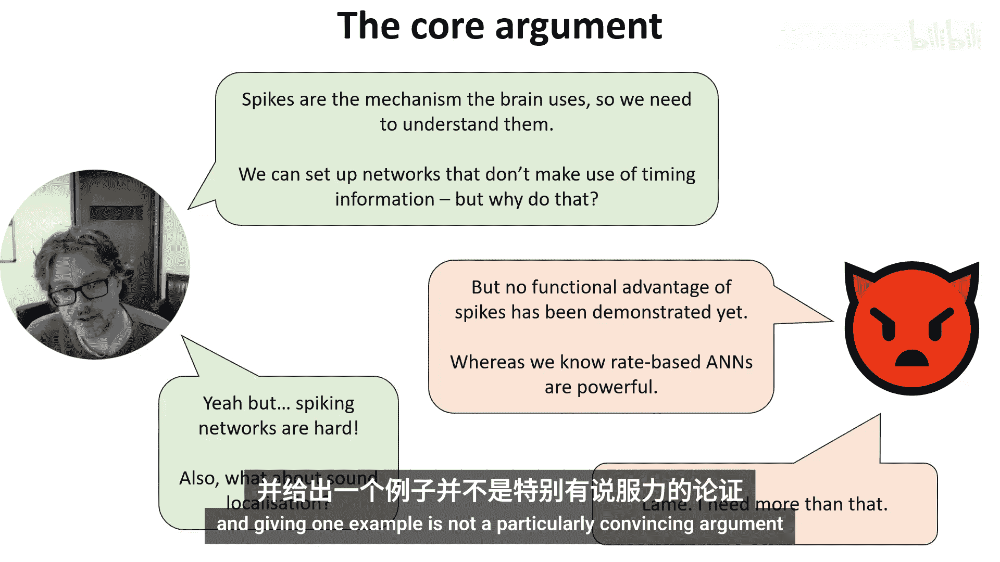
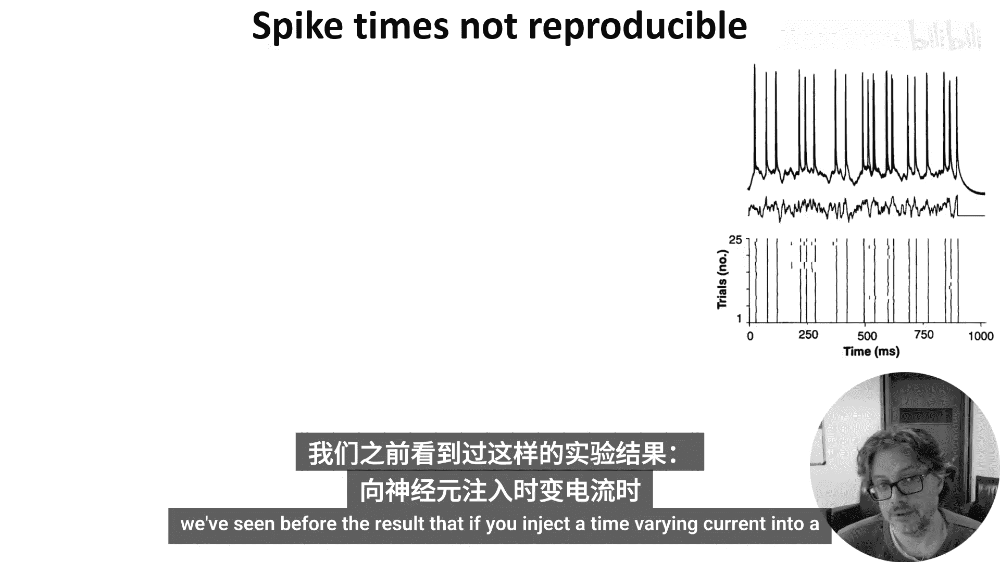
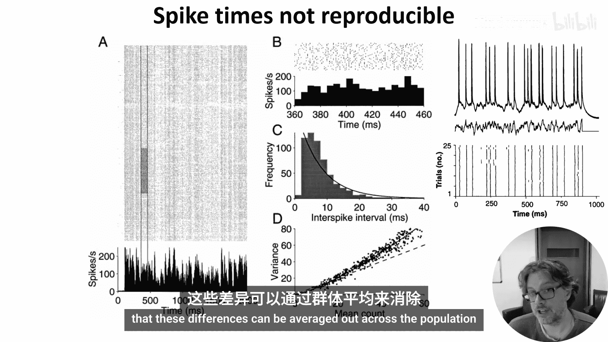
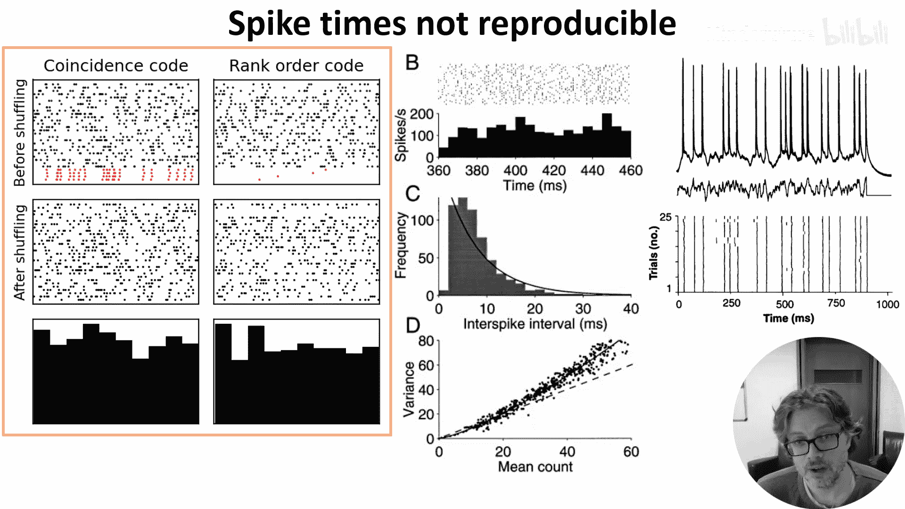
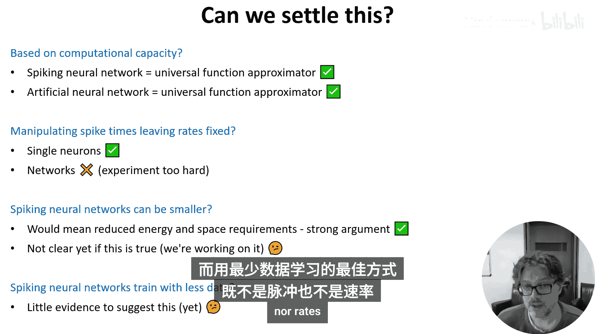

# 机器学习人员的神经科学 ｜ Neuroscience For Machine Learners p34 P34_W9_V1-What_are_spikes_for -BV1MiawzJExR_p34-

One of the most surprising things in neuroscience is that there's this extraordinary method that neurons use to communicate and compute the discrete action potential or spike。

But we don't know why the brain does this。At a philosophical level。

 this might be a question without an answer。 It just does because that's the path the evolution taken。

 It could have taken a different one。 And that might be true， but we don't know that for sure either。

 So let's have a look at some of the ideas and the debate about this。

The first argument is that the main function of spikes is just that they're an energy efficient mechanism for reliably sending signals along a long wire。

That's basically the reason why digital is often preferred to analog in communications and computing。

😊，You can reconstruct a digital signal perfectly， even in somewhat noisy conditions。

But noise will always degrade an analog signal。And it's a very valid argument。

 And it's likely to be part of the reason。 It's certainly a key inspiration for the neuromorphic devices。

 we talked about last week。But how valid is it when we know that there are many other sources of neurons in the brain。

 like synaptic failures。 And even if it's true， is there more to it than that。

 Do we need to understand spikes to understand what the brain is doing。

My point of view is that we know that the brain does use spikes and so we need to understand that if we want to understand the brain。

Even if we think that the brain only uses spikes for their rates。

 we have to understand how the brain could discard the non rate information and spike trendss。

People have worked on that showing how you can set up spik in your networks so that they behave as if they were just conveying rates。

But why would the brain actively throw away a potentially useful source of composition or richness？

My take then is that if you want to say that the brain only has rates。

 it's on you to show that using spike timing is actively harmful in some way so that it's worth the effort to discard that information。

But there's a counterarment to that， which I'm representing here by this totally neutral choice of emoji。

😊，If spike times are carrying all this potentially useful information and rich dynamical behavior useful for computation。

 how come we've never managed to demonstrate a case where spiking performs better than non spiking？😊。

We know that rape based artificial neural networks are powerful。

 but we can't yet say the same about models of spiking neural networks。

You've seen in previous weeks that training spiking neural networks is making great strides。

 but we're still far from the level of performance of ANNs。Personally。

 I think that while this is clearly true， part of the reason for that is that we have good theory and techniques for working with continuous and differentiable systems and not as good yet for hybrid。

 discrete and continuous systems。😊，That's a limitation on our mathematical techniques。

 but there's no reason the biological mechanisms of the brain should have the same constraints。

Also it's not entirely true， we do know some systems where precise spike times are definitely important。

 like the sound localization circuit。Still， though。

 I do recognize that just saying it's hard in giving one example is not a particularly convincing argument and a big part of my research is about trying to do this better。

😊。

Before we get further into the arguments， it's worth asking if the reason we haven't made progress on this issue is that there's no actual issue。

If we smooth out spike times as a sort of proxia firing rate， we can see that indeed。

 it's not capturing the structure of the spike times。

 This is the picture people usually have in mind。But if we use a narrow window， that window。

 that becomes less obvious until eventually there's no distinction between firing rates and firing times。

So does this mean we can just ignore the distinction between spike times and firing rates， well。

 not quite。Firstly， while spikes can tell you everything you need to know about firing rate at any time scale。

 the reverse isn't true。 Only the narrow smoothing windows tell you about the spike times。Secondly。

 the argument is not just that the concept of rights can do anything that times can do。

 but the spikes are actually generated by a process where spike timing is not important。

 and that's a much stronger statement。And on the face of it， it's surprising。

 We know that single neurons don't discard spike timingping information from their inputs and that they produce reliable spike times in response to a time varying input current。

It is possible to set up a network of neurons that discards the timing information。

 but as I said before， this seems like a strange and unnecessary thing to do。😊，Of course。

 that doesn't mean that that's not what the brain does， it is often surprising。

So what's the conclusion of this slide well it's not quite as simple as saying that firing rates and spike times are mathmatic is the same thing。

 but that is a useful point of view to keep in mind in this debate。😊。

Let's return to the point that knowing spike times salluah everything that there is to know about spike rates。

 but not necessarily vice versa。Can we quantify that？It's not entirely straightforward。

 but people have tried using information theore approaches。😊。

The idea is to record some sensory information， in this case。

 the amount that the rat's whiskers have been deflected and simultaneously record the activity of a set of neurons。

Then you ask， how much information in bits does knowing the spike train tell me about the amount the whiskers have been deflected？

You then do this using either the full set of spike times or just the spike rates or counts in this figure。

Of course， since the spike timing information tells you the rates of accounts。

 the amount of information must be at least as large， but the finding here is that it's much larger。

 knowing the spike times tells you almost twice as much as knowing the counts alone。😊。

And this is a finding that has been found many times in different sensory modalities and different species。

😊，At first， this looks like a knockdown argument in favour of spike timing。

 but it's not quite as clear cut as that。Firstly， it's really hard to measure mutual information in these very high dimensional settings。

 and so it's hard to be 100% confident that what we've done is meaningful。😊，Secondly。

 just because the information is there doesn't mean that the animal makes use of that information。😊。

Another argument against bite times being important is that they're often not reproducible。

 and so they couldn't be used as the basis of a neural code。

We have seen before the result that if you inject a time variantan current into a neuro。

 you get reproducible spike timess。

But by contrast， if you repeatedly show an animal the same stimulus。

 you often get spike times that are very different。Despite counts are also highly variable。

 but the argument is that these differences can be averaged out across the population。😊。

However， you wouldn't necessarily see obviously reproducible spike timing patterns。😊。

Here are two spike time encodes that give rise to histograms that are indistinguishable at a glance from one with no meaningful spike timess。

😊，On the top row， you see the spikes ordered so that four of the neurons have a special relationship to each other in terms of their timing。

😊，On the left， they will have the same time， plus or minus a bit of noise。

 and on the right they're in a fixed order relative to each other。However。

 if you randomly shuffle the order that you plot them or compute the histogram of spike times。

 you don't see anything resembling an obvious spike timing code。😊。

A rank order code is a bit tricky to work it implies a lot of constraints on the network structure。

But a coincidence code is quite natural， which brings us to the next argument。

The next argument is that if coincidence were an important part of the neural code。

 we would expect to see high pairwise correlations between neuron spike trains。

 which we don't see in recordings。It's true that we would expect to see correlations。

 but it's a surprising fact that a timing code doesn't need them to be that high。In fact。

 input correlations that are so small as to be indistinguishable from noise can have a huge effect on downstream neural firing。

😊，Ceral Russell and colleagues generated simulated input spike trains with pairwise correlations varying from 0 to 0。

01。Injected those spikes as input currents into cortico neurons and then measured the output neuron firing rate。

 and as you can see， the neurons were incredibly sensitive to even these tiny differences in correlation。

😊，In the case of neuron C1， its firing rate increased from  zero to almost 10 spikes per second。😊。

And they also take that the same thing can be seen in a leaky in fire neuron。

So the fact that we don't see huge correlations and spike trades doesn't mean that timing information isn't critical to network functioning。

😊，And in fact， we can go further than this。 You can argue that regardless of whether or not the code is timing or rate based。

 you'd expect to see local relations and individual spike train statistics consistent with them being generated by a Poisson process that has no meaningful timing information。

These statistics are what you get in any scenario when each individual spike carries the maximum amount of information。

This has been developed into an interesting and detailed theory by Sophie Deev。

 and I put a link to a good starting point in the reading list。😊。

There's more to these arguments than this little sketch， of course。

 but you can begin to see the problem。 It's a debate that's been going on for decades and doesn't seem any closer to being resolved。

 So what would it take。Well， we can't decide purely based on computational abilities。

 We've seen that spik in neural networks are universal function proxiators and so rate based artificial neural networks。

We could try manipulating circuits in a way that disrupts spike timing。

 but not right to see if it changed the function of the network。

And we can do that for single neurons， but for population based biking networks。

 that experiment is beyond our humbilities for the moment。

One approach that we're looking into is trying to show that spikes let you do more with fewer neurons and synapses。

This would mean reduced energy and space requirements。

 both of which are critical for biological networks。It's not yet clear if this is true。

 but we've seen some suggestive signs in our research。And finally。

 maybe speakingiking neural networks need less training data。

 This really would be a dramatic difference， is it likely。Well。

 it's possible that somehow temporal sparsity or thresholdholding will be important for that。

 but I haven't seen anything that convinced me of this yet。If I had to guess right now。

 I'd say that the most likely is that the brain primarily uses spik to reduce resources。

 both energy and space， and that the optimal way to learn with minimal data will turn out to be neither spikes nor rates。

 but something we haven't imagined yet。

Maybe one of you will discover it。