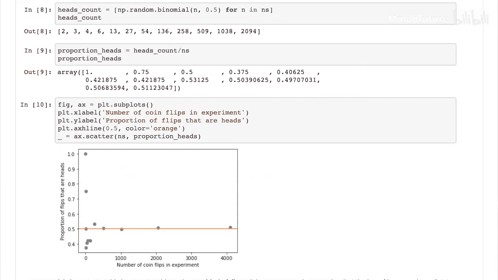
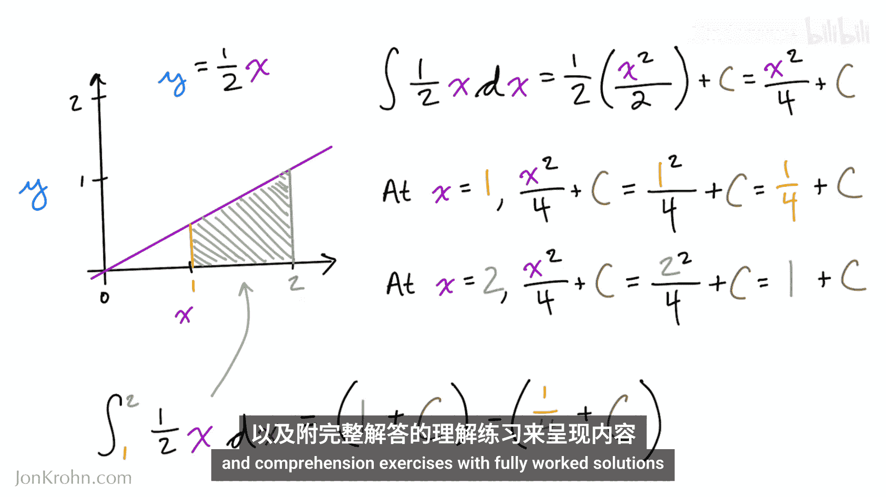

# 机器学习的线性代数及Python实现 ｜ Linear Algebra For Machine Learning p01 P01_机器学习基础-欢迎踏上旅程 -BV1L8nLz6E8C_p1-

Hi， I'm Dr。 John Cone， chief data scientist at the Maine Learning company Untapped。

 number one bestselling author of the book， Deep Learning Illustrated。

 and the creator of dozens of hours of popular video tutorials on deep learning。

Based on my experience teaching machine learning over the years。

 I've identified a body of underlying knowledge that is critical to being an outstanding ML practitioner。

As with the popular deep learning materials I've created in the past。

 the content in this machine learning Foundation series is brought to life through the combination of vivid full color illustrations。

 straightforward examples of Python code within hands-on Jupyter notebooks。

 and comprehension exercises with fully worked solutions。

As you can read in further detail within the Assoated GitthHub reppoitory at Github。

com/jochroone/mfounds， the eight subjects in this machine learning foundation series are organized into four couplets。

Intro to linear algebra， linearar algebra 2 matrix operations， cculus 1， limits and derivatives。

 calculus 2， partial derivatives and integrals。Probability and information theory。

 intro to statistics， algorithms and data structures， and optimization。

Mastering the eight subjects in the series will provide firm foundations to anyone。

 whether you're getting started in ML or you're a seasoned user of ML softwareft libraries looking to reinforce your understanding of the underlying theory。

Later subjects build upon content from earlier subjects。

 so the recommended approach is to progress through the subjects in the order provided that said。

 you're welcome to pick and choose individual subjects。

 even individual videos within the subjects based on your interest or existing familiarity with the material。

I did my best to limit assumptions about viewers' backgrounds All code demos will be in Python by far the most widely deployed software language in the fields of data science and machine learning。

 so experience with Python or another object oriented programming language would be helpful for following along with the code examples if you are comfortable dealing with quantitative information such as understanding charts and rearranging simple equations。

 then you should be well prepared to follow along with all of the mathematics。

Whatever your existing background， this practical in depth video series will greatly expand your ability to work with and model data By the end of the journey。

 you'll have a strong working understanding of all the foundational subjects that underlie contemporary ML approaches。

 including deep learning and other AI techniques。 Man， Am I ever excited to get started。 Ready。

 Let's do this thing。😊。