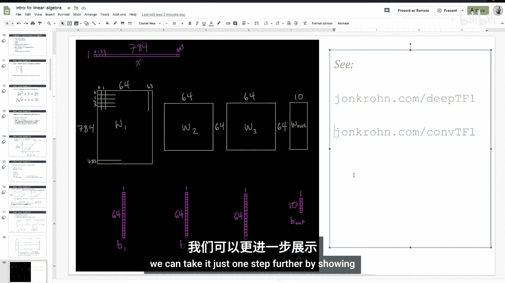
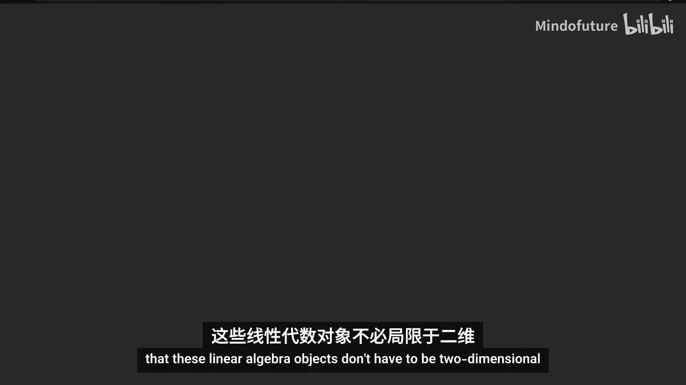
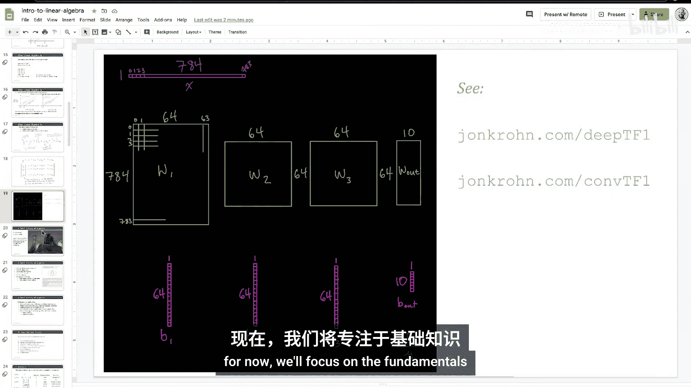

# 机器学习的线性代数及Python实现 ｜ Linear Algebra For Machine Learning p02 P02_什么是线性代数 — 主题1 -BV1L8nLz6E8C_p2-

Hither， this is John Cone。 Welcome to my machine learning Foundation series。

 This is the first subject in the series。 It is intro to linear algebra。

 This is an interactive primer on the theory and practice of Tensor manipulation in Python。

 And here is a wonderful illustration of my puppy oboe by illllustrator Hagleley Bassins。😊。

So in this intro to linear algebra we are going to have three segments。

 we're going to talk about data structures for algebra。

 then we're going to cover common tensor operations with tons of hands on examples。And finally。

 the final subject in this subject。Is matrix properties We're going to kick off segment1 in this video data structures for algebra。

 All of the topics in here are what linear algebra is， a brief history of algebra， tensors。

 particular types of tensors， including scalrs， vectors。

 simple manipulation of vectors such as transposition， ways of characterizing vectors。

 like norms and special types of vectors like human vectors， more special vectors。

 basic orthogonal and orthoormal， We're going to。😊。

Tackle building vectors in nuy and other types of tensors， as well as matrices。

Tensors more generally in Tensorflowlow and Pytorch。

 the two most popular automatic differentiation libraries In this first video。

 we're going to talk about what linear algebra is and just do a single slide on a brief history of algebra。

 You'll have to wait for future videos for the rest of the content。😊，So what is linear algebra？Well。

 first， let's talk about what algebra more generally is。

 So algebra is arithmetic that includes any non numerical entities like X。

So here's a simple example if we have this equation 2 x plus 5 equals 25。

 well we can subtract 5 from both sides of the equation。

 and then that will leave us with 2 x is equal to 20， we can then divide by2 on both sides。

 leaving us with 10 is our answer and you can confirm for yourself that x must be equal to 10 because you can plug it into the original equation and when x is equal to 10 to x plus 5 comes out to 25。

 it's the only solution to this equation。So that's what algebra is。Now。

 to take into what linear algebra is a bit more， it isn't linear algebra。

 if it has an exponential term， So for example， an equation that has 2 x squared plus 5， well。

 that isn't linear。 It's a nonlinear transformation。And then a square root。

 that's also a nonlinear transformation， so this equation is also not linear algebra。

To give you a really nice and tidy definition of what linear algebra is。

 we could say that it's solving for unknowns within a system of linear equations。

So let's talk about that idea of a system of linear equations， multiple lineare equations。

 or resolving for unknowns like x across several equations simultaneously。 So here's an example。

Let's say a sheriff has a car that travels at 180 kilometers an hour。A bank robber。

As a slightly slower car goes 1 hundred 50 km an hour。

 But that bank robber gets a five minute head start on the sheriff。

So how long does it take the sheriff to Keshe the robb and what distance will they have travelled at that point。

For simplicity， let's ignore acceleration traffic， et ceter。

 and we'll just assume that they're traveling in a straight line in one direction。

So we could solve this problem graphically with a plot。

We can note here that 150 kilometers per hour corresponds to 2。

5 kilometers per minute and 180 kilometers per hour corresponds to three kilometers per minute。

You can plot things out here， and so we have a plot of time along the X axis。

 the horizontal axis in minutes。And then we have a plot of distance in kilometers along the vertical axis。

You can see here there's a green line corresponding to our bank robber。Going 2 kilometers per minute。

 So that's a particular slope。And our sheriff is traveling at a faster speed。So it has more slope。

 a slope of  three instead of 2。5， corresponding to three kilometers per minute instead of two and a half kilometers per minute。

And then we have our five minute head start to the bank rubber accounted for by the gap here along the X axis。

So what we're trying to solve for is this crossover point where the sheriff catches the bank robber。

So what time is it， how many minutes have elapsed at that point？

And what distance have they both traveled at that point。

 so you can see that graphically you could come up with a solution here。Alternatively。

 we can solve the problem algebraically。To represent the bank ro， you can have this first equation。

 which is distance D is equal to 2。5 times time， and then a second equation representing the speed of the sheriff。

However， we also take into account that five minute had start。

 So we have a penalty of five for the sheriff。 Now， both of these equations are equal to D。

So we can actually set。This term here， equal to this expression here。So 2。

5 t is equal to 3 t minus 5。You then multiply the three into the brackets。

To expand out this side of the equation。And then we start trying to isolate T by moving3 T over to the other side of the equation here。

 so we subtract 3 T from both sides of the equation。When we do that now。2。

5 T minus 3 T gives us a negative 0。5 T is equal to negative 15。

And so now we can divide both sides of the equation by negative 0。5。And that isolates T completely。

 giving us a time of 30 minutes。 So now we know how long it takes for the sheriff to catch the bank robber。

To figure out distance， this is really easy now that we've solved for t。

 we can simply plug that 30 into the T in either equation， so for the first equation， 2。5 times t2。

5 times 30 is equal to 75 kilometers， and then we can plug it into the second equation 2。So。

30 minus5 is 25 and 3 times 25 is 75 kilometers， of course we get the same answer。

Because it is a system of linear equations。Now， that was a nice， neat and tidy situation。

Where we had one solution。However。There would have been no solution if the sheriff's car were the same speed as the bank robbers。

So if they both were traveling at exactly the same as speed forever。

Then there would be no solution to this problem。On the other hand。

 we could also have an infinite number of solutions。If。

Both the bank robber and the sheriff were traveling at the same speed and have the exact same starting time。

 so the slope is the same， the start time is the same now they overlap at every time point。

These are the only three options in linear algebra so you either have one solution， no solutions。

 or infinite solutions， it is impossible for the lines to cross multiple times。

 so this is a key part of this being linear algebra in these systems of equations。

In a given system of equations， there could be many equations。

There could be many unknowns in each equation。In the example that I just showed you。

 there were two equations and there were two unknowns。However。

 let's consider another example here where we are building a model。Specifically。

 this is something called the regression model， which I'll get into a little bit of the detail here in case you're not already aware of it。

In this model here， we are trying to predict house price。So。We have， for a given house。

 we have its price that we're predicting why。And then we also have a number of features or variables。

That we are collecting。To try to predict that house price and in a lot of cases。

 the more features that you have， the more accurately you're going to be able to predict what you're trying to predict。

 the more relevant features。So some of the relevant features here might be distance to school or number of bedrooms and so on。

I have M features here， and so B， C and M， these are examples of features， this could be an integer。

 the number three distance to school could be a value like 2。5 representing 2。5 kilometers。

And so on for however many features we have， in this case， M features。

We also have to have a Y intercept here， so this is one last variable。

 it allows us to across all of the house prices that we have。

Have an average house price and without this， y intercept without that kind of average baseline before we start factoring in the other features becomes much more difficult to fit a good model。

So。Here we have many。Unknowns。And we could have effectively unlimited rows， where。

Every time we get a house price and collect the pertinent information associated with that house price like distance school number of veterans and so on。

 that's another row for our system of equations。It's typical in machine learning problems。

Even a regression model like we're looking at here to have thousands of rows representing different houses。

 So N rows， we could have thousands of rows here。And maybe a dozen features。

 so M could go up to 12 columns。In a typical deep learning model， in contrast。

 it would not be uncommon to have millions of images save for a machine vision model so we'd have millions of rows in our set of equations。

And millions of columns representing millions of parameters。

 potentially high resolution images would have a lot of pixels。So。

Here's that equation from the preceding slide。I've now generalized it to a lot of different houses and houses。

And I've made it into a set here using set notation from linear algebra， these square brackets。

And so for any house I in the data。So we can call that particular price Y I， which could be say。$300。

000 it would have you， then X I1 to X I M are all of the features for that particular house I。Now。

 across this whole system of equations， we were trying to solve for the parameters， A， B， C， and M。

Y is our outcome that we're predicting， say a house price x。Is the。Variables。

 the actual values that we have associated with that house price。 So x11， x12。

 x1 m and so on throughout this set of equations。And these parameters， A， B， C， and M。

These are the unknowns。They were trying to sell for。 And you'll notice these unknowns are。

Consistent across all of the equations。 So whether we're talking about the first row， the second row。

 the n row， A， B，C， and M are going to be the same value。

 So we're trying to find an ideal value to represent all of the rows in the dataset set for each of the features。

 each of the columns。I have some quick examples to show you here of how this looks in practice。

 so if you go to JohnPne。com/ deepeptF1。This brings you to a deep neural network in TensorFlow。

And by the end of this whole machine learninging foundation's journey。

A lot of what's happening in this notebook will start to make sense early on in the training I'm not expecting this stuff to make sense。

The reason why I'm in here， though， is just to show you that this same kind of thinking。

That we had in the slides。From linear algebra。Applies as well to various。嗯。Algebraic objects。

 what I'm going to introduce momentarily is tensors。 So we have vector tensors here。

 one dimensional tensors。And nature tensors， two dimensional tensors here。And so we have inputs。

 these x's are our inputs， just as they were in the pre preceding example。

 so these x's are inputs into the model that we're using to predict the outcome y。

In our deep learning model， in this particular model。

 it's a machine vision model that's being passed in。784 pixels per image。

 so we have this vector of 784 pixels being input。And we're using that to predict。Outcomes。

There y variable here， this vector of length 10。And in the middle。

 we have these things called weights and biases， weights matrices and bias vectors。

 the specifics of that don't really matter except that these are。

 I'm just trying to show you some linear algebra theta structures。

And these are encoded in whatever software language that we're using， in this case。

 this is TensorFlow here。And so， we create。Biopects。B 1，2，3， and be out corresponding to B 1，2，3。

 and be out these vectors here。 and then we also have weights。So of a particular shape， W1， W2。

 W3 and W out。 So these are these matrices with these particular dimensions。

So this is just an example of how we're going to have various parameters in this case。

 weights and biases。That are going to be tuned by our machine learning algorithms in order to be able to map some particular pixel inputs into a prediction of what those pixels being input represents。

Some particular outcome。 So it's this is just a slightly more complicated situation than we had with a linear regression example。

And。😊，We can take it just one step further by showing that these linear algebra objects don't have to be two dimensional。

We can have higher dimensional。Linear algebra objects， higher dimensional tensors。

I'll explain all of this terminology in more detail in the next video。Yeah。But for now。

It suffices to say that we have these。Many dimensional convolutional objects that are specified by many dimensions。

And these allow for。Some especially powerful machine vision models called convolutional neural networks。

Anyway， just want to get you excited about what we can do with linear your algebra， these notebooks。

 these Tensorflowlow notebooks show you an endpoint that we're working towards in the series。For now。

 we'll focus on the fundamentals。

Speaking of fundamentals， I find it absolutely fascinating to consider the origins of algebra。

 so let's take a quick moment here to do that。This guy here is Abu Jaafar Mohamd In Musa。

More commonly known as Alquaithmi， because he came from a place called so Alquami means the man from Quaithum。

 and so this is a former center of Persian culture in modern Uzbekistan today called Heva。

So in English， we pronounce thisalgothmy。So this medieval Persian mathematician。

 who was around from 780 to 850 in the common era， was not only critical to the history of algebra。

 as I'll get to in a second， but is also the namesake of the word algorithm。

 so very prominent old mathematician。So Algoithmi wrote the Compendious book on calculation by completion and bouncing。

And in Arabic， this word completion。Is algebra。So。Algebra is actually right here in the name。

Of the book。And completion and balancing refers to various ways that we can rearrange algebraic equations。

 some of which we've already looked at at the beginning of this video。

 The medieval Islamic Arab Empire made most significant early contributions to modern symbolic algebra。

 So the kind of algebra that we work with today。😊，Although it was refined significantly by the French。

 such as Rene Descartes in the 17th century。Though that said。

 many other cultures developed their own approaches to algebra。So rhetorical algebra。

 this spoken algebra， was developed as early as 1900 BC by the Babylonians。

There's an Egyptian papyrus dated to 1650 BC with a linear algebra on it。

 so we know they were up to some algebra。Indian mathematicians。

We're doing linear equations around the 6th century BC。

 as we know from some mathematical documents from then。And the Greeks， as long ago as 400 B， C。

 were themselves doing geometric algebra， an example that we have here。

 So this was in the time of the philosopher Plato。 and is a particular example of this geometric algebra here。

By Euclid in his book， Elementments。The Chinese had linear equations solved in a book from 250 BC。

 this book was called9 chapters on the mathematicaltheal Art。

Although the Europeans started much later in the late Middle Ages。

 initially by translating Arabic texts to Latin in the 12th century， by the 13th century。

 European mathematics rivaled other cultures。And when the Islamic Empire declined after the 15th century。

 European culture was left carrying the baton of algebra to today。

This technique devised initially thousands of years ago in some respects and in its symbolic form many centuries ago by Persian mathematicians。

We today have tons of contemporary applications to take advantage of lots of compute power and perform these algebraic applications in tons and tons of devices all across the world。

 billions of them I'm sure。So one kind of straightforward application is solving for unknowns in machine learning algorithms。

 including deep learning algorithms， so this is our primary focus across this machine learning Foundations program。

It's also used for reducing dimensionality， so if we have some high dimensional data。

 we can reduce it down using techniques like principal components analysis。

We can rank web pages in order of importance。For example， with eigvectors。

 we're going to talk about both eigenvectors and principal component analysis in subject two of the Ma learninging Foundation series called Linear Algebra 2。

And same thing with recommender systems， so if you want to build a recommender for movies。

 for example， based on other movies that somebody has watched。

You can use singular value decompositions to do that。

 and again that is something we'll be covering in linear algebra 2 once we get past the foundational content in this linear algebra 1 course。

It's also used to process natural language， you know with single value of the decomposition or another technique called matrix factorization。

 and so whether we're talking about processing，Language coming out of somebody's mouth。

 the language sounds or written language。We can be using linear algebra to be modeling topics。

 identifying what topics are being discussed in that natural language。

 as well as for semantic analysis。So in this machine learning Foundation series。

 this intro to linear algebras subject that we're covering right now is foundational for， of course。

 the linearar Algebra 2 matrix operations subject that is coming up that will cover eigenvectors and SVD and PCAN。

It also I'm putting in nonbolt here because it also is foundational for though not as directly as it is for linear algebra 2 for our calculus 1 limits and derivative subject。

 as well as for calculus 2 on partial derivatives and integrals。

 it's also foundational for probability and information theory and intro to statistics the only one that it isn't really providing much for is the algorithms and data structures class subject which is subject 7 and it is very important as basically all of these prior seven are for the final optimization class that will tie everything together and show us in incredible detail exactly how modern machine learning algorithms optimize。

Al right， up next， we are going to be introducing what tensors are。 I've mentioned them a few times。

 We're going to dig into exactly what they are in the next video。

 See you there to be sure not to miss the next tutorial in this series， subscribe to my channel。

Thanks for taking part in this tutorial。 I hope you enjoyed it。 If you did， please like and comment。

To be sure not to miss any of my content。Head to Johnchroone。com and sign up for my email newsletter。

You're also welcome to add me on LinkedIn， simply mention that you're a viewer of the Machine Learning Foundation series。

 and finally you can follow me on Twitter too if that's your social medium of Joice。

See you next time。