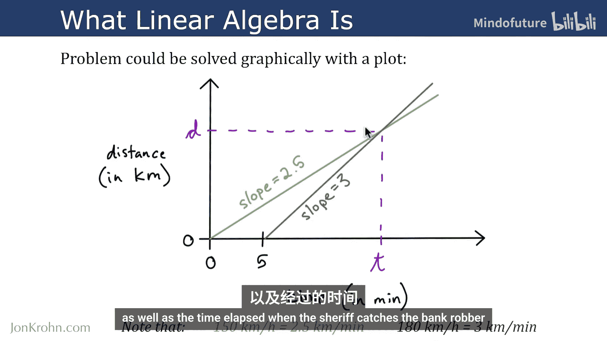
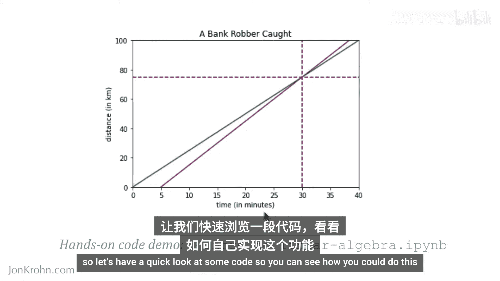
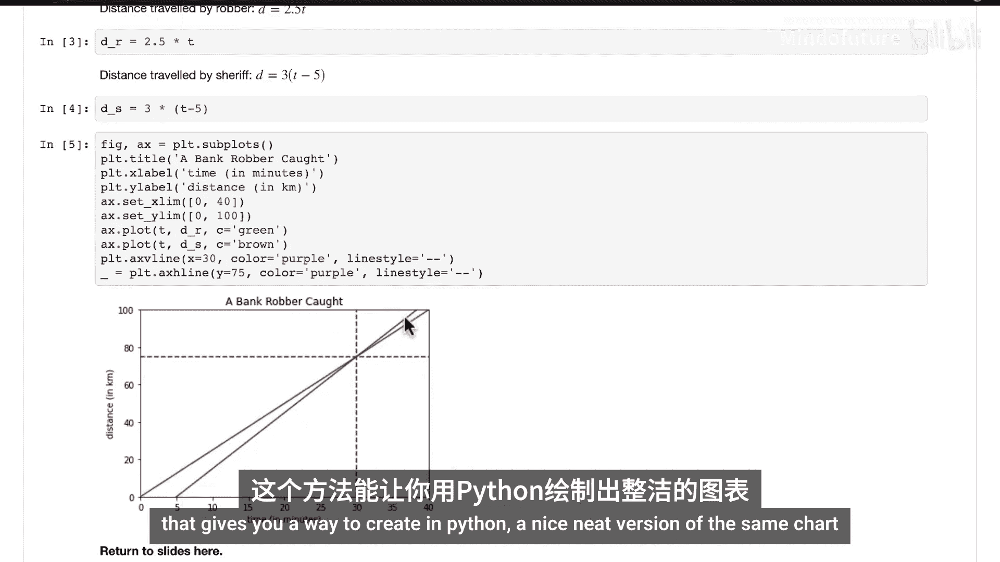
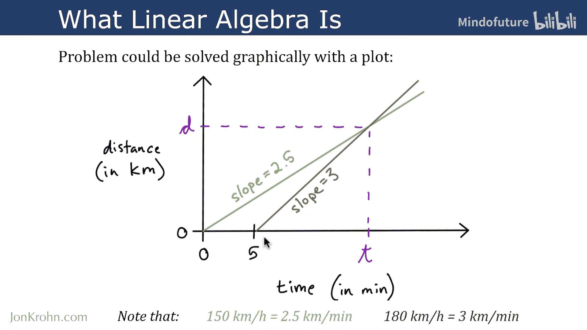
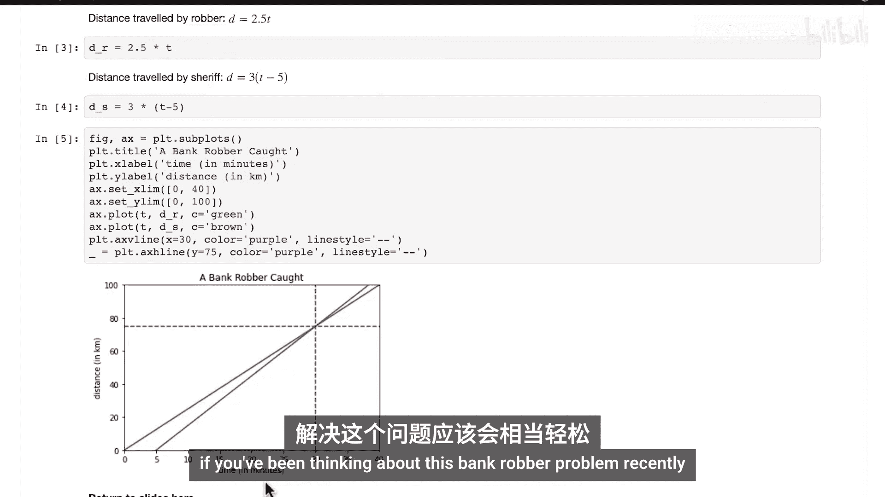

# 机器学习的线性代数及Python实现 ｜ Linear Algebra For Machine Learning p03 P03_绘制线性方程组 — 机器学习基础奖励视频 -BV1L8nLz6E8C_p3-

As I mentioned near the end of the preceding video。

 the next topic we'll learn about is the concept of tensors。

Before we start learning that new linear algebra concept， however。

 I've got a couple of videos to provide you with interactive exercises that not only are fun。

 but should also assist with comprehension of the theory we've covered already。In this video。

 that interactivity comes in the form of a hands on code demo in Python In the next video。

 the interactivity is in the form of a paper and pencil mathematical exercise。😊。

In the last video on what linear algebra is。I showed you that we could graphically solve with a plot that we sketched out by hand。

 And if you wanted it to be precise。 you'd have to get out of ruler or use graph paper or something like that。

 But you could use a paper and pencil to sketch out your linear system。

 So your line in this case representing the bank robber who's traveling at a slope of 2。

5 km per minute， starting at time 0。 And then five minutes later， our sheriff starts moving as well。

 But at the steeper slope of 3 km per minute。 And then we could with our sketch I the point where these crossover。

And solve our system of linear equations and identify the distance travelled。

 as well as the time elapsed when the sheriff catches the bank robber。

Now， instead of doing it graphically by hand， you could also create a plot in Python that is exactly the same information as I sketched out。

 So let's have a quick look at some code so you can see how you could do this yourself。

I have hundreds， maybe thousands of hands on code demos。 I haven't count them all。

 but there is a lot of them in my machine learning foundation series。

 And this will just give you a little taste of what it's like。

 So you can make your way to Github dot com slash John Gr slash M L foundations。

And that brings you to the Gitthub repo for my Ma learninging Foundation series right now we're in the first subject intro to linear algebra。

 so you can click through to access this notebook。

And coming up shortly in this machine learninging Foundation series， we have a video called Scalrs。

 and in that video we'll do a deep dive into how to execute the code in all of the Jupiter notebooks in this machine learning Foundation series using the Google Coabb environment which allows us to execute interactively。

 however for the time being， let's just look at some static code here。

In this first segment called data structuress for algebra。

 our first subject is what linear algebra is， and our dependencies for this example。

 this plot that we're going to create are nuy， the number library， the numeric library of Python。

And that plotlibb， probably the most popular library in Python for creating plots。

And so we're going to start off by simulating our time。 We know that we need time to start at zero。

 We're not going to be plotting time before the bank robber leaves so we can start time at0。

 and then we already know from the precing video where we worked through the solution and determined that the bank robber would be caught by the sheriff after 30 minutes。

 We know that we're not going to need much more than 30 minutes。 So I set 40 minutes。

 a 40 minute cap for our line that we're going to be plotting out。

So this L space method in the Numpie library allows us to create points from a starting point to an ending point。

 so we're starting in zero minutes。All the way through to 40 minutes。

And then we can have as many points as we'd like between our start point and our endpoint。

I'm electing to use 1 thousand points， which is more than enough detail for our simple line in this simple plot。

So we use this L based method to create this variable T。

Which consists of 1 thousand points ranging from 0 to 40。Now we can pass that T value。

 the time value。Into our two functions。 So remember from from the last video on what linear algebra is that the function for the distance traveled by the robber is simply D equals 2。

5 times time。And so we can very simply take our time variable and multiply that by 2。5， 2。5 times t。

 2。5 times t。 and that gives us the distance traveled by the robber over time。

To get the distance traveled by the sheriff again， as we discussed in the slides。

 the function is D is equal to 3 times t minus 5。 So again。

 we just replicate that function here in Python code。

Now that we have both of our distances for both the roer and the sheriff。We can plot it。

So we start off by simply creating a map plot Lib plot。 We add a title。

 I chose to call it a bank roper cot。And then our X axis label， time and minutes。

 our y axis label distance in kilometers。And then we set boundaries on exactly the range that we would like to plot over。

 So again， because I know that we want to start at a time of 0 in a distance of 0。

 that's my starting point on both the x and the y axis。

And because I already know the solutions to this problem， if you didn't know the solution。

 then you'd have to play around with different sensible values。

 Same thing with just getting your T to be at sensible points。

If you didn't already know the answer like we do， if you hadn't already solved this linear system using linear algebra。

 then you'd have to play around with different values so that your plot kind of made sense and you could work your way by changing values。

 you know changing limits， changing where these purple lines are to figure out where these two lines intersect exactly。

 but。Again， we already know the solutions， I already know that the sheriff catches the bank ropper after 30 minutes。

 so I have my X limit set to 40 just beyond that 30 minute point and the same value that I have time points created for。

And then along the Y axis again， I know that the sheriff is going to catch the bank robber at the 75 km mark。

 And so just going a little bit beyond that to create a nice pretty chart， I have 100 k。

Then I'm choosing to plot out the bank robber and the sheriff in the same two colors that I used on the slides。

So the bank robber is in green， the sheriff is in brown。And then finally。

 the last piece is to add these purple hatched lines。

 So they're hatched because we select this line style。

And we're saying here that I want a vertical line at that 30 minute mark。

 So vertical line where x is equal to 30 in the color purple。And then。A horizontal line， H line。

Add the 75 k mark also in purple and also hatched。So there you go。

 That gives you a way to create in Python a nice， neat version of the same chart that I hand sketched。

On my iPad and certainly doesn't look as pretty， but also illustrated the kind of the point that I was trying to make。

Once we'd solved for the unknowns， it was then pretty easy for me to create this very precise chart in Python。

All right， as I mentioned earlier， we do have tons of hands on code demos coming up in this machine learninging foundation series。

 pretty much all of them。 or I think all of them are executed interactively after this one。

 I just wanted to give you a quick little taste of the kinds of hands on code demos we'll be doing when we get to that Scalrs video coming up。

 I'll show you how to execute all the code interactively in the Jupiter notebooks that we'll be working with throughout this series。

😊，Al right， coming up in the next video， we are going to do a paper and pencil exercise that is a completely different problem。

 It isn't a bank robber and a sheriff。 It involves solar panels collecting sunlight energy。

But you'll be able to solve the problem。Pretty easily。

 if you've been thinking about this bank robber problem recently。

