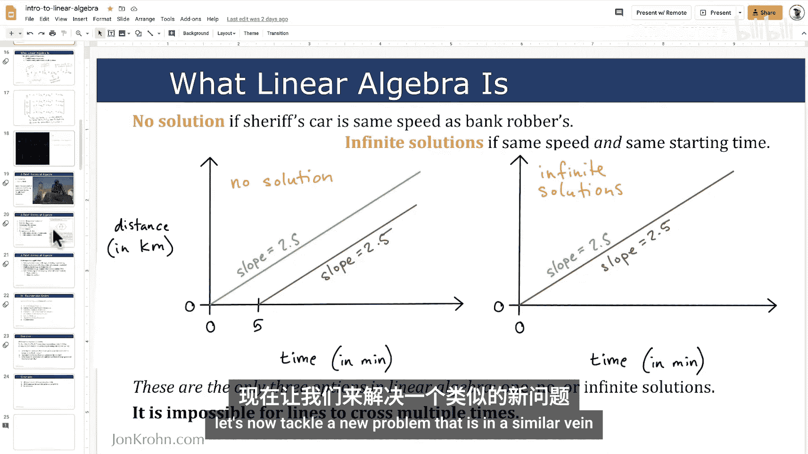
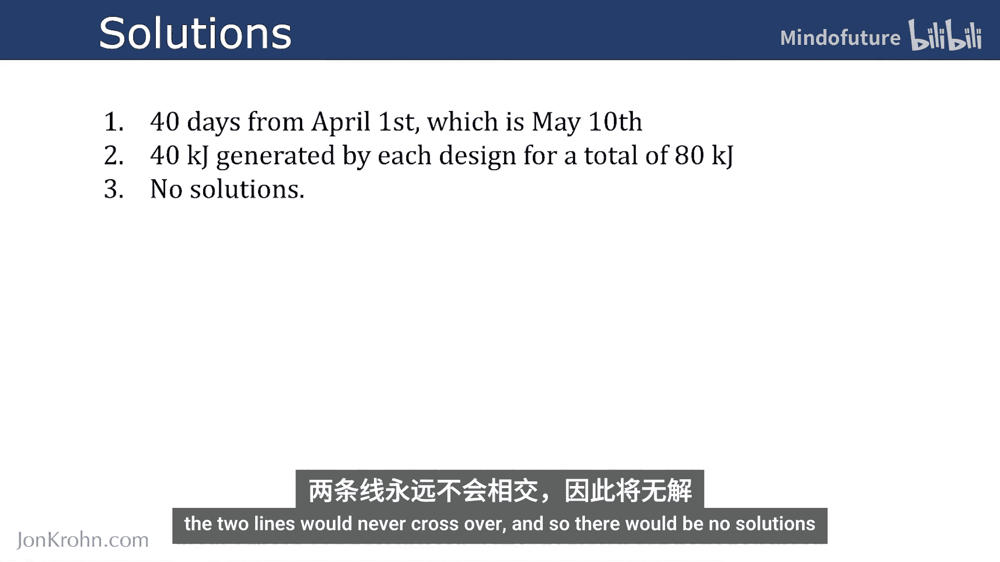

# 机器学习的线性代数及Python实现 ｜ Linear Algebra For Machine Learning p04 P04_线性代数练习 — 主题2 -BV1L8nLz6E8C_p4-

Previously， I described what linear algebra is， including providing examples of what systems of linear equations are and how we can go about solving them either graphically or algebraically。

Let's now take a crack at a quick linear algebra comprehension exercise that bears a distinct resemblance to the sheriff and bank robber example from the preceding video。

Al right， so here's a quick skim over the sheriff and bank robber question from the preceding video and the work solution。

 Let's now tackle a new problem that。

Is in a similar vein。So let's say Jill designs solar panels as a hobby。On April 1st。

 her Mark1 design begins generating power， one kilojoule of it per day。On May 1。

 her Mark 2 design begins generating four kilojoules of power ver day。So first question is。

 what day is it when Jill's Mark 2 design has generated as much total energy as the mark 1 design？

The second one can be answered directly from that first one。

 which is how much total energy have both generated by that day。

And what would the solutions to 1 and2 be if the Mark 2 design generated 1 kilojoule a power per day All right。

 so maybe you consider pausing the video here and trying to tackle this yourself？Otherwise。

 here are the solutions。It'll be 40 days from April 1st when the different designs generate an equivalent amount of total energy。

And that'll bring us to May 10th。And then once we have that number。

 it's very easy to figure out how much energy was generated by each design。

 which is 40 kilojoules each for a total of 80 kilojoules by that May 10th date。

And if both a Mark 1 and Mark 2 design generated the same amount of power。

 the two lines would never cross over and so there would be no solutions。

