# 机器学习的线性代数及Python实现 ｜ Linear Algebra For Machine Learning p05 P05_张量 — 主题3 -BV1L8nLz6E8C_p5-

Having oriented ourselves to what linear algebra is in general， in this video， I'll describe tensors。

 the fundamental building block of linear algebra for absolutely any kind of machine learning。

Already， what are tensors we hear about tensors associated with machine learning in some places here and there。

 it's even in the name of TensorFlow， one of the most popular libraries for doing machine learning。

 particularly deep learning， So what are tensors well。

 you might be surprised that it's actually quite simple。

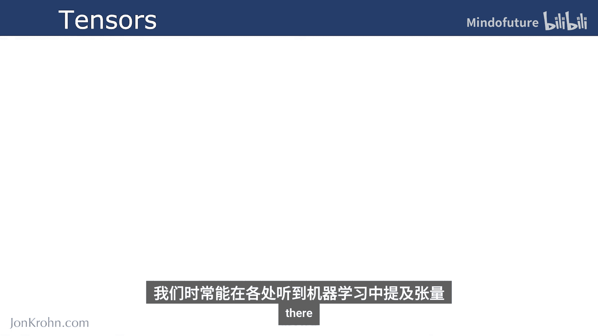

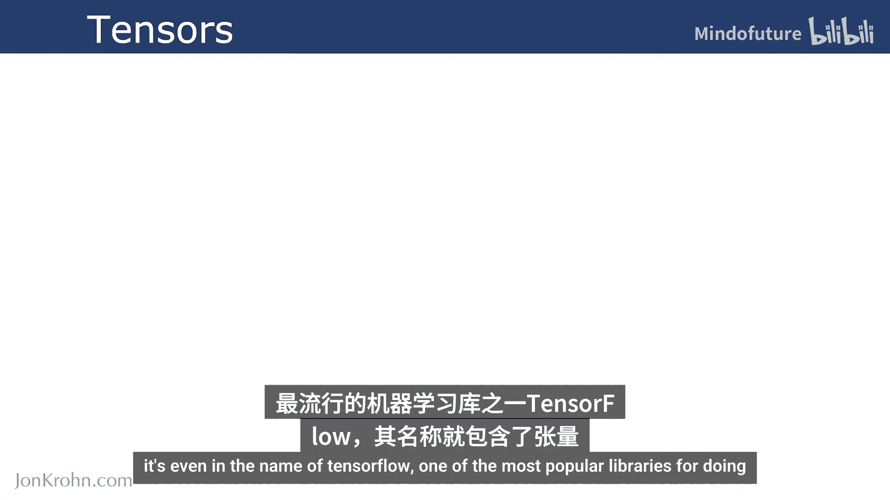

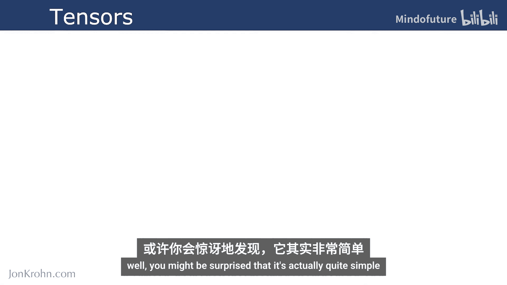

So tensors are simply a machine learning specific generalization of vectors and matrices to any number of dimensions。

 so what do I mean？

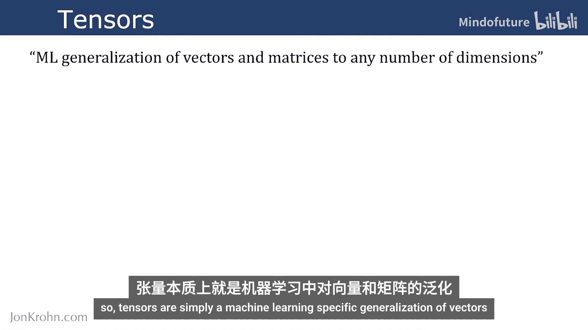

The zero dimensional tensor is a scalar， so it is just a single value。And then we have vectors。

 which are a linear array in one dimension of values， and then a matrix is a two dimensional array。

So a lot of people in computer science are familiar with scalers， vectors， and matrices。

And the idea of a tensor， it just generalizes these kinds of objects to any number of dimensions。

 So here I have a three tensor。A three dimensional tensor。

 it gets harder to draw higher dimensional tensors。

 but they can be in effectively any number of dimensions in a little bit more detail。

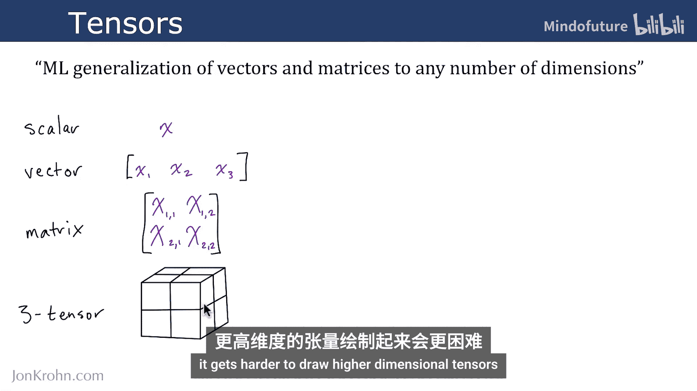

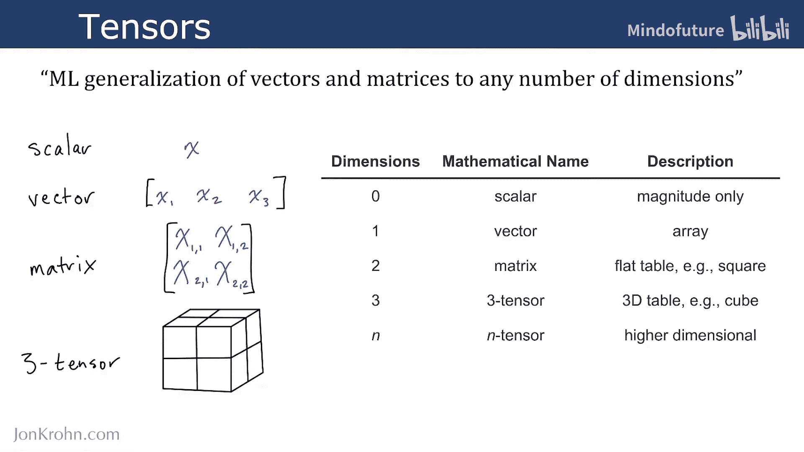

A zero dimensional tensor， we call that a scalar， as already mentioned here。

 and it has magnitude only， so it's just some value representing magnitude， a one dimensional tensor。

 it's a vector， we can call that an array。

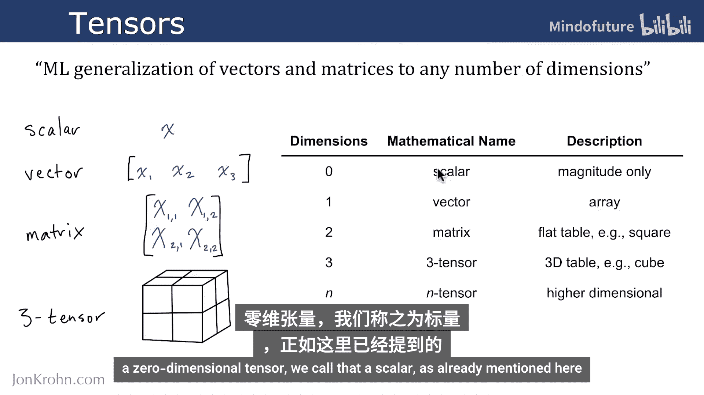

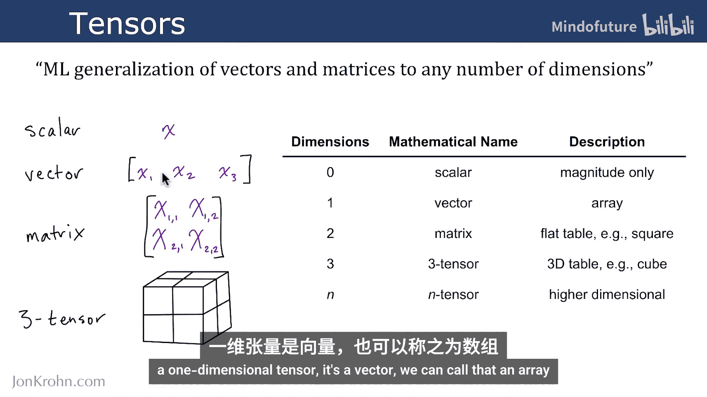

Two dimensional vector。 we can call that a matrix。 It's like a flat table， for example， a square。

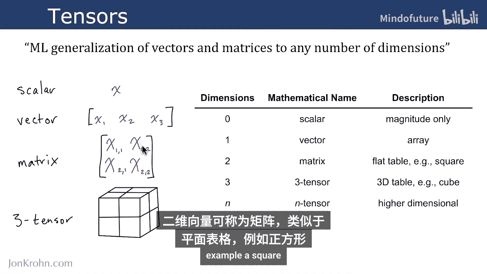

Or a3 dimensional tensor， which is like a 3D table。

 we can call that a3 tensor and a cube is an example of a three tensor。

 and then they can have any number of dimensions， N number of dimensions。

 So an n tensor could be a  four tensor or a 12 tensor or whatever。

 And these are just higher dimensional than cubes and difficult to picture with our feeble human brains。

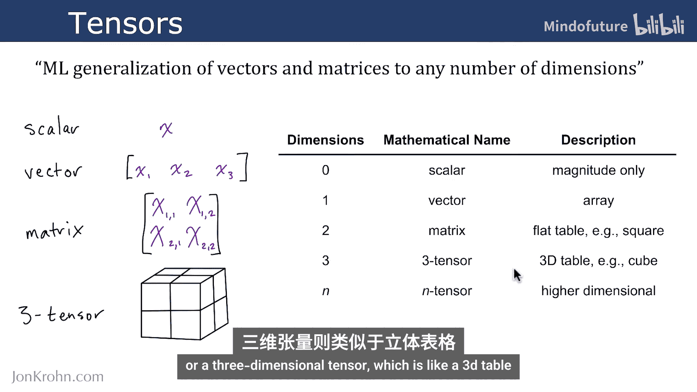

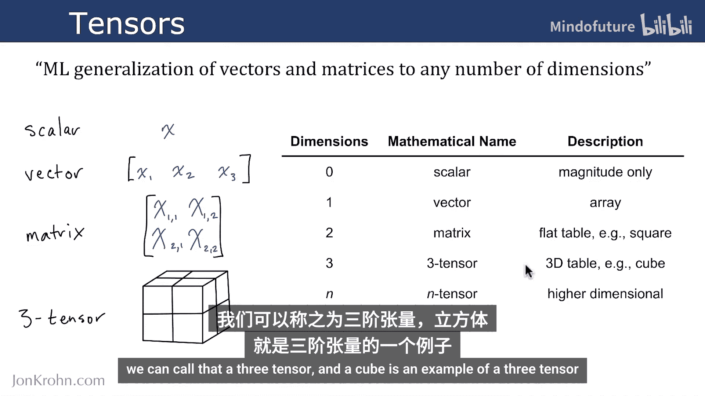

Up next， we'll cover。Exactly what Scalar tensors are。

 and we will start programming some in a number of highly relevant programming libraries。

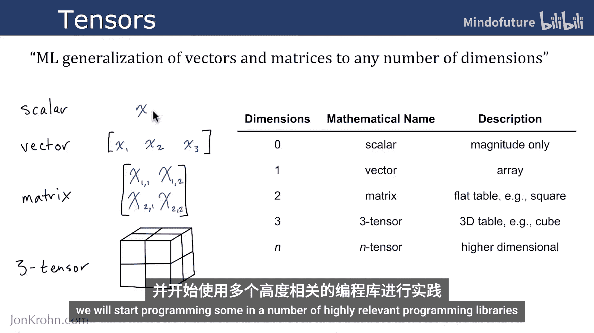