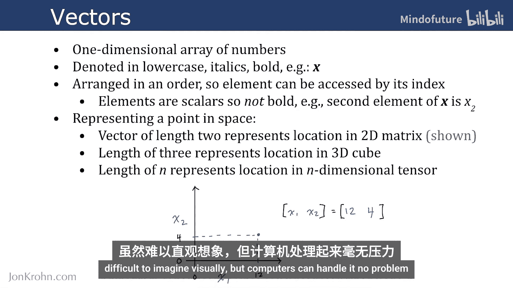
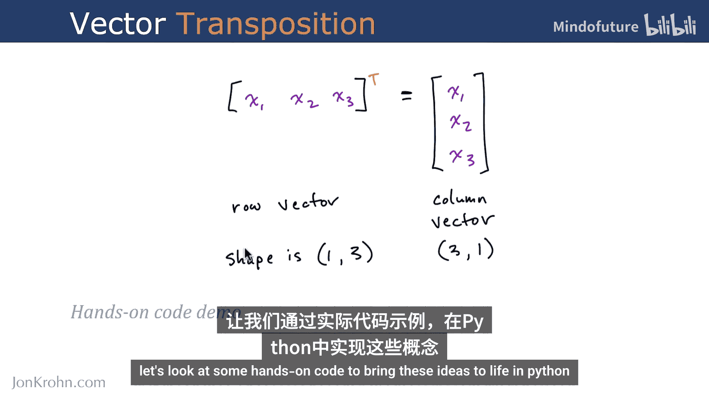
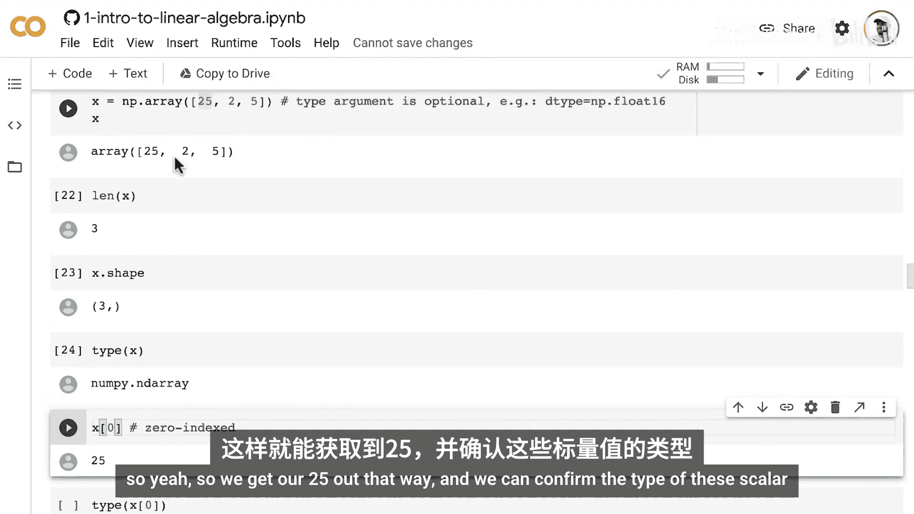
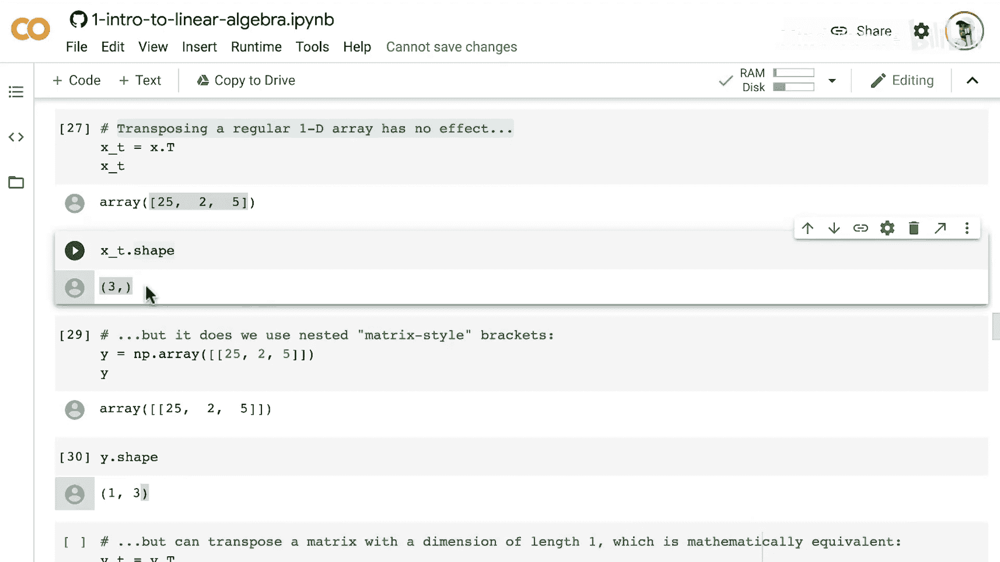
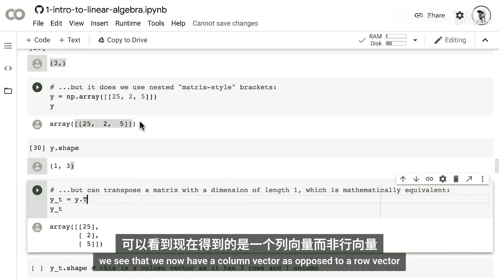
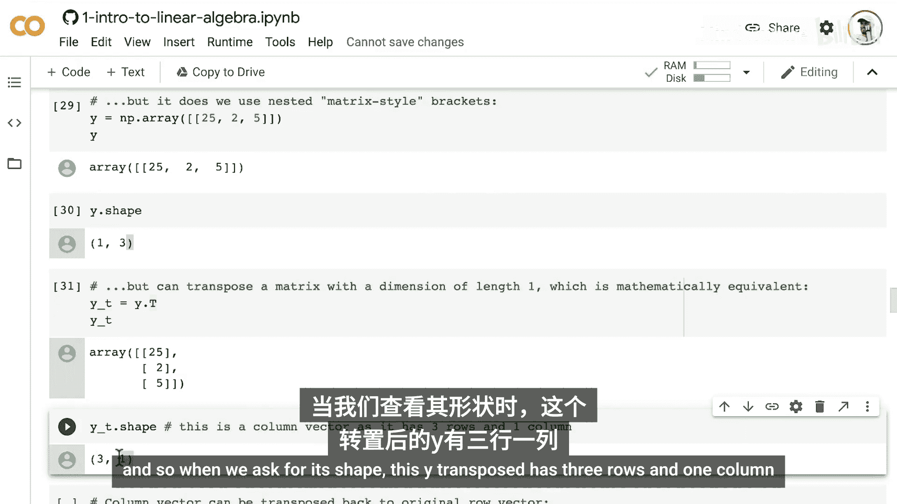
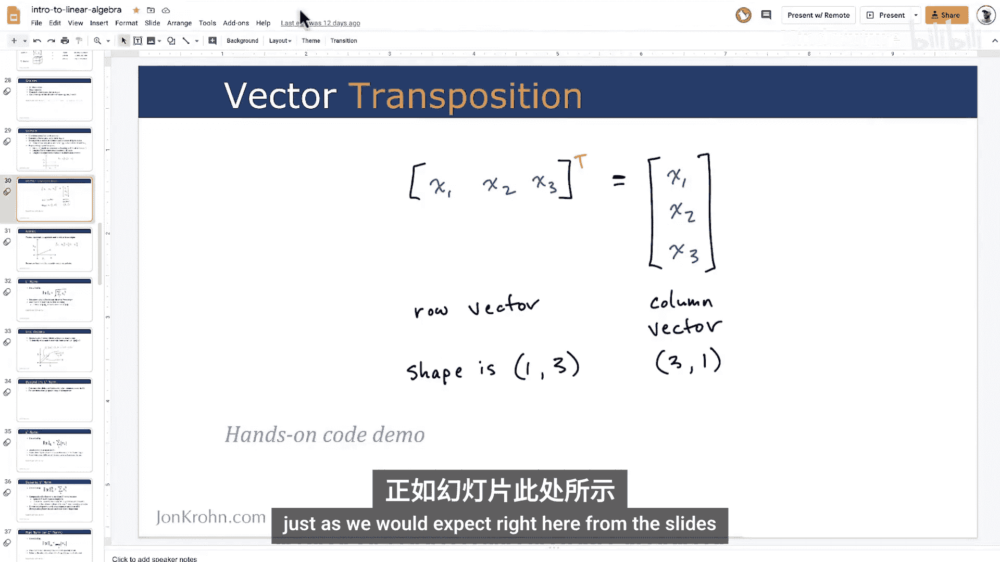
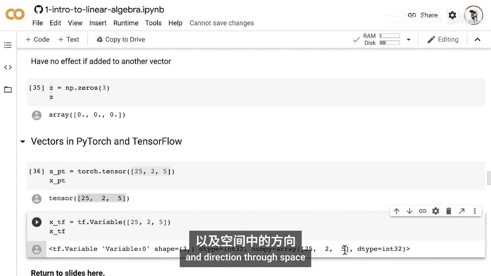

# 机器学习的线性代数及Python实现 ｜ Linear Algebra For Machine Learning p07 P07_向量和向量转置 — 主题5 -BV1L8nLz6E8C_p7-

In the preceding videos， I introduced what tensors are in general， and then we dug into scs。

 which are tensors that have zero dimensions。In this video。

 we'll expand our discussion to one dimensional tensors， more commonly known as vectors。

 I'll also demonstrate how to create and transpose vectors in Ny TensorFlow and Pytororch。

 the most prominent Python libraries for manipulating tensors。

Vectctorors are one dimensional arrays of numbers。So these are typically denoted in lowercase。

 italics and bold。So this contrasts with scs， which are in italics and lowercase， but not bold。

 So we're going to look at an example of that in a second。Vectctorors are arranged in an order。

 so all the elements in the vector are in a specific order。

 and then we can access each one of the elements in that vector by its index。

So here's that example of the distinction between。Vectctorors and scrs in terms of not， so。

Each of the elements in a vector are scrs。 So individual numbers。 And so those aren't bold。

 So if we want to denote the second element。Of some vector， x， which is bolded。

 Then we denote that with x subscript 2。And this is not bolted。

 So if we were referring to this vector here， which has a length of two。

Then the second element x2 is this number four here。

We can think of vectors as representing a particular point in space。

A vector of length 2 represents a location in a 2 D matrix or in a two dimensional space。

 So this vector here of length2。It has。Two scrs in it， x1 and x2， which contain the values 12 and 4。

And so。We can represent that in a matrix where the point。

Is identified by being 12 units along the x1 axis and four units along the x2 axis right here。

If we had a vector of length 3， then that vector would represent a location in a 3D cube。

 so if we had one more dimension here， then you could imagine a third dimension in this grid depth so that would be going away from your computer screen or coming out of your computer screen towards you and so a three dimensionsal vector represents a point in that kind of three dimensional space。

It should follow pretty straightforwardly then， that if a vector of length 2 represents a location in 2D space。

A vector of flag 3 represents a location in a 3D cube。Then a vector of any length。

 n represents a location in some n dimensional tensor， in some n dimensional space。

Difficult to imagine visually， but computers can handle it no problem。

All right， so。Having introduced what vectors are， let's talk about the most simple operation which we perform very often on vectors and this is vector transposition。

So we denote transposition with a capital letter T as a superscript on a vector。

And transposition transforms a vector from a row vector to a column vector or vice versa from a column vector to a row vector。

So all of the elements in a vector remain intact when we transpose it。

 and they remain in order simply。The vector transforms from being a row to being a column。

 and so if the row vector has a length of three， then it shape in matrix notation。

 which we'll talk about more later but to summarize quickly it always has rows before columns。

 So this row vector has one row and three columns。Then when we transpose it。

The elements stay in order。 but the shape of vector is now three rows and one column。

Let's look at some hands on code。To bring these ideas to life in Python。

All right， so we're continuing along in our intro to linear algebra notebook。

We've already talked about scrs in here， which are tensors of rank0 or zero dimensional tensors。

 and we used base Python， Tensorflow and Pytorrch to create scalers Now here we're going to use the nuP library。

 which I'll import。Here in this cell， as well as later on。

 we'll get into using Tensorflowent pitorrch to create vectors as well。

We use the Numpy array method to create tensors of any kind of dimensionality。

 including one dimensional tensors， rank one tensors， like vectors。Within the array call。

 we specify a list。Of the scalar values that will be in our vector or whatever shape of tensor we have。

You can optionally specify an additional argument data type， so here。

 because all of these values in our vector are integers， we will default to having integer values。

For all of the elements in the vector， however， if you were to optionally add in this argument here。

Where we're specifying that we want this to be a 16 bit float。

Then all of the elements would be 16 bit floats so we could have integer values sorry we could have decimal values as opposed to just integer values。

So we can see here when we output our vector x， it has the three elements that we specified pretty straightforward。

 We can see what the length of our vector is with L x。Or X dot shape。And we can see what type it is。

 okay， it's a nuy array。And then we can access elements of this vector， individual elements。

 for example， if we wanted to access the first element in the array， the number 25。

That is specified by x0。Because Python is zero indexed。 So the first element we denote with index 0。

So yeah， so we get our 25 out that way， and we can confirm。

The type of these scalar values are 64 bit integers if we had optionally created 16 bit floats or some other kind of data type。

Then when we looked at the type of the individual element。

It would show up as whatever type we'd specified。All right， so that's creating a vector in Numpy。

 Now let's look at transposing a vector in Numpy。 So there's it's such a common operation that Ny provides this dot T。

That we can add onto the end of any given vector， and it will transpose it for us。However。

 let's have a look at this。 So if I execute this。Um codeode cell。When I transpose it。

 it appears to have no effect whatsoever。When we look at the shape of this new Xt。

 this supposedly transformed vector and has the same shape。As X did。

And the reason for this is because a regular one dimensional array。

 where we specify it just with one set of square brackets and nuy is a one dimensional array。

 And so when we transpose it， there's no dimension， second dimension for it to be。Transposed into。

However。If we create our vector with nested matrix style brackets like this。

 so two sets of square brackets， we're going to see a lot more of this when we start making matrices later on。

Then。This vector has two dimensions to work with。 So when we look at its shape。

 we see that it has one row and three columns， unlike previously when we looked at a shape here。

Where this vector just had a length， effectively of  three。

So。Once we've specified the nested square brackets， we're working with a two dimensional space。

 and so now when we transpose with the dot T operator。

We see that we now have a column vector as opposed to a row vector。

And so when we ask for its shape， this y transposed。Has three rows and one column。

 just as we would expect right here。

From the slides。

And as I mentioned earlier on in this section， we can transpose right back to the original row vector。

 So if we take our Yt， our transposed column vector。When we transpose that。

 it goes right back to the row vector that we started with。

And you can confirm that it has the same shape as our starting vector 2。

A quick note here on zero vectors， we are going to talk about these time and again。

These are vectors that consist entirely of zeros。And you can create them with， say。

 the Ny zeros method。You can specify the dimensions of the tensor that you'd like。

 if you specify just one dimension， then it assumes you want a tensor of a particular length。

 and so here we are with our vector tensor consisting entirely of zeros。

 you're going to see zero vectors crop up here and there。

 and I just wanted to make sure that we were on the same page about what they are。All right。

 and the final little bit here that I want to cover in this video is talking about how to create vectors in Pytorrch and TensorFlow。

Once you know how to create any kind of tensor in Pytorrch and Tensorflow like the scalrs that we created in the preceding video。

 it's really easy so we use the same methods， the torch tensor method to create a vector in Pytorrch we specify the elements that we'd like to have in our vector in the same way that we would have done it in Ny and。

Yeah， we just call our tensor method。 and there you go。 We have a p torch tensor that is a vector。

And then same thing in Tensorflow， we use the variable method here。

 passing the same kind of notation as we do in Pytorch N Nmpy into that variable method。

 and it outputs for us。A vector of length 3 specifies that it's a 32 bit integer here。

And it shows us in a kind of numppy formatted format， exactly what the vector contains。All right。

 so now that we've seen vectors and vector transposition。Up next。

 I'll explain how vectors can represent not only a point in space。

 but also a particular magnitude and direction through space。

