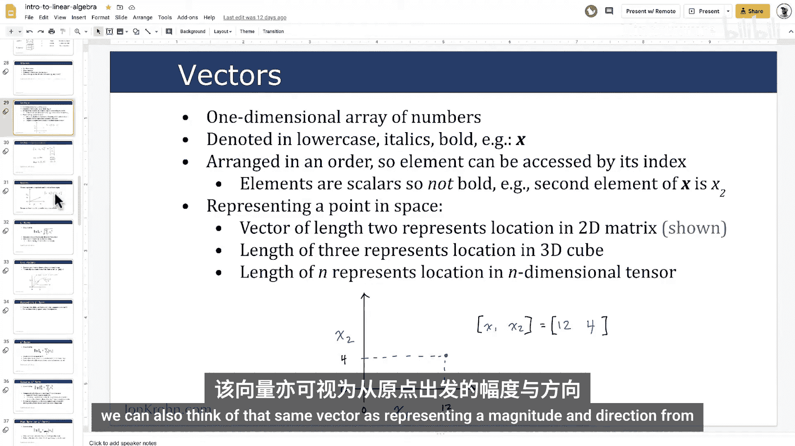
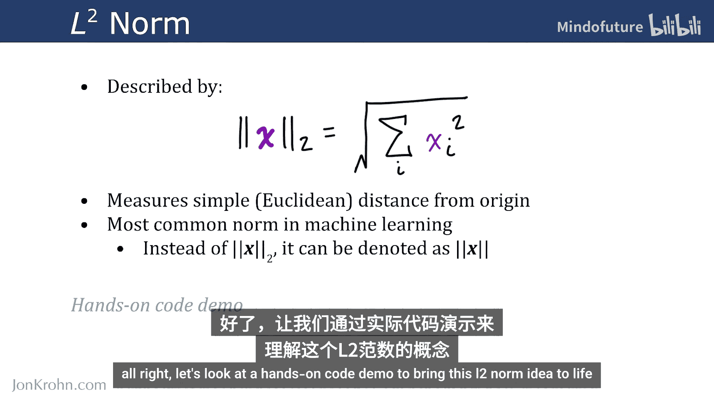
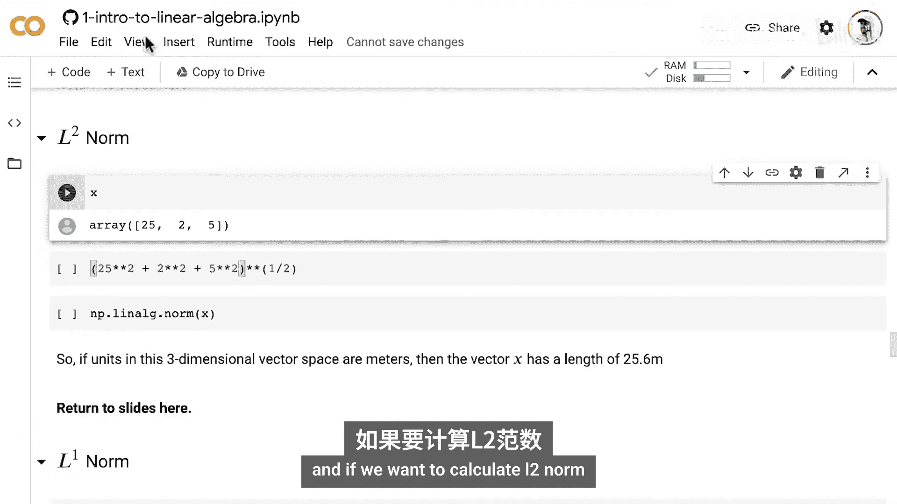
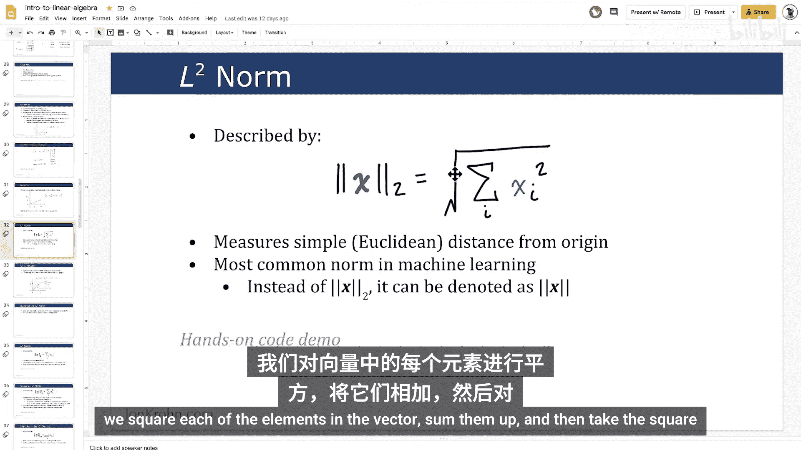
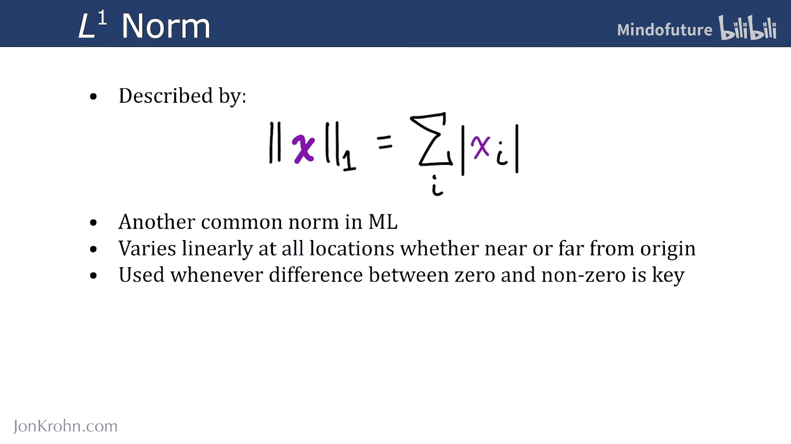
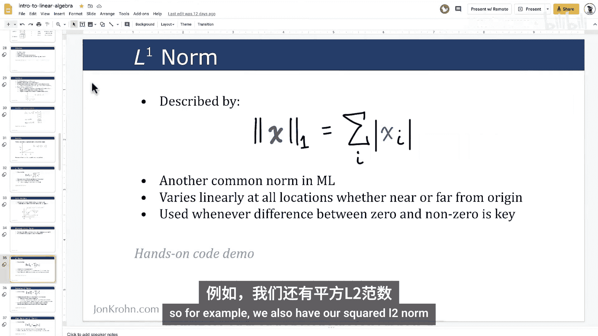
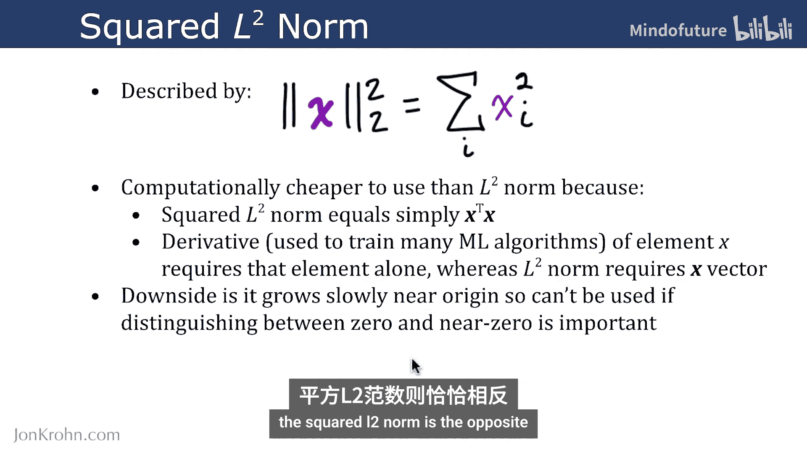
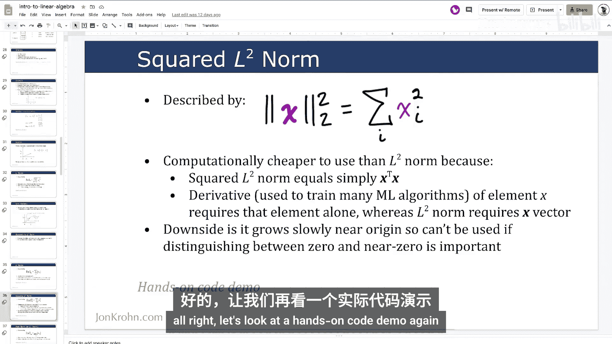
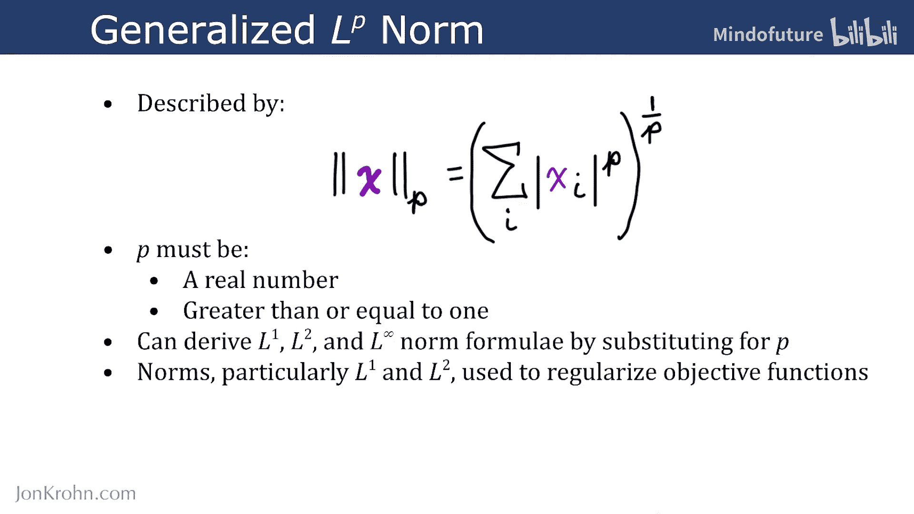

# 机器学习的线性代数及Python实现 ｜ Linear Algebra For Machine Learning p08 P08_范数和单位向量 — 主题6 -BV1L8nLz6E8C_p8-

In the preceding video， I introduced what vectors are。

 and I describe vectors as representing a point in space in this video I'll describe how we can also consider a given vector to represent a particular magnitude and direction through space。

Once we come to grips with that idea， I'll introduce norms。

 which are functions that quantify vector magnitude。

Re'recalling from the last video that a vector can represent a point in space。

 So with a vector of length 2。We can represent a particular point in two dimensional space。

 So this one here， this vector with x1 equal to 12。

And x2 equal to 4 represents this particular point in space at x1 equals 12 and x2 equals 4。

We can also think of that same vector。

Is representing a magnitude and direction from origin。So in this case。

The vector traces in space from that 00 origin to that 124 coordinate。Norms。Are a class of functions。

That allow us to quantify the magnitude， the length。Of a given vector。Of all of the norm functions。

 the most common and most important is L2 norm， which is described by this function here。

 So what we do is we square。Each of the elements in our vector。

And then we sum up those elements and we take the square root after having summed do of them。

We denote L2 norm with this notation here， so these kind of two straight lines can look like absolute values。

 but two sets of them on either side of the vector and then the number two as a subscript you'll notice here that I'm making use of even in my notation here that we have a bold X representing a vector and a unboled italicized x representing each of the scalar elements of that same vector x。

So this L2 norm function， it measures the simple distance from origin for this vector。

 origin being this00， however many dimensions our vector is in。

 the origin is always just a zero vector insisting entirely of zeros。

So L2 norm measures simple distance from origin and when I say simple distance。

 this is also known as Euclidean distance named after the mathematician Euclid。

 and this is the kind of distance that you and I experience most frequently。

 in fact it's the kind of distance that we just use in the real world when we say okay。

 your two meters away from me and we measure that distance with a ruler or measuring tape or what have you。

 that is Euclliidean distance。So this L2 norm， this measure of Euclidean distance is the most common norm in machine learning。

 it's so common in fact that instead of this notation with the subscript2。

 you can denote it without the subscript 2 and it will be assumed that you're talking about L2 norms so we will see other norms momentarily where you would leave the subscript in and yeah if it's not there。

 you just assume it's the L2 norm。All right， let's look at a hands on code demo to bring this L2 norm idea to life。

All right， so here we have our vector X。Which we created in the previous video。

And if we want to calculate L2 norm。

We used this equation here。 So I already went over it。 We square each of the elements in the vector。

 sum them up， and then take the square root of that result of that sum。

 So here we are doing it in Python code here， so。😊。

We square each of the individual elements in our array。And then。We sum them all up。

And we take the square root of that sum。So that gives us an L2 norm。

 a Euclidean distance from origin 000 in this case to 2525 coordinates。

 that is a Euclidean distance of 25。57 and you don't need to of course。

 rate a lengthy Python code like this whenever you want to calculate the L2 norm and lots of other libraries come with a built- in norm method in Numpey's case in the linear algebra module。

So we get the exact same result by running that nuy method。

And this means that if the units in our three dimensional space here were meters。 So this vector。

X is describing a direction and magnitude away from origin away from some location 000 towards this location。

 2525 in 3 dimensional space， and assuming that these are all meters， 25 meters， 2 meters， 5 meters。

 that means that our vector x has a length of about 25。6 meters。Having learned about L2 norms。

We can now talk about something called unit vectors。

So this is a special case of vector where the vector's length， its L2 norm， is equal to  one。

So let's take a look at this diagram here to kind of bring this idea to life。

 so we have some vector X here represented by the purple arrow running from the origin on this graph to the point that that vector denotes。

And when we calculate the L2 norm， this orange distance from origin to that point。

We see that that L2 norm is equal to1， and because of that property。

 we can say that this vector x is a unit vector。All right。

 there are other kinds of norms beyond the unit vector。Over the next few slides。

 I will skim over these common norms for our immediate purposes， really only the L2 is important。

All right， so here's a brief overview of L1 norm， which is described by this function here。

So with L1 norm。What we do is we take the absolute value of every element in the vector X。

And we simply sum those absolute values up。So this is another common norm in machine learning。And。

One of the interesting properties of the El norm is that it varies linearly at all locations。

 whether we're near or far from origin。We use Elenor in situations where differences between zero and non zero are key。

So let's look at a hands on demo of what this L1 norm is like。So again， we've got our vector X here。

Same as before when we were looking at L2 norm， and so to calculate the L1 norm。

 we can take the absolute value of each of the elements。As I do here and then sum them up。

Because these are all positive， the absolute values are the same as the integers themselves。 so yes。

 or L1 norm for our vector x is 32。 so you can see the same vector depending on what norm we use to measure it。

 it has a different。Length， the L2 norm describes。The traditional Euclidean simple length。

 kind of the easiest way for you and me to think about length， but if we do it with L1 norm。

 we get this different result and so you're going to see some more norms here。Momentarily so。

For example， we also have our squared L2 norm。Which is。Kind of like the L2 norm。

 except it's missing a final step， so。With the L2 norm， we did this same operation first。

 we squared each of the elements in the vector and then summed them together with L2 norm we also then took the square root after。

 but with squared L2 norm， we just don't do that square root。

And so we denote squared L2 norm with a subscript 2 and a superscript 2。

To distinguish it from regular L norm。This squared L2 norm is computationally cheaper to use than the more common L2 norm because squared L2 norm equals simply。

The transpose of x times x。So very simple， cheap operation to calculate squared delta norm。And。

The derivative of the squared del to norm and derivatives are used to train many machine learning algorithms。

 as we'll see later in the machine Learning Foundation series， so the derivative of an element X。

Within our vector x， so the derivative of a single element requires that element alone。

Whereas to calculate L2 norm， that requires us to have information about the entire vector。

 about all the elements in the vector。The downside of squared L2 norm is that it grows slowly near the origin。

 so it can't be used if you're distinguishing between0 and near  zero if that's really important to you。

 so whereas the L1 norm excs at distinguishing between0 and nonzero。

 the squared L2 norm is the opposite。

All right， let's look at a hands on code demo again。

All right， so let's calculate squared L2 norm。Again， we'll use our vector X。

 also here we swear each of the elements in the vector。And we sum them all up pretty simple。

 especially since we've already done a regular L2 norm， which just involves an extra step。

 and so you can see our squared L2 norm， we end up with a very large value relative to L2 and L1 norms in this particular case。

And we'll cover tensor multiplication more soon， so don't worry too much about this particular method that I'm using here。

 this dot method， we'll talk about that more later on。For the time being。

 what I want to show you is that when we perform this operation of x transpose times x。

That is what we're doing here， you can just trust me on that for now。

 and as you can see that operation results in L2 norm。

 so that's kind of a simple way to calculate it。The final norm that we're going to cover that we're going to just skim over here is something called max norm。

 which we can denote with an infinity sign。And this norm。Is。

Defined by taking the absolute value of each of the elements and then simply returning the maximum value of each of those。

This is the final norm we'll discuss it also occurs reasonably frequently in ML。

 but probably less so than any of the other ones we've covered。

It simply returns the absolute value of the largest magnitude element。

Let's look at a hands on code demo to make this idea clear。

So if we have some vector x or same vectors as we've continue to look at。

Here we take the absolute value of each of the elements and again because these are all positive。

 the absolute value is the same as the inputs in all three cases。

And then we simply just take the maximum value from across those， which of course is going to be 25。

 it's the largest value。So it's a relatively simplistic one。

 but it does come in handy every once in a while。All right finally。

 we can generalize our idea of norms。To this LP notation， so all of the norms that we've covered。

 L2 norm， L1 norms， squared L2 norm， and L max norm。

They are all actually specific cases of this generalized LP norm。So here's the formula。

 I can leave it to you to kind of go through it and prove to yourself that each of the norms we've covered fit this formula so you just substitute in。

 if you want to calculate L2 norm， you substitute a2 in for the P。

 and you'll find L2 norm or if you want L1 norm， you substitute a1 in。

Some constraints for norms are that P must be a real number and it must be greater than or equal to one and yeah as I just said。

 you can derive for yourself these formulae in your own time if that interests you。Norms。

 particularly L1 and L2 norm， are used to regularize objective functions。

 so this is a very specific but very common use case of norms that I want to mention here。

 and this is something that you'll see frequently in machine learning so if you are already familiar with machine learning that you might know about L1 or L2 penalties of regression and that is talking about these norms。

 L1 and L2 that we covered here。So there you go that's how norms are used。

 so that wraps up our coverage of the most important vector norms in machine learning。

 and in particular we focused on L2 norm and its relationship to a special class of vectors called unit vectors。

In the next video， I'll introduce a handful of other special vectors to be sure not to miss the next tutorial in this series。

 subscribe to my channel。

Thanks for taking part in this tutorial。 I hope you enjoyed it。 If you did， please like and comment。

To be sure not to miss any of my content。Head to Johnchrome。com and sign up for my email newsletter。

You're also welcome to add me on LinkedIn， simply mention that you're a viewer of the Maine Learning Foundation series。

 and finally you can follow me on Twitter too if that's your social medium of Joice。

See you next time。