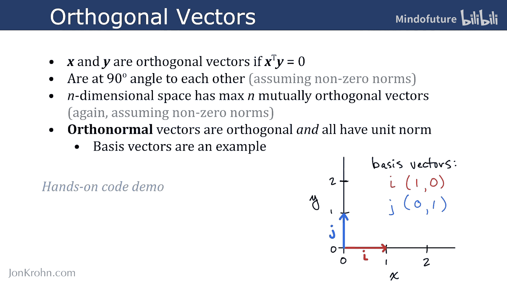
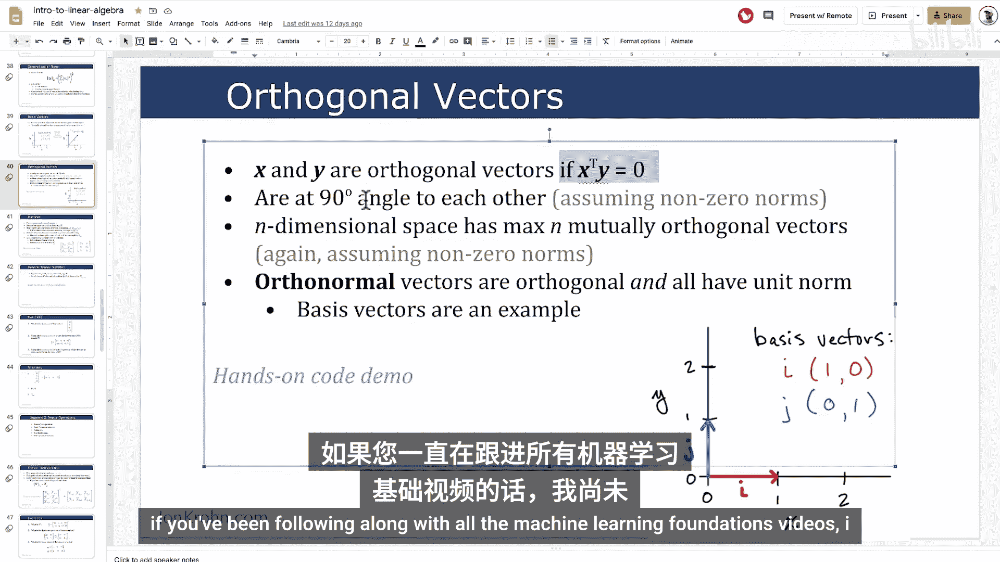
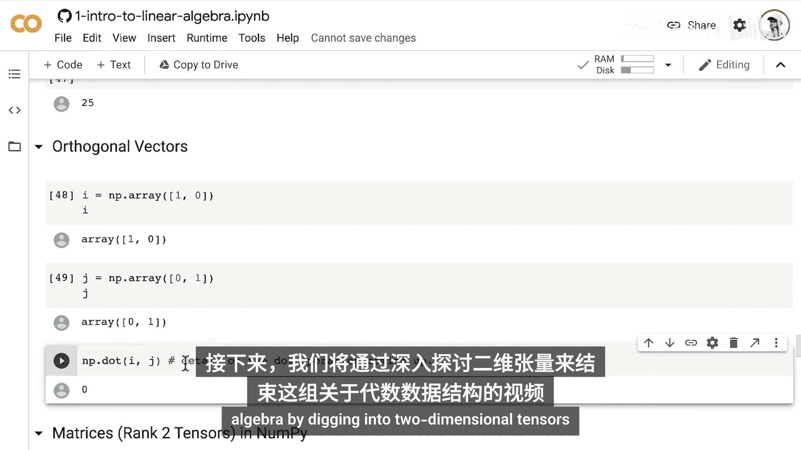

# 机器学习的线性代数及Python实现 ｜ Linear Algebra For Machine Learning p09 P09_基、正交和标准正交向量 — 主题7 -BV1L8nLz6E8C_p9-

Previously I introduced vectors， norms， which allow us to quantify vector magnitude and unit vectors。

 a special vector case that has an L2 norm equal to1 In this video I'll introduce other special vectors that build upon these concepts。

 specifically I'll cover basis vectors， orthogonal vectors and orthoormal vectors。

Bas vectors are a set of vectors that can be scaled to represent any vector in a given vector space。

So we typically use unit vectors along the axes of a vector space for basis vectors。

 let me explain what this means so if we have a two dimensional vector space。

We can represent it with two axes， x and Y。And the typical basis vectors would be unit vectors。

Like these I and J。 So we have one unit vector I stretching from the origin 00 to this coordinate 10 x is equal to 1 y is equal to 0。

 and then a second vector J which stretches from the origin to 01 where x is equal to 0 and y is equal to 1。

 So these two vectors together these basis vectors I and J can be scaled to any vector in the two dimensional space。

 So for example， this vector v。Which runs from the origin to this point here of x equals 1。5 and。

Y equals 2。That vector V can be described by scaling I and J and adding them together， so 1。

5 times I plus 2 J。Is equal to that vector v。Orthgonal vectors are sets of vectors where， say。

 if we have a two dimensional space， we can have two vectors X and Y。 and when we。

Take something called the dot product of those two vectors， X and Y。 It comes up to 0。

 So I'll explain more about the dot dot product momentarily and we'll look at a quick handson co demo to bring this concept to life。

But what this in effect means。Is that assuming。Both of the vectors X and Y have some length that is they have non zero norms。

 their length is something other than0。Then what this means is that the vectors are at a 90 degree angle to each other。

 they are orthogonal。Something to note here is that in an n dimensional space， there are at most。

 there's a maximum of n mutually orthogonal vectors。

 so this means that if we're in a two dimensional space。

 there are at most two mutually orthogonal vectors or in a three dimensional space there's at most three of them again。

 I'm assuming here that all of the vectors have length， Of course。

 if they have no length then they can easily be orthogonal， but they're not very interesting。

So orthoormal vectors。Are a special case of orthogonal vectors。

 so they are both orthogonal and they all have unit norm。

 And we've actually already seen examples of this。 Bas vectors are an example of orthonormal vectors。

So basis vectors like we saw in the preceding slide。They are orthogonal。

 They're at a 90 degree angle to each other。And。These base vectors are orthoormal because they have unit norm。

 they have a Euclidean distance length of1。All right。

 let's look at a quick hands on code demo to bring this idea to life。

So here are two vectors。I and J。That are exactly the vectors INj from the slides。

And when we take the dot product of them。The result comes out to zero。

 so that just kind of proves this point that I made here， although I haven't yet。

 if you've been following along with all the machine learning foundations videos。

 I haven't yet explained in detail what the dot product is。

 I will get into that in more detail shortly。

Nice， we've now covered zero dimensional tensors， more commonly known as scalrs。

 and one dimensional tensors， which we typically call vectors。

 up next we'll be approaching the end of this set of videos on data structures for algebra by digging into two dimensional tensors。

 which are generally known as matrices。

