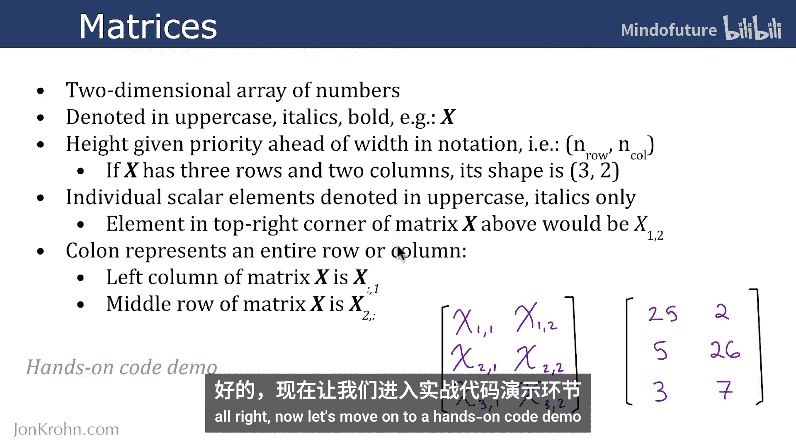
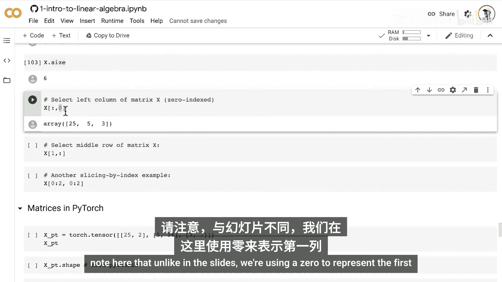
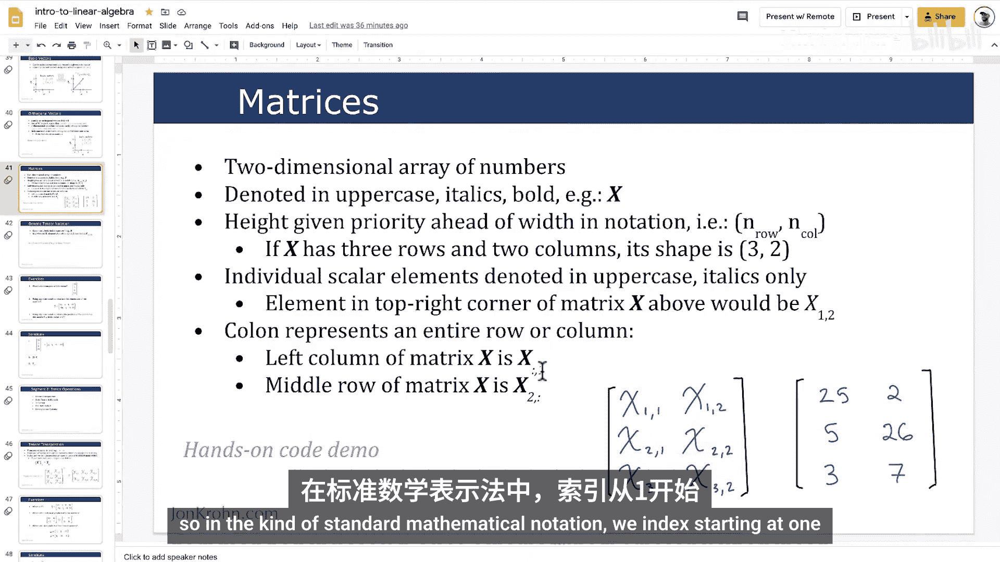
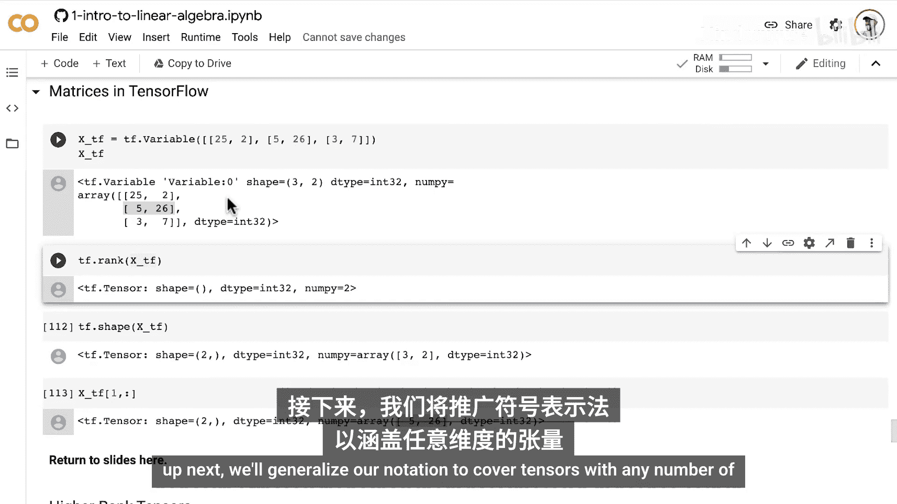

# 机器学习的线性代数及Python实现 ｜ Linear Algebra For Machine Learning p10 P10_矩阵张量 — 主题8 -BV1L8nLz6E8C_p10-

Having now covered scals， which are zero dimensional tensors and vectors。

 one dimensional tensors in this video we'll take it up another dimension and introduce matrices。

 or as some people prefer to call them mates， which are two dimensional tensors。

We'll cover the specifics of matrix notation， and then we'll dive into a hands on code demo to create matrices in the key Python libraries for handling tensors。

 namely numpy， TensorF and Pytorrch。A matrix is a two dimensional array of numbers。In fact。

 I've taken the liberty of having a matrix on the screen here so that it's very easy to understand。

 this should be pretty straightforward， given how we've already covered zero dimensional scrs and one dimensional vectors。

 So matrices are just another kind of tensor where we have numbers in two dimensions Let's talk about that in more detail。

 So we denote matrices in uppercase， italics and bold， for example， X like this。

 So this is in contrast to vectors which were also in italics and bold， but in lowercase。

When we denote the dimensions of the matrix， height is given priority ahead of width in notations。

 so as an example， if the matrix x like our matrix x here has three rows and two columns， three rows。

 two columns， its shape is three， two， and we use round brackets around those two dimensions。

The individual scalar elements of the matrix are denoted in uppercase italics only。

 as you can see here， so for example， the element in the top right corner of this matrix X would be x notice it's unboled。

Underscore1， comma 2。 again， we have that row column priority happening。 So first row， second column。

We can use colons to represent an entire row or column， so for example。

 the left column of this matrix x is represented by colon comma 1。

Or the middle row of this matrix X is represented by two comma colon again。

 using this row column notation to denote which rower column we're representing。 All right。

 Now let's move on to a hands on code demo。

Okay， let's create the exact same matrix X as we had in the slides。So to create a nuumpy array。

We can call a matrix also a rank 2 tensor where rank 0 is scalar rank 1 is vector。

And so to create a matrix in Ny， we use the array method， and then we use。Nested brackets。

So the outer set indicates where we break rows and the inneret indicates the elements within each of those rows should be pretty straightforward what's happening here。

 by crossreencing the code that you type in and the output of matrix X here。

 notice I'm using a capital X to represent this matrix whereas earlier in the notebook when I was representing scalrs and vectors I was using lower K X following the conventions I already described in the slides。

We can find out with the shape。Of this matrix is okay， three rows two columns。

 exactly as we talked about in the slides。And you can also ask for its size。

 which is the total number of elements in the array。

 so effectively the number of rows times the number of columns in the case of a matrix。

If we want to select a particular column， then we can use a colon just like I showed you in the slides for the kind of standard notation。

Note here that unlike in the slides。We're using a0 to represent the the first column or the first row。

 depending on the case。 So in the kind of standard。

Mathematical notation。

We index starting at one。But with。Python， as is common in computer science， we are zero indexed。

 so starting in zero， so we had to make that little translation。

 so to select the left column of our matrix X。InThis column here。

 we can specify I want all of the rows and then whichever column you'd like， in this case。

 the first one。 and okay， it provides us with a vector tensor。

That includes all of the elements of that column。 If we want to select the middle row of the matrix。

 then we can say， okay， I want all of the columns。And then specify a particular row。In this case。

 the second row， which has these elements 5 and 26。And。If you want to slice by index in more detail。

 you can say， okay， I want to select from this starting point of this ending point with the column。

 So， for example， by using0 to 2 and 0 to 2， we're selecting the。

First through the second row and the first through the second column。

Giving us this portion of the matrix。So you can play around with changing these values to make sure that you have a great sense of exactly how you slice elements of a matrix up。

 and you can also play around with adding rows or adding columns by playing around with where we create this matrix here。

Going beyond nuumpy to Ptorrch。It is。Essentially the same kind of way that we created the nuumpy array to represent a matrix。

 we're simply using the torch Tensor method just as we did for scalarrs and vectors earlier in this notebook。

 so all of the notation here should be pretty straightforward and in even outputs in pretty much the same way as with Numpy。

you can ask for things like the shape。And get that back。

 It's very easy and pythonic to perform any of these operations in Pytorrch。 Again。

 you can think of Pytorrch as。Very similar to the operations that you would apply in Ny。

And of course， then slicing by index happens in the same way as an empire as well。

So here we've selected the second row yet again。And in Tensorflow， it is also very easy here。

 So again， the same kind of。Nested square bracket notation for indicating exactly the shape of our matrix in TensorF we get a lot more outputs。

Then we do with nuy or piey torch， mostly we don't need them。But then you have them here now。

 you can ask things like the rank of this tensor and it will return for you that it is a rank to tensor。

 which is the case for all matrices。Remember rank 0 is scalar rank 1 is vector rank 2 is matrix。

We can ask for the shape。Note that this is not as Pythonic。Or it's not quite like nuy。

 so here for asking for attributes of our tensor， we have to use the tensor flow method formally here instead of just asking for an attribute of our nuy or Pytorch object。

That's fine， that's not too tricky。And slicing up。Our matrix that's exactly the same as it was in nupy or pitorch。

 so here again we're asking for the second row， and so we get a vector that represents that second row。

 the5 and the 26。All right， there you go， those are two dimensional tensors more commonly known as matrices up next we'll generalize our notation to cover tensors with any number of dimensions。

