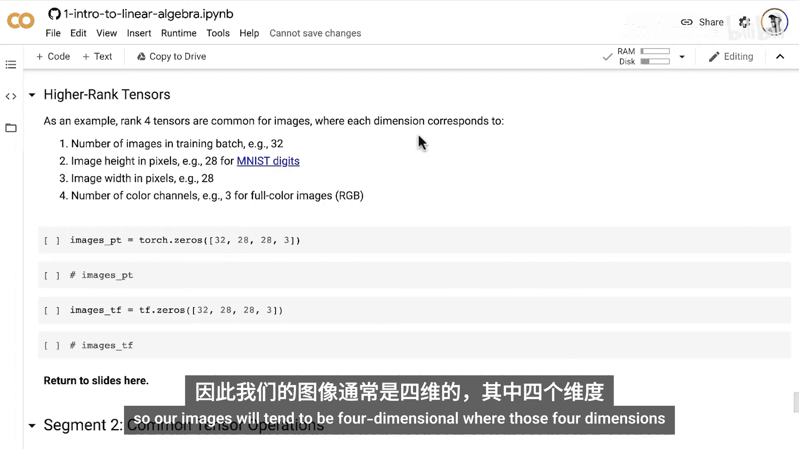
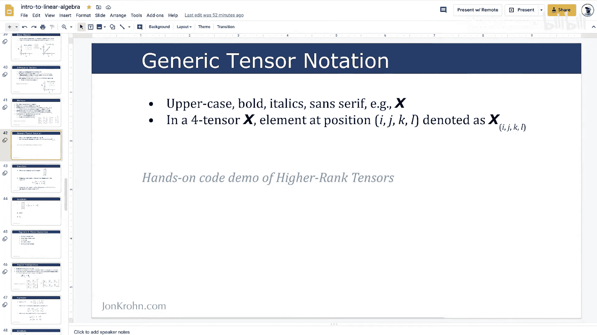
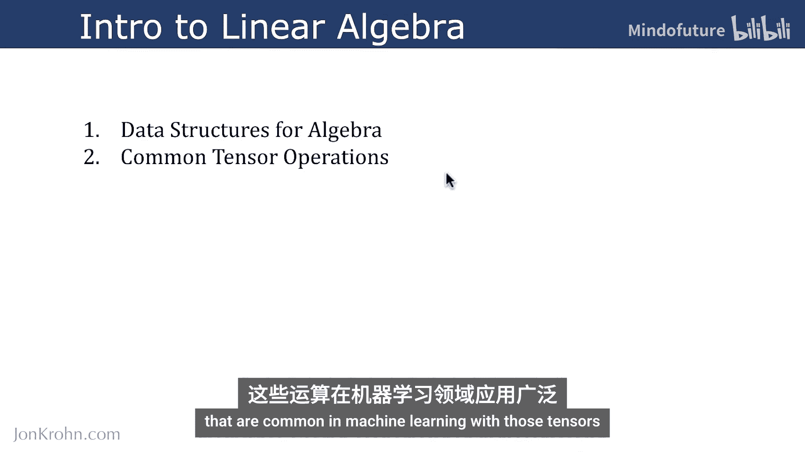
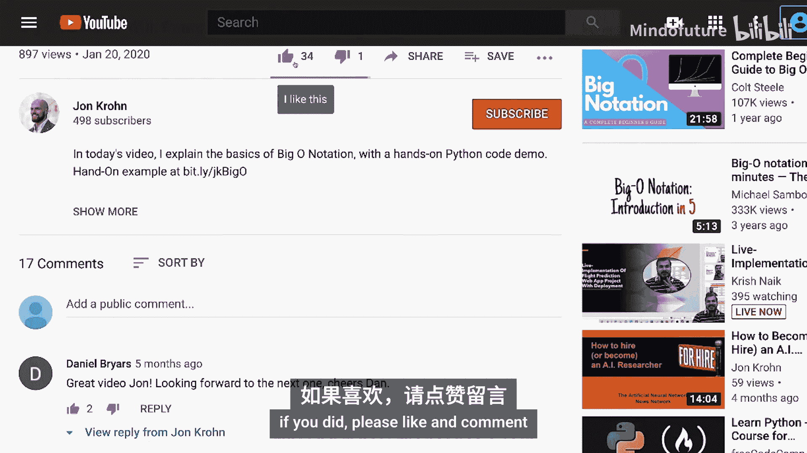

# 机器学习的线性代数及Python实现 ｜ Linear Algebra For Machine Learning p11 P11_通用张量记法 — 主题9 -BV1L8nLz6E8C_p11-

We've now detailed zero dimensional sc of tensors， one dimensional vector tensors and two dimensional matrix tensors in this video we generalize our notation to be able to represent tensors with any number of dimensions。

 including the high dimensional tensors that are common behind the scenes in machine learning models。

As usual， we'll then jump to a hands on codemo to create high dimensional tensors in Python。

To denote tensors more generally than the scalar case， the vector case， the matrix case。

We use uppercase， bold， italics and a sand serif font to represent our tensors。

This is very similar to what we had for matrices。 matrices were uppercase， bold and italics， but。

They were a serif font。 So a serif font has kind of a fancy little extra things in places。

 And so sands， serph means without。Sands just， I think it's the Latin word for without。

And so when it stands here， it means it doesn't have those little fancy bits。

 so it's just plain and simple lettering。For example， if we had a four tensor。

 a four dimensional tensor X。Then an element at I JK L would be denoted as X。

 and then I JK L below it。 So this is easiest to understand by jumping into a hands on code demo。

So here we are our usual Jupyter notebook。As an example of a way that higher rank tensors specifically rank4 tensors are used very often in machine learning。

 particularly in recent years deep learning architectures。

 we very often have input an input tensor into a machine vision model that is four dimensional so are images will tend to be four dimensional where those four dimensions which could be represented by IJK and L。

Are the number of images in our training batch。 And this could be any number。 but let's say we have。

You know， 32 images to train with and a given a round of training for our model。

And then the second dimension can be the height of the image in pixels。

 so is the kind of hello world data set for machine vision， we often use Ynas MNs digits。

 which you can read about more through this link。And those images have a height of 28 pixels。

 as well as a width of 28 pixels。 So we， it would be common to have the second and the third。

Dimenssions in our four tensor be the height and width of those images。

 and then the fourth and final dimension。Would be the number of color channels。

So with the Mnes digits， these are actually monochromatic they're black and white。

 so we only need one color channel， but we often have full color images。

 which would require three color channels， typically red， green and blue RGB。

 We're not going to go through the hassle of loading in data and looking at individual cases here。

 we will dig into lots of handson examples of training machine learning models later on in the machine learning foundations videos。

 but for now let's just create a couple of four tensors。

 one in ptorrch and one in Tensorflow So in this case we're going to use the torch zeros method to create a four tensor with these sizes in each of the four dimensions。

 the same as we add here 32， 28，28 and 3。So we can create that very quickly。😊，In Pytorch。

 And you can have a look at what that。Fortensor looks like by uncommenting this line here。

And there you go。 So it's a similar kind of idea as we had with matrices。

 we just now have another set of square brackets。Around allowing us to have another dimension to look at and it's all zeros here。

 if we actually input images， then there would be real information here for each of the pixels。

All right， so there you have it for pi torch。And then now let's have a look at TensorFlow。

 we can do the exact same thing in TensorFlow with almost the exact same method。

 we're just calling the Tensorflowlow library instead of the Pytorch library。

And then you can look at it。By uncommenting this line and seeing what it looks like。

And yep looks pretty similar to what we saw in Pytorrch just has a little bit of extra information as we're used to seeing with any of our tensorflow tensor outputs。

With that there you have it， folks， that rounds out the content for segment 1。

Of this introduction to linear algebra。So we've come a long way on our journey here。In this segment1。

 we comprehensively introduced what linear algebra is and what the tensor data structure is。

 including scalar， vector， matrix and higher dimensional tensors。

 the cornerstone data structures of linear algebra。

 We had a particular focus on special types of vectors。

And the norms that we use to measure vector length。

As well as how to create tensors in all of the major Python libraries for dealing with them， nuy。

 TensorFlow and Pytororch。I've got a few comprehension questions coming up next。

 and then after that we'll get started on segment  two。

 common Tensor operations in which we'll move from dealing with Tensors statically to performing operations that are common in machine learning with those tensors。

To be sure not to miss the next tutorial in this series， subscribe to my channel。

Thanks for taking part in this tutorial。 I hope you enjoyed it。 If you did， please like and comment。

To be sure not to miss any of my content。Head to JohnChrome。com and sign up for my email newsletter。

You're also welcome to add me on LinkedIn， simply mention that you're a viewer of the Maine Learning Foundation series。

 and finally you can follow me on Twitter too if that's your social medium of Joice。

See you next time。