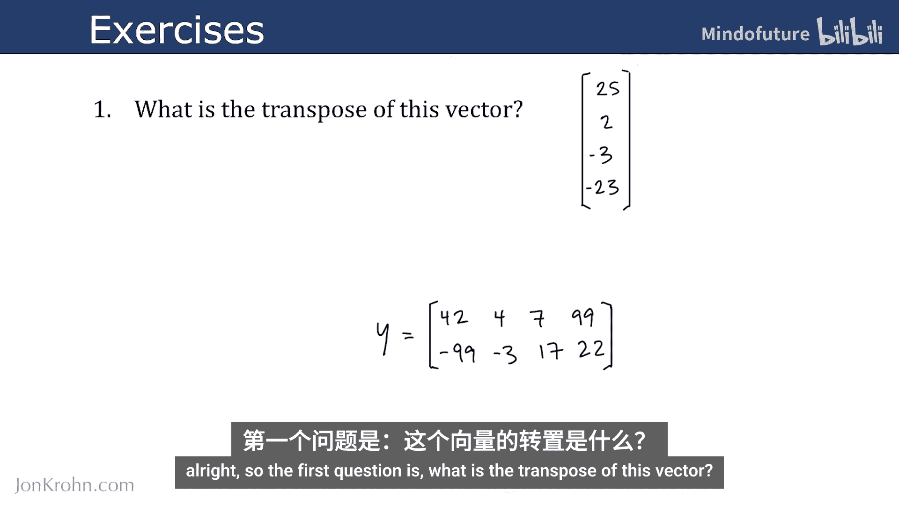
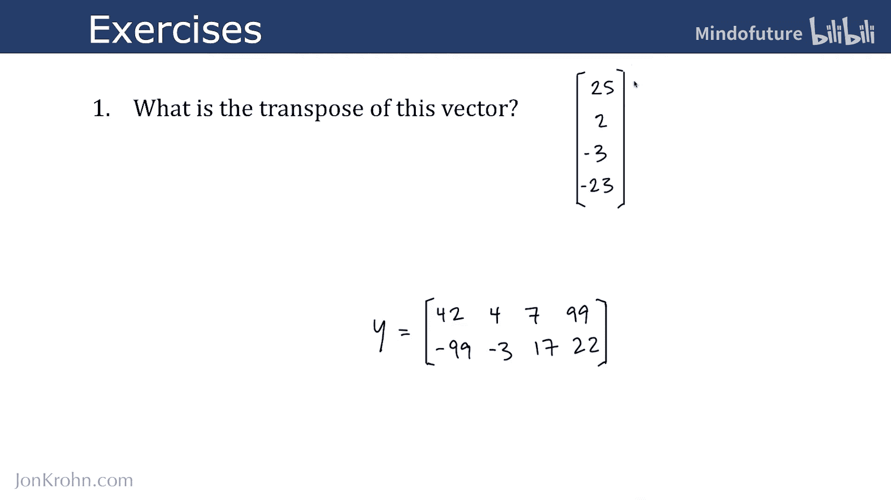
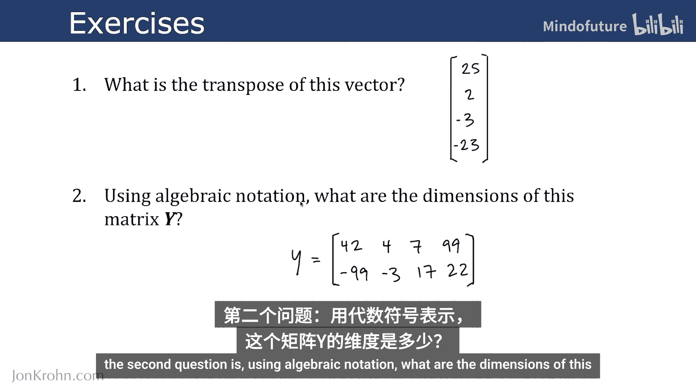
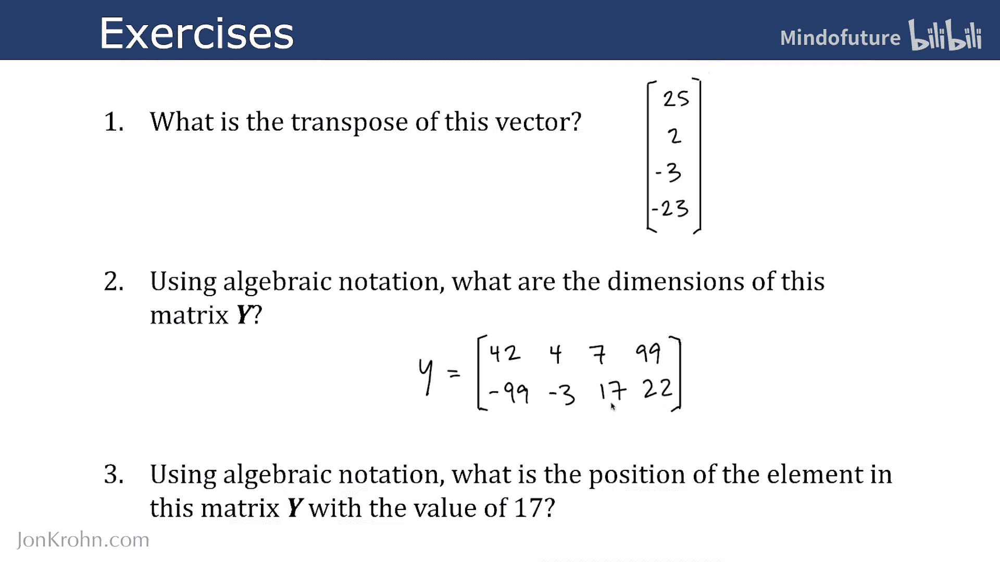
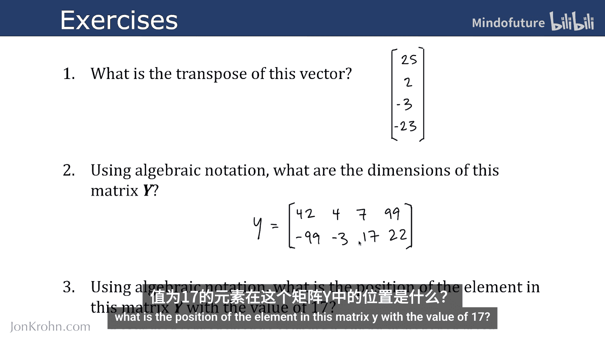

# 机器学习的线性代数及Python实现 ｜ Linear Algebra For Machine Learning p12 P12_代数数据结构练习 — 主题10 -BV1L8nLz6E8C_p12-

Hopefully， you feel like you have a good handle on tensors。

 the linear algebra data structures that underlie all of machine learning to test your comprehension。

 I've got three quick exercises for you。Allright， so the first question is， what is the transpose？

Of this vector。

The second question is， using algebraic notation， what are the dimensions of this matrix y？

And the third and final question is using algebraic notation。

 what is the position of the element in this matrix Y with the value of 17。

