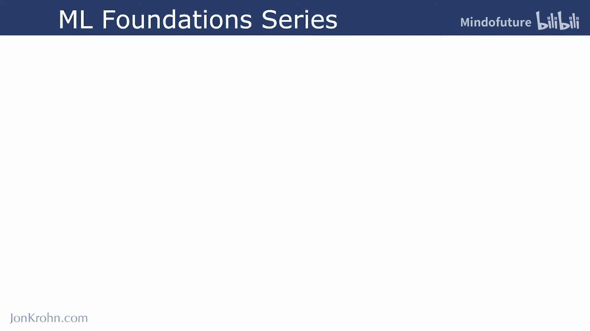
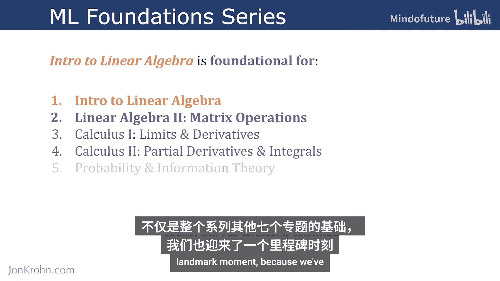
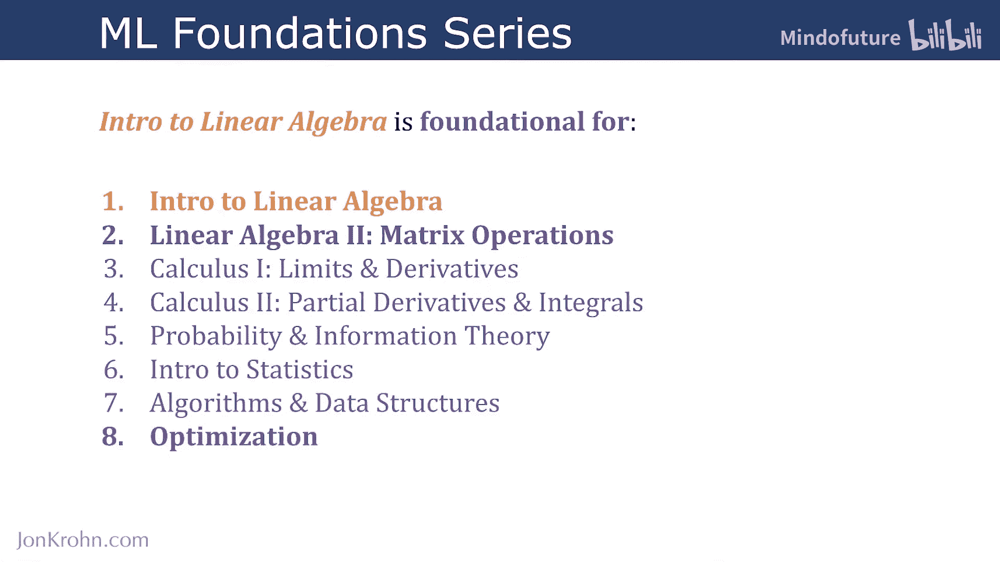
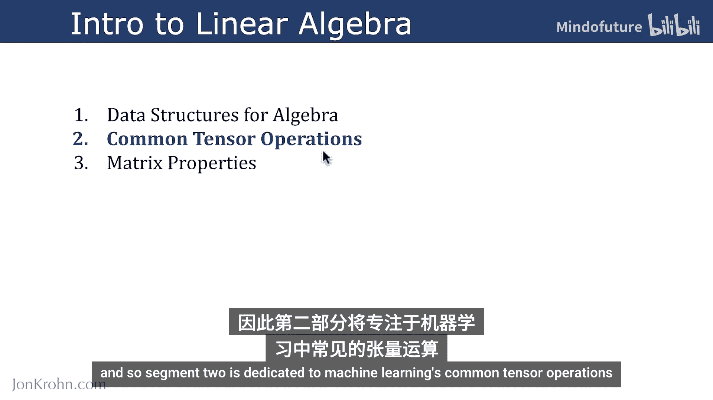
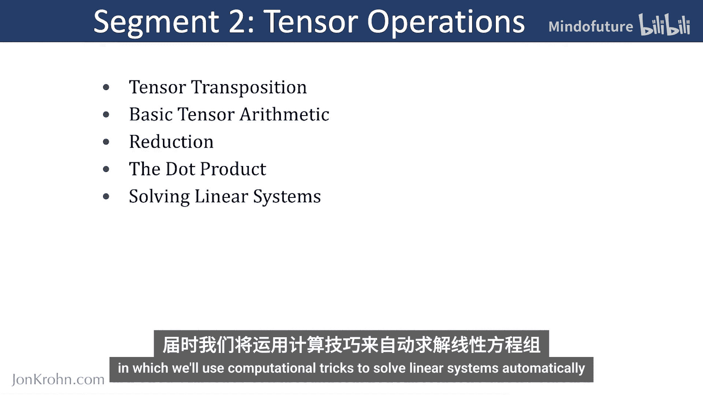

# 机器学习的线性代数及Python实现 ｜ Linear Algebra For Machine Learning p13 P13_张量运算 — 主题1__线性代数导论的第2部分 -BV1L8nLz6E8C_p13-

Recalling that my Ma learning foundation series consists of eight subjects。

 and that first subject we're currently undertaking Intro to linear algebra is itself foundational for the other seven subjects in the series。

We've reached a landmark moment because we've now completed the first segment of this first subject。

The first of three segments of the Intro toline algebra subject was data structures for algebra。

In which we detailed characteristics of the tensors that are ubiquitous in machine learning。

With an appreciation of tensors under our belts， we're now well positioned to perform mathematical operations on them。

 and so segment 2 is dedicated to machine learning's common tensor operations。

More specifically， in segment2 will be transposing tensors。

 performing basic arithmetic operations on them， reducing higher dimensional tensors to scalrs。

 and performing the dot product operation on vector tensors。To wrap the segment up。

 we'll take a break from hands on code demos to work through solving linear systems of equations on paper using algebra。

All of this will set us up perfectly for segment  three in which we'll use computational tricks to solve linear systems automatically。

