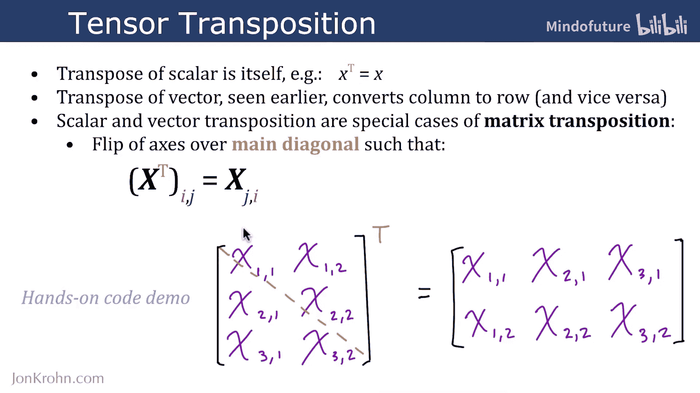
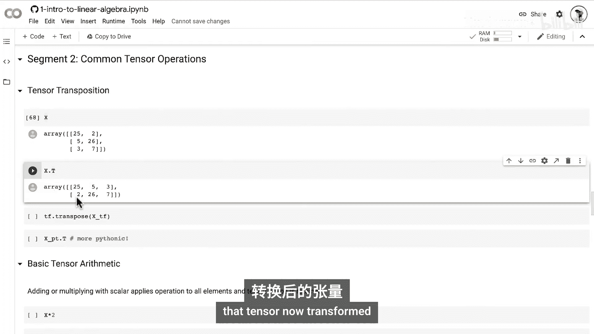
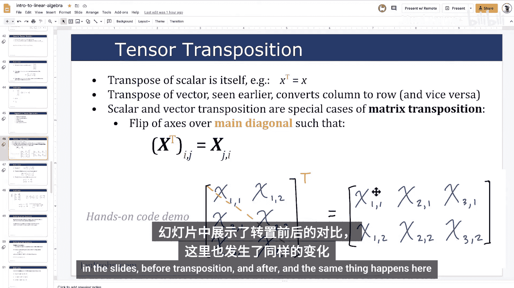
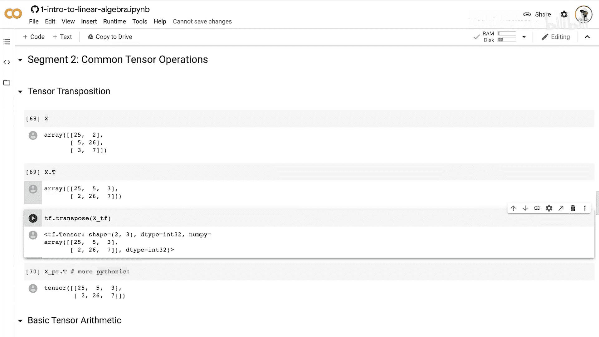

# 机器学习的线性代数及Python实现 ｜ Linear Algebra For Machine Learning p14 P14_张量转置 — 主题11 -BV1L8nLz6E8C_p14-

Hey there。In this video， I'll introduce the theory of Tensor transposition。

 and then we'll see how easy it is to transpose tensors in any popular tensor library， be it nuumpy。

 TensorFlow， or Pytorrch。The easiest kind of tensor to transpose is a zero dimensional tensor。

 a scalar， So the transpose of a scalar is simply itself。The transpose of a vector。

 we've actually already seen this earlier in the Ma Learning Foundation series。

 this converts a column vector to a row vector and vice versa。Now。

 where things get really interesting。Is with matrix transposition， which。

If you really examine this closely， scalar and vector transposition are really just special cases of matrix transposition。

So in a matrix transposition， we flip the axes of our matrix over the main diagonal。

 so the main diagonal of the matrix runs from the top left corner to the bottom right corner of the matrix。

 so we just flip over the axes。Such that。Any given elements？

That was in the if and Jith position for the row and column respectively， it simply gets flipped。

 So all of a sudden， what was。You know， column J is now row J and vice versa。

So seeing a graphic representation here that I've drawn。

 you can see the top left element stays in its place。

 but this top right element now becomes the bottom left element。

 but all of the elements are still in the same order it's just that what was once。

This right hand column is now。The bottom row and the left hand column is now the top row。Cool。

 so that's it， let's look at a hands on code demo to see how this is done in code。

Alright， so following along in segment2 now of our first subject intro to linear algebra。

 we already earlier in this notebook created the matrix X。

 and it's a nuy matrix here's what it looks like It's actually exactly the same as the one that I just showed you in the slides。

And when we take the transpose of it， which is super easy in numpy。

 we just put dot capital T on the end of our tensor and boom， it outputs that tensor now transformed。

 and so you can go have a look。

Here is the shape。In the slides before transposition and after and the same thing happens here and the elements。

That。We're in the first column， the left hand column。Are now the first row and so on。

To do this in Tensorflowlow and Pytorch， pytorch as usual is exactly as easy as nupyy。

 it just has the same dot T operator that you can put on the end there in TensorFlow as usual it's just a tiny little bit。

 less obvious， you need to call the Tensorflowlow transpose operation and apply it。

To your tensorflow tensor。And you get your results。Pray straightforward。All right。

 that's it for tensor transposition up next， we're covering basic tensor arithmetic。

