# 机器学习的线性代数及Python实现 ｜ Linear Algebra For Machine Learning p17 P17_点积 — 主题14 -BV1L8nLz6E8C_p17-

Calculating the dot product of two vectors is one of the most common tensor operations in machine learning。

 particularly deep learning。In this video， we'll use hands on code demos to bring the concept of the dot product to life。

If we have two vectors， say X and y， with the same length n， and they must have the same length n。

 then we can calculate the dot product between them。

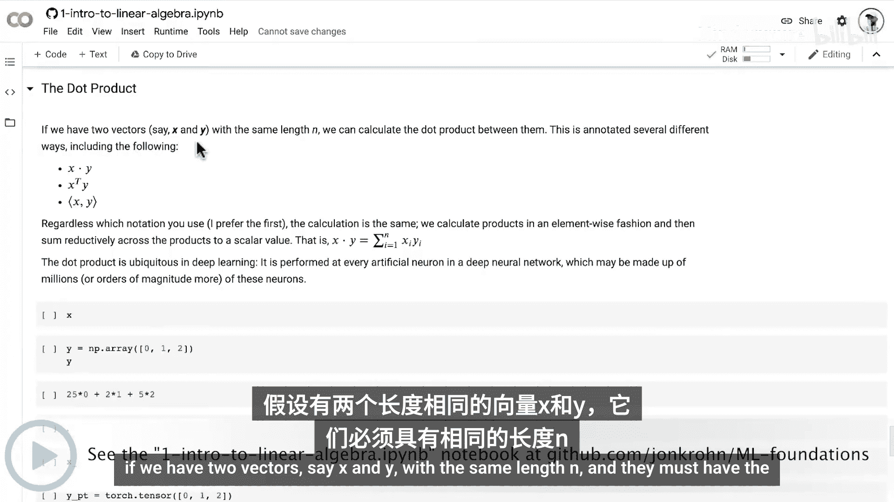

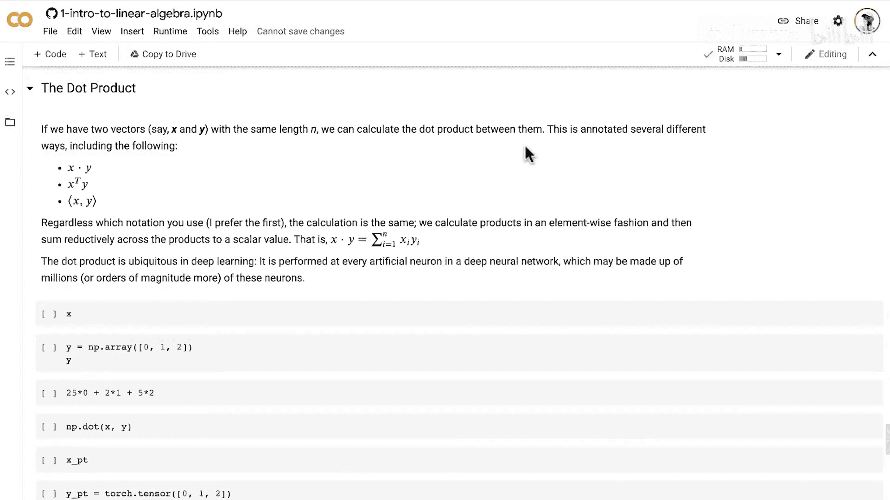

This is annotated in several different ways， including the following， you've got x dot y。

 x transpose y， and then this particular angle bracket notation with commas。

 with a comma in between x and y。And I definitely prefer this x dot y notation。

 though I also am okay with this x transpose Y， you'll certainly see this one a lot in the literature。

Regardless which notation you use， obviously， the calculation is the same。

 So how do we do the dot product Well， First， we calculate the products in an element wise fashion。

 So this means the first element of x times the first element of y。 separately。

 we calculate the product of this second element in x， the second element of y and so on。

 until we reach the n element in the vector。And then after we have all those separate products。

 we then sum them all up。Redductively to give us one final scalar value。

 So this is a reductive sum operation just like we covered in the preceding video in case you missed that one。

So the dot product is ubiquitous in deep learning， it is performed at every artificial neuron in a deep neural network。

 which may be made up of millions or orders of magnitude more billions of these artificial neurons。

 so super common operation in machine learning。

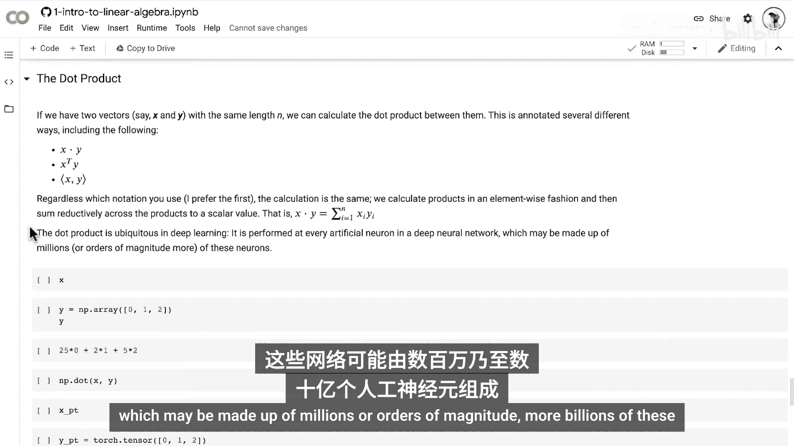

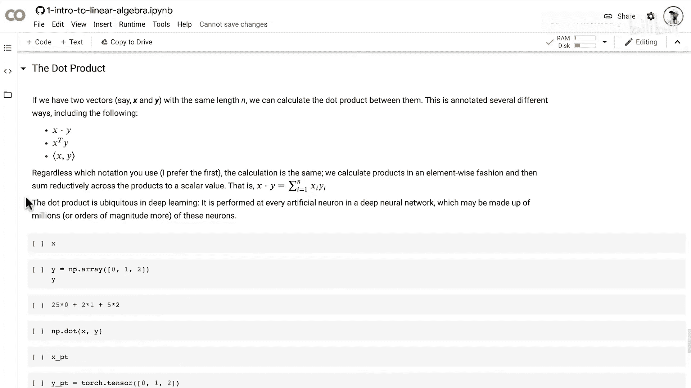

So we already have this vector X。From an example earlier in the notebook。

And we'll quickly create another vector Y here。To calculate the dot product between these two vectors。

 So remember， they have to be the same length。Otherwise we're good to go here I'm showing you in a kind of manual way how we calculate the dot product。

 So as I mentioned up here， it's the element wise sum。

 So 25 times0 separately we do two times1 and five times2。 So here are those three operations。

 those three multiplications happening on an element wise basis and then we just sum them all up。

And that gives us our result of the dot product。 So x dot y is equal to 12。

And you of course don't need to do things manually like this， you can simply use the nuy dot method。

 you throw in your x and y vectors as arguments， and you get back 12。

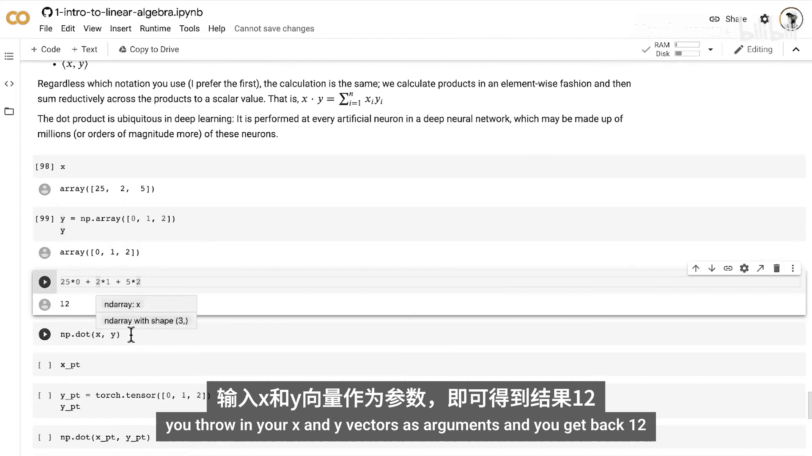

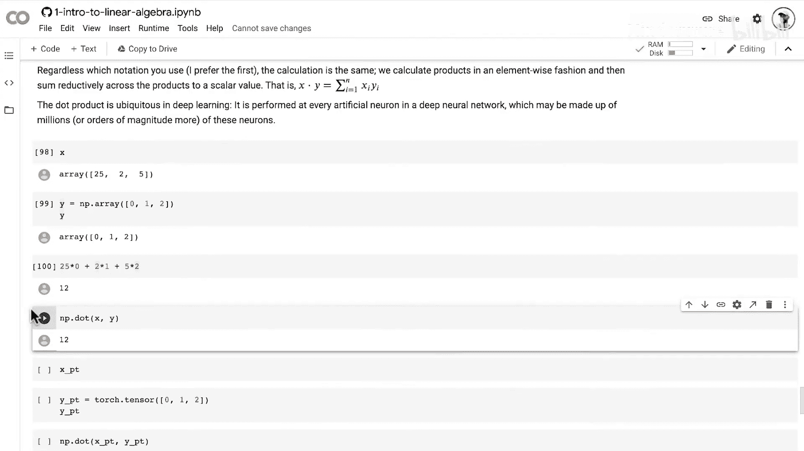

And here we can do the same kind of thing in pytorrch， we already have this pytorrch vector tensor。

 let's create a second vector tensor of the same length。

 and you can actually pass these right into the nuumpy dot method。

 or you can use the torch dot method。

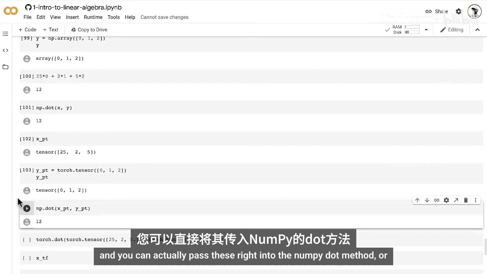

If you're going to use the torch dot method， note that you need to pass in tensors of float values。

 so these ones here are integervalued tensors and it's a constraint that they need to be float tensors so I just added a decimal point after one of the elements in each of these two tensors to have these be floatvalued tensors and then this torch dot operation proceeds absolutely fine noting that we do get a float back as a result as opposed to an integer。

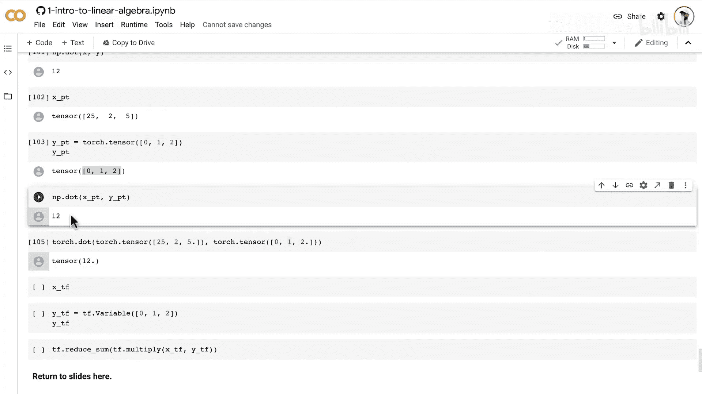

In Tensorflowlow。We can use this tensorflow vector of length 3， create a。

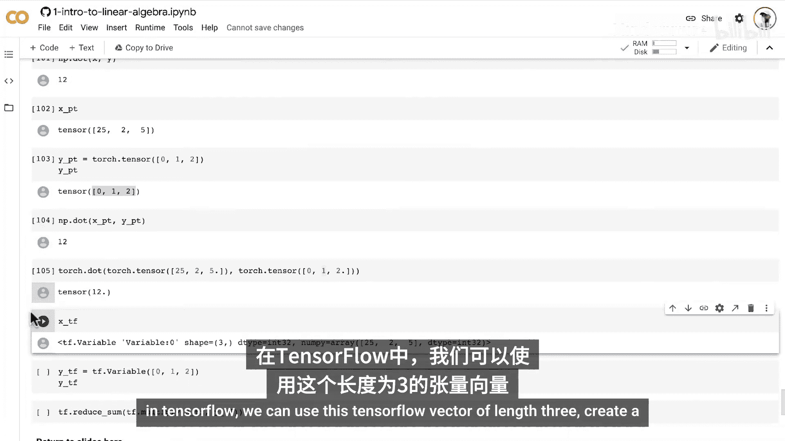

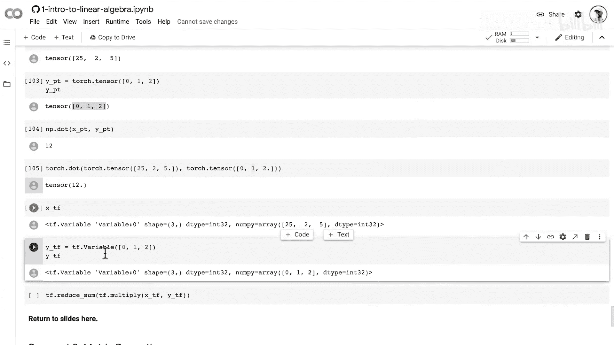

Second y vector of length3， and here it's a multistep operation kind of in line with a theme if you've been following along with these videos that pytorch and numpy tend to be a bit more intuitive and pythonic than using Tensorflow and here's another example in Tensorflow we have to do this in two steps so we use the multiply method to do elementwise multiplication first and then we use the reduce sum method to give us our single。

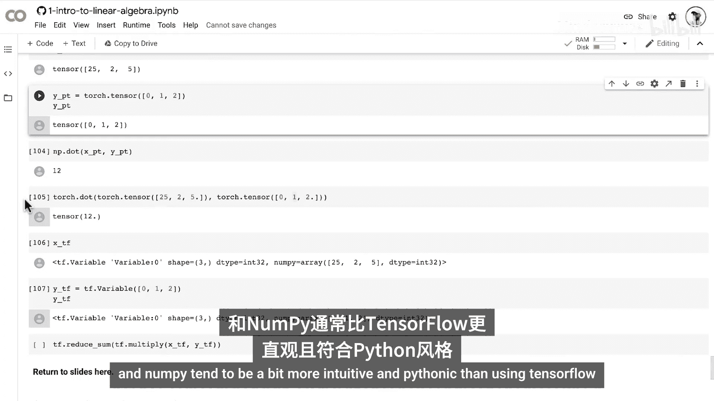

Reduced some value as a result of this dot product operation as a whole。All right。

 with that that wraps up the theory on common tensor operations that I wanted to cover in the next video I've got three exercises for you to check your comprehension of the dot product and the other key tensor operations that we covered After that we'll take a break from code demos for a little bit to try our hand at solving algebraic linear systems on paper。

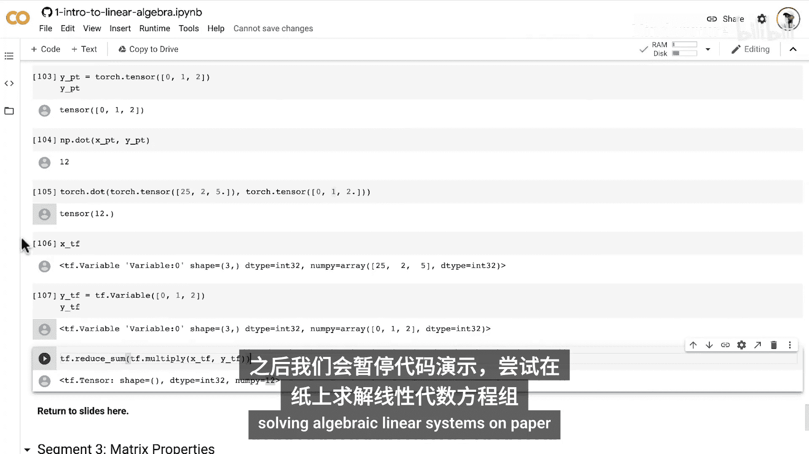