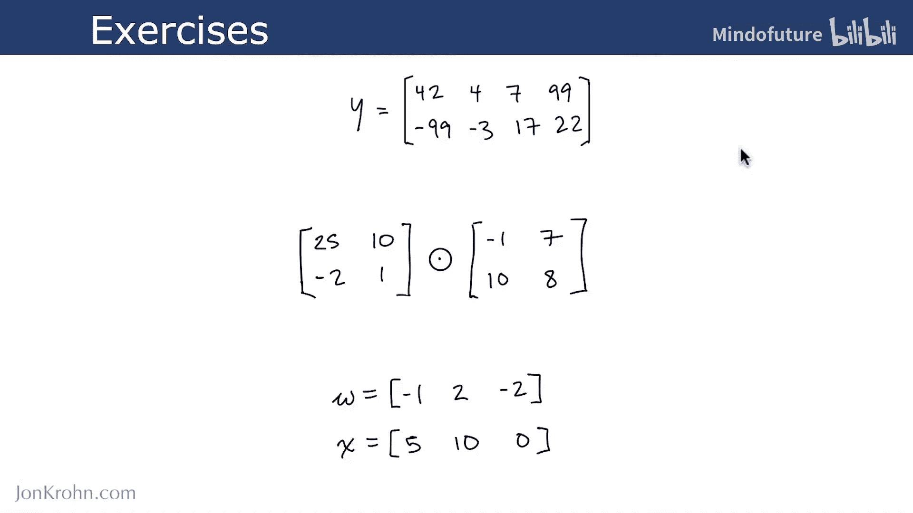
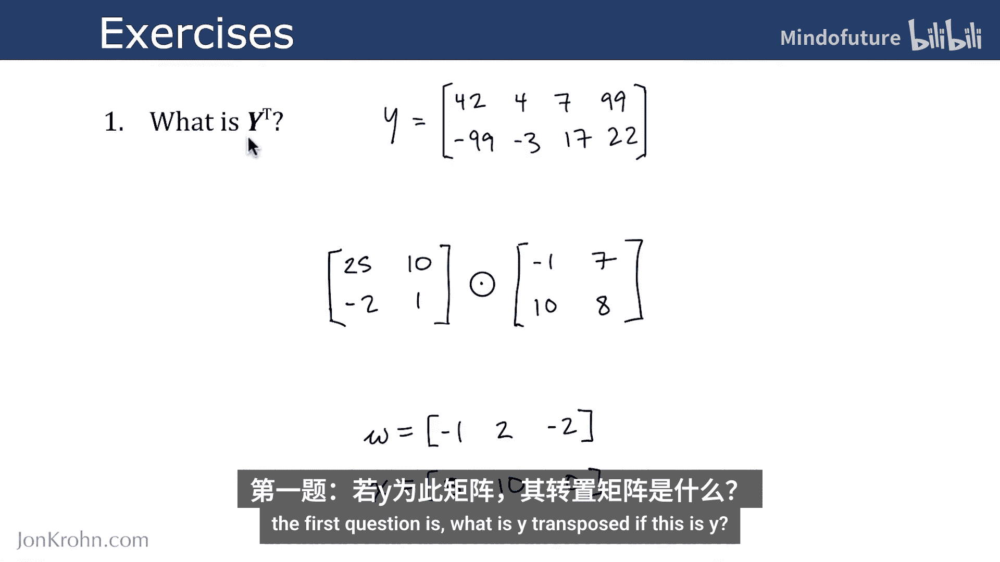
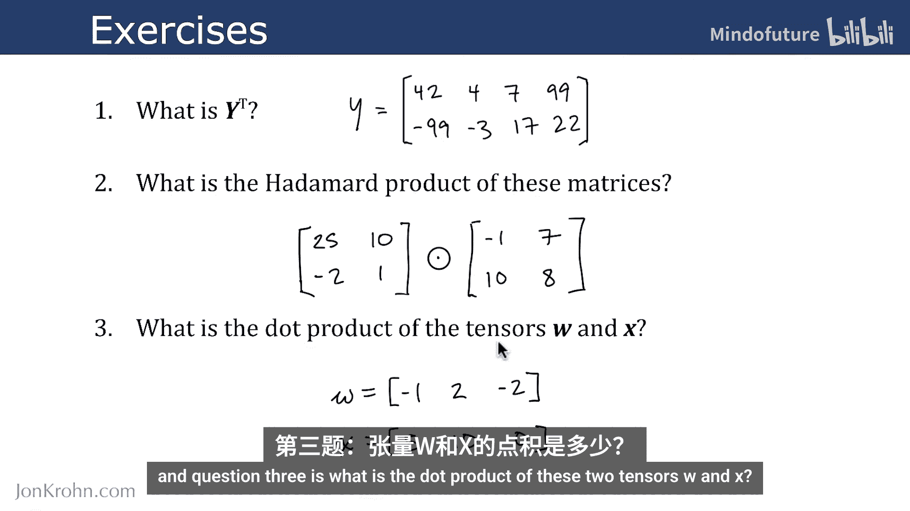
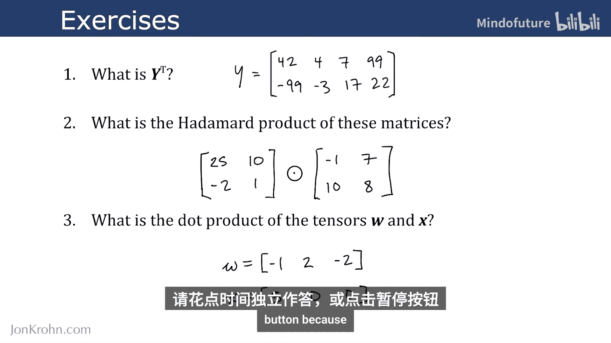
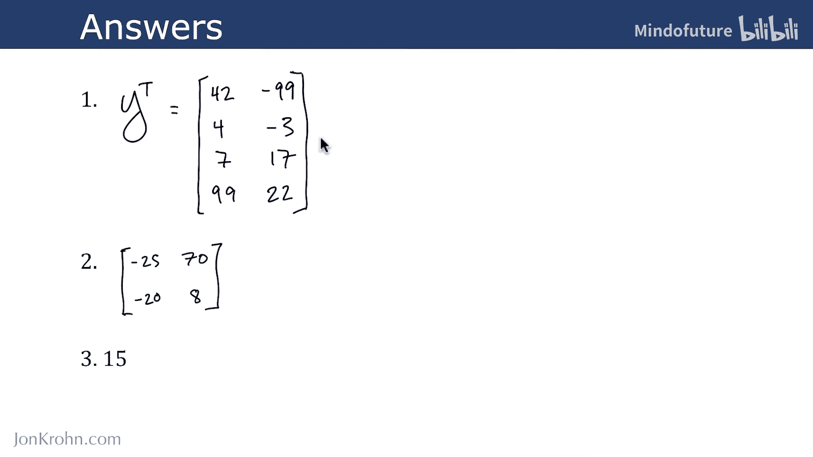

# 机器学习的线性代数及Python实现 ｜ Linear Algebra For Machine Learning p18 P18_张量运算练习 — 主题15 -BV1L8nLz6E8C_p18-

Feeling comfortable with your understanding of the most important tensor operations for machine learning。

 Well， let's check。Here are three quick exercises on the material we covered so far in this segment on common tensor operations。

The first question is， what is？Why transposed if this is why？

Second question is， what is the Hadamamad product of these two matrices？

And question 3 is what is the dot product of these two tensors， W and X？

Take a moment here to try to answer these questions on your own or press the pauseuse button because I'm about to give you the answers。

All right， so here are the three answers to those questions。

