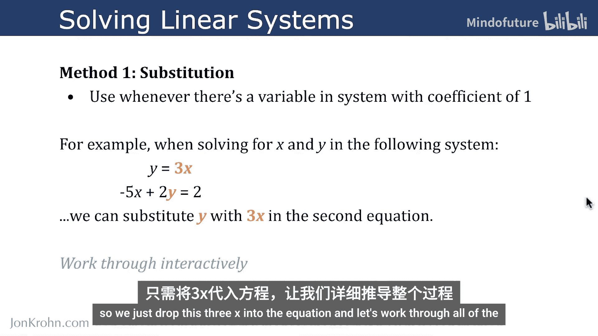
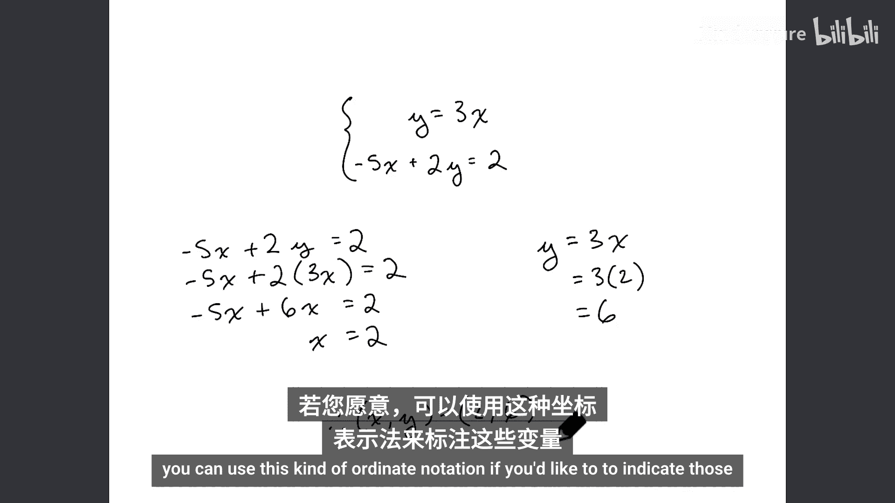
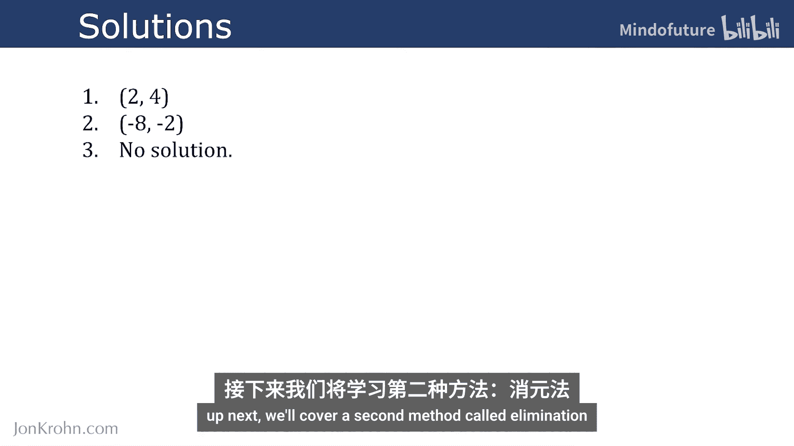

# 机器学习的线性代数及Python实现 ｜ Linear Algebra For Machine Learning p19 P19_用代换法求解线性系统 — 主题16 -BV1L8nLz6E8C_p19-

In the next segment on matrix properties， which is coming up shortly。

 will cover enough theory to use matrices to solve some simple linear systems computationally。

 That is using code。Before we do that， which feels a little bit like cheating to me to understand how to solve linear systems more intimately。

 let's first solve some of them algebraically on paper。Substitution。

 the first algebraic method that we'll be covering for solving linear systems。

Is useful whenever there's a variable in the system of equations with a coefficient of1。For example。

 when we're solving for x and y in the following system。

 where y is equal to 3 x and negative 5 x plus 2 y is equal to 2。

 so here's a system of two equations。And this variable y in the first equation in the system has a coefficient of one。

And you don't need to write the one' when it's a one， you just leave it as y， typically。

In this situation， we can simply substitute y in the second equation with what y is equal to。

 which is 3 x。 So we just drop this 3 x into the equation。

And let's work through all of the details so that this is really easy and straightforward to understand。

So here's our system of equations， the same one that we were looking at on the slide a second ago。

 and note that you can use this curly bracket notation to indicate all of the equations that are in your system of equations。

Taking the second equation in the system。And then dropping 3 x in place of Y。In it。Allows us to say。

 okay， negative 5 x plus 6 x， you multiplying2 times 3 x gives us 6 x。

 So now we know negative 5 x plus 6 x is equal to 2。

And this is pretty quick to solve because negative 5 plus 6 is equal to positive 1。

 so that leaves us just with x， a single x on the left hand side of the equation。

 so we know now that x is equal to 2。In this system of equations。

 we're willing have two variables to solve for x and Y once we have x solving for y is a piece of cake so we can take the first equation in the system。

We can substitute 2 in for the x in 3 x and3 times 2 is equal to 6。 So now we know x is equal to 2。

 y is equal to 6。 So we have solved for the unknowns in our system of linear equations X is equal to 2 and y is equal to 6。

 you can use this kind of notation， coordinatedinate notation if you'd like to to indicate those variables。

To give you some practice using substitution to solve linear systems yourself。

Here are three questions that you can solve。 So try solving on a piece of paper yourself for the unknowns in the following systems of equations。

 So there's three。Separate systems here solve for X and Y。In each one of them。

 and I'd recommend pausing the video right now。Because otherwise。

 I'm about to show you the solutions。All right， and here are the solutions to the three questions。

So if you had some difficulty with a third one， it's because there is no solution。

 and so this means that the lines in the linear system described by the two lines in the equation。

 they don't overlap and so yeah it's impossible to solve for x and Y。Cool， so that's substitution。

 The first algebraic method we'll cover for solving linear systems up next will cover a second method called elimination。

