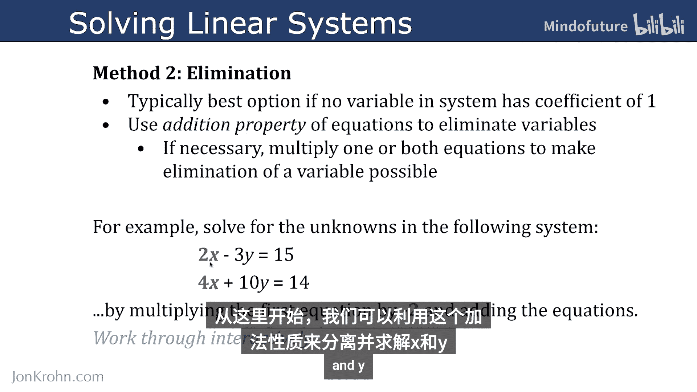
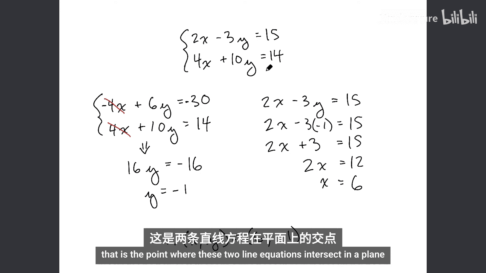
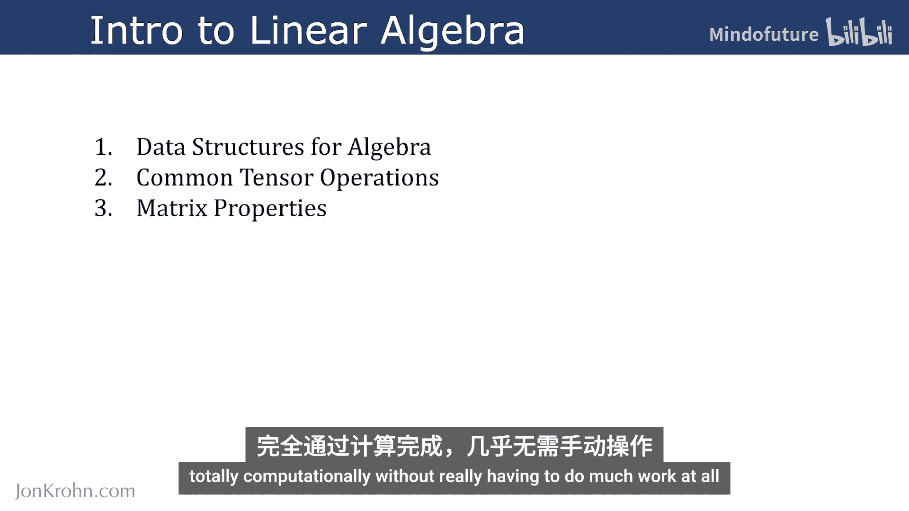
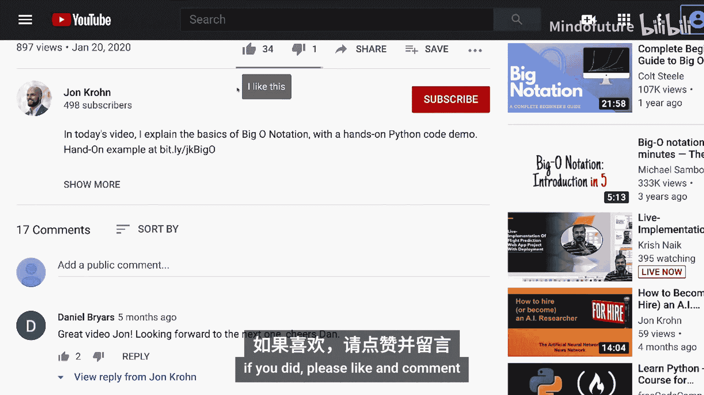

# 机器学习的线性代数及Python实现 ｜ Linear Algebra For Machine Learning p20 P20_用消元法求解线性系统 — 主题17 -BV1L8nLz6E8C_p20-

In the preceding video， I showed you a technique called substitution that we can use to solve linear systems algebraically。

 In this video， we'll cover a second method， which is useful in scenarios where substitution falls short。

This one's called elimination。With the elimination method， this is typically the best option。

If no variable in the system has a coefficient of one。 So if there was a coefficient of  one。

We could use the substitution method that we covered in the precing video。

But if it doesn't have a coefficient of one， then we can take advantage of the addition property of equations to eliminate variables。

If necessary。You can multiply one or both of the equations to make elimination of a variable possible。

All right， so this is easiest to see with an example。

 so let's solve for the unknowns in the following system。

We've got 2 x minus3 y equals 15 and 4 x plus 10 y is equal to 14。

So we can see here that by multiplying the first equation by negative 2。We'll then have negative 4 x。

As the first term in the first equation。And from there。

 we can use this addition property to isolate and solve for both X and Y。

In more detail， let's work through this system of equations and solve it step by step。

 So here's our system of equations。 same one from the slides。We multiply the first。

Equation by negative2。 And then we end up with negative 4 x。Plus6 y。

Negative 3 y times negative 2 is plus 6， and negative 15 times negative 2 is negative 30。

So this is still the same equation as here， we've just multiplied all of the terms by negative2。Now。

We can add the two equations together。In so doing， negative 4 x plus 4 x cancels out。

 so the X term is gone。6 y plus 10 y comes out to 16 y。

And then on the right hand side of the equation， we have a negative 30 plus 14。

 which leaves us with negative 16。Now we can divide both sides by 16。

 leaving us with y is equal to negative 1。From this point。

 once we have one of the variables pretty straightforward， we can take either of these equations。

 I ended up taking the first one， so you substitute this y equals negative 1 in for the y in the equation。

 so negative 3 times negative 1 is equal to 3。Subtract 3 from both sides of the equation leaves us with 15 minus-3 is 12。

And then。Divide。Both sides of the equation。To isolate x and get 12 divided by 2， which is equal to 6。

So there you have it， this is the point。Where x equals 6， y equals negative 1。

 that is the point where these two line equations intersect in a plane。

To test your comprehension of elimination， let's take a crack at solving for the unknowns in the following three systems of equations。

I would recommend pausing here。So that you can try these on your own。

 I'm going to be showing the answers in just a moment。So here are your solutions。

 hopefully they lined up with the same answers that you had。With that。

 we wrap segment 2 on tensor operations， so we talked about tensor transposition。

 basic tensor arithmetic reduction and the dot product for all of those sections。

 we did a lot of hands on code demos， and then to wrap up the segment we used paper and pencil to solve systems of linear equations。

With a couple of different methods。And that's going to come in really handy for the next segment。

So in this first subject of intro delinear algebra。

 we've now wrapped the first and second segments of three segments exciting。

Segment one was data structures for algebra， which we finished earlier。

Common tensor operations is a segment we just finished now。

 and coming up next is matrixtri properties。Which will allow us to cover all of the most important properties of matrices with respect to machine learning。

 including how to use them to solve linear equations like the ones we just solved by hand。

Totally computationally without really havinging to do much work at all。

Cool， see you there。To be sure not to miss the next tutorial in this series， subscribe to my channel。

Thanks for taking part in the tutorial， I hope you enjoyed it。If you did， please like and comment。

To be sure not to miss any of my content， head to JohnChrome。com and sign up for my email newsletter。

You're also welcome to add me on LinkedIn， simply mention that you reviewer of the Maine Learning Foundation series。

You can follow me on Twitter too if that's your social medium of choice。

See you next time。