# 机器学习的线性代数及Python实现 ｜ Linear Algebra For Machine Learning p21 P21_可视化线性系统 — 机器学习基础奖励视频 -BV1L8nLz6E8C_p21-

Right before we jump to segment 3 on matrix properties and start learning more new linear algebra theory in this video I show you how to visualize the linear systems that we solved with substitution and elimination in the preceding videos。

These hands on code demos in Python provide a crisp geometric visualization of the lines in each system。

 as well as the points that we solve for when we solve for the unknowns in a system of linear equations。

Returning to our first notebook from Github。com/jo Chone sm Foundations。

 the intro to linear algebra notebook。

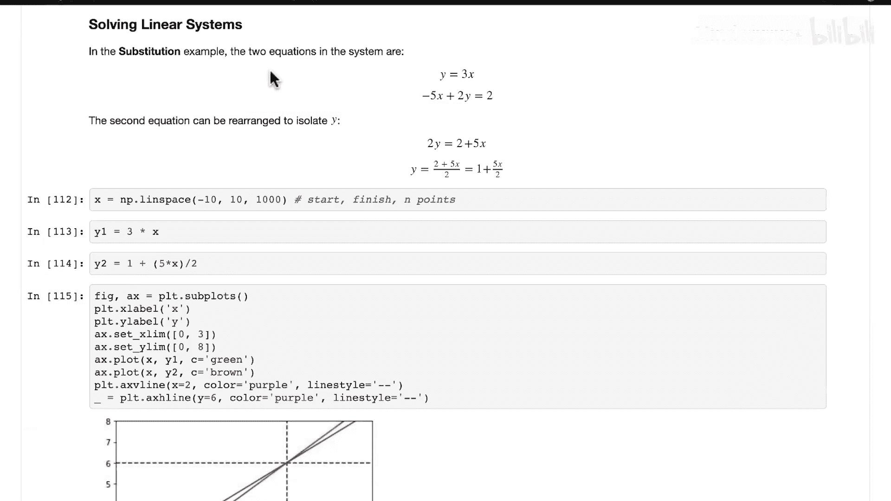

Let's look at some code to plot out the equations in the systems of linear equations that we solved with paper and pencil。

 as well as the points that we solve for。When we worked through these exercises。

So let's start off with this system of equations here。

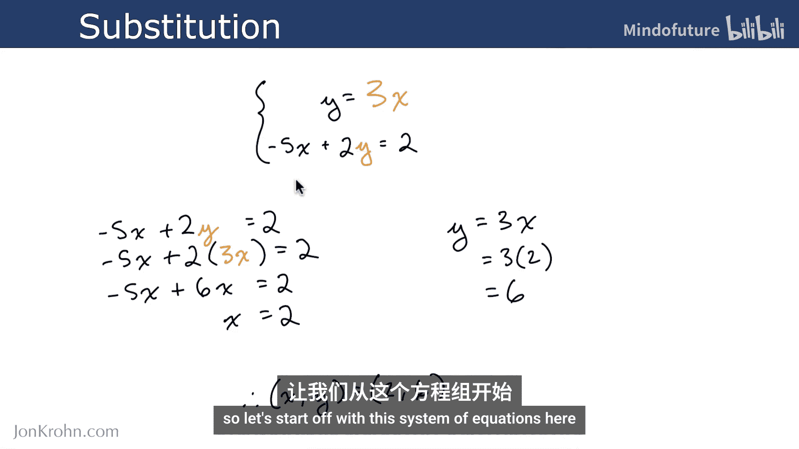

So taking what I've written here by hand and converting it into。

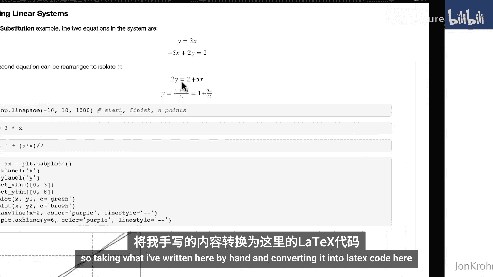

Laatete code here， you can see the same equations are right here。And so in order to plot。

Y is a function of x for both of these equations， we need to isolate Y。

The first equation y is already isolated for the second equation， we can rearrange it pretty easily。

 so we move negative 5 x over to the other side of the equation。

 giving us 2 y is equal to 2 plus 5 x。And then we can divide by two on both sides of the equation that isolates y on the left。

 and it puts this expression in here over to， which can be simplified a little bit to this here。

1 plus 5 x over2。 Allright， so now having our two equations。

 let's actually create them as plots in that plotlib so similar to what we did with the bank roper and sheriff plot that we created early on in this machine learning foundation series。

 we have to simulate X values over some particular range。We've already solved these equations。

 So you kind of know the rough range that you'll need x and Y to be in in order to create a nice plot。

 So that's definitely helpful， for example， we know that。

If the x point that we're solving for is going to be x is equal to 2 and y is equal to 6。

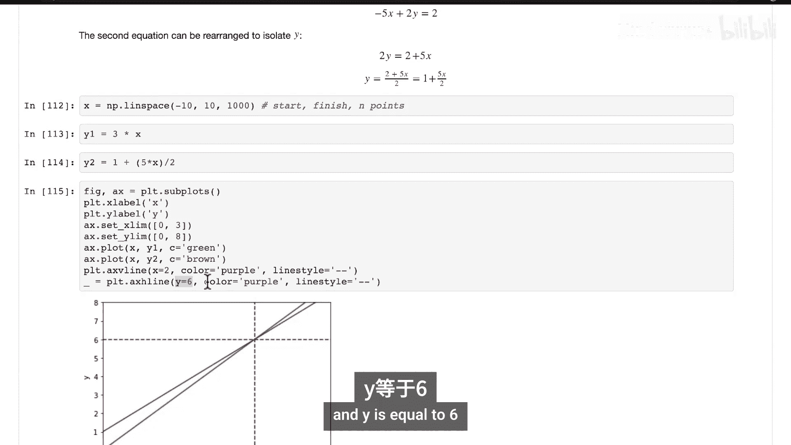

Right so we know that from having solved the system of linear equations already by hand。

 if you hadn't already solved it by hand， then you'd have to do some some guessing back and forth as to what your parameters should be。

 Since we know them， I know that you know this range。

 negative 10 up to 10 for my x values is definitely going to be more than enough。

 And so we create 1000 x values spaced evenly over that range from a negative 10 to 10。

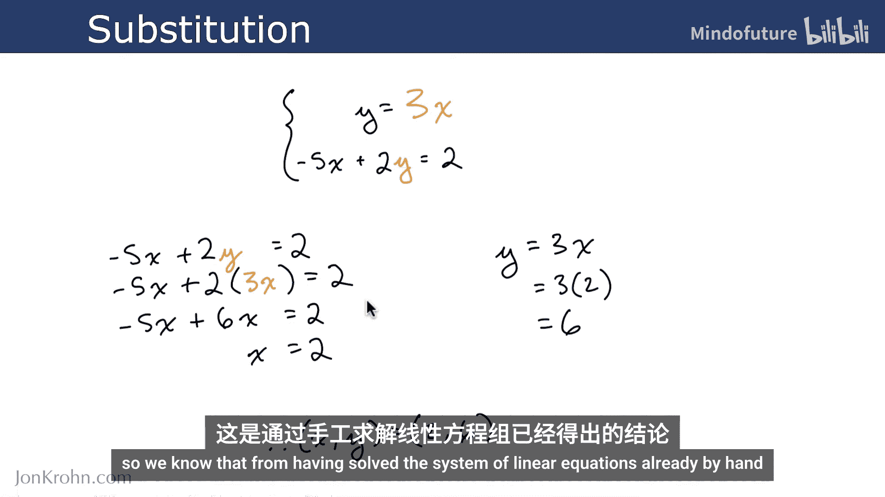

That exact number doesn't really matter all that much。Then we use our two equations。

 so our first equation is y equals 3 x， so I'm going to call it y1 is equal to3 times x。

And then for our second equation， our second y。Is here， so we have y is equal to 1 plus 5 x over 2。

 y is equal to 1 plus 5 times x over 2。All right， so now that we have our。Two lines。

 So our two sets of y values is a function of x。 We can plot them out as lines in mat plotlib。

This is very similar code to what we used earlier to create the bank robber and sheriff plots。

 and I used all the same colors。 and in an odd coincidence。

 the actual the plot itself looks quite similar to the bank robber and sheriff example。

 The next example I have coming up looks a bit different in terms of the configuration of the lines and such。

So we create our plot， and then I add some simple labels X and y to the x and y axes respectively。

 set reasonable limits for the range of x and the range of y axes。In this case， I wanted to show 0。

0 in the plot。But I also wanted to show obviously the point where our two lines intersect because that's the whole point of this plot so I just picked some values so up to three on the x axis and up to8 on the y axis to capture all of that。

Just like the bank ro and Sheriff example， I'm plotting one line in green and one in brown。

Arbitrarily， you know， doesn't。 there's nothing。 There's no reason why I would pick green for one and brown for the other。

But yeah so。Y1 is a function of x， so green is our first equation， y is equal to 3 x。

And then our second equation with y2， this equation here is in brown。

And so we can see the brown line has a slightly lower slope。Then the green line。

 And so even though the brown line has a higher y intercept of positive one。

 eventually the green line catches up to it here。 And we know that that point where the two lines intersect is at x equals 2 and y equals 6。

 we know that from having solved it already。

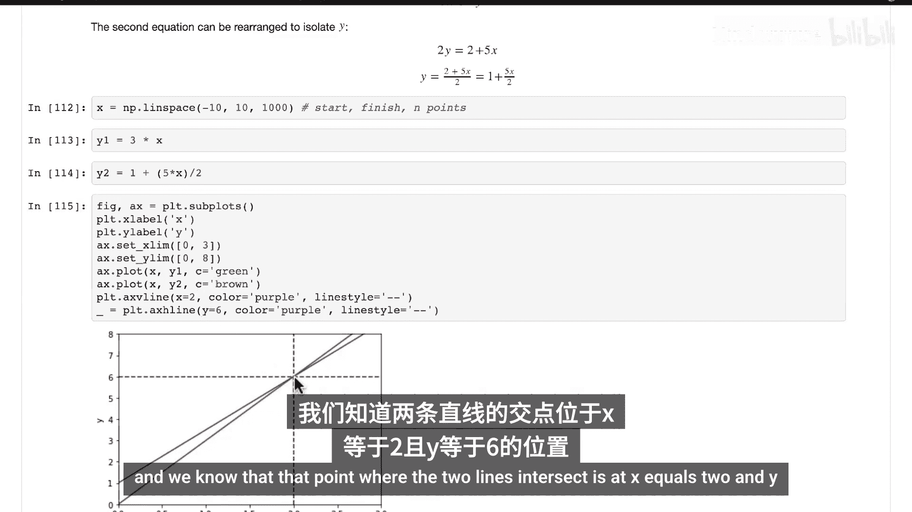

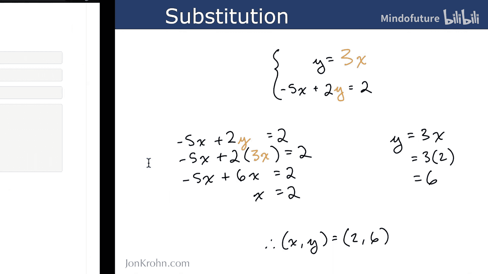

And using the same hatched purple lines to indicate。Where that point is。

 where x is equal to 2 and y is equal to 6。So hopefully that's helpful for understanding visually what we're doing when we're solving for unknowns in a system of linear equations。

 we have just two dimensions here， x and y， so we can visualize this in a two dimensional plane if we had X Y N Z。

 then we could use a 3D plot to show a point in 3D space that we're solving for beyond that it would be hard to create a visualization in four dimensions and so on。

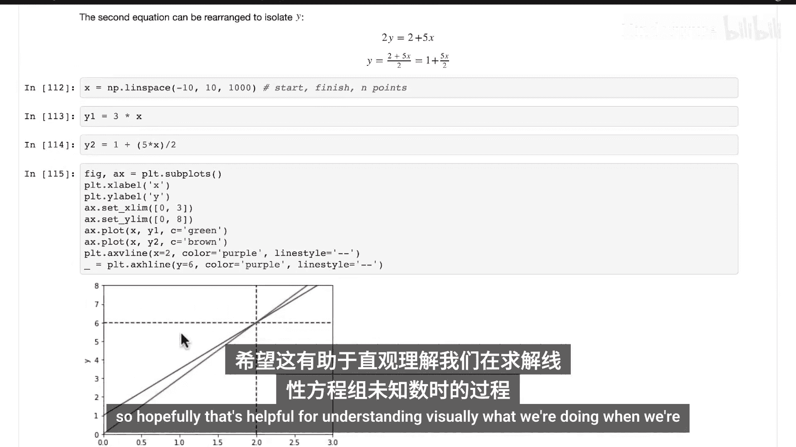

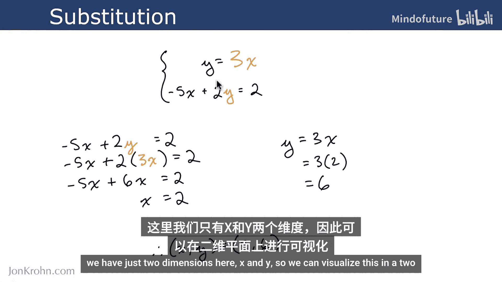

But you can nevertheless， even though it's hard to visualize four dimensions or more。

 solving for unknowns in a linear system is the same kind of idea of identifying the point where the lines cross over。

 whether it's a two dimensional space or a higher dimensional space。All right。

 so as one further example， let's also go through the elimination example that we worked through together。

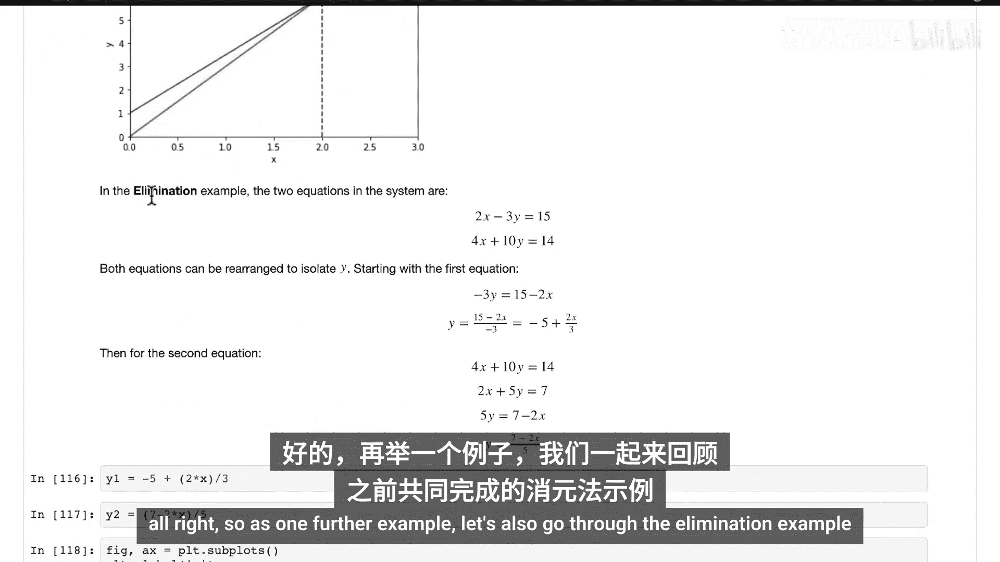

So in that example， this is what it looked like when I first provided it so we can take these two equations in the system of linear equations and represent them in the Jupyter notebook here and in this case in order to isolate y and make y function of x in our Python code。

 we're going to need to rearrange both of the equations， so let's start with the first one here。

 we can move 2x over to the other side， which gives us negative 3 y is equal to 15 minus 2x。

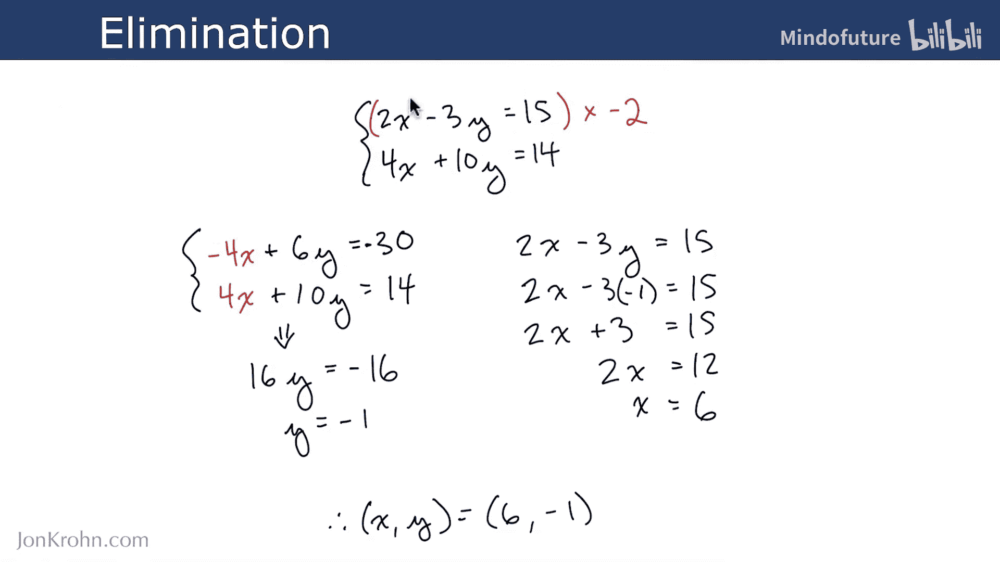

And then in order to isolate y completely， we can divide both sides of the equation by negative 3 on the left hand side that leaves us with y。

 which is what we wanted。 And on the right hand side， we have 152 x divided by negative 3。

 We can simplify that a little bit。Dividing 15 by Ne 3 is negative 5。

And then our other term on the right is plus 2 x divided by 3。All right。

 so that's the first equation now isolated for y for the second equation to isolate y in the second equation。

Let's redraw the equation here， so the first thing that I noticed is that we can divide by 2 to simplify a bit so 4 x divided by 2 is 2 x。

 10 y divided by 2 is 5 y 14 divided by 2 is 7。And then we can rearrange to isolate for y so bring 2 x over to the other side of equation。

 So now we have 5 y is equal to 7 minus2x。 and then finally divide both sides of the equation by 5 to isolate y completely。

 so 5 y divided by 5 is y and then 7 minus2 x divided by 5。

 we can't cleanly create a simpler looking expression like we had here。

 but this is fine just like this。 So the first equation now in Python code is y is equal to negative 5 plus 2x over 3。

 So here it is in Python code and then our second equation is y is equal to7 minus2 over 57 minus2。

X over5。And yeah， then we just plot it out。So in this case I added one extra thing in order to make it look nice relative to the previous two plots that we had so we have the substitution example as well as the bank robber and sheriff example in both of those the edges of the plot served as the x and y axes but in this case I'm going to have the axes somewhere else。

 I thought that it looked cleaner this way that I could create a better visualization this way。

 particularly as our point is in the negative on the Y axis。

So I added these x and y axes here in light gray。 So if this vertical line at x equals 0。

 this horizontal line at y equals 0， both of them in light gray。And other than that。

 it's basically the same as the preceding plot。

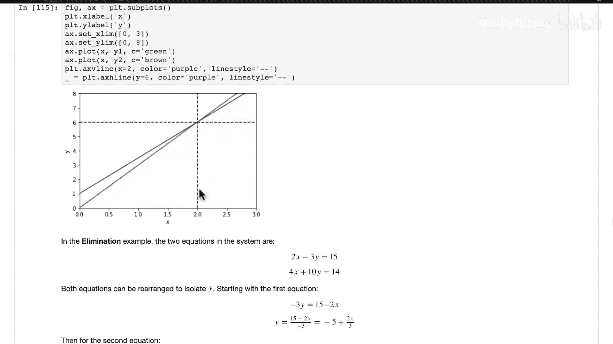

All that I did was I set different X and Y range values that created a nice looking plot here。

These two lines of code are the same as in the preceding plot and I added the point。

Where the two lines intersect， which we had already solve for here。

 So we determined that the point where they intersect is where x is equal to 6 and y is equal to negative1。

 So I plug those values in6 and negative 1。

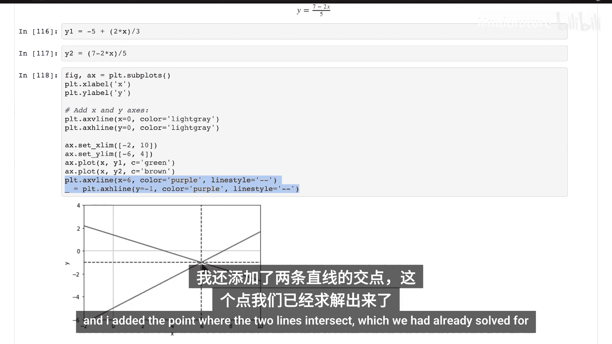

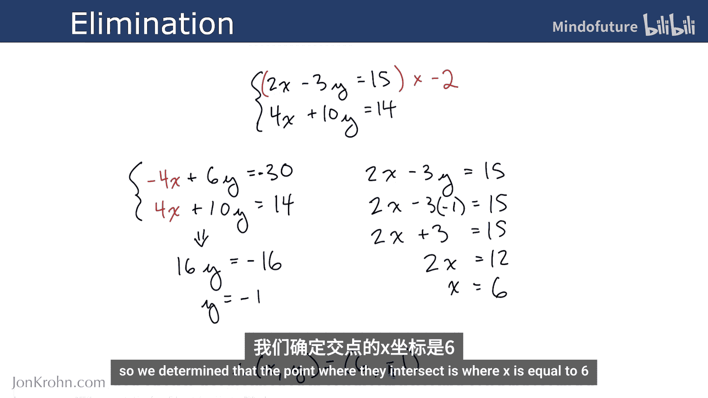

Andvoila， that is indeed the point where these two lines cross over。

 and so that is the solution to this linear system of two equations。

I hope that that gives you a nice visualization of that theory that we've covered so far。

 and now you're all ready to get into segment 3 on matrix properties coming up right now。

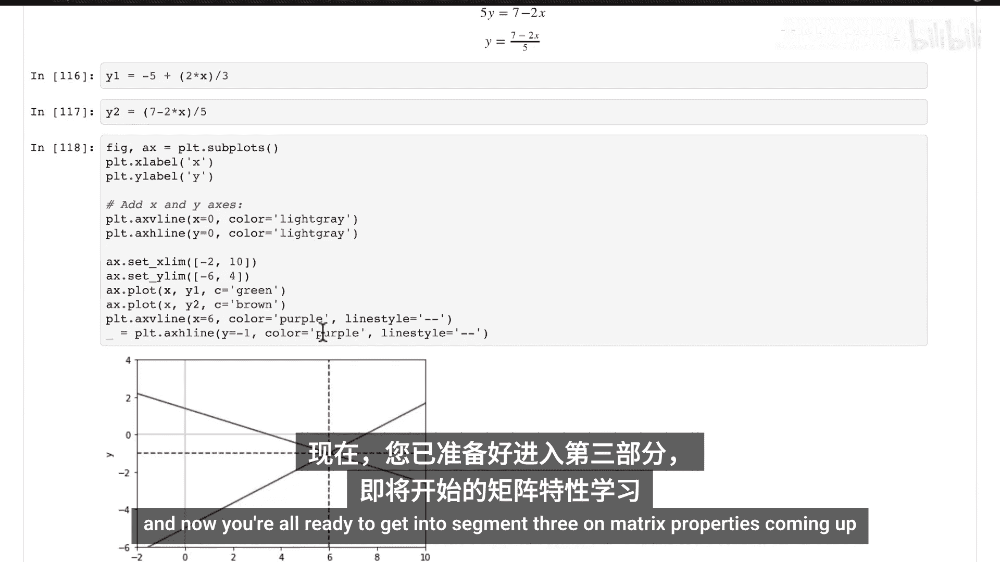