# 机器学习的线性代数及Python实现 ｜ Linear Algebra For Machine Learning p22 P22_矩阵性质 — 主题1__线性代数导论的最后部分 -BV1L8nLz6E8C_p22-

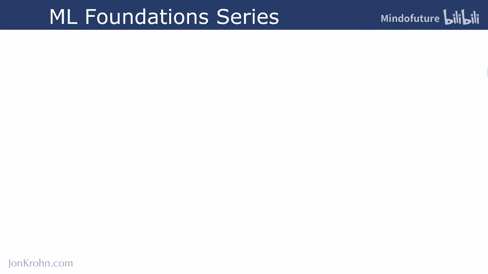

Recapapping that my machine learninging foundation series consists of eight subjects。

 and that the first subject we're currently undertaking Introdelinear algebra is itself foundational for the other seven subjects in the series。

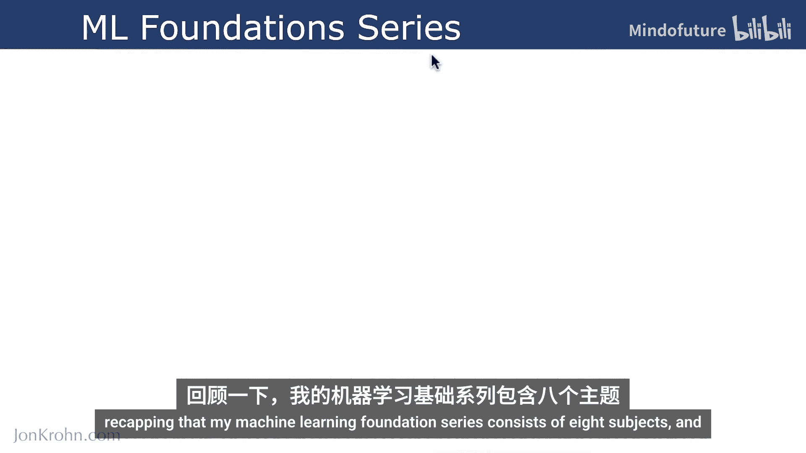

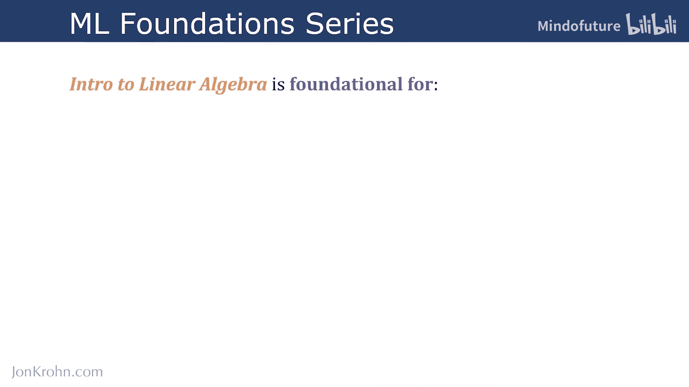

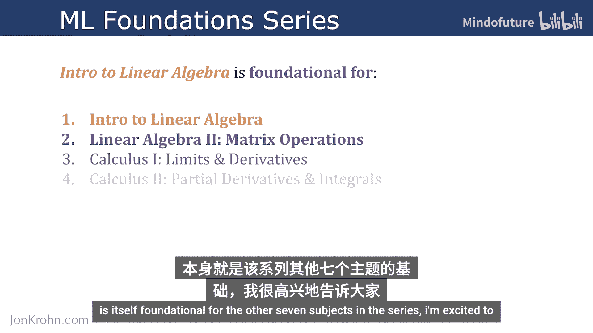

I'm excited to let you know that we're nearly ready for subject  two。

 which details matrix operations。Perhaps unsurprisingly。

 the linear algebra 2 subject builds heavily upon intro to linear algebra。

 which is why I've highlighted it in bold。

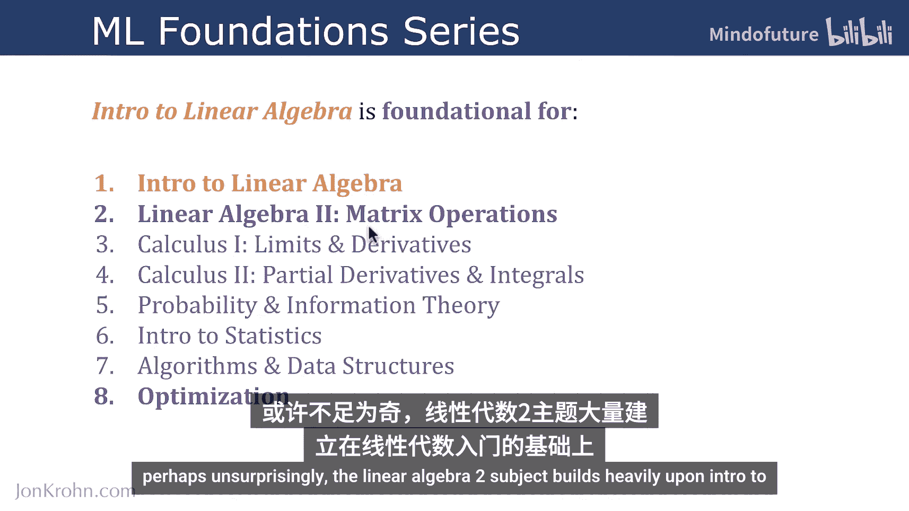

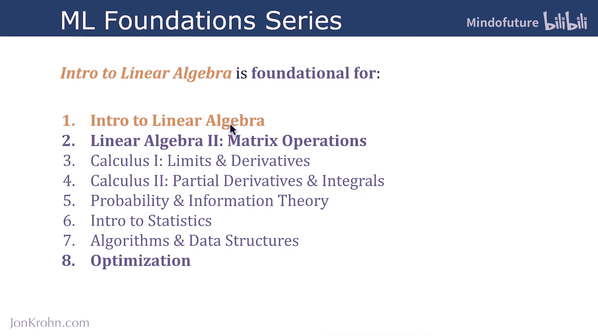

The first two segments of the intro to linear algebra subject were data structures for algebra。

 in which we detailed characteristics of the tensors that are ubiquitous in machine learning and common tensor operations in which we began applying some of the simpler。

 yet critical to machine learning， mathematical operations on tensors。

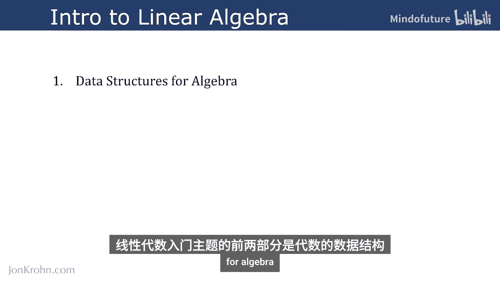

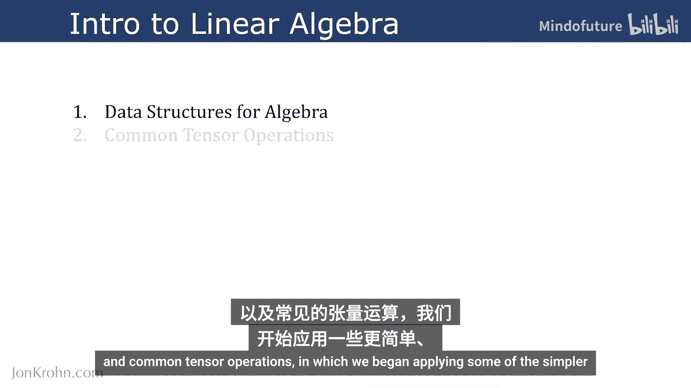

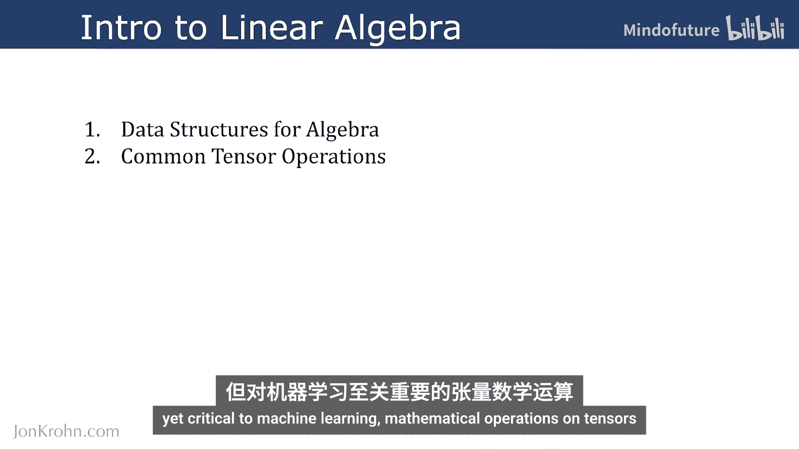

The third and final segment of intradelinear algebra focuses on matrix tensors in particular。

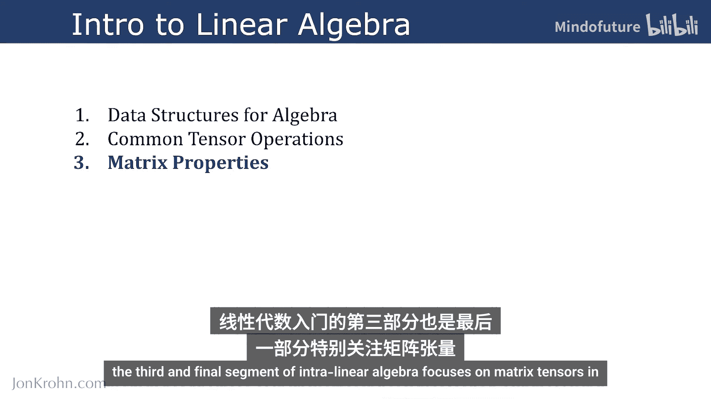

Marices are especially widespread in machine learning。

 and some of their properties merit special attention。

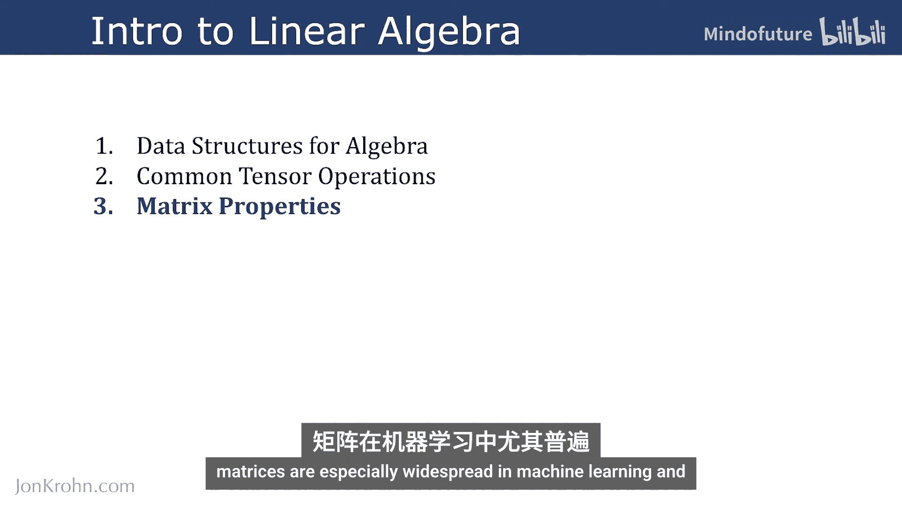

Specifically， in segment 3， we'll cover the Frbeius norm which quantifies the size of a matrix。

 the ins and outs of matrix multiplication， both matrix by vector multiplication。

 as well as matrix by matrix multiplication。Special types of matrices such as symmetric matrices and identity matrices。

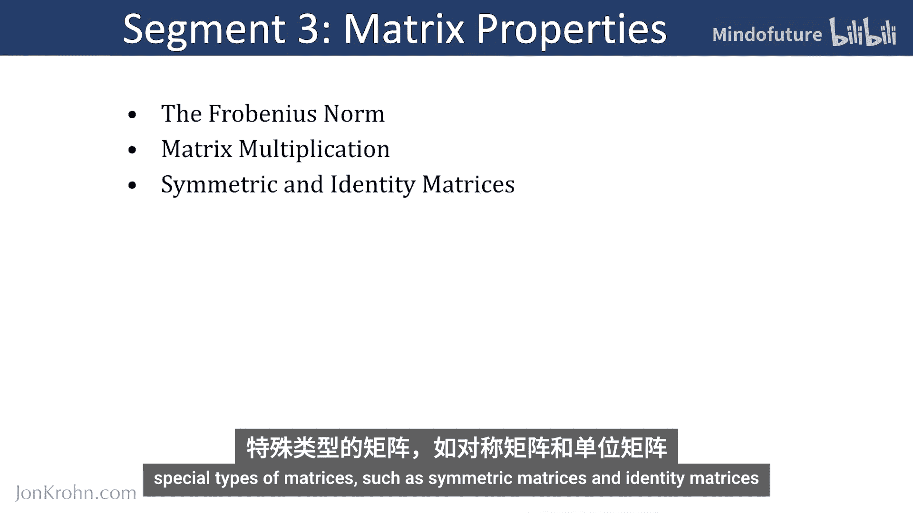

Wildly powerful matrixtri inversion， which we'll see time and again in the Maine Learning Foundation series and is likely to blow your mind on a couple of those occasions。

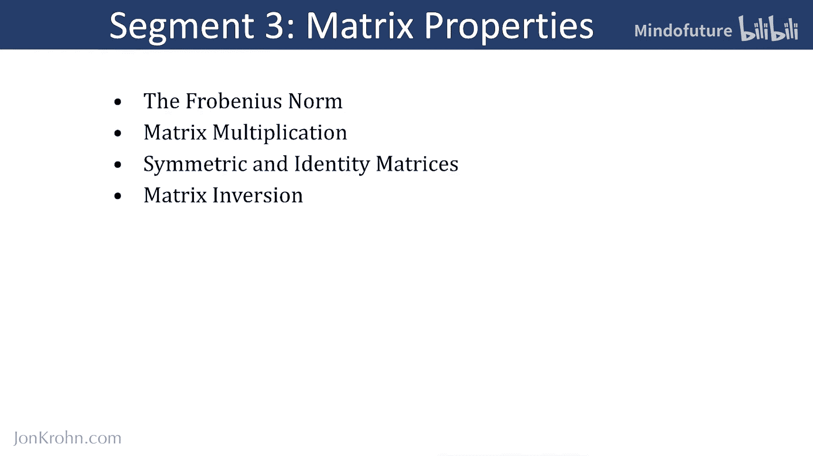

And we'll wrap up the segment with two more special classes of matrices， the diagonal。

 and orthogonal varieties。

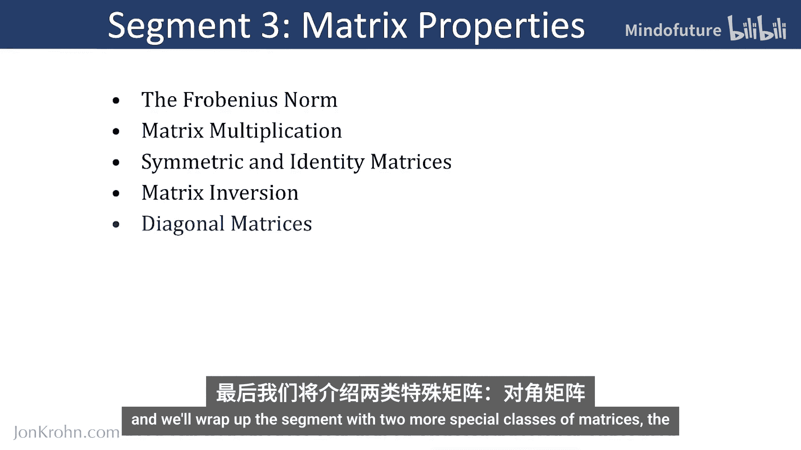

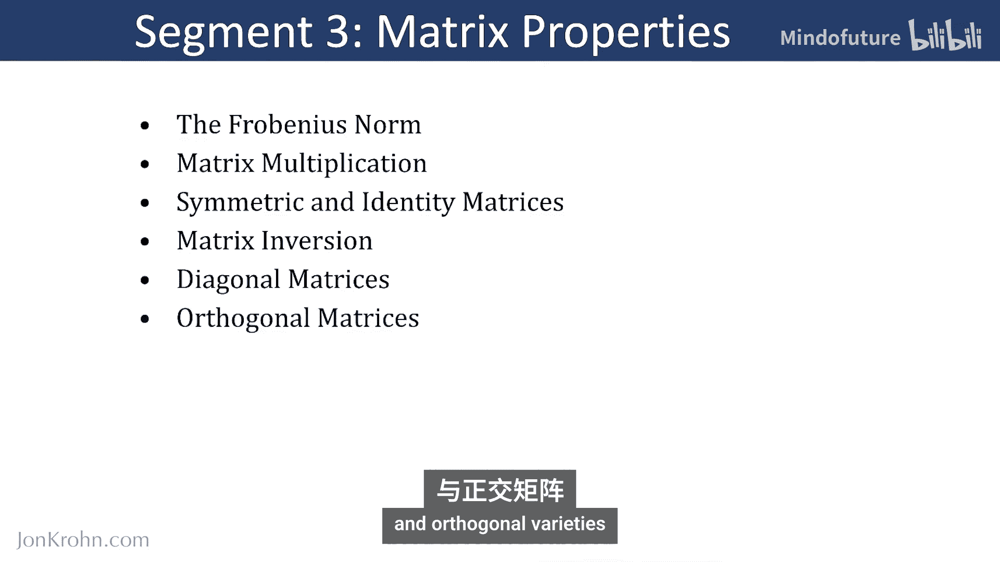

Not only will these topics wrap up segment 3， they'll wrap up the entire first subject。

 providing us with the foundations we need to tackle the second subject linear algebra 2。

 which features relatively advanced operations on matrices that build upon the matrix properties covered here。

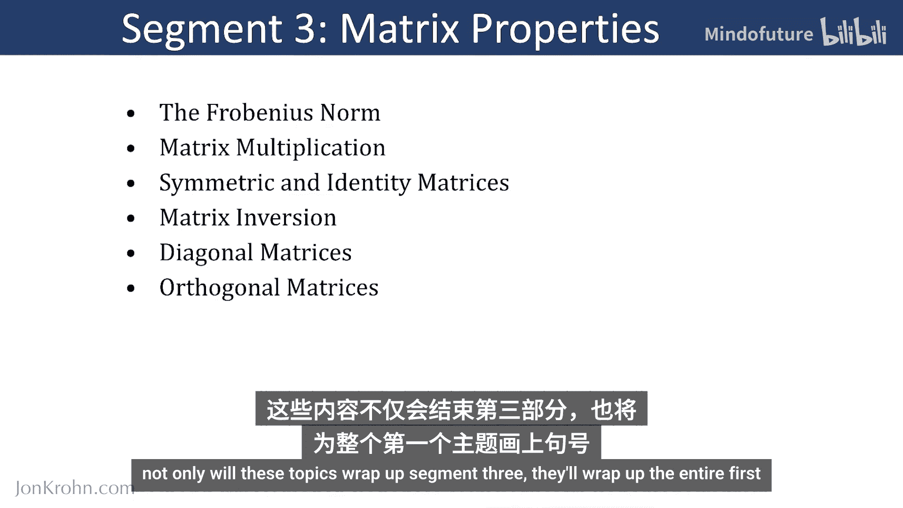

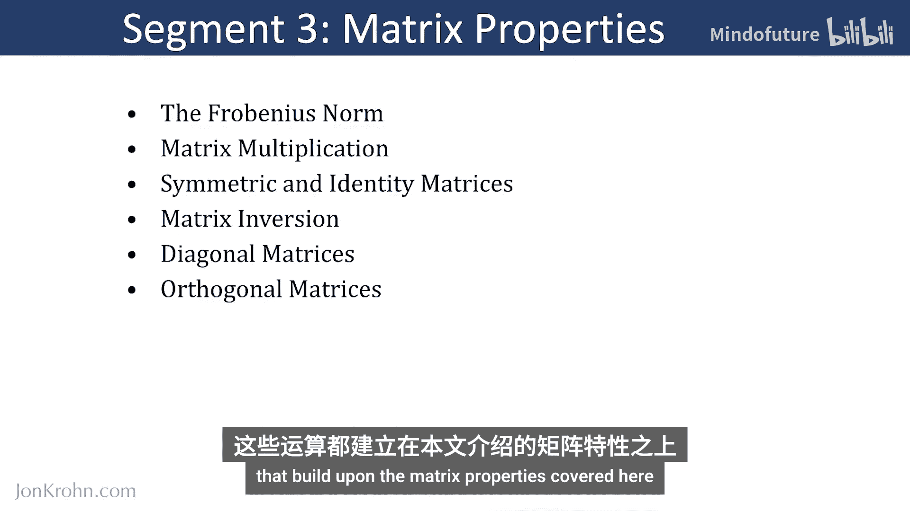

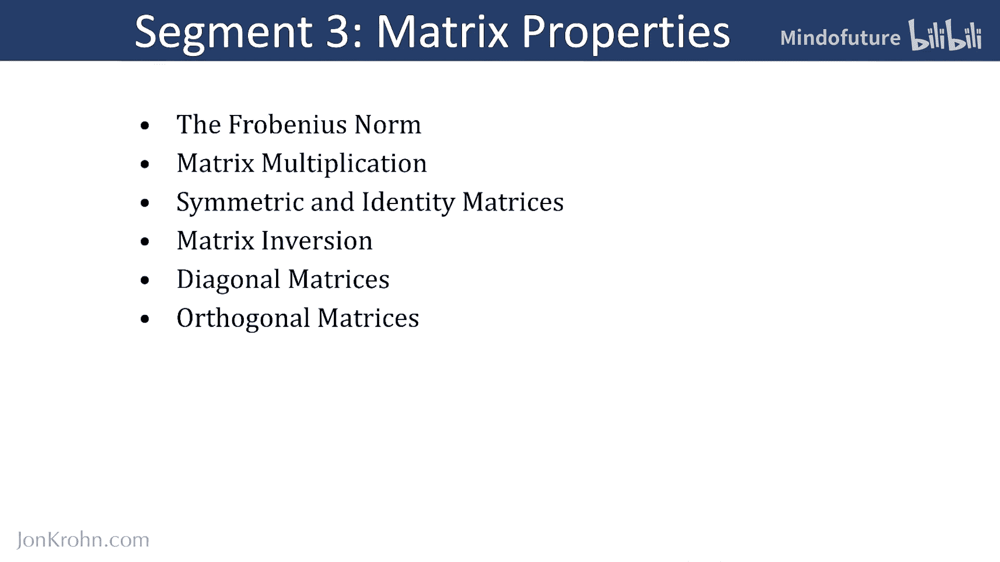

Okay。