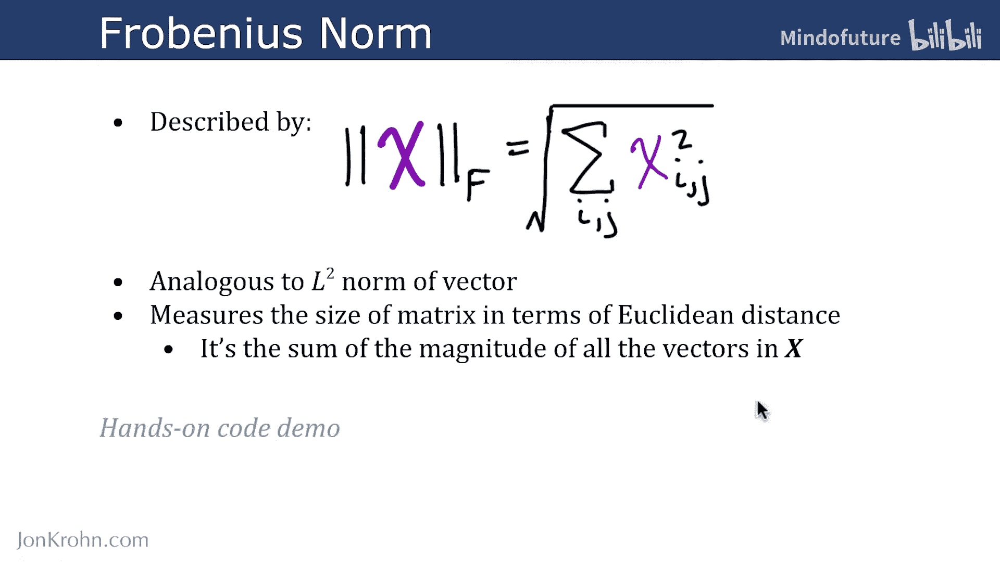
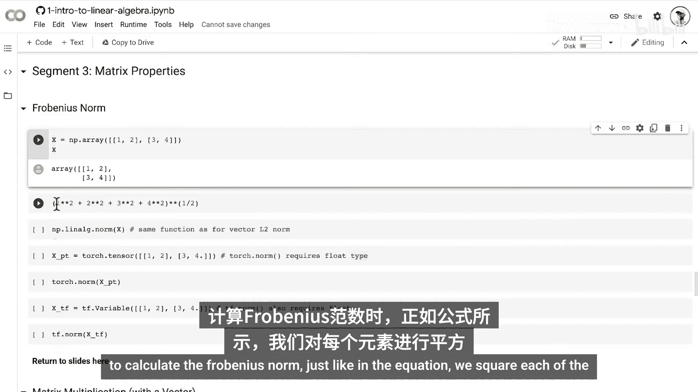
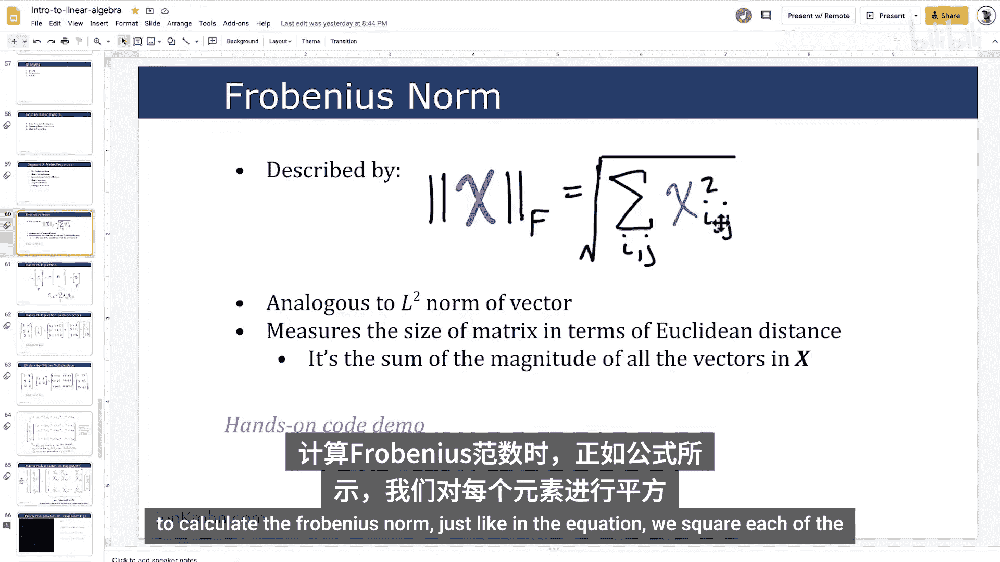
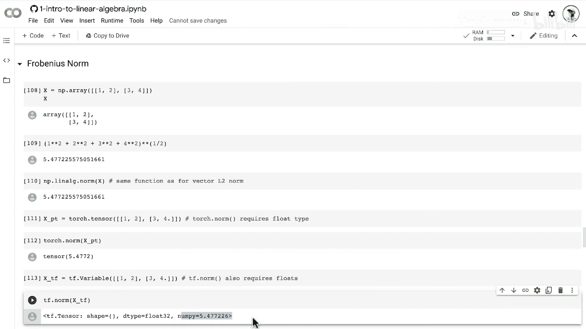

# 机器学习的线性代数及Python实现 ｜ Linear Algebra For Machine Learning p23 P23_弗罗贝尼乌斯范数 — 主题18 -BV1L8nLz6E8C_p23-

In this video， I introduce the Frrobeius norm， a function that enables us to quantify the size of a matrix。

 we'll use a hands on code demo in Numpy to solidify our understanding of the topic。

The Frroenius norm， it described by this equation here。

 It looks maybe a little complicated at first glance， but I promise you， it's really easy。

 And you'll see that， especially when we get into the hands on co demomo coming up。

So we annotate the Frbinius norm using the same kind of norm notation as we used in earlier videos where we were talking about vector norms。

 so you can check that out if you haven't already the norms and unit vectors topic that occurred earlier in this subject。

So there we had a vector which is lowercase in bold here we have a matrix which is uppercase and bold。

 so it's a matrix X， and we have the same kind of double absolute value looking bars around the tensor in this case a matrix。

And。We specify that it's a Frbeius type norm with this capital letter F as subscript。

Then to actually calculate the Frbeous norm， we consider each of the elements in our matrix X。

 So this is not in bold because this is an individual element of this bolded。Mattrix sensor X。

So we're considering each of the individual elements， so for I rows and J columns in the matrix X。

 we simply sum up across all of those individual elements， every I and J。

 but we square those elements before we sum them up。Once we've done that。

 so squaring each of the elements， summing them all up。

 and then taking the square root of that result， that gives us the Frbenius norm。

This perbenous norm is analogous to the L2 norm of a vector， again。

 check out that norms and unit vectors video from earlier for a refresher。So like the L2 norm。

 the Frbenous norm measures the size of a matrix in terms of Euclidean distance。

 so that's just normal plain old distance like we would use to measure the dimensions of a room or how far you threw a ball or anything like that。

Another way of thinking about the Frenous norm is to think of it as the sum of the magnitude of all of the vectors in some matrix x。

 so you could consider， say all of the columns in a vector to be individual vectors。

 and it's just the sum of the magnitude of each of those vectors。

Let's look at a hands on code demo to bring all of this to life。

For a simple calculation， let's use Numpy to create a new matrix with some low values in it。

So here's a matrix x with just four values，  one， two，3， and 4 in a two by two arrangement。

To calculate the Frbinus norm， just like in the equation。

We square each of the elements， sum them up， and then take the square root。

So let's do that here， let's take each of the elements and square them one squared，2 squared。

3 squared and four squared。Sum them all up。And then we could take the square root。

And that gives us our result the Frbenous norm of this matrix x is 5。5。

Of course we don't need to do it manually like this and do all the individual mathematics to get the for venous norm。

 you can actually use the same function as we used earlier for the vector L2 norm。

 so this linear algebra norm method in the NI library， it gives us that exact same 5。5 value。

As if we calculate it manually and quickly here's how we can do it in pytorrch and Tensorflowlow as well。

 so note that if you're using pytorrch or Tensorflow norm methods， you need to have your matrix type。

Your tensor type more generally be af floatat。So while NmpI works on integer typed。Tenssors。

 pytorrch and tensorflow both require floats。 So I'm just adding a period here to indicate that。

These should be float typed tensors in out of case。

 so using the torch tensor method to create the same tensor as we had here in Numpy。

 and then we can use the torch Nor method to get again the same result 5。5 and same thing in tensorF。

So hopefully that's straightforward enough。Up next is matrixtri multiplication。

 one of the most critical mathematical operations in machine learning。

