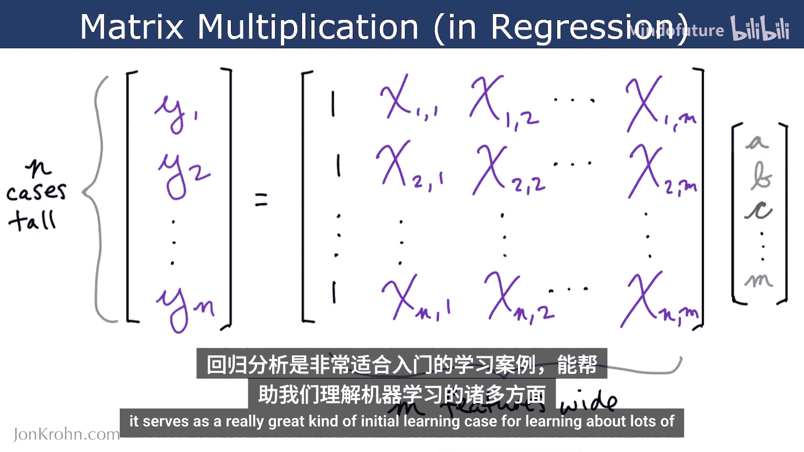
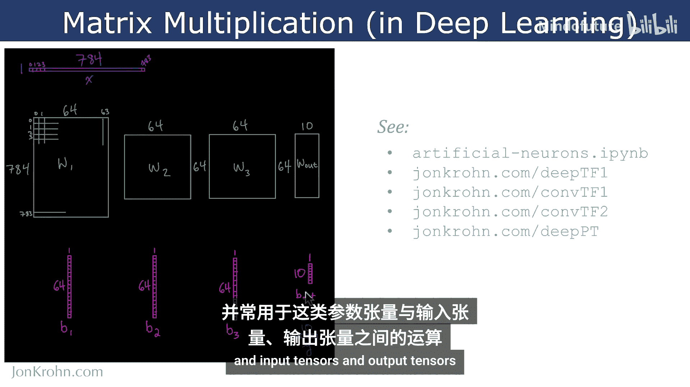
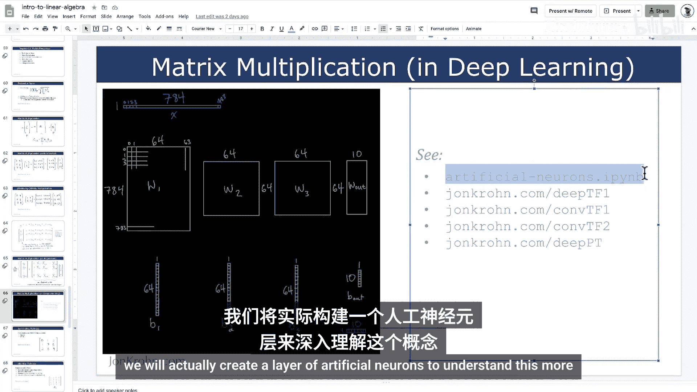
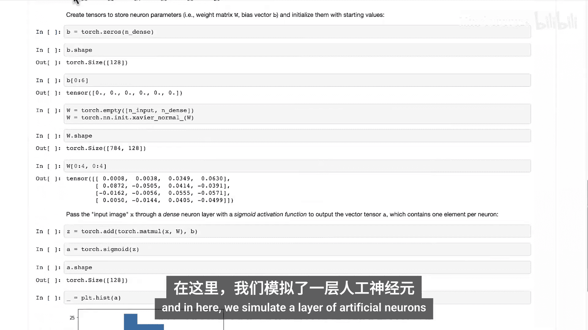
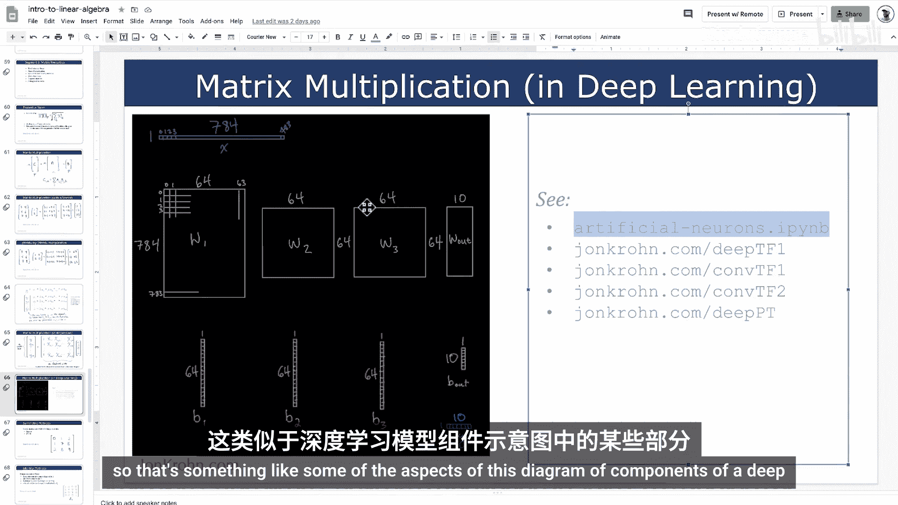
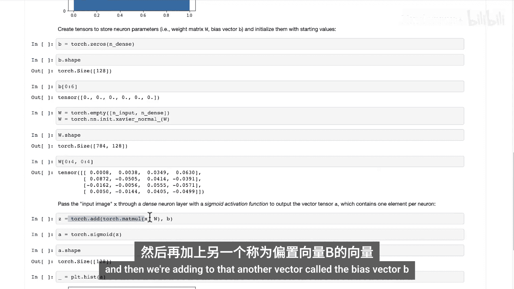
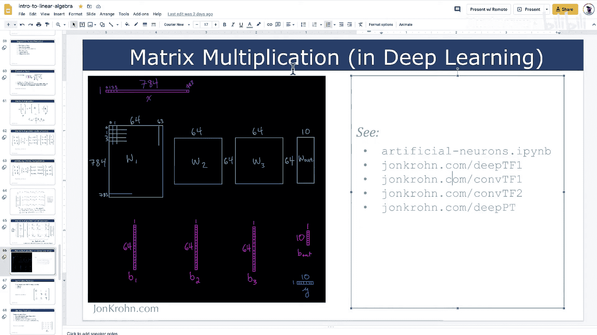

# 机器学习的线性代数及Python实现 ｜ Linear Algebra For Machine Learning p24 P24_矩阵乘法 — 主题19 -BV1L8nLz6E8C_p24-

Matrix multiplication is arguably the single most important and widely used mathematical operation in machine learning。

It isn't as immediately intuitive as element wise operations on a matrix such as the Haamamad product。

 which we covered in an earlier video。So in this video。

 we'll make sure you get a solid grip on matrix multiplication via a combination of colorful diagrams。

 calculations by hand， interactive code demos， and an applied machine learning example。

If we'd like to perform matrix multiplication on two matrices。The most critical thing。

Is that the number of columns in the first matrix， say matrix a。

Must match the number of rows in the second matrix， say matrix B。So in this case。

 matrix A has n columns and matrix B has the same number N rows。

Then the number of rows of A can be anything I have it as M here， and the number of columns of B。

 that's also free to be anything I have it as P here。

When we multiply these two matrices by each other。We end up with a resulting matrix， say matrix C。

That has the same number of rows as the first matrix。 So M rows in this case。

And the same number of columns as the second matrix， so P columns in this case。

To figure out exactly what is in each element of the matrix that is created here by the matrix multiplicationification。

 use this formula here， which is a little bit difficult to understand when you look at it like this。

 but we're going to go over a paper and pencil example on the next slide that will make what's happening here clear。

 Well let's go over it quickly now。So for any elements。In C。

 so let's say the element in row I shown in green and column K shown in blue。That element。

Is the result。Of summing a number of operations over the columns of a or equivalently actually over the rows of B。

So this summing operation over J。In yellow。Is the sum over。These elements from A and B。

 So one from each， and it's the element。Ocurring in the I row。

And the Jith column of a multiplied by the element in the Jith row and the kith column of B。See yes。

 we calculate all those individual elements。In a given row of A。

 which corresponds to a given column of B， and then we sum up across that row of A。

 which is also a column of B。So let's look at an example to make this clear。

It's easiest to understand matrix multiplication if we do it first where one of those matrices is actually a vector so a vector。

 you could think of that as a matrix with one column or with one row in this case we'll do one column。

So does this do these two matrices meet the criteria for being able to perform matrix multiplication。

 so remember that in order to perform matrix multiplication。

 the number of columns of the first matrix must be equivalent to the number of rows of the second matrix and we have two columns in the first matrix to rows in the second matrix。

All right， having established that we can perform matrix multiplication。

 then let's actually carry it out。To do this operation here， this involves。

Taking3 times 1 plus4 times 2。And repeating that。For each of the rows of a。

 so three times 1 plus 4 times 2， 5 times 1 plus6 times 2。7 times1 plus8 times 2。And we sum across。

The columns in this case here。And so。First， let's calculate the individual products of the elements。

 so three times 1 is 3， four times 2 is 8， five times 1 is 5，6 times 2 is 12，7 times 1 is 7。

8 times 2 is 16。And then actually perform the summ， peopleupils say is 11。

5 plus 12 to 17 and 7 plus 16 finally is 23。So let's look at this in code as well。

 since we wouldn't typically be doing things by paper and pencil。

 though paper and pencil certainly makes it easier to understand what's happening in code。

So here I'm creating the same matrices。Well， the same matrix in vector， technically。As on the slides。

So matrix A。As this structure matrix B as this structure， sorry， vector B has this structure。

And in Nai。We can use the Numpey dot method。To perform matrix multiplication。So first off。

 we can confirm that this produce the same output a vector with three elements， 11， 17 and 23。

As we obtained here。So we're getting the same results， so that's great。

I wasn't lying to you about anything， and I didn't do any arithmetic wrong。

But there is something funny here， which is it's funny to me that in Numpy we use the dot method to perform matrix multiplication because technically speaking。

 you would really only call the dot product a similar kind of operation that we performed between two vectors。

 and we covered that in an earlier video in this machine learning foundation series called the dot product。

In pytorrch and Tensorflow。Let's carry out the same operations as here。

 let's carry out the same matrix multiplication as we did in the slides and as we did a nuy。

 so create a pytorrch tensor and a p torch vector， A and B with exactly the same elements in it。

And then in Pytorrch， we use the matrix multiplication method。

 and that terminology makes a lot of sense to me。For matrix multiplication。

 instead of say calling it the dot method when we're not performing a dot product but performing matrix multiplication。

So。Like the Nmpy dot method， this torch mat mo method is automatically inferring。

What the dimensionality of the tensorors going into it is in order to perform a dot product。

 matrix multiplication， or matrix by vector multiplication。

 which is really just a special case of matrix multiplication。In Tensorflow。

 so let's create the same tensors A and B here。In TensorFlow， we actually need to specify explicitly。

Whether we want to perform the dot product， matrix by vector multiplication。

 or matrix by matrix multiplication。So again， with pytorrch and nupy that's figured out automatically with TensorF。

 we need to be explicit about it。Let's go back to the slides and do a paper and penciled example of matrix by matrix multiplication。

 and then we'll come back and do that in these three libraries again。

For an example of matrix by matrix multiplication， I'm using the same matrix that I called a in the code here and the same matrix as from the preceding slide where we did matrix by vector multiplication。

And for my second matrix。I decided to have the first column of the matrix be identical。To。The vector。

From the preceding slide。 So it's just a 1 and a2。 and I've added another column 9 and 0。

 And I did this on purpose to illustrate something cool as we go through and carry out matrix by matrix multiplication。

 So again， following the rule。😊，Of matrix multiplication， the formula of matrix multiplication here。

We first。Do3 times1 plus4 times 2。To get this cell in the top left hand corner of the output matrix。

And so actually， everything that we do for the left hand column。The left hand column。Of。

The output matrix。It's actually identical to the operations that we performed on the preceding slide。

 So all the same all this math right here。Is identical to the math that we're performing in this column here。

 And so the first column of our output matrix has the exact same results as。

The is the preceding slide， so 11，17 and 23 yet again。Now。

 the difference with this matrix by matrix multiplication now is that we have an extra column。

And so with this extra column， we perform the same operations， so three times 9 plus4 times 0。

5 times 9 plus 6 0，7 times 9 plus 8 times 0。And when you actually do that arithmetic。

 you end up with 27， 45， and 63 for the second column。

So as long as we have the same number of columns in this first matrix。

 the same number of rows in the second matrix， this matrix by matrix multiplication can happen。

 and so you could think about extending and having additional columns in the second matrix and that would result in additional columns in the output matrix and the calculations that we'd be doing in each of those individual columns。

Would be independent from each other just as we saw here。 So this you could think of。

This matrix by matrix multiplication is kind of being many matrix by vector multiplications where the vector is a 1 by two column vector or a9 by zero column vector。

 and then we just kind of stack those vectors next to each other。In the resulting output。

That's a behavior that we're going to see and play around with a lot in the second subject of Maine Learning Foundation series。

 which is coming up pretty soon now。All right， and let's do a hands on code demo of this example as well。

So A is the same as before。We'll do Npy first again。This time， B。Has。Two columns。

Same examples in the slides， and when we use the， the nuumpy dot method。

Just like we did in matrix by vector multiplication。

 we can do that here and we get the same results as we had on the slide。

 which is great Again I'm glad I didn't make any arithmetic errors。😊，One thing to note here。

That I hadn't mentioned yet， but it' actually really important。

 and you may have pieced this together yourself。Is that Ma multiplication is not what we call commutative。

So multiplying a times B is not the same。Except in special circumstances， so it's。

Typically not the same。Is multiplying the matrix B timesns the matrix A。So in this case。

You can't even perform matrix multiplication。The other way around， B times a。

 because the number of columns and rows doesn't line up properly。

 so you get a size mismatch error if you try to run that line of code here。

So that's something to note and in some circumstances， so say if A and B were both square matrices。

Then， you could perform。At least you'd be able to carry out。

The A times B matrix multiplication and the B times a matrix multiplication， but。

Unless there were some special things going on in the structure of those matrices。

The results would be different。 You wouldn't get the same result from multiplying A times B or multiplying B times A。

 Anyway， that's a bit of an aside。 and you can experiment with that in your own time。Anyway。

 let's look at doing these same examples in Pytorch and Tensorflow， just like we did in nuy。

Let's create this new matrix B in Pytorrch， and you can actually just convert the nuy matrix into Pytorrch with this from Numppy method available in Pytorrch。

And one other way of doing the exact same thing。 And I thought this was kind of neat because me。

 I kind of think about。The individual columns。As I mentioned when I was going over these slides。

 I think about the columns of the second matrix as being independent vectors that produce independent vectors in the results。

 Well if you think about it that way then when you create your matrix you might think about it as being okay the first column vector 12 and the second column vector 9 and0。

 but in that case，Before you finalize your matrix， you're going to want to transpose it so that these are column vectors。

 not row vectors anyway， it's just another little bit of inocide and you know just some other way that you can be thinking about these matrices。

So either way， you end up with the same matrix tensor in Pytorrch and。

As I mentioned earlier when we were looking at matrix by vector multiplication in pi torch。

 we can use this mat mole method for both matrix by vector and matrix by matrix multiplication。

 so we get the same results here as we did in nuy。And again。

 we're using the same mat mole method as we did for the matrix by vector multiplication。

In Tensorflow， as I mentioned， when we were doing the matrix by vector multiplication。

 you're going to need to use。The specific type。 So for TensorFlow， we used map Vc earlier。

For the matrix by vector multiplication。But for matrix by matrix， we use this map mall function。

 So a bit more specificity in Tensorflow and also something that I skimmed over here is just like we can convert from。

😊，A nuy matrix or any kind of nuy tensor into a pytorrch tensor with the from Numpy Pytorrch method。

 we can also do that。In Tensorflow with this convert to tensor method， but。

You may need to specify the data type when you do that， whereas Ptorch will take a guess for you。

 of course you can optionally specify what you would like the type to be。All right。

 having covered a couple of examples of matrix multiplication and done some hands on code demos。

 now let's also just quickly tie all of that into a real worldor machine learning example so that you can understand when matrix multiplication would be used in practice in machine learning。

So in the first topic of this machine learning foundation series in a video called What Linear algebra is。

 I already showed。This diagram， so what we were doing in this case was we were using data to try to predict the price of a house why using various input attributes like number of bedrooms distance to a school and so on。

 so those are symbolized by X。And what we're trying to learn with our regression model is we're trying to figure out what the parameters A B。

 C， all the way through to M are。And then that way。

 when we get information about a house in the future， when we get the number of bedrooms x1。

 the distance to school x2 all the way through to， you know however many features M features we have。

 we can use those parameters， A， B， C， and M to predict what the house price is likely to be。

To train this regression model， we would typically have a set of data。N data points here。

 so I have one two all the way through to n house prices with the y values here。

 and then I have one two all the way through to n， say number of bedrooms for this feature x1 and then for this other feature x2。

 say distance to school， I have one to n examples and of course every row represents a specific house。

So this is the number of bedrooms and the distance to school and whatever feature M is for this particular house。

 YM。Also， I want to quickly note that I did something here to make this a bit more visually appealing and easy to understand。

 but strictly speaking。X actually extends right word to M minus1 not to M because of the presence of a all the way on the far left here。

 the y intercept or the average house price on the far left， but。Don't really。

 you don't need to worry too much about that detail to understand what I'm trying to get to here at a high level。

So instead of doing this， you know， this kind of。Cunky mathematics here and repeating these parameters。

 A B，C and M in every single row of this set of linear equations。

You can represent this regression more neatly。As a matrix multiplication。And then in that case。

 we only need to have each of the parameters once in the entire equation。

So you can work through this following the same formula that we did at the beginning of this video where I was showing how we do major re。

 but effectively what's happening here is for every single row we're calculating。

A times1 and B times this x11 and C times x12 all the way through to M times x1 m。

 and then we sum up each of the rows after performing that multiplication and so that's the same thing as we're doing here。

 It just looks a lot meter this way。 So we have a matrix here of features。

And we use a column of ones to represent that y intercept， that average value that will。

'Learn with a， the parameter A。But otherwise， it's just all of the features in our data。And yeah。

 and our outcomes。Our and you say the house prices and dollars can be a vector of those y values。

So yeah， hope that helps you understand you know an example of matrix multiplication in practice and later on in other subjects of this machine learning Foundation series we will see several more we're going to work through a regression a lot。

 it serves as a really great kind of initial learning case for learning about lots of aspects of machine learning。

And a final slide here， a lot of people are interested。In deep learning。

 which is a subfield of machine learning。And。Similarly to the last example in the very first topic of this machine learning Foundation series in a video called What Linear algebra is。

 I also showed this diagram which shows a bunch of vector and matrix tensors。That represent。

The inputs， the outputs and the various parameters。

 the weights and the biases that we're learning in a deep learning network。

 and you don't need to understand。Anything about this right now。

 I don't expect you to understand these matrices or their purposes at all。 That isn't the point。

All that I'm trying to show you here is that。In a few examples。Which we'll go through quickly here。

Matrix multiplication you'll see is deeply embedded in deep learning and is used to perform operations regularly between these kinds of parameter tensors and input tensors and output tensors。

So by the time we get to the final subject of this machine learning Foundation series。

Which is called optimization。 We will actually create a layer of artificial neurons to understand this more deeply。

 Let's go quickly look at that notebook now。

So all of the notebooks for the Ma learninging Foundation series are Gitthub。

com/jochroone/mfounds and then the specific notebook here is this artificial neurons notebook。

 so we have been primarily working out of this one intro to linearar algebra notebook which contains most of the content in this first subject called Intro tolinear algebra in the Maine Learning Foundation series。

 but let's quickly jump to this artificial neuronsur notebook。And in here。

We simulate a layer of artificial neurons so that's something like some of the aspects of this diagram of components of a deep learning model。

And in it。Righted in the middle of his notebook were performing the matrix multiplication operation in Pytorch。

Specifically， we're multiplying an input vector x times something called a weight matrix W。

And then we're adding to that another vector called the bias vector B。

In case you're curious that's the same kind of thing we're doing here so we have an input vector。

 we have a weights matrix and then a bias vector and yeah we we could do that a number of times for a larger deep learning architecture is actually an example of that here at Johnchroron。

com/deeptf1 which you can check out on your own it uses all these same tensor components and matrix multiplication happens in the middle and same kind of thing for a convolutional neural network it just gets more and more complicated。

In TensorFlow2。As well as in pie torch。The kind of high level code is much simpler and you don't see the matrix multiplication happening。

 but even in these higher level more abstracted library versions。

 that matrix multiplication is still of course， happening in behind the scenes。

 like you can see in these three notebooks。Anyway， check that out in your own time and we'll dig into some aspects of that in more detail later on in this machine Learn Foundation series。

Allright， that was a great mediay video covering matrix multiplication up next is a relatively quick one on special types of matrices。

 including identity matrices， which display distinctive behavior when used in matrix multiplication。

See you there。

To be sure not to miss the next tutorial in this series， subscribe to my channel。

Thanks for taking part in the tutorial， I hope you enjoyed it。If you did， please like and comment。

To be sure not to miss any of my content， head to joChrome。com and sign up for my email newsletter。

You're also welcome to A me on LinkedIn， simply mention that you're a reviewer of the Maine Learning Foundation series。

You can follow me on Twitter too if that's your social medium of choice。

See you next time。