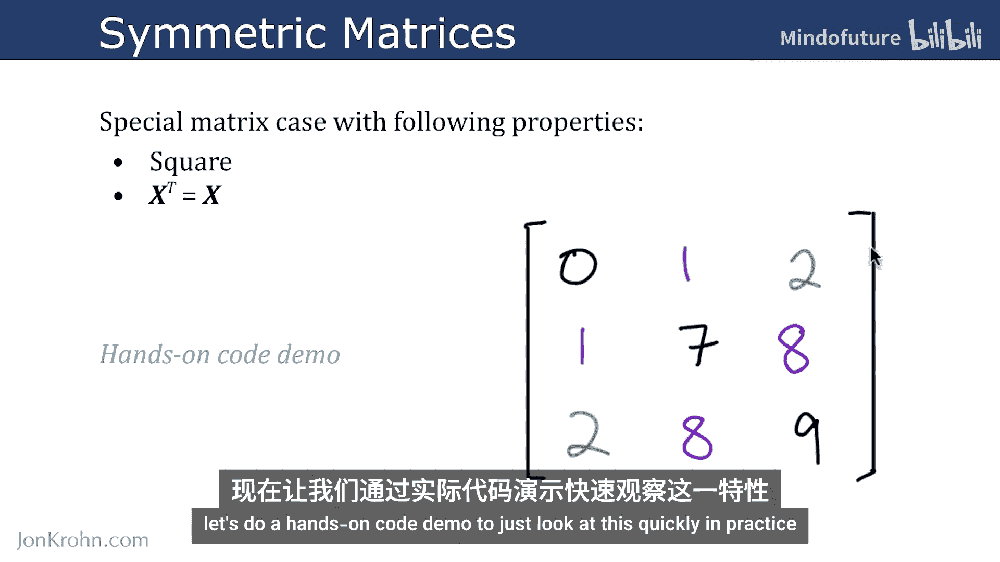
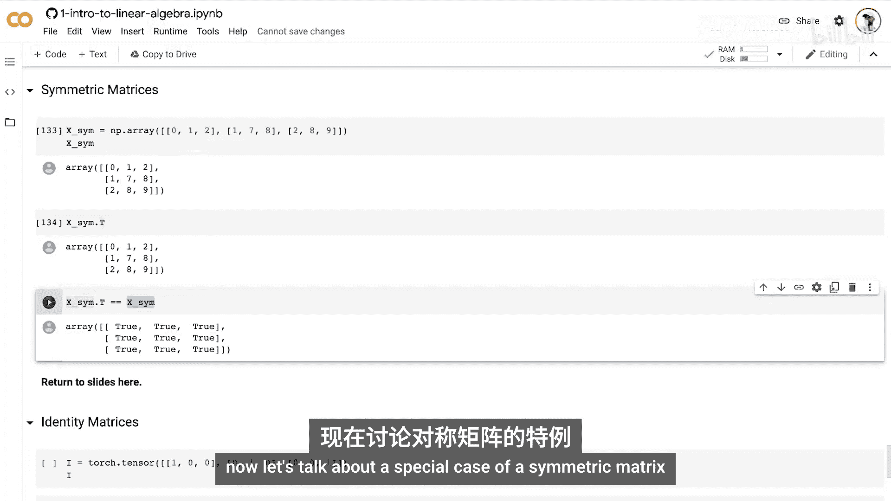
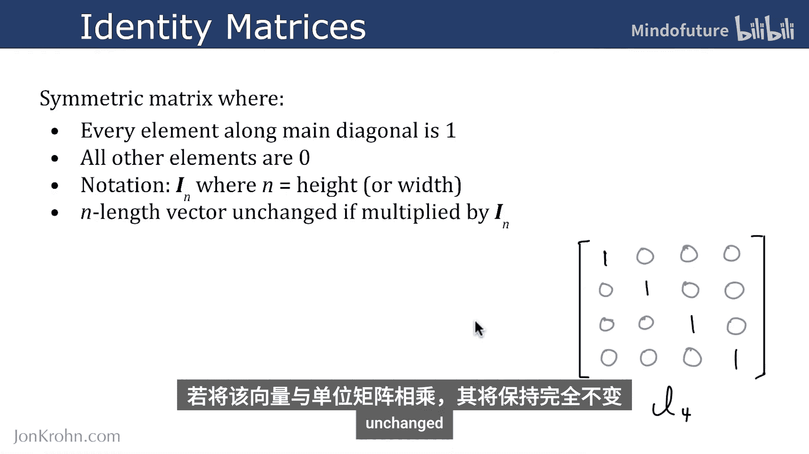
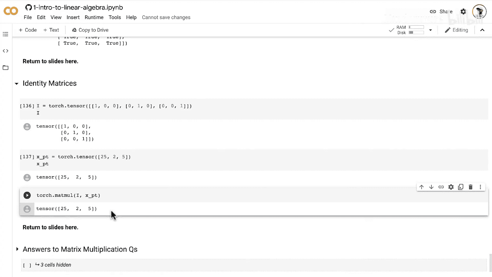

# 机器学习的线性代数及Python实现 ｜ Linear Algebra For Machine Learning p25 P25_对称矩阵和单位矩阵 — 主题20 -BV1L8nLz6E8C_p25-

This video is onsymmetricsymmetricsymmetric matrices， a special class of matrix tensors。

I'll use a combination of slides and hands on code demos to show you symmetric matrices in general。

 as well as the most critical symmetric matrix of all， the identity matrix。

A symmetric matrix is a special matrix case with the following properties。So first。

 it has to be square， so it has as many rows as it has columns。

 So I've got an example of a symmetric matrix right here with three rows and three columns。

 the other key property。Is that the transpose of the matrix is equal to the matrix itself。

 So that means that you can have anything along the main diagonal of the matrix， but above and below。

 there must be a symmetrical mirror image so that when you transpose。You end up with the same matrix。

Let's do a hands on code demo to just look at this quickly in practice。

I'm using nuumpy in this cell to create the same matrix。

 the same symmetric matrix as I showed you on the slide。

You can confirm that for yourself and let's have a look at the transpose of that matrix by using the dot t operator on the matrix yep。

 it looks exactly the same and you know you can visually inspect it quickly when it's a  three by3 matrix。

 if it was a bigger matrix you could use the double equal sign to confirm that all the elements are the same whether you have the transpose or the original。

So cool， that's a symmetric matrix， that's it。Now let's talk about a special case。

Of asymmetric matrix。

That's the identity matrix， so this is a symmetric matrix where every element along the main diagonal is equal to 1。

All of the other elements are equal to zero。We can annotate such an identity matrix with。

I and of course， it has matrix notation。 So it's capitalized and taicized and in bold。

 And then you put as a subscript， however many rows or columns， whatever the height and width。

Height or width and also， I guess the length of the main diagonal。 They're all the same value。

 So in this case， identity matrix I 4， it has four rows，4 columns。

 and its main diagonal is four elements long。 The special thing about identity matrices is that if you take an n length vector。

 So in this case， a vector of length 4。😊，And you were to multiply that vector by the identity matrix。

 it is left completely unchanged。

Let's go look at a hands on code demo to see that。All right。

 so here I'm using Pytorrch to create an identity matrix。

And we could have done all these examples in Nmpy and in Pytorrch and in TensorFlow。

 like many of the examples in this notebook， but I figured by this point if you've been following along with all the videos。

You should be pretty comfortable being able to do any of these exercises here that we're working through in nu Py or tensor flows。

 so if you want to as an exercise on your own， you could try doing。

This creation of an identity matrix and the rest of the steps that we're talking about here in either of the three libraries anyway。

 so I'm creating the identity matrix in Pytorrch。And so as you can see。

 this is an identity matrix I3， which has three rows， three columns。

 and we've got all ones along the main diagonal， zeros everywhere else。

Now you can take any vector tensor of length  three。Let's use this one。With the elements 25， 2。

 and 5， if we perform matrix multiplication。Of that identity matrix by the vector。

We output exactly the same vector as went in。So this is the special property of identity matrices。

Up next are three comprehension exercises on matrix multiplication that include an identity matrix after that we'll move on to the all important matrix inversion operation which relies directly itself on an understanding of identity matrices as well。

