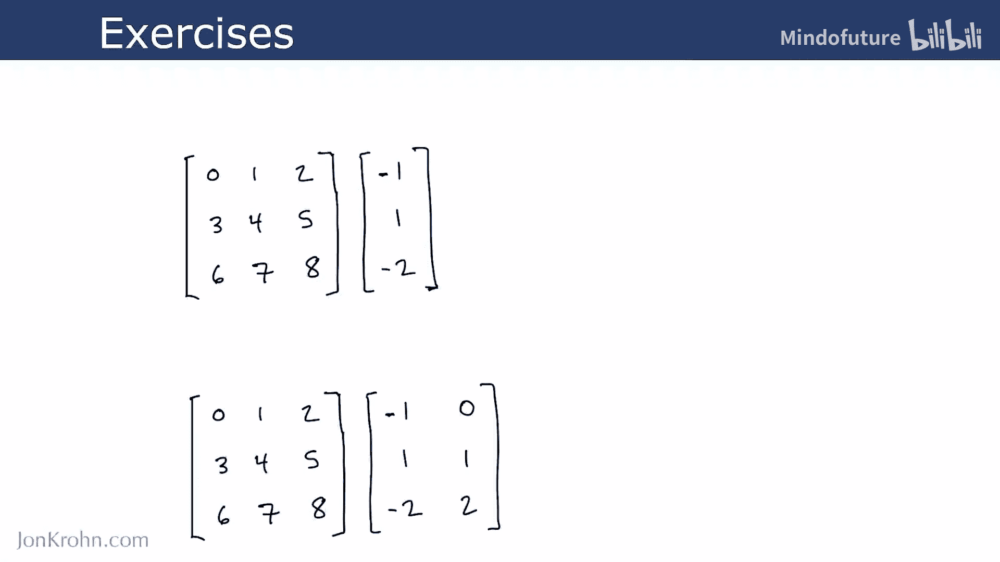
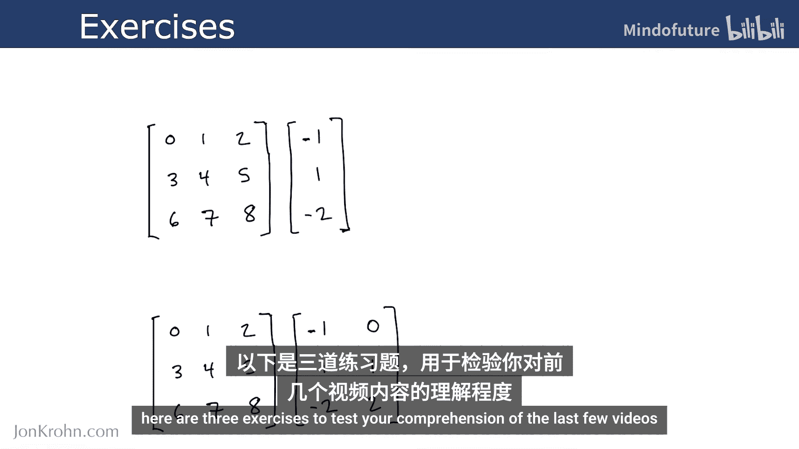
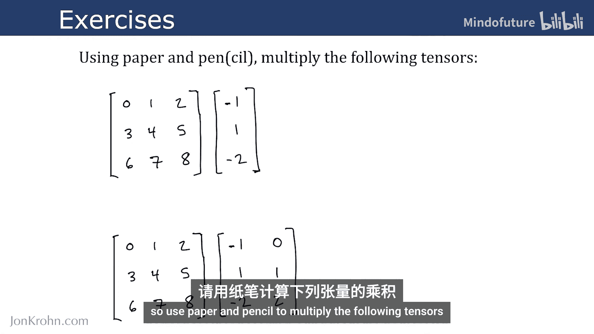
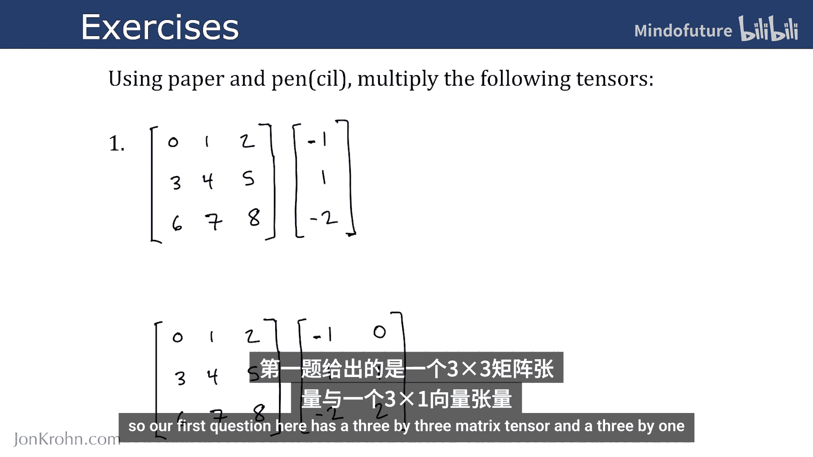
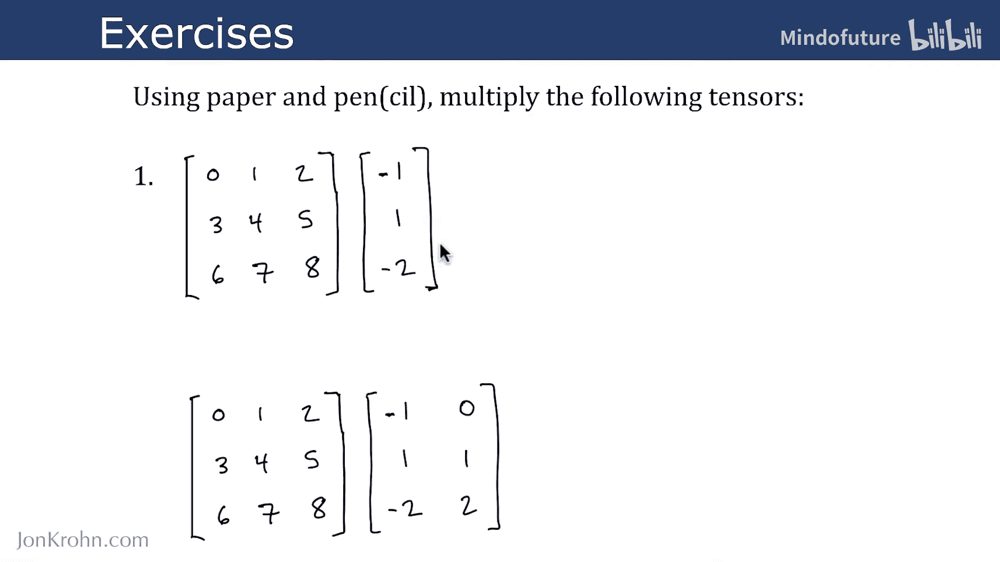
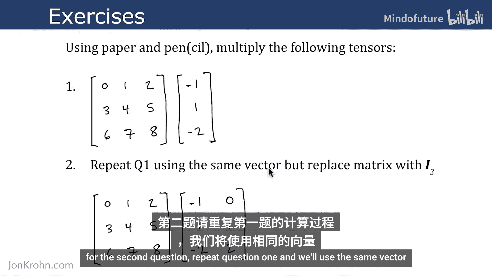
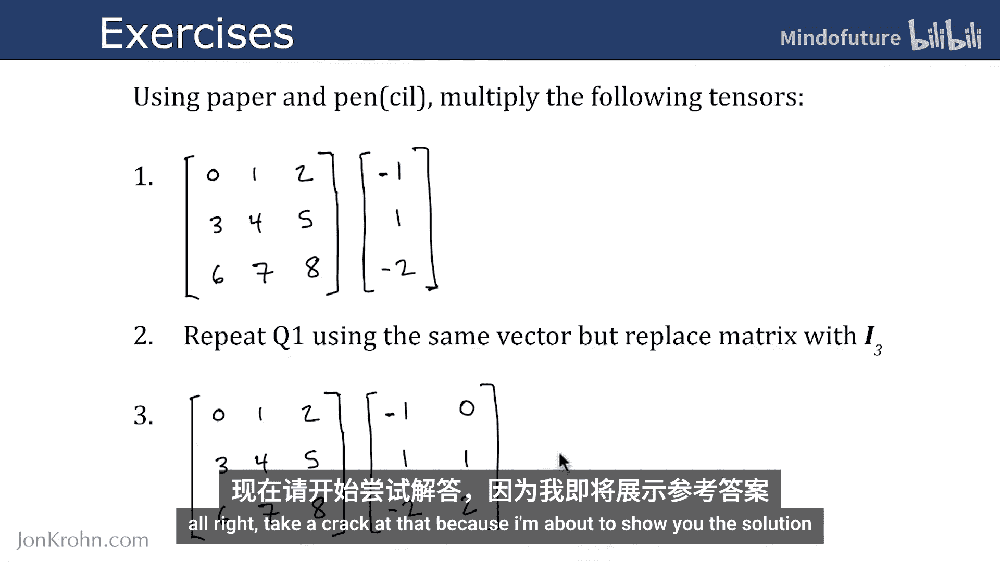
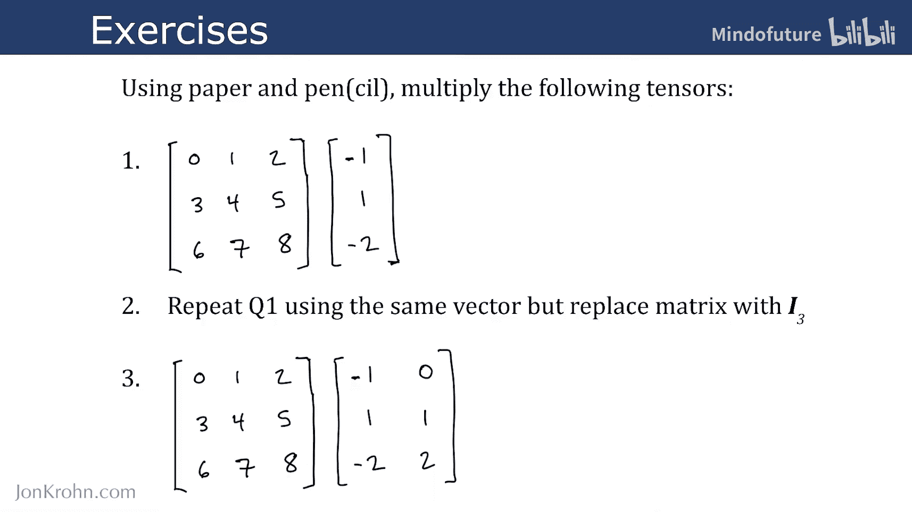
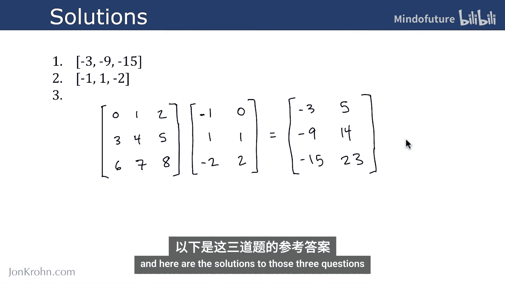

# 机器学习的线性代数及Python实现 ｜ Linear Algebra For Machine Learning p26 P26_矩阵乘法练习 — 主题21 -BV1L8nLz6E8C_p26-

Here are three exercises to test your comprehension of the last few videos。

So use paper and pencil。

To multiply the following tensors。So our first question here has a three by3 matrix tensor。

And a 3 by one vector tensor。

For the second question， repeat question1， and we'll use the same vector。

 but replace the matrix with the identity matrix I3。

And then the third question is multiplying two matrices by each other。All right。

 take a crack at that because I'm about to show you the solution， so press pause if you need to。

And here are the solutions to those three questions。

