# 机器学习的线性代数及Python实现 ｜ Linear Algebra For Machine Learning p27 P27_矩阵求逆 — 主题22 -BV1L8nLz6E8C_p27-

Inversion is a wildly useful operation that we can perform on matrices。

 we'll see it time and again at critical mind blowing moments in forthcoming machine learning foundation subjects。

In this video， I introduce what matrixtri inversion is。

 and will use a combination of colorful equations and handson code demos to solve for unknown values in a simple regression style problem。

Finally， I'll complete the video by detailing matrixtri inversion's limitations。

Matrix inversion is a clever， convenient approach for solving linear equations computationally。

 so it's an alternative to manually solving with substitution or elimination or other approaches。

 like we did with paper and pencil examples in two earlier videos in this machine learning Foundation series namely the solvinglving linear systems with substitution and solving linear systems with elimination videos。

The matrix inverse of some matrix x is denoted as x with a superscript of negative 1。

 and so this is similar to notation if you were to take any given variable and move it to the other side of the equation。

 you could also denote it in the same way。And。This matrix inverse of x。

 it satisfies this specific property where if we take the matrix inverse and perform matrix multiplication with the original matrix X。

 the result is an identity matrix。 So if the matrix x。Has four rows and four columns。

Then we'll end up with an identity matrix。I 4。To appreciate the significance of matrix inversion and how it can be useful for solving for unknowns。

 let's do a small scale example。 So this is going to be a regression like example。😊。

We already looked in an earlier video on matrix multiplication at this way of framing a regression problem where we have。

 say， some outcome， this could be house prices as y。

 and we're predicting house prices using a matrix of features。Represented by a matrix x。

 And so these features could be you know， one column could represent。

Number of bedrooms and another column could represent distance from a school and so on。

 and there's there're always in a true regression problem。 We have a constant。In this matrix。

 which allows us to have。A baseline average value for your outcomes， in this case。

 an average house price。And then we have this vector。Of。Feature weights of unknowns。

That we would like to solve for。 So we have our outcome data。 We have our input data into the model。

 and then we have these variables， this vector of variables that we'd like to solve for。

And in nice neat tensor notation， this whole formula can be represented as y equals X W。

So why is a vector tensor？X is typically going to be a matrix tensor。 That's why it's in uppercase。

 And then W is a vector。Of all these weights， A through M。

 corresponding to the number of columns in our feature matrix。Okay， so one more time。

 let's go over the details of what's in this equation here， y equals xw。So in that equation。

We know the outcomes Y， which could be say house prices in the example I've been giving。

We know the features X， which are predictors of house price， like bedroom count。

And vector W contains the unknowns， the model's learnable parameters。

So assuming that the inversion of the matrix X exists。 And at the end of this video。

 I'll describe situations where it doesn't exist。 So the limitations of finding the inverse。

But assuming that the matrix inverse does exist， then matrix inversion can solve for the unknown W。

Let's derive it quickly。So here is an equation where I've just flipped the left and the right side of the equation。

 so of y equals xw， we have xw equals y， so that's exactly the same really。Now。

Let's add in the matrix inverse so we can multiply both sides of the equation by the inverse of x。

And on the left side of the equation。Because of the property that we discussed on the first slide of this video。

 we know that the matrix inverse times the original matrix results in an identity matrix。

And we know from an earlier video called symmetric and identitydent matrices。

That when we multiply a vector times an identity matrix， we just end up with that vector as a result。

So now we have the neat equation that we can use to solve for the unknown vector W。

 it's simply the matrix inverse of x and the vector y multiplied by each other。So here's a example。

 a contrived example using some values that I put together。For the sake of simplicity。

 I've contrived a set of linear equations that is about as simple as possible as we could have for solving with matrix in version。

We have two equations。And so， these good。Represent in some way。

 the same way of thinking about this as a first house and a second house in our house data set。

 And then we have our outcome。 Maybe this could be like house prices in hundreds of thousands of dollars。

 We have one house that's worth $400000 and another house that's worth negative $700000。

 Hopefully this concept is making sense， even though my contrived example has some silly numbers in it。

So。Yeah， each row represents a different data point， a different instance in our data set。

 we have the outcome that we're predicting， and then we have the features that predict that outcome。

 So the features for predicting this outcome y equals 4 are 4 and 2 and the features that predict。

This outcome negative 7 are negative 5 and negative 3。And then we have these unknowns， B and C。

 these unknown variables that we're trying to solve for。

So let's take all these values and put them into tensors。So we can grab the feature values。

And we can put all those features into a feature matrix X。4，2， negative5， and negative 3。

And then we have a separate vector tensor y representing our outcomes that we're trying to predict with our input values。

The last thing is to have a weights vector that we're solving for。And so this weight vector here。

 it has two elements， B and C， B and C。And remember from the preceding slide that we can solve for this unknown value W。

By。Calculating the matrix multiplication of the inverse of x and the vector y。So here it is again。

Nice， so let's do that。 let's actually do this in a hands on code demo。

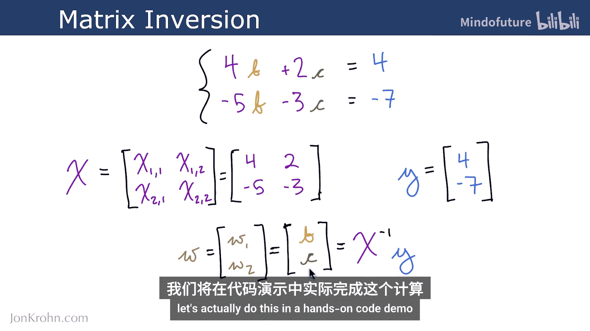

So we'll do this in nupy first， I'm creating a vector X for the features。

This is exactly the same is on the slides，42 negative 5 negative 3 for x。

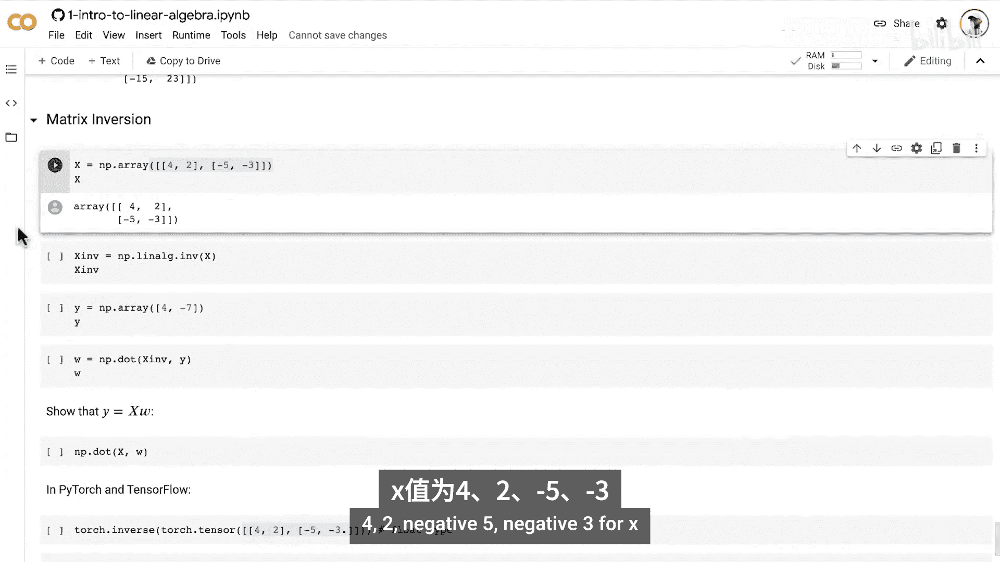

4our2 negative 5 negative 3 for x representing the x values。

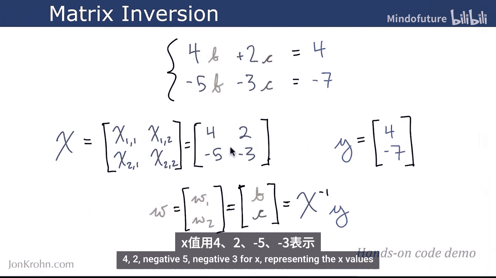

And then we can use a built in Ny function in the linear algebra module in。

Which stands for inverse to calculate the matrix inverse and。

We're not going to in this machine Learn Foundation series cover how to do this by hand。

 I'll provide other resources at the end of the second linear algebra subject if you'd like to learn how to do this by hand。

 but that's outside the scope of this machine Learn Foundation series。

We're just going to use built in functions like the Npy inverse function to automatically calculate the inverse of x。

 So here is the inverse of x。 Now that we have it。

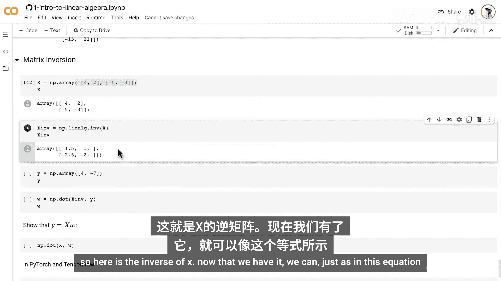

We can just as in this equation here， we can take this inverted matrix X。

And multiply it by our outcomes y to get our weights W。

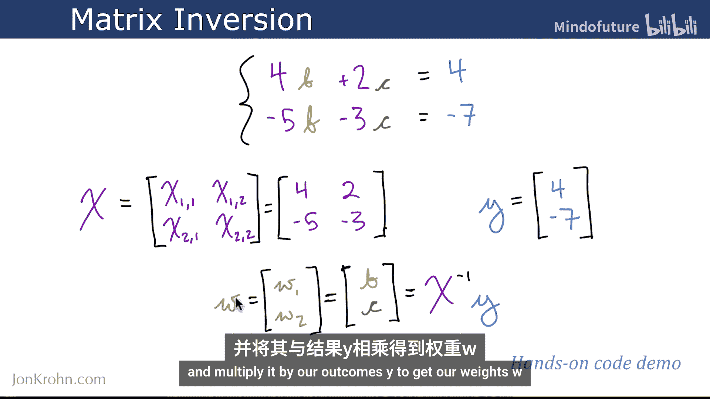

So let's create a vector tensor to represent those y values。

And then here we can use the nuy dot method to perform matrix multiplication on the inverse of x multiplied by y。

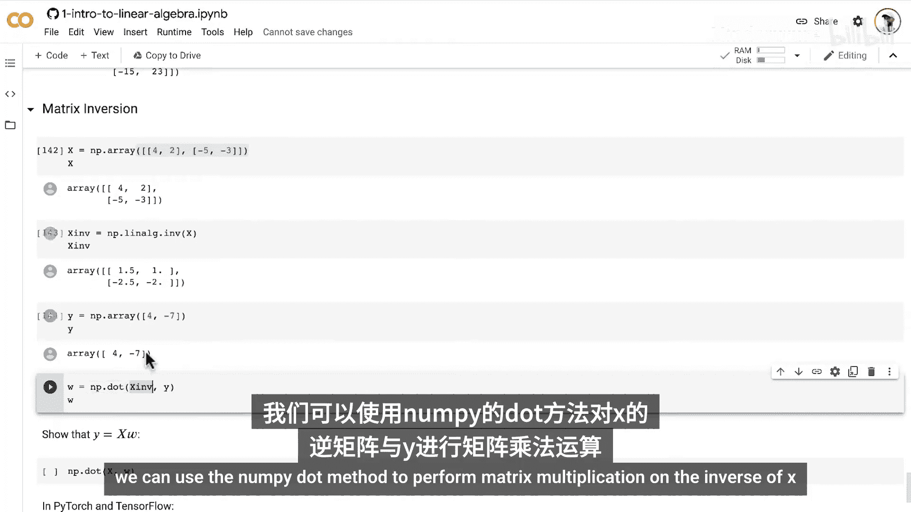

Inverse of x multiplied by y。

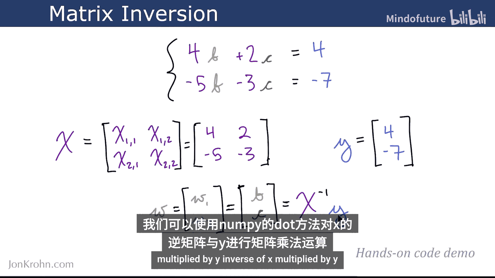

And that gives us our weights， W， which are negative 1 and 4。

 So that means that B is equal to negative 1 and C is equal to 4。

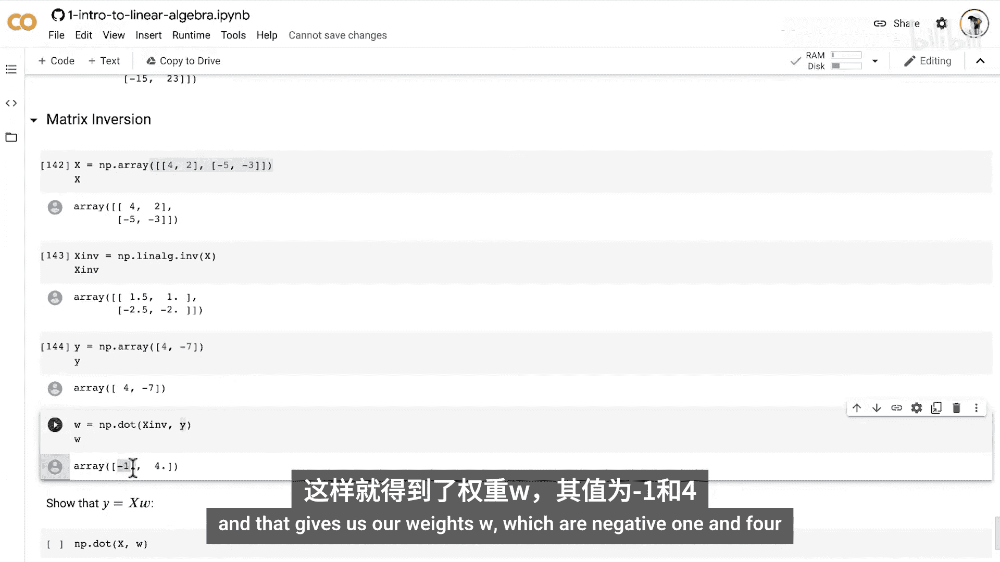

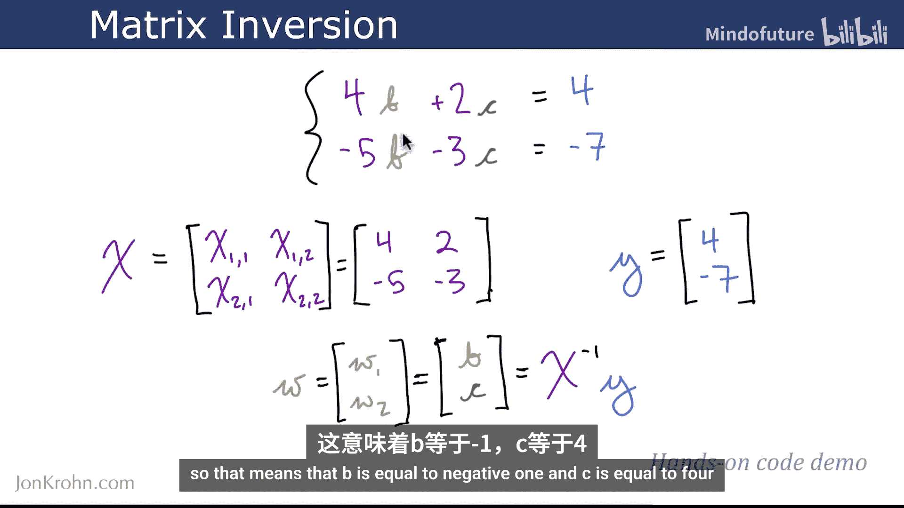

And you can confirm that for yourself because now that we've solved for W。

 we can show that the outcomes Y。R。Predicted by x and W， so going back to our original equation。

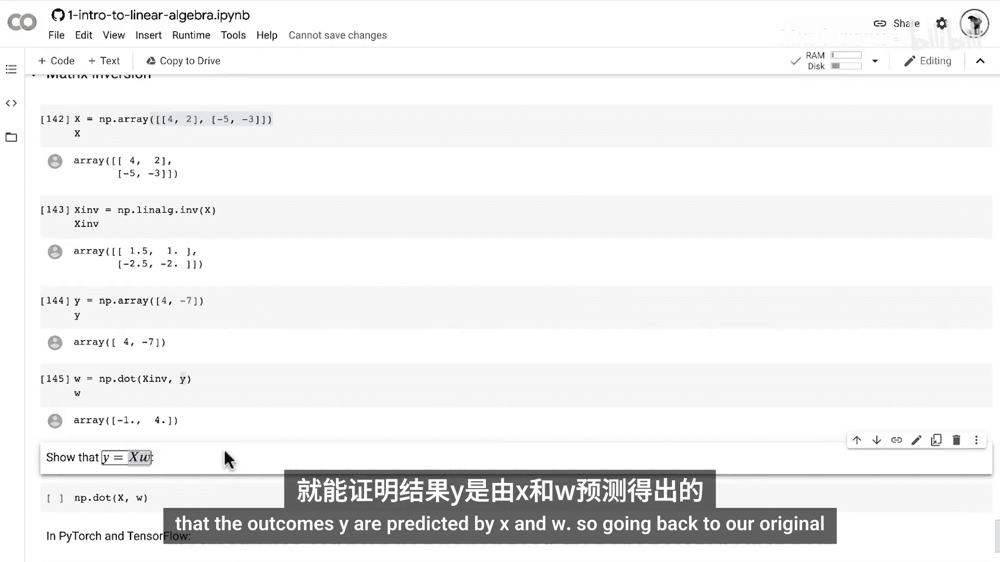

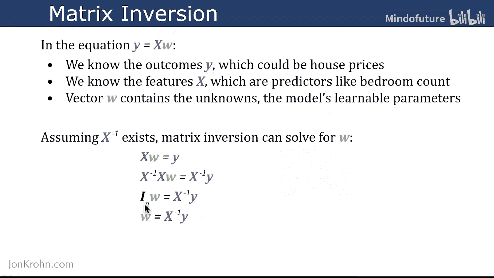

Y is equal to x times W。We can do that here， so we use the nuy dot method again to perform matrix multiplication on x and W。

And that returns for us。Our y values。So we succeeded using matrix inversion to find the unknown weight values and we've confirmed that they work。

 so that's in nuumpy and you can also do these operations in Pytorrchn Tensorflow。

If you want to do it in Pytor or Tensorflow， your matrix has to be of flow type。

 so I added a period in both cases here to ensure that and so creating the same。Matrix tensor。

 as we had here。In Numpy， in both。Pytorrch and Tensorflowlow。

And then passing those into the appropriate method for matrix inversion in Pytorrch and Tensorflowlow respectively。

You end up with the same answers as we had for our inverted matrix here。 So 1。5，1， negative 2。

5 and negative 2。 you see that get the same thing here in Pytorrch and in Tensorflow。

 except for just a little bit of rounding error， you get exactly the same result as well。

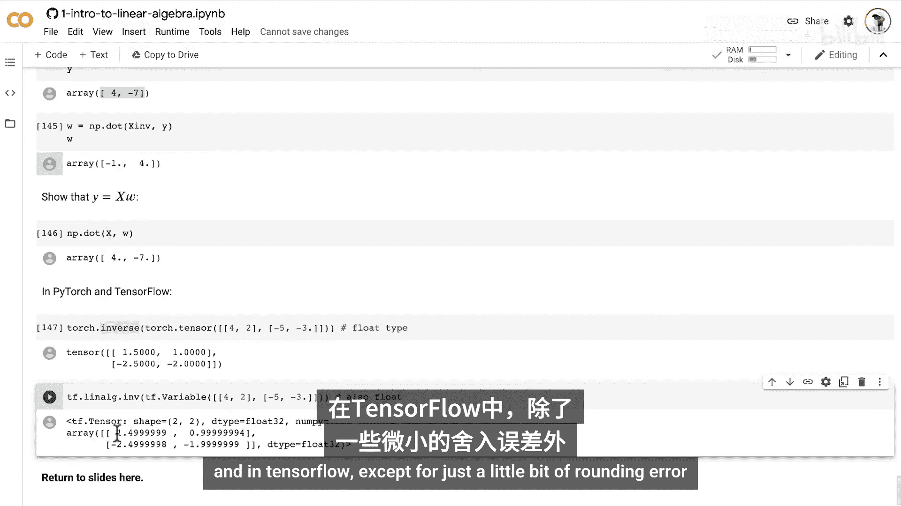

Finally， as I mentioned a couple of times earlier on in the video。

 there are limitations to where we can apply matrix inversion。 So while matrix inversion。

Is a nifty trick， it can only be calculated if the matrix that we're trying to invert isn't singular。

So that is all of the columns of the matrix must be linearly independent。

 We talked about this property in more detail in the first topic of this machine learninging Foundation series in a video called what linearar algebra is。

So what this means is。A matrix is singular， and it can't be inverted if。There are two。

Columns that are dependent。 So where you have a multiple。Where one column。

 say two and four is a multiple of another column one and two。

 this would mean that you have two lines that never cross over each other。

 and so it's impossible to find a solution。And of course。

 if you have two columns with exactly the same value。

 So one and2 and one and 2 for two different columns， then this means that you have overlapping。

Lines and you have infinite solutions， so in that case as well。

 you can't use matrix inversion to solve。Another limitation for matrix inversion is that it can only be calculated if a matrix is square。

 so the number of rows in the matrix is equal to the number of columns in some more technical matrix terminology we could say that the vector span must be equal to the matrix range。

 So the vector span is represented by the rows and the matrix range as the number of columns。

 I'm not going to talk too much about that here。 but you can look up those terms on your own if you're really interested。

So when a matrix is square that avoids what we call overdetermination where the number of rows is greater than the number of columns。

 that is the number of linear equations is greater than the number of dimensions in our linear in our set of linear equations so here's an example of an overdetermined system where we only have two dimensions so there's only two columns in the linear system。

 but there are three rows， we have three lines and so we can't solve for a single point where these lines overlap because there are multiple points。

 there's three points， so there's not one single answer， we can't calculate the matrix inverse。

Similarly， we can have an underdetermined system。Where the number of rows is less than the number of columns。

 So again， we have a two dimensional system here。 So there's two columns in the linear system。

But there's only one linear equation。 And， of course， here， we also can't calculate where。

Lines overlap because there's only one line to work with。

So those are the limitations of matrix inversion， but it may still be possible even in overdetermined or underdetermined situations。

To solve for the unknowns in the equation， but we can't use straight matrix inversion and coming up in the second subject。

 linear Algebra 2 in this machine learninging Foundation series。

 we will cover some of these other means。

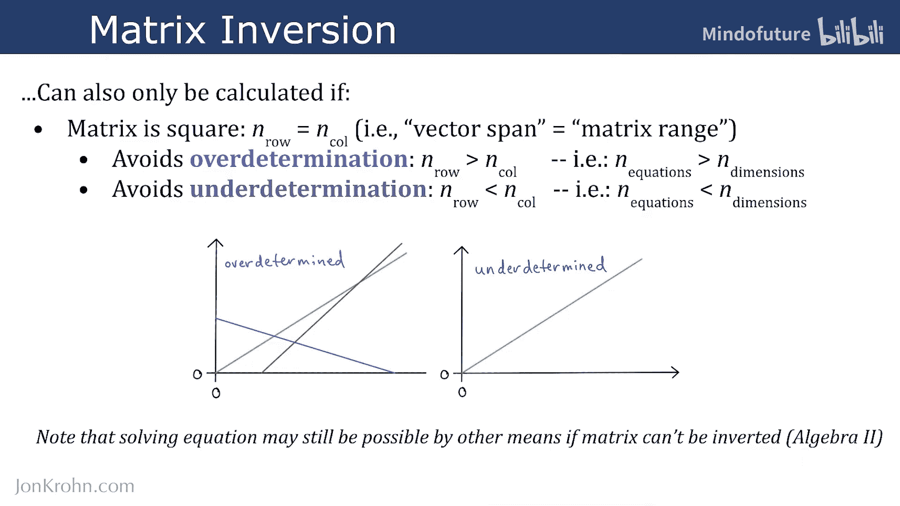

Since I love hands on code demo so much and viewers love hands on code demo so much。

 let's look at one quickly here too， where we try to do matrix inversion and there is no solution。

So I'm creating a matrix X here。Which。Is representing a two dimensional system。

 So we have a system of two linear equations representing a two dimensional system。

 So a horizontal axis and a vertical axis conventionally like we saw on the most recent slides。

And we have。Two columns to represent those two different dimensions。

The first line in the linear system is represented by the first row。

 and the second line in the linear system is represented by the second row。Now。

 we have a problem here because this is a singular matrix。This second。Line is。

A parallel to the first line。 And we can tell that because it's a multiple。Of the first line。

So what this means is that we're not going to be able to invert this matrix and。

You can prove that to yourself by uncommenting this line of code here。And trying to invert it。Nope。

 it does not work。 In fact， the error even comes out and tells you that this results in a singular matrix error。

Another example， so we have two lines here that don't overlap。

 Another example would be to have the same line twice。In which case。

 you similarly will get a singular matrix error。Cool。

 matrixtri inversion was the last big meaty topic of the intro to linear algebra subject。

Up next are a couple quick videos on two more special matrix classes。

 they'll wrap the subject up nicely。

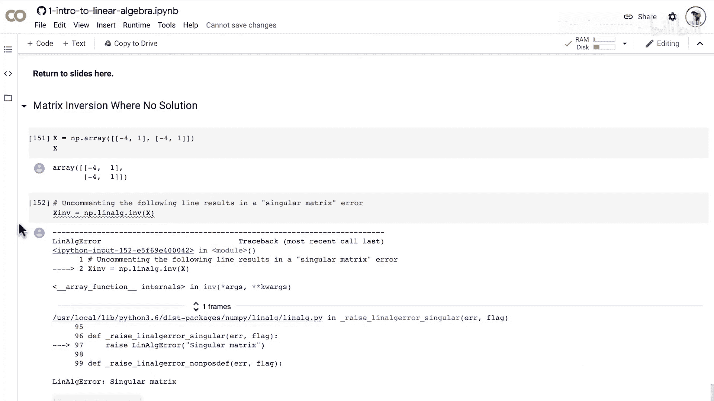