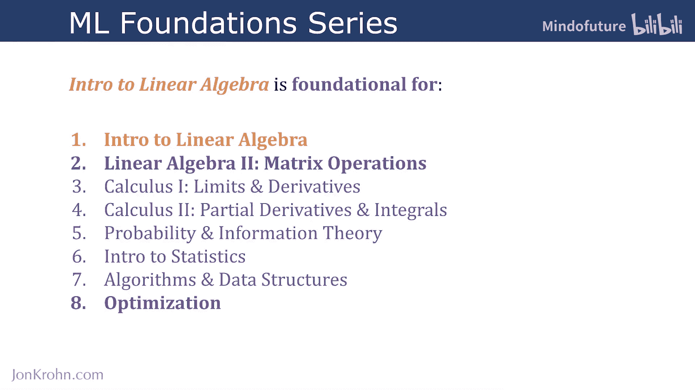
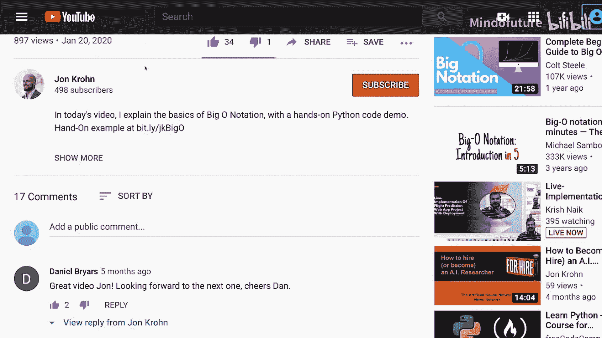

# 机器学习的线性代数及Python实现 ｜ Linear Algebra For Machine Learning p29 P29_正交矩阵 — 主题24 -BV1L8nLz6E8C_p29-

Welcome to the final topic of my Maine learning Foundation series first subject on Introductory algebra。

 this video is a short one on orthogonal matrices， a special type of matrix with unique properties that makes it tremendously valuable in machine learning。

Recall orthoormal vectors from earlier， specifically。

 we detailed these in the basis orthogonal and orthoormal vectors video of the Ma Learning Foundation series。

 In it， we discussed how orthonormal vectors are both orthogonal to each other。

 as well as having unit norm。And so basis vectors are the most common type of orthoormal vector。

 but you could have orthonormal vectors that aren't basis vectors， for example。

 by having orthogonal vectors that don't occur directly on the X and Y axis， for example。

In orthogonal matrices。Orhoormal vectors， like basis vectors。

Make up all rows and make up all columns。So an orthogonal matrix is made up entirely of orthoormal vectors。

Because of this。It means that if we take a transpose a。That's equal to A a transpose。

Which is not typically the case with any given matrix A。And in either of these two cases。

 performing this a transpose a or A A transpose matrix multiplication will result in an identity matrix。

 and you can prove that to yourself on your own time。

 either with paper and pencil or in a hands on code demo。Because of this property。

Lets's rearrange something here and we'll show this here too。

 so if you take this Aa transpose equals the identity matrix。

 you could multiply both sides of the equation by the inverse of a。And that would leave us with。

A transpose is equal to the inverse of Ai。Because A inverse A would cancel out on the left side of the equation。

So basically we're just moving this a over to the other side of the equation when we do that。

We use a inverse。 and so a transpose is equal to a inverse times the identity matrix and。

Multiplying this matrix by the identity matrix leaves us with。The inverse of a。

This is a really useful relationship to have a transpose be equal to the inverse of a。

 because calculating a transpose is very computationally inexpensive。

 it's very computationally cheap。So with an orthogonal matrix。

 this also means that calculating a inverse is very cheap because we know since the matrix is orthogonal when we want to calculate the inverse of that matrix。

 we can just calculate its transpose and bangang， we've got it。Cool， and with that。

 we've wrapped up the third and final segment。Of the intro to linear algebra subject and so the segment was called matrixtri properties。

 and in it we covered the Frroenius norm， matrix multiplication， symmetric and identity matrices。

 matrix inversion， diagonal matrices， and just in this video now， orthogonal matrices。Nice。

 congratulations， you've reached the end of Intro to linearar algebra。

 the first of eight subjects in my Ma Learning Foundation series。

The intro to linear algebra's subject was made up of three segments。In the first。

 we cover the fundamental data structures of linear algebra tensors。

 including dissecting the most important attributes of vector tensors with respect to machine learning。

Common operations in machine learning across tensors of all dimensions was the focus of the second segment。

And only moments ago， we wrapped up the matrixtri properties segment。

 wherein we focused on the fundamental attributes of matrix tensors with respect to machine learning。

All of this understanding of tensor properties， particularly matrix properties。

 sets us up perfectly for subject two of the machineine learninging Foundation series。

 which is all about performing linear algebra operations on matrices。

 including distillation of a given matrix into eigenvectors and eigenvalues， matrix determinants。

 singular value decomposition and the more penrose pseudoinverse。

 which enables us to solve for unknown values in linear systems that aren't appropriate for ordinary matrix inversion。

 such as the overdetermined systems of equations that are typical of machine learning。😊，Alright。

See you there。

To be sure not to miss the next tutorial in this series， subscribe to my channel。

Thanks for taking part in the tutorial， I hope you enjoyed it。If you did， please like and comment。

To be sure not to miss any of my content， head to JohnChroone。

com and sign up for my email newsletter。

You're also welcome to add me on LinkedIn， simply mention that you're a reviewer of the Maine Learning Foundation series。

You can follow me on Twitter too if that's your social medium of choice。

See you next time。