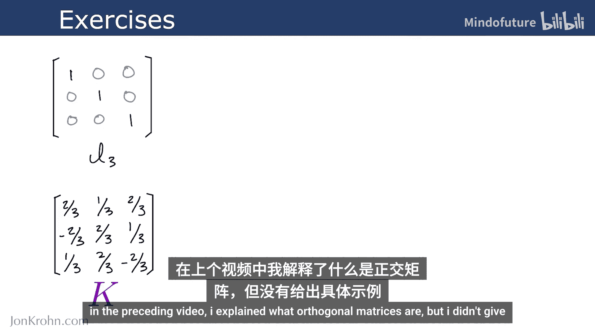
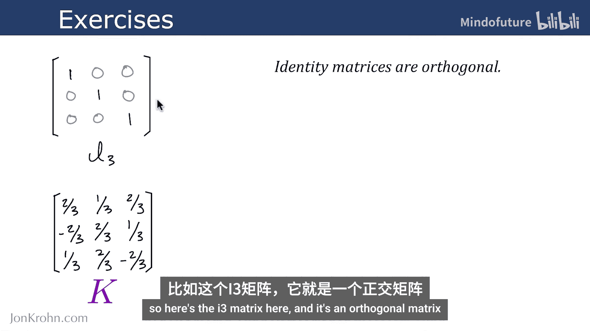
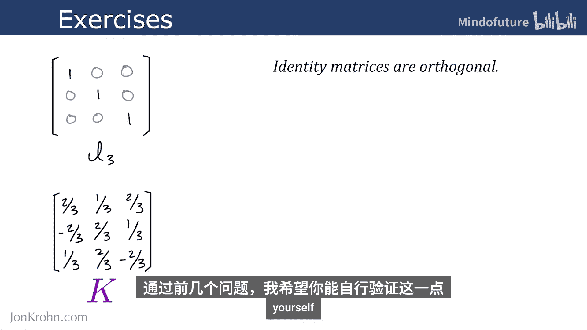
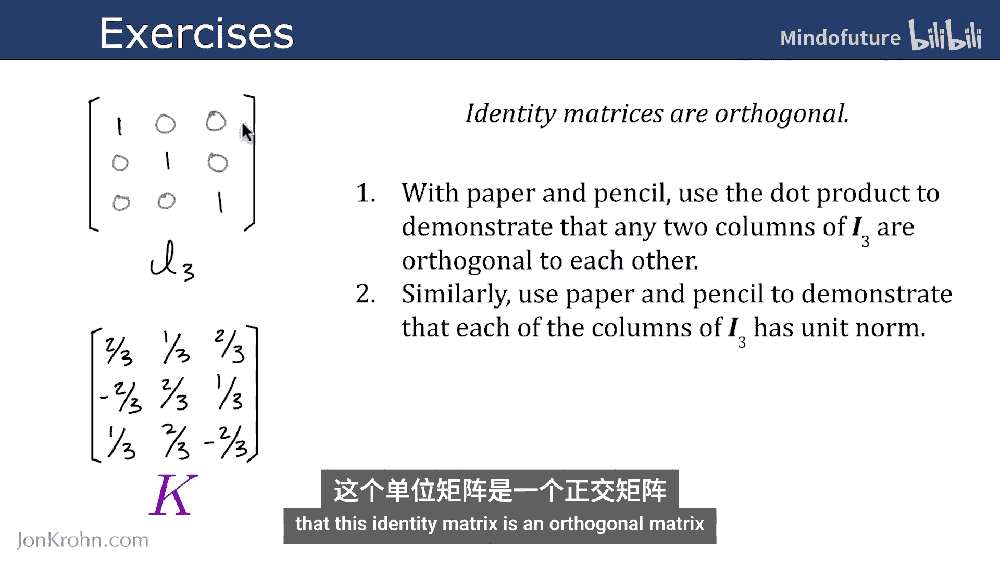
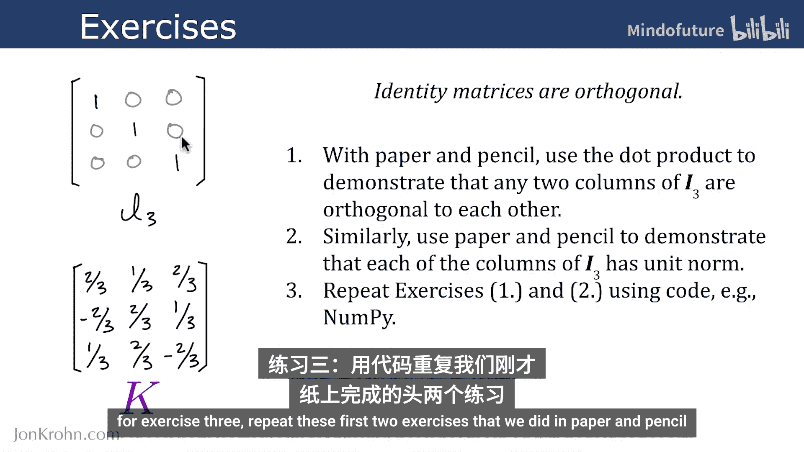
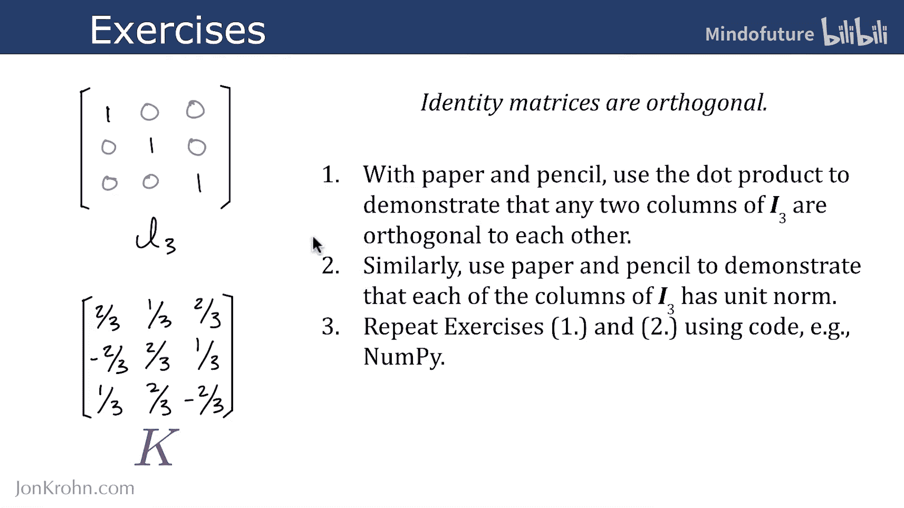
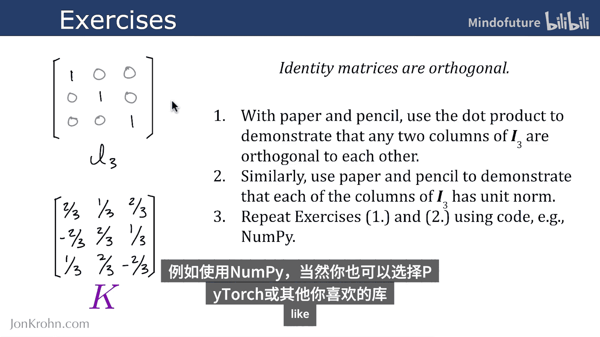
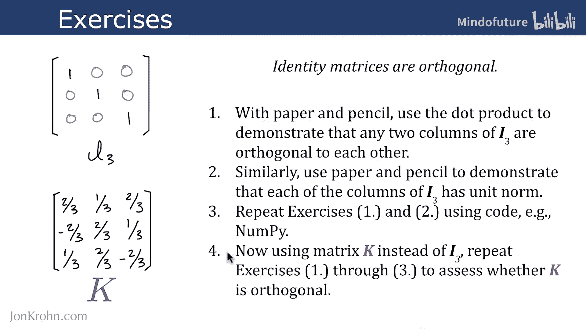
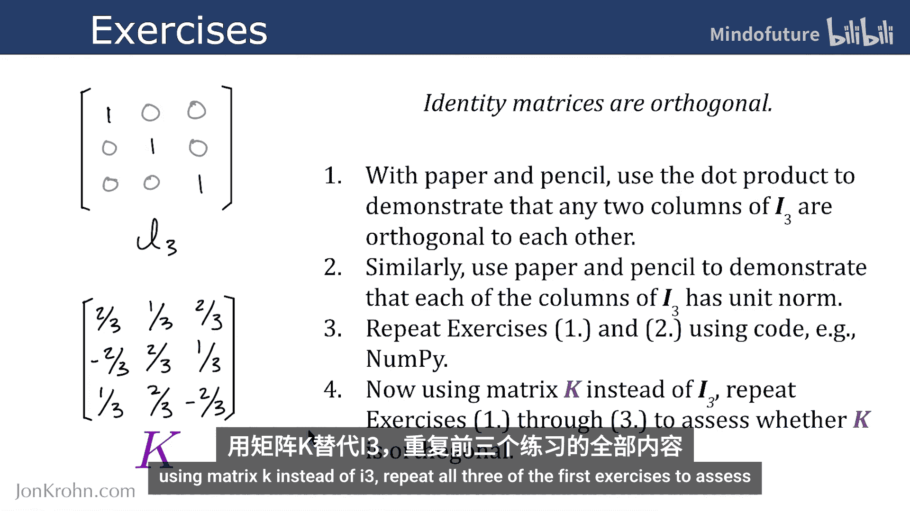
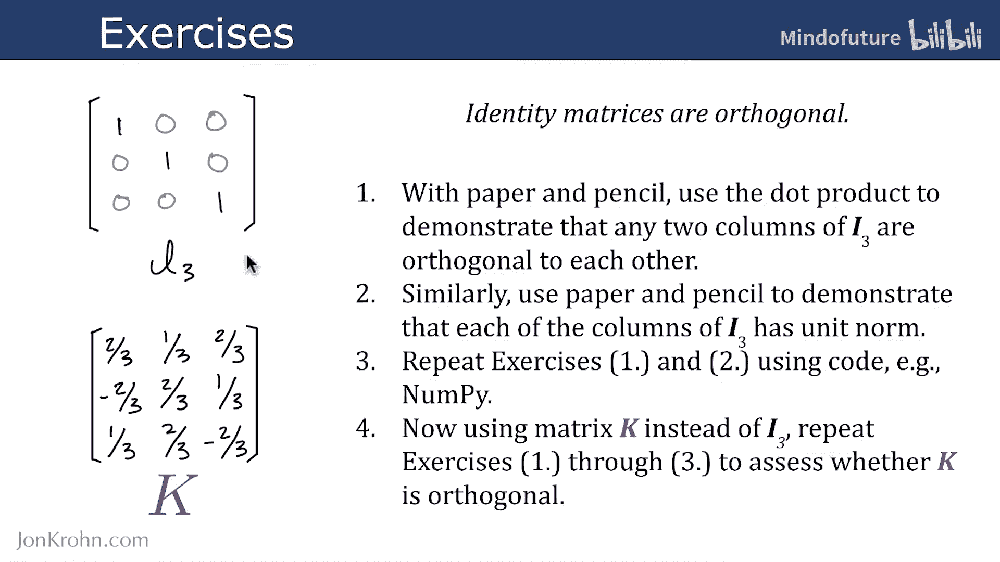

# 机器学习的线性代数及Python实现 ｜ Linear Algebra For Machine Learning p30 P30_正交矩阵练习 — 主题25 -BV1L8nLz6E8C_p30-

Before we jump to subject 2 on Matri operations and learn lots of new linear algebra theory。

 here are some exercises that are focused on comprehension of the orthogonal matrices topic we learned in the preceding video。

Conveniently， these exercises will also test your comprehension of a number of other topics from earlier in this series that are key to moving forward with the matrix operations coming up next in subject 2。

These topics include identity matrices， the dot product， L2 norms， and orthoormal vectors。

In the preceding video， I explained what orthogonal matrices are， but I didn't give any examples。

 so identity matrices are an example of an orthogonal matrix。

 so here's the I3 matrix here and it's an orthogonal matrix so with these first couple of questions here I'd like you to prove that to yourself。

First， with paper and pencil， use the dot product to demonstrate that any two columns of I3 are orthogonal to each other。

Further for exercise 2。Use paper and pencil to demonstrate that each of the columns of I3 has unit norm。

By doing that， by showing that all of the columns are orthogonal to each other。

 and that all the columns has unit norm that will prove that this identity matrix is an orthogonal matrix。

For exercise three。Repeat。

These first two exercises that we did in paper and pencil using code， for example， numpy。

 but you could also use P To any other library that you like。

And then finally， for the fourth exercise。

Using matrix K instead of I3， repeat all three of the first exercises to assess whether K is also orthogonal like I3 is。

