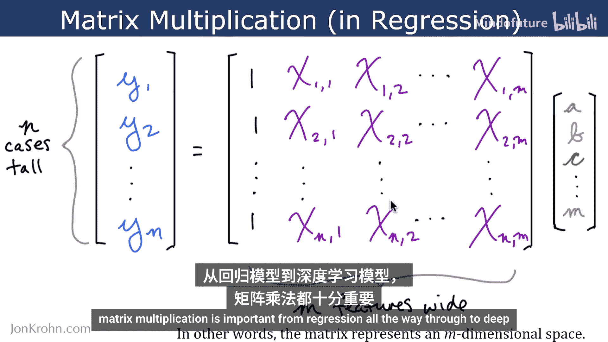
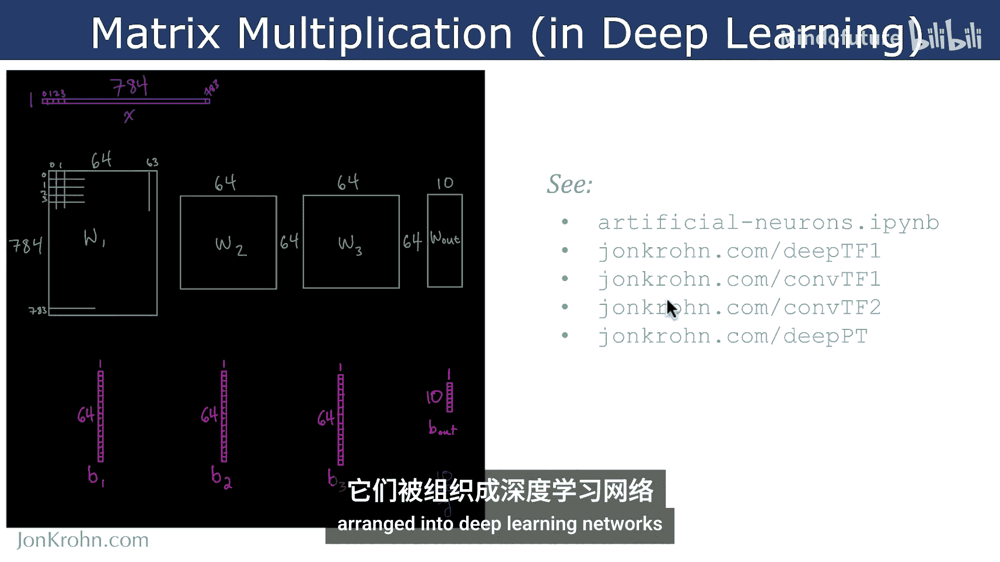
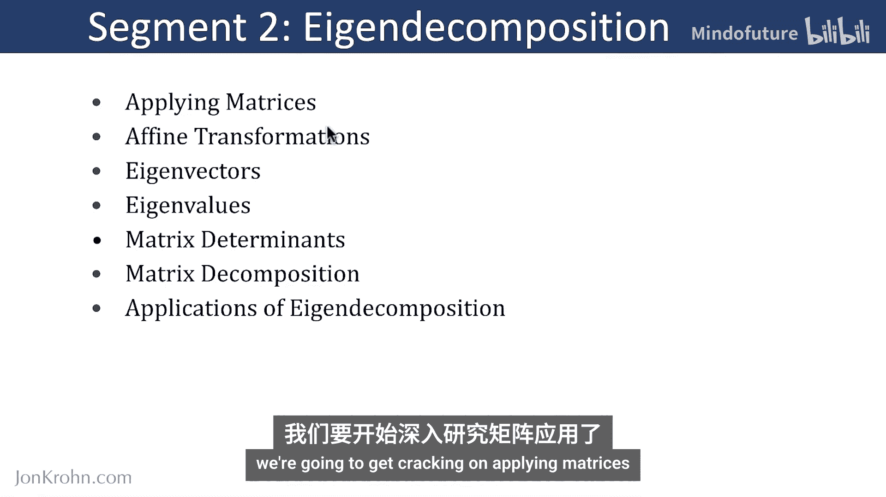

# 机器学习的线性代数及Python实现 ｜ Linear Algebra For Machine Learning p31 P31_线性代数II-矩阵运算 — 主题2 -BV1L8nLz6E8C_p31-

Yes， I'm so glad you're here because with the core linear algebra building blocks under our belts。

 we've reached the point where the Ma learninging Foundation series starts to get really interesting and practically useful。

 Welcome to this subject 2。😊，This subject is called linearar Algebra 2 matrixtri operations。

Broadly speaking， in this subject， we'll use tensors in Python to solve systems of linear equations and identify meaningful patterns in data。

 I'm Doctor John Cone， and this is my puppy Oboe， V mascot of the machine learning Foundation series。

The second subject we're embarking upon now builds upon the first subject of my machine learning Foundation series。

 Intro to linear algebra。In that first subject， we detailed tensors。

 the critical fundamental bricks for developing machine learning applications。

We learned how to create and manipulate those tensor bricks in all three of the most relevant Python libraries。

 Numpy， Tensorflowlow and Pytorch。 And we learned the essential properties of all dimensions of tensors with a particular emphasis on the properties of the two dimensional matrix tensors。

😊，All of the introductory linear algebra content set us up perfectly for the current subject。

In which we turn things up a notch and begin performing relatively sophisticated linear algebra operations on matrices。

 which enables us to distill a given matrix into its eigenvectors and eigenvalues。

 So these are widely useful， characteristic vectorctors and scalarvalues of any matrix。😊。

We also calculate the determinant of a matrix。 So this is a scalar that provides key information about how a matrix transforms other tensors。

And then getting into specific machine learning relevant applications。

 we can compress data by performing singular value decomposition。

 a ubiquitous technique for selectively decreasing the size of a matrix while retaining its most informative components。

And we'll also make use of the Moore Penrose pseudo inverse。

 which is a hugely useful tool that enables us to solve for unknown values in linear systems that aren't appropriate for ordinary matrix inversion。

 such as the over determinedtered systems of equations that are typical of machine learning。

Those capabilities on their own that I just ran through are hugely useful。

When it's all said and done， however， the linear Alge 2 subject will also prove foundational to several other topics in the machine learning Foundation series。

 particularly calculus1。Intro to statistics。And the final optimization subject。

 which ties together all seven preceding topics very nicely。

The second subject in the series on matrix operations is itself broken into three segments。

 So the first one is a review of introductory linear algebra。 The second is eigen decomposition。

 where we dig deep into eigenvalues， eigenvectors and matrix determinants。

And then the final part is matrix operations for machine learning， where we start。

Taking into the specific machine learning applications of linear algebras。

 such as singular value decomposition and the more Penroses pseudo inverse。

 which I assure you is going to blow your mind。All right， so the first segment here。

 review of introductory linear algebra。 We're only going to spend a few minutes on that。

 If I was offering this course today， this subject is a afternoon course or something to you。

 then I would want to make sure that you had。The introductory linear algebra under your belt that you need to have in order to move forward。

Instead， for this， since you're watching videos， I can assume that you've watched the introductory linear algebra videos from the first subject already。

 or you're already familiar with that content。By doing this quick review。

 it will show you the specific subjects that you need to know to move forward。

 if there's anything that's feeling a little shaky， a little unfamiliar。

 then you might want to go back to the first subject and review those particular videos or use some other resources to learn about those topics。

 So let's quickly review these critical fundamental introductory linear algebra topics that we need to move forward and understand the current subject。

 linear algebra 2， sufficiently well。Alright， of course， we should， at this point。

 know what linear algebra is。 It's a。Approach to solving for unknowns within systems of linear equations。

 So we talked in the first videos about the specific example where we have a sheriff chasing a bank robber and were're able to solve that problem graphically with a plot。

Or we're able to solve it using algebra。And so， this is what。Vineer algebra is。

We talked about how there would be no solution in situations where。

Say the lines all run parallel to each other。 So in this case。

 if the sheriff's car is the same speed as the bank robbers。Or there'd be infinite solutions， if。

The bank robber and the sheriff have the same speed end starting at the same time。

So in either of these situations。We can't specifically solve for the unknowns， but。Otherwise。

 we can solve for distance and time in this example。

So we can solve for the point where the lines cross over。

 and this is what we mean by solving a linear algebra system。

So there are only three options in linear algebra， either there's one solution， no solutions。

 or an infinite number of solutions。It is impossible for lines to cross multiple times。

 which is why we can't have， say two or three solutions。In a given system of equations。

 there could be many equations， so that bank Rob Sheriff example has two， but there could be many。

 many equations。There could also be many unknowns in each equation， not just two。

 like distance and time。A common example is a regression model where we might have many houses。

 say hundreds or thousands of houses in our data set。

 and we might have many unknowns that we're solving for distance to school。

 the Y intercept number of bedrooms and however many other features we have about our houses and features。

We can use linear algebra to represent all of the elements in that regression model。

And then we can use linear algebra to solve for unknowns in relatively simple machine learning models like regression models all the way through to the most sophisticated models like deep learning models。

We can also use linear algebra to reduce dimensionality。 For example。

 we can do principal component analysis。To distill data into its most influential components of data。

 and that is where we will finish off this subject linear algebra 2 with principal component analysis。

Linear algebra is also great for ranking results， for example， with eigenvectors。

 including in the Google Page rank algorithm， so you can see this paper here。

 and we will talk about eigenvectors a lot coming up in the very next segment coming up shortly in this series。

Linear algebra is also useful for recommender systems， for example。

 you know this kinds of systems on Netflix that suggest what kinds of movies you might like or on Spotify。

 what kind of music you might like， and so we can use singular value decomposition in these kinds of recommender systems and we will be learning about SVD in this linear algebra 2 subject as well。

Linear algebra is ubiquitous in natural language processing。 for example。

 SVD shows up in NLP as well。Also in approaches like matrix factorization that are key in NLP。

So some specific NLP approaches that make heavy use of linear algebra include topic modeling and semantic analysis。

Okay， so knowing what linear algebra is and being aware of its linear algebra applications。

 particularly the ones shown in orange that we will be learning in this subject， these critical。

 critical linear algebra applications for machine learning just a very quick skim of the terms the topics that you should be well aware of in order to be able to continue forward in this second subject that we're tackling now。

 So those topics from the first subject intro to linear algebra that are so important are tensors So you should definitely know what tensors are scalar vector matrix and higher dimensional tensors。

You should know how to transpose vectors and for any of these really critical topics that I know are really important for you to be able to comprehend what we're doing in this second subject linear Al 2。

 I do have in the Gitthub repository for my ML foundationunds program at Github。

com/jochone sm Foundations， you can make your way to the second subject Jupiter notebook。

So if you really need to brush up and these terms are completely unfamiliar to you or you know quite vague。

 then you might want to head into the intro to linear algebra subject and watch to those corresponding videos。

 but if you're just feeling like， I just want a quick little refresher。

 then you can pop into the linear algebra to notebook。

In which I have for this review of introductory linear algebra。

 I do have handson code examples that you can work through in nuy and in pytorrch so that you can brush up on how to perform any of these key aspects like vector transposition that we're talking about right now。

 So you can go through these handson examples， these code based examples so make sure you're up to scratch on all of the key theory and introductory linear algebra applications all the way down through to this segment2 on eigen decomposition where we'll actually start learning new subject to content。

 So yeah， vectors， you've got in that Jupyter notebook something you definitely need to know。

 you also need to know what norms are， particularly L2 norms。And so， yeah。

 this is the most important norm of all。 And again， that is covered in the。

Hands on codemo that I just had up。You need to know about unit vectors。

You need to know about basis vectors。Orthgonal vectors。As well as orthonormal vectors。

 of which basis vectors are an example。You need to know how to transpose a matrix。

You need to know what symmetric matrices are。You need to know how to perform matrix multiplication for sure。

That's very important for moving forward with any further machine learning。

And that's because matrix multiplication is critical in all pretty much all machine learning algorithms from these kinds of regression models。

 So here is a matrix multiplication representation of this house price regression model that we just talked about briefly。

😊，And we talk about a number of times in the intro to linear algebra subject。And so yeah。

 matrix multiplication is important from regression all the way through to deep learning models。

 which are some of the most sophisticated machine learning algorithms we have today。

 there are a number of notebooks here where you can see matrix multiplication happening in action for the purpose of artificial neural networks or artificial neural networks arranged into deep learning networks。

 So again， we talk about that a lot in the intro to linear algebra subject to keep going with this linear algebra 2 subject。

The final key topics that you should be aware of in order to make the most of this linear algebra 2 subject on matrix operations are what identity matrices are。

You should be able to make use of matrix inversions。For example， you should be able to solve for。

The unknowns in W in this W vector。Given some inputs X and some outcomes Y using matrix inversion。

 and you should be aware that matrix inversion only works if the matrix is square。

Which avoids overdemination where we have way more equations than dimensions。

 So here we have three equations and two dimensions。

 there are three points in this case where the lines intersect。

 So this is an overdetermined linear algebra system and matrix inversion is also only possible if there isn' an underdemination where we have。

 say one line in a two dimensional system。 So of course， we can't solve for the unknowns here either。

And then the final restriction for matrix inversion is that it won't work if the matrix is singular。

So all of the columns in our matrix need to be linearly independent。

 So this means that we don't have。Parallel lines like this， where there's no solution or。

The exact same lines like this where there's infinite solutions。The key thing to note here， however。

 is that solving these equations may still be possible by another means。

 even if the matrix can't be inverted， and that is something that is going to be a big part of this linear algebra 2 subject。

And this is really important because machine learning systems are almost never having perfect squares that we can invert。

 Typically， we have over determineded systems， though there are also some situations， for example。

 in deep learning， where we have highly under determineded systems。

 So these over determineded situations arrive where we have。

Many more data points than we have unknowns， as might happen if you have thousands of house prices。

 but only a dozen unknowns in your regression model。Whereas underdetermined systems。

 those happen in deep learning， where say you have tens of thousands of training data points。

 but you have millions or maybe billions of parameters in your model。All right。

 and the two final topics that you should be on top of in order to move forward with this linear algebra 2 subject are diagonal matrices。

And orthogonal matrices。Alright， so if you've got all those topics that we just covered firmly under your belt。

 then you're in perfect shape for moving forward with all of the new content in this linear Al 2 subject on matrixtri operations。

Speaking of that second subject。We've now completed that review of introductory linear algebra。

 and we're ready to move on to new content on eigen decomposition。

So in this eigen decomposition segment， we will be covering what applying matrices means。

 applying them to vectors， applying them to other matrices， that's where we're going to start off。

And that will include discussion of a fine transformations。

Then we're all primed to dig into eigenvectors and eigenvalues。

 which are characteristic vectorctors and scs of any given matrix。

 We'll talk about matrix to determinants， which are a scalar that tell us how a matrix application is going to impact the vector or matrix that we applied to。

 as well as give us information about eigenvalues。 So there's a relationship between eigenvalues and matrix determinants that we'll dig into。

Then we'll talk about matrix decomposition with eigen decomposition so how we can take apart a matrix into its characteristic。

 eigenvector and eigenvalue components， and how that eigen decomposition can be applied with countless types of real world applications。

Alright， so you're ready。 The preamble is over。 Hopefully you're feeling relatively confident about your intro to linear algebra foundations。

 because now we're going to get cracking on applying matrices。😊。

