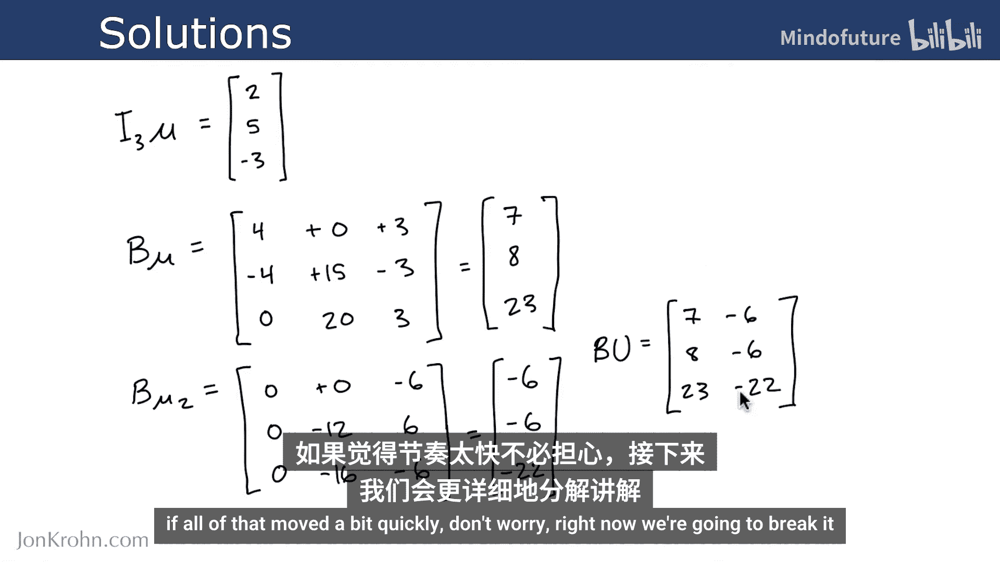
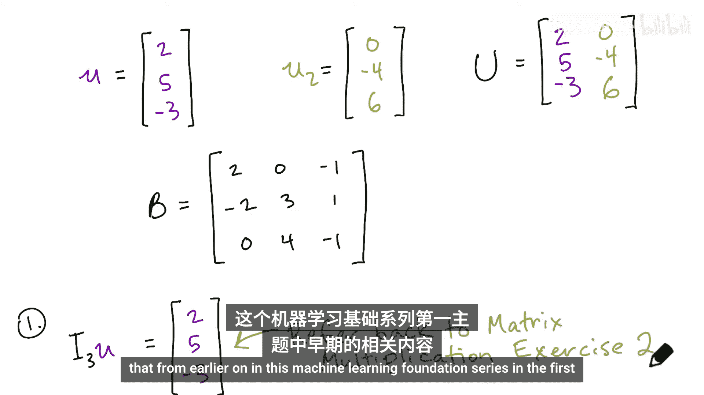
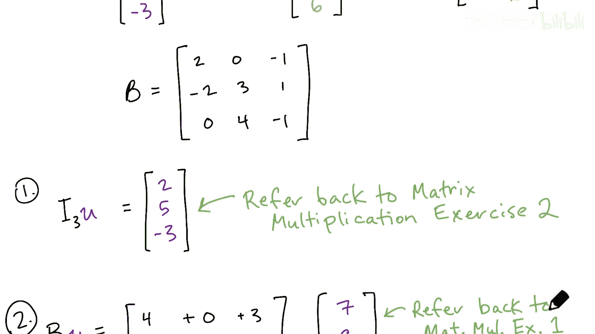
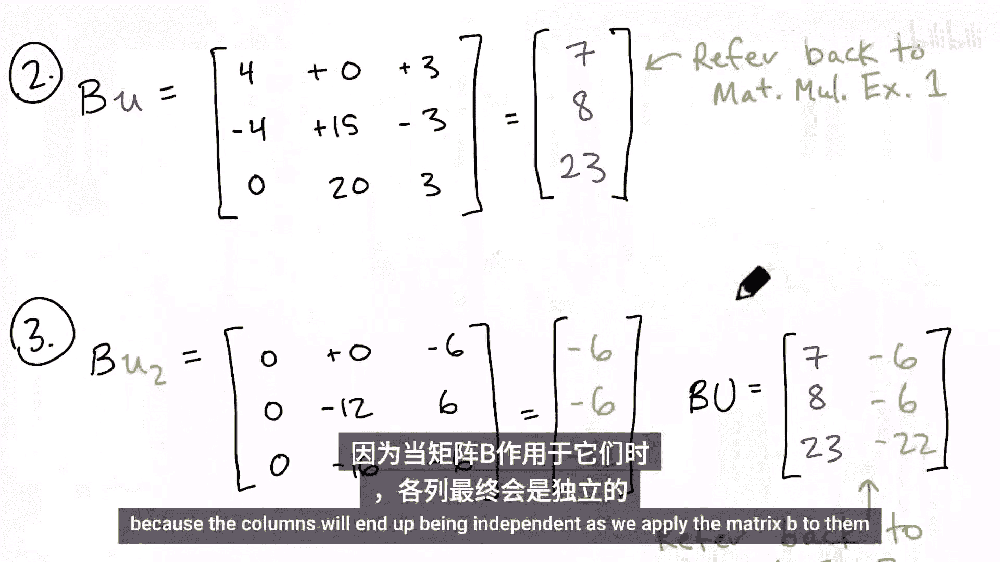
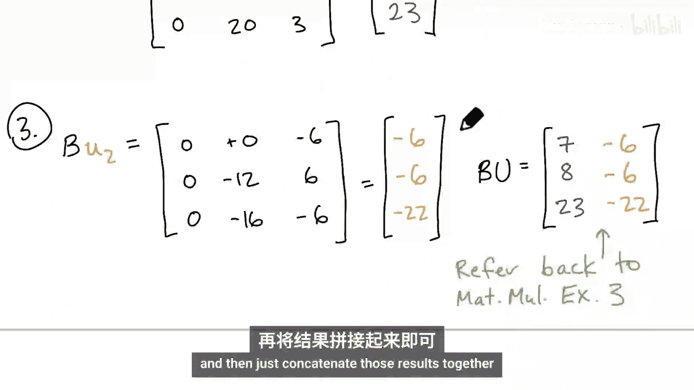
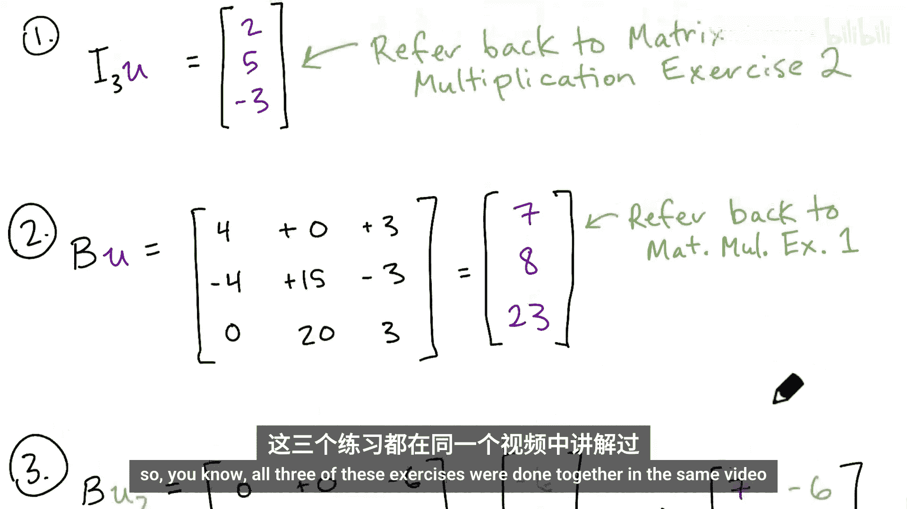
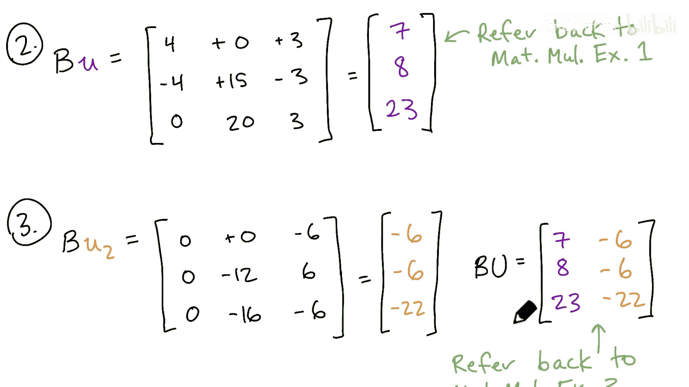
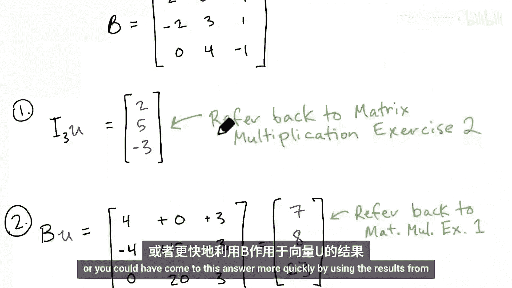
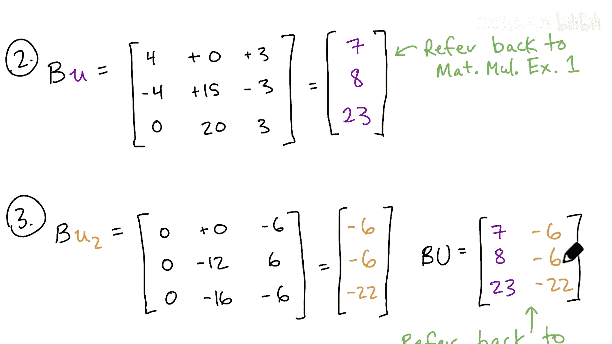

# 机器学习的线性代数及Python实现 ｜ Linear Algebra For Machine Learning p32 P32_应用矩阵 — 主题26 -BV1L8nLz6E8C_p32-

In order to appreciate what eigen decomposition is， including what eigenvectors and eigenvalues are。

 we first need to have a clear working understanding of what it means to apply a matrix to another tensor。

In order to ensure we have such a working understanding， in this video。

 we go over three matrix application exercises together。All right。

 so far in this machine learning foundation series。

 all of the exercises we've done have been comprehension exercises when I assign exercises to you。

 and I ask you to pause the video and then tackle them on your own。In this case。

 you might be able to do that。But if not， we will work through the solutions together because this is such an important thing to be able to do。

The exercises are using pencil and paper or a whiteboard or whatever you have。

 App the identity matrix I3 to this vector U。The second exercise is to apply this matrix B to this vector U。

And so all that apply here means is perform matrix multiplication。

 So when we say apply for this first exercise， we mean perform matrix multiplication where the first term in that matrix multiplication is I3 and the second one is the vector U。

And then for the second exercise， we're performing matrix multiplication of the matrix B and the vector U。

For the third exercise， it's a little twist where we concatenate the column vector U and the column vector u2。

 so concatenate them together to form a matrix U that has two columns。

And then apply the matrix B to that matrix U that you create。

So this would be a good spot to pause a video and try this on your own。But if that's tricky。

 we are working through the solutions together in a sec。All right。

 so if you were feeling confident and you took a crack at performing the three exercises。

 here are the solutions to those exercises。The first solution。

The identity matrix I3 applied to the vector U gives us this result。

The matrix B applied to the vector U gives us this result and the matrix B applied to the column vector u2 gives us this result and therefore the application of B to the matrix U which is the concatenation of U and u2 comes out to this here。

 if all of that moved the quickly don't worry， right now we're going to break it down even more。

All right， to assist you with understanding what's happening here。

 I've color coded our two vectors U and U2。 So the vector U， I've color coded in purple and U2。

 I've color coded in orange。 So later when we start talking about the matrix U。

 you can see clearly it consists of those purple and orange columns representing the vectors U and U2 respectively。

Allright， so for our first exercise。We were applying the identity matrix I3 to the vector U。

 and this should actually be pretty easy at this point if you're not able to figure out why applying the identity matrix I3 to the vector U results in getting this same U back。

 you should know that at this point to be able to move forward。

 and so I definitely recommend referring back to the matrix multiplication exercise to and working through that from earlier on in this machine learning Foundation series in the first subject in linear algebra。

For exercise 2， where we apply the matrix B to the vector U。

This does require us to do some matrix multiplication， again。

 referring back to the matrix multiplication。Topic from earlier in this machine learning foundation series。

 So the exercise right before this one here should。

Clear up exactly how to perform this matrix multiplication。

 So we end up doing a series of dot products。And then。You know。

 summing together through those dot product operations， we get this final answer。Of 7。

8 and 23 of this vector here is a result of applying the matrix B to the vector U。So， yeah。

 should be able to get that。After you refer back to this matrix multiplication exercise。

And then finally， in exercise3， we're asked to apply this matrix B to this matrix U。

 which we create by concatenating U and U2， these two column vectors together into a single matrix。

So。Based on an understanding of matrix multiplication。

 we've already done half of the work because the columns will end up being independent as we apply the matrix B to them。

 So to get the result of applying matrix B to matrix U， we've already done half of the work。 So B U。

Gives us the first column。And so then all we need to do is calculate B times the vector u2。So again。

 going back over the matrix multiplication exercises from earlier should give you the tools you need to figure out how to perform this series of dot products and get this final vector。

And once we have this vector， that gives us our second column。

In the matrix that results from applying the matrix B to the matrix U。

So applying the matrix B to the matrix U。If you don't believe me that you can calculate the two separate columns。

 calculate the results of applying this matrix B to the vector U and the vector U2 and then just concatenate those results together if you don't believe me that this works。

 you can both refer back to the matrix multiplication exercise3 from the intro to linear algebra subject so you know all three of these exercises were done together in the same video。

Then yeah， so you can either go ahead and apply B to U。

 or you could have come to this answer more quickly by using the results from applying B to the vector U and just adding those to the results concatenating those rather with the results of applying B to U2 separately。

Nice， now that we've done these paper and pencil exercises together。

 we're well prepared to scale up our capacity to apply matrices by doing hands on code demos in Python。

 that's next。