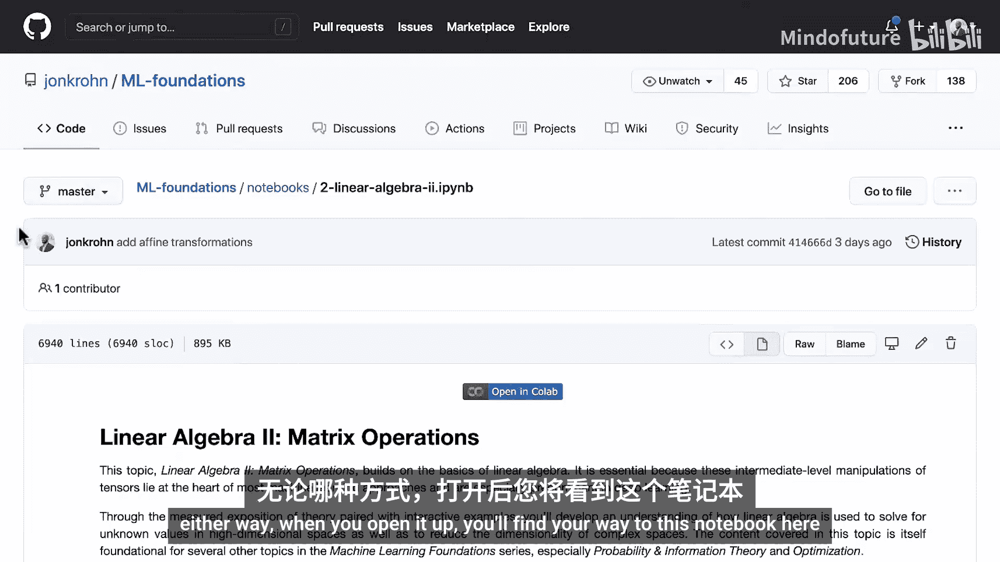
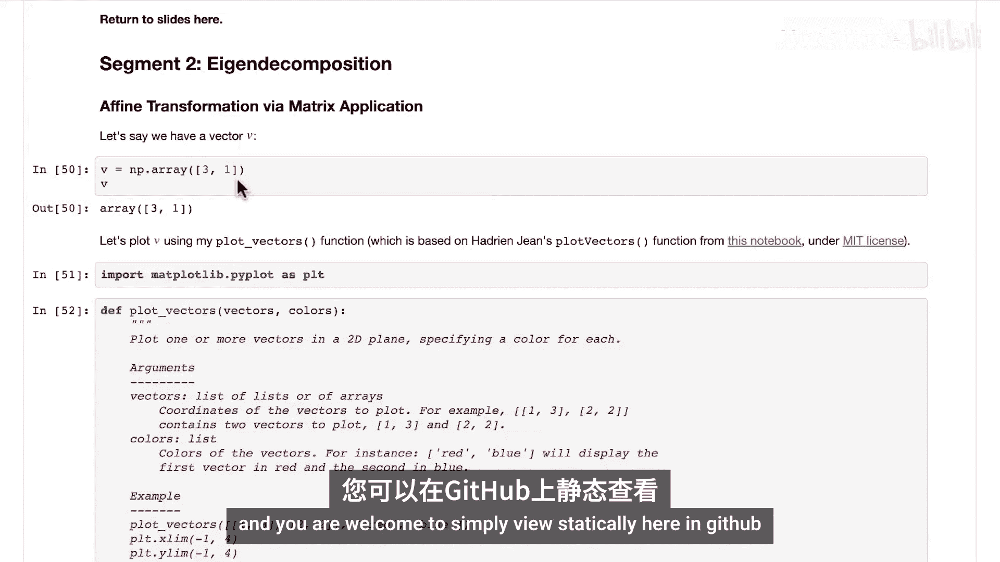
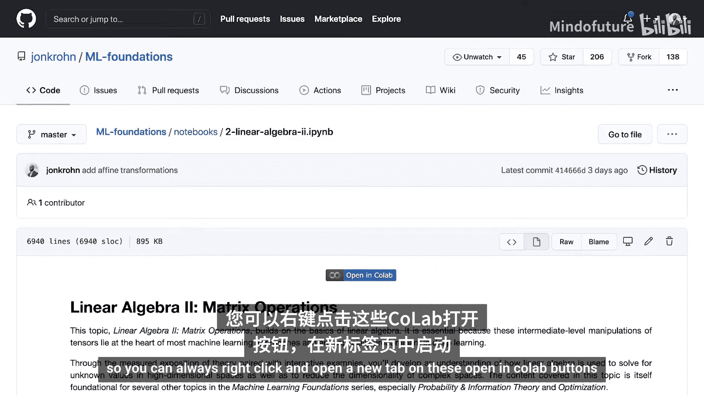
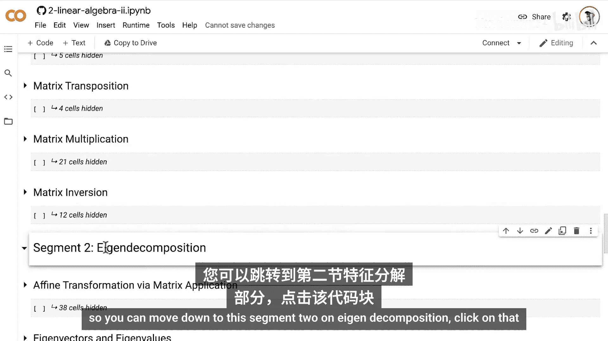
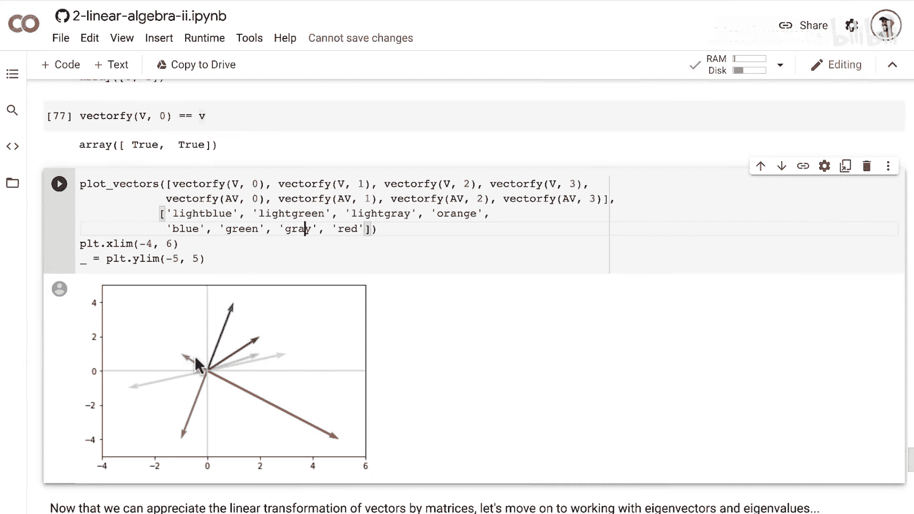

# 机器学习的线性代数及Python实现 ｜ Linear Algebra For Machine Learning p33 P33_仿射变换 — 主题27 -BV1L8nLz6E8C_p33-

In this video we use handson code demomos in Numpy to develop working experience with a fine transformations。

 these are particularly useful transformations like flipping and or rotating that we carry out by applying matrices。

For this hands on co demomo， make your way to my Ma learninging foundation's Gitthub repository at Github。

com/jochone/mlfoations。

And then make your way to the second notebook， which is called linearar Albra 2 matrixtri operations。

 you can either click on the link right here， or you can find it in the notebooks directory as the second notebook here。

Either way， when you open it up， you'll find your way。To this notebook here。

And you are welcome， as always， to simply view the executed code。

 so we are getting started now in segment2 of this notebook on eigen decomposition。

 so we're going to get started here with this section on a fine transformation via matrix application and you are welcome。

To simply view statically here in Gitthub， however。

 I do recommend following along interactively if you'd like to in Google Collabab。

So you can always right click and open a new tab on these open and coab buttons。

And then you've made your way through to an executable notebook as long as you have a Google login。

 which is free， like with your Gmail account， for example。

Let's start off by clearing out all of the outputs。

 So I have all the outputs in there so the people who are viewing statically can see all the outputs when they do that。

 But when we're executing interactively， we don't want the outputs to already be there before we've executed。

And。We have already。Gone through all of this introductory linear algebra。

 we're not going to execute all of this code again。

 all of that review code so you can move down to this segment2 on eigen decomposition。

 click on that block。

Go up to run time and run all of the cells before you can trust me and ignore that warning and run anyway。

That might just take a few moments for all of that to run。

And you can confirm and actually see so the Google coab will collapse sections。

 So these first couple of sections here， you can see right out of the box if you want to be able to see in these other sections。

 you can open them up by clicking on these triangles here。However。

 we don't really need to look at that stuff because that was all review so this new content。

 segment2 on eigen decomposition is what we're interested in now。

 specifically these a fine transformations via matrix application。So let's say we have a vector V。

This vector V is a length2 vector。 It has the elements 3 and one in it。

And we can plot that vector out using my plot vector's function， which is based on Hadrian Jeans。

 plot vector's function， which he has in this notebook here and I'm using。

 or rather I've adapted under MIT license。This plot vectors function， it takes in vectors。

So a list of lists or a list of arrays of numpy arrays that represent the vectors。

And then we also pass in the colors that we would like the vectors to be。And so， for example。

 we can pass in a list containing just one element， this nuy array V。

And then a second list specifying that we'd like that vector V to be colored in light blue。

Press play andvoila。 we see our light blue vector v。

 which stretches to a x value of 3 and a y value of one corresponding to the coordinates that are specified by the vector V itself。

So an x of 3 and y of 1。The only other thing to note here is that is that I've set limits so that the plot prints nicely so I'm plotting from this range of negative one up to5 on both the x and y axes these are things that I' will be changing constantly as we plot things out because the vectors will look pretty from different perspectives with typically each plot So I'm going to be changing these a lot。

 but I'm not going to talk about it too much because it's kind of boring and it's really obvious in just how the plot comes out。

Al right， so as we saw in the last video where we were working on applying matrices with paper and pencil。

 applying a matrix to a vector that is performing matrix vector multiplication。

Can linearly transform the vector， for example， it can rotate it or rescale it。

The identity matrix introduced earlier is the exception that proves the rule。

Applying an identity matrix does not transform the vector。 So let's create an identity matrix I2。

 which we can apply to a vector of length to。And then we'll use the nuy dot method here to perform that matrix by vector multiplication。

 And， of course， as we should know by now， applying the identity matrix to a vector results in the vector being returned as is as as went in to that matrix multiplication。

 So the vector V is exactly equal to the vector V after the identity matrix has been applied to it。

But what we're going to be doing here， this was just to show an example is we're going to be going forward and I'm going to be showing you what a vector looks like before and after applying a matrix to it。

 and so I'll use a light color for the before and a darker color for after so。I'll use light blue。

 for example， before we apply the matrix and then dark blue after。 So we had this vector V。

Which looks like this。From earlier in light blue and when we apply the matrix I to it。

 what does it look like after， Well， it's the after， so it's in dark blue。

 but it looks identical in contrast， consider this other matrix， so a non identity matrix。

 let's call this matrix E and this particular matrix E that I've selected it flips vectors over the x axis。

So if you're ever interested in flipping a vector over the x axis。

 but having no other transforms performed on the vector。

 then this matrix E here is the matrix that you should apply。You don't need to memorize that。

 which're just kind of using this as an example， flipping vectors over the X axis isn't probably something you do a lot in machine learning。

So yeah， when we apply that matrix E to the vector V。We come out with this new vector。

That now is flipped here。 So this value here flipped from being positive  one to negative one。

 which effectively flips。The vector over the X axis。 So here you can see the before of vector v。

 and then the after， once we've applied the matrix E to that vector v。

So to see how this plot vector's method works here， we pass in our list of our two vectors。

 so the vector v before vector V after the matrix E has been applied to it。

And then we specify in the colors that we'd like。 So V is in light blue and E V is in darker blue。

Before and after。All right， so that's flipping over the X axis as a second example。

 let's look at this matrix F， which flips vectors over the y axis。 So here。

We have a negative one in this position here， whereas for flipping over the x axis。

 we have the negative one here。Yeah， if you're ever interested in flipping a vector over the y axis。

 this is the matrix you want to use to do it。So， yeah， so let's apply F to the vector v。

 And now the positive3 in the first position has been changed to a negative 3。

 And so when we plot this out， we can see that our before vector v。Has been flipped over the Y axis。

By applying the matrix F。So applying a flipping matrix， like we've done。

 flipping over the X axis or the y axis is an example of an a transformation。

So this is a change in geometry。That may adjust distances or angles between vectors。

 but it preserves parallelism between vectors。 So if we had multiple vectors。

 when we apply fine transformations， if two of those vectors happen to be parallel。

 they would remain parallel before and after transformation， despite other changes in geometry。

 like distances or angles between vectors that might have happened。

So we're going to look at some examples of these in one moment。

In addition to flipping a matrix over an axis， which is also known as reflection。

Other common a transformations include scaling， which is changing the length of vectors。Shearing。

 which is it's a little bit hard for me to just explain verbally。

 but I have an example of this coming up on the Mona Lisa painting coming up shortly。And。

Rotation is another example of an a fine transformation。

 so you can click on this blog post here for an outstandingstand take on a fine transformations in Python。

 including more than I've listed here。 And this blog post also talks about how to apply a fine transformations not only to vectors like we're doing。

 but also to images， so。So being able to do that is outside of the scope of these machine learning foundations。

 but it might be something that you're interested in doing。

 it's not something you need to know how to do for carrying out machine learning。

 but it could be interesting for you。In addition to a matrix being able to perform a single defined transformation like scaling。

 sharingar or rotating， or reflection。A single matrix can also apply multiple a fine transformations simultaneously。

 for example， you could have a matrix that flips a vector over a particular axis as well as rotating it by 45 degrees。

As an example， let's see what happens when we apply this matrix A to the vector V。

 So this matrix A here is going to perform a number of a fine transformations。

 so many in fact that I couldn't say specifically， you know it does just x and Y。

 It does quite a few different a fine transformation simultaneously。

 and it affects vectors in different places， quite differently as we'll see。So first of all。

 let's look at applying this matrix A to our vector V。

 which we have been applying matrices to already。So let's plot the impact of applying that matrix A so we've got our trusty vector V here。

And after we apply the matrix A to it， it's transformed so that it's been rotated and it might have a slightly different length。

 I'm not sure， but roughly the same length was primarily it has rotated this vector。

Another example of applying a， let's start using a different starting vector。

 So if we have this vector here in light green， then applying the matrix a to it。

Results in this dark green vector， which is here。 So we can see that it was rotated like the light blue first vector was。

 but not as much。 And that's because it has a different length。 Now。

 depending on the particular properties of a vector。

 App a matrix is going to have different effects on that vector。

In order to apply a matrix to multiple vectors simultaneously。

 we can concatenate several vectors together into a matrix。 Let's save the matrix V。

Where each column in that matrix is a separate vector。

Then whatever linear transformations we apply to V will be independently applied to each column vector。

So here's our vector V again。If we want to be able to transpose this vector v so that we can turn it into a column vector in Ny。

 we need to make it two dimensional so we can convert it into a matrix like this。So let's now grab。

A number of vectors， specifically four of them。 So we already have two vectors in this notebook。

 let's now create a third and a fourth， which are these vectors V3 and V4。

 and now we can convert all four of our vectors V V2。

 V3 and V4 into column vectors using the same approach here。

And then we can concatenate them together along this axis， axis is equal to1。

Which will give us four column vectors。 If you set axis to 0。

 you would kind of stack these into one giant tall column vector of length 8。 So yeah。

 that's why we use axis 1 here。And then now when we apply the identity matrix to this matrix V， we。

 as you should expect， based on the theory we've covered so far and the paper and pencil exercises we've done。

 that matrix V comes out with the same result。In contrast， when we apply。A non identity matrix。

 like our matrix A， we end up transforming all four of our column vectors。

So I create this little function here to convert a column of a matrix back into a 1 D vector that we can plot easily with my plot vectors function。

 So if we。Vectctorify the first column of the vector V。

 Then it's converted back to this one dimensional array， this vector array。

And we can confirm that it is exactly the same as the original vector V。

So we can use the vector P function to grab specific columns from our matrix V or from our。

Matrix A V， which is the matrix V after the matrix A has been applied to it。So specifically。

 we're going to be plotting the first， second， third， and fourth。

Columns of the vector V as well as the first， second， third and fourth of the matrix A V。

We are going to use。These light colors， light blue， light green， like green。

 orange to represent the before and the darker colors， blue， green， grain。

 red to represent the after。So let's plot that out and you can see our initial vectors。

 So some of them we've already seen before， the light blue 1， vector V， the light green1。

 the vector V2。 and we have our new。Starting vector is the light gray one here， V3 and the orange1。

 V 4。 And so we can see。Just as when we plotted them separately。

The light blue vector V has been transformed to this dark blue spot here。Dark blue orientation。

 So here it is light blue to dark blue and same thing for the light green vector V2 has been transformed into this spot here。

Which is exactly what we had when we were looking at that vector being transformed alone。In addition。

 we have our light gray vector， which ends up being transformed to here in dark gray。

So you can actually see here the light blue and the light gray， they are reflections。

And they are rotated。Similarly， so they're in different。Parts of the plot， but they impacted。

Similarly， by this matrix A。And then finally， we have this vector V4 in orange。

 which is reflected and stretched significantly， so we can see that depending on where a vector is。

 it can be impacted dramatically differently by applying a particular a transformation。

Now that we can appreciate the linear transformation of vectors by matrices。

We are all set to move on to understanding what eigenvectors and eigenvalues are。

To be sure not to miss the next tutorial in this series， subscribe to my channel。

Thanks for taking part in the tutorial， I hope you enjoyed it。If you did， please like and comment。

To be sure not to miss any of my content， head to Johnchroone。

com and sign up for my email newsletter。You're also welcome to add me on LinkedIn。

Simply mention that your reviewer of the Ma Learning Foundation series。

You can follow me on Twitter too if that's your social medium of choice。

See you next time。