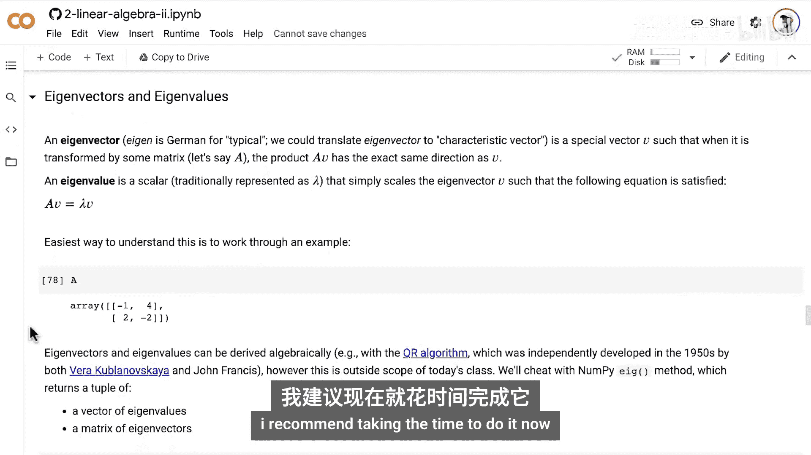

# 机器学习的线性代数及Python实现 ｜ Linear Algebra For Machine Learning p34 P34_特征向量和特征值 — 主题28 -BV1L8nLz6E8C_p34-

This video is a juicy one， I hope you're as excited as I am。

We start off by going over a high level explanation of what eigenvectors and eigenvalues are。

 then we move on to comprehensive handson code demos in Python to compute eigenvectors and eigenvalues。

 as well as to develop a clear working understanding of what they are。

The concepts of eigenvectors and eigenvalues go hand in hand， as you'll see in a moment。

 but let's start off by talking about eigenvectors on their own。

So let's say we had a painting of the Mona Lisa and to make it kind of easier to understand the idea of eigenvectors。

 we've drawn a grid on top of the Mona Lisa and we have， let's say they're basis vectors here。

 certainly orthogonal vectors。A red vector that's vertical and a blue vector that's horizontal。

If we apply a flip matrix。A matrix that when applied， reflects the Mona Lisa over this Y axis here。

Then the red vector and the blue vectorctor are both eigenvectors of the flipping matrix because the red vectorctor and the blue vectorctor retain their direction。

 So with the red one， that's really obvious。With the blue1。

 it is still on the same span to use the linear algebra return。 It's just the negative。

 So it is on the same axis， even though it's facing the opposite direction。

 we say that the vector hasn't been knocked off its span so it's on the same on the same line as it was before。

And so the red vector and the blue vectorctor are eigenvectors of the flipping matrix。

If we take a different matrix， a matrix that applies a shearing effect to our image。

Then in this case， the red vectorctor is no longer an eigenvector， but the bluevector still is。

So when we apply a shearing matrix to the Mona Lisa。The painting。Maintains its size。

From left to right， but it's shifted at the top。 So the pixels at the top have moved rightward。

 the pixels at the bottom have moved leftward。 and the further we are from the center of the image。

 the further up or down we are， the more the pixels have moved。So that's what the shearing effect is。

And we can see that the blue vectorctor， it maintains its direction。 It's still on its span。

 It's still on the same line。But the red vector， which was vertical。

 I now been knocked off of its span。 It's been knocked off of its line and is now pointing in another direction。

So bluevector is an eigenvector because it maintains its direction。

When the shearing matrix is applied， but the redvector is not an eigenvector of the shearing matrix because it does not maintain its direction。

 It gets knocked off its span。So that's really all there is too with aigenvectors。

I feel like a lot of people think it's a really complicated concept and took me a while to wrap my head around it。

 but I think that this explanation makes it pretty clear we're going to go through some more examples now while also talking about eigenvalues。

So， eigenvalues。Are scalar values？That tell you how much the eigenvector's length has changed as a result of applying the particular matrix that that we're applying。

 So in this case here where we're applying a shearing matrix。

The blue eigenvector of that shearing matrix， it has an eigenvalue of one。

Because its length stays exactly the same so we can count  one，2，3，4，5 of these squares。

Before the shearing matrix is applied， and it's still 1，2，3，4。

5 units long after the sharing matrix is applied。 So this blue eigenvector。

It has an eigenvalue of one for this particular shearing matrix that has been applied。So if。

 as a result of applying this shearing matrix， the eigenvector was no longer 5 units long。

 but it was suddenly 10 units long than the eigenvalue for that eigenvector and this particular shearing matrix would be an eigenvalue of 2。

 So in that case， not only would the Mona Lisa be sheared， but she would also be widened。

 She would be doubled in width。If a third sharing matrix that we applied。

Caused the eigenvector to have in length so that all of a sudden was two and a half units long。

 in which case the Mona Lisa would be sheared， but she would be narrower。In that case。

 the eigenvector would have an eigenvalue of 0。5 for that third shearing matrix。Okay。

 and so as we alluded to earlier。Eigenvalues can also have a negative sign。

So if we had a new matrix now that does shearing and flipping of the image it's applied to。

Then the eigenvector would have a negative eigenvalue of this blue eigenvector。

 So the redvector is definitely not an eigenvector because it gets knocked off its span。

 It's no longer pointing up or perfectly down。But this blue。Eigenvector。

 this bluevector is still an eigenvector， But in this case， because it's 1，2，3，4，5 units long。

 But now facing the exact opposite direction of the original vectorctor， which was 1，2，3，4。

5 units long， that means that the eigenvalue for this eigenvector and this particular shearing and flipping matrix that we've now applied。

The eigenvalue is negative 1。You know， this might be relatively obvious now。

 but if our shearing and flipping matrix， if we had a second shearing and flipping matrix that also。

Caused the Mona Lisa to double in width。Then our eigenvalue would be negative to assuming that this eigenvector now。

You switches from being five units long and pointing perfectly rightward to being now 10 units long and pointing perfectly leftward。

Okay so that gives us a high level understanding of what eigenvectors and eigenvalues are Now let's jump into a handson co demo so that we can get comfortable with using Python to find the eigenvectors and eigenvalues of any given matrix。

All right， so we're back in our linear Al 2 notebook。And I have a note here about the nomenclature。

 the etymology of eigenvectors and eigenvalues。 So eigen is the German word for typical。

 so you could translate eigenvector into English to mean characteristic vectorctor。

And the eigenvector， as we've seen on the Mona Lisa， is a special vector V， let's say。

Such that when it is transformed by some matrix， let's say by the matrix A。

Then the product A V has the exact same direction as V。

Or the exact opposite direction as we saw in the Mona Lisa。An eigenvalue。Is a scalar。

 So a single number traditionally represented as the Greek lower case letter Lambda。

And the eigenvalue simply scales the eigenvector V， such that the following equation is satisfied。

 So where a is the matrix that we are finding the eigenvector and eigenvalue  for。

 the eigenvalue simply satisfies this equation。 So when we apply our matrix a to the eigenvector。

That is exactly equal to the result we get when we apply this lambda scalar value to that vector v。

 this is kind of interesting to think about because in one case， we're applying a matrix to a vector。

 and on the other side of the equation， we're applying a scalar to a vector。

But I promise you it works out， and the easiest way to understand this is to work through an example。

So let's consider this matrix A， which we created earlier in the notebook。So that you're aware。

 eigenvectors and eigenvalues can be derived algebraically， for example， with the QR algorithm。

 which was independently developed in the 1950s by both Vera Kublanovskaya and John Francis， however。

This Q R algorithm or other algebraic approaches for deriving eigenvectors and eigenvalues are outside the scope of the machine learning Foundation's curriculum。

But you can follow through to this link to learn about it。

 it's simply too much for the scope of what we need to know and in terms of being able to apply machine learning with our understanding of eigenvectors and eigenvalues。

 I don't think it's critically important to be able to derive it algebraically。But yeah。

 if you want to learn it， absolutely go ahead and do so。So instead of using an algebraic derivation。

 we will cheat。 We'll use the nuumpy Ig method， which returns a tuple。

That includes a vector of eigenvalues and a matrix of eigenvectors， so let's have a look at that。

We pass in our matrix A， the matrix that we want to find the eigenvectors and eigenvalues for。

And we pass it into this Ig method， which is in the nuumpy L Algee linear algebra module。

And because it returns this tuple， I have this lambdas ready to receive the vector of eigenvalues that comes out of the method。

 and then I have this V capital v ready to receive the matrix of eigenvectors。SoLet's run that cell。

 Okay， it's done。 Now let's have a look first at the matrix v。

 which contains as many eigenvectors as there are columns of a。 So a has two columns。And therefore。

 we have two eigenvectors。Each column in V is a separate eigenvector for V。And each。Eigenvector。

 the first one and the second one， has a corresponding eigenvalue。

 which is stored in our lambdas vector of eigenvalues。

 So the first eigenvalue corresponds to the first eigenvector and the second eigenvalue corresponds to the second eigenvector。

So let's first confirm that A V equals lambda v for the first eigenvector。 So remember。

 this is our equation。For what eigenvectors and eigenvalues are。So。

Let's confirm that the math works out。So let's take the first column。Of our matrix V。

And call that this vector v 0。86 and 0。51。And then let's also grab our first eigenvalue。

Note that I couldn't call his variable lambmbda spellt properly because lambmbda is a reserved term in Python。

 So I used a phonetically correct variable lambmbda。Regardless of what you call it。

 it is still the first eigenvalue 1。37。And now let's satisfy this equation or confirm that this equation is satisfied。

 So let's first calculate the matrix multiplication of a times the vector v。 and we get this result。

 and then we can also multiply。Our eigenvalue by the vectorctor v by the eigenvector v。

 And in both cases， we get the same result， therefore proving。That。The left side of this equation。

Which we calculated here is equal to the right side of the equation， which we calculated here。

Now let's plot things out to get a bit of a geometric understanding of what's happening here。

So let's use our plot vectors function from earlier。And we can see our original vector in light blue。

 as we've been doing throughout this notebook so far。

 So the original eigenvector of our matrix a looks like this。 And we can see that after the matrix a。

Has been applied to that eigenvector。It retains exactly its direction。

 It has simply been lengthened somewhat。And the amount that it's been lengthened corresponds exactly to our eigenvalue for the eigenvector。

 so。嗯。This blue arrow， the eigenvector after being transformed by a is 1。

37 times the length of the original light blue eigenvector V。

And we can show this again for the second eigenvector of a。 So let's grab the second column。Of our。

Matrix V here。 So this is our second eigenvector now。And we put that into this variable v2。

And we grab our second eigenvalue from our vector of eigenvalues。

We can now calculate the product of applying our matrix A to our second eigenvector。

And we can confirm that that is equal to multiplying our second eigenvalue by our second eigenvector。

 we get exactly the same result as the equation suggests it should。So perfect。

 So for both of our eigenvectors for matrix a， we have proved that that equation is satisfied。

 And now let's have a look at the second eigenvector。

So we can see the second eigenvector looks like this in light green， B2 in light green。

And when we apply the matrix A to it。It becomes a lot longer and in the negative direction。

Which we should have actually known here。In advance， from the eigenvalue。

 so the eigenvalue is negative 4。4。Which means that the dark green， the eigenvector。

 the second eigenvector， after being transformed by our matrix a。Is 4。

4 times longer than the original eigenvector and has a negative sign So it points in the exact opposite direction。

Using the P torch IG method， we can do exactly the same as we just did above in nuumpy。

So here is our nuumpy matrix tensor。And we can create the same matrix tensor as a pytorrch Tensor。

 Note that just as with many of the pytorrch functions that we saw in the first subject of this machine learning foundation series。

 our intro to linear algebra subject。Just like then。

 this ig method requires that all of the tensors that are passed into it are float type。

 so I have this period here to ensure that this creates a float type pytorch tensor。

Whereas the nuy Ig method， similar to most nuumpy methods， can handle integer type。Tensors。

 so that's another distinction that you need to make sure when you're transferring between nup and P torch。

Other than that， things are pretty straightforward。 So we have the torch Ig method。

 We pass in our pi torch tensor， our pi torch matrix a。And。Unlike in numpy， in pytorrch。

 eigenvectors are not output automatically by default。

 so we need to set eigenvectors to true by default。

 the torch eig method returns eigenvalues only another little distinction between the nuy and pytorrch methods。

And another distinction is that the piytorch method creates only one output object。

So I'm calling it eigens。And that single object contains both the vector of eigenvalues。

And our matrix of eigenvectors。So let's have a look at our first eigenvector。And。

We can also look at our first eigenvalue。By using these particular notations to cut through the various layers of the eigen's onion and access。

The eigenvector that we would like in this case， the first eigenvector and the eigenvalue that we would like in this case。

 the first eigenvalue。So。Just like we did in Numpy， we can use matrix multiplication。

And pass in our our matrix A， as well as our first eigenvector to get the product。

And pass in our eigenvalue and our first eigenvector， our first eigenvalue and our first eigenvector。

 And we get the same results， just as we would expect， as is true for our second eigenvector。

 So now specifying our second one instead of our first one。And specifying our second eigenvalue。

Instead of our first eigenvalue。And then again， perform matrix multiplication。Between our matrix a。

 second eigenvector， our second eigenvalue in our second eigenvector。 and yet again。

 they are equivalent to each other。We can plot these eigenvectors out。

Here all you need to do is you take your torch tensor and you add this nuy method on the end of it。

 and it converts that torch tensor into a equivalent nuumpy array。

 which is then an acceptable input into my plot vectors function。As you can see。

 we get exactly the same eigenvectors both before。And after transformation by the matrix A。

 whether we use Pytorch or whether we use numpy， and that shouldn't be surprising because the math should be identical。

 it shouldn't matter which library you use。Allright。

 the final topic to cover here is to talk about eigenvectors in greater than two dimensions。

So up until this point， we were working with matrices a that had two columns。

Resulting in two eigenvectors for that matrix A。 And while plotting gets trickier in higher dimensional spaces。

So it's nice and easy for me to plot eigenvectors in this two dimensional Xy plane。

But if we have more than two dimensions， we can nevertheless find and use eigenvectors with more than two dimensions。

 even if I can't app it easily。 I could do 3 E D plots， but I didn't put the effort in。

So here's a 3D example， and there are three dimensions handled over the three rows of our matrix x here。

We have three rows and we have three columns and we're going to get out three eigenvectors when we pass our matrix X in this case。

 into our nuumpy g method and。Let's see what we get here。 We have， of course， as I just said。

3 eigenvectors，1 per column of x， and we have a corresponding eigenvalue for each eigvector。

 So first eigenvector， first eigenvalue。Second eigenvector， second eigenvalue， Third eigenvector。

 third eigenvalue。And if we had a 4 by4 matrix or a 5 by5 matrix。

 then we'd end up with four eigenvectors and four eigenvalues or five eigenvectors and five eigenvalues respectively。

And whatever the dimensionality。We can confirm that the matrix。

 the original matrix that we are finding the eigenvectors and eigenvalues for。

That multiplied by any given eigenvector is equal to that eigenvector's eigenvalue multiplied by the eigenvector。

 So we can confirm this for one example。 Let's do the first eigenvector。

So we'll grab the first column of our。Eigenvector matrix here。

 and that first column corresponds to our first eigenvector。Let's grab our first eigenvalue。29。7。

And we can confirm that。Matrix multiplication of the matrix x times that first eigenvector。

Gives us this result。Which is equal to the first eigenvalue multiplied by the first eigenvector。

They are the same， confirmed。Allright， so now is comprehension exercises that I recommend you carry out on your own time。

You can use Pytorch to confirm。That x v equals lambda v。For the first eigenvector of x。

 so you can repeat the same operations that we did here。But now using pytorch， like we did earlier。

 So using the same kind of pytorrch code here。To。Investgate and confirm that you get the same results in Ny as in Pytorch for this three dimensional matrix x。

And then confirm that same equation X v equals lambda v for the remaining eigenvectors of x。

 So there are two more。You've got the。Second eigenvector in your third eigenvector。

 And you can go ahead and confirm that in either nupy or pytorrch。

 So you should have all the information you need to carry out these exercises。We've。

Followed all of the prerequisites within this notebook in the last few minutes。

To perform these exercises， and you know what the right answers should come out to。

 certainly for the first eigenvector， and hopefully it's relatively plug in play to get the answers for the second and third eigenvector and confirm this equation for those as well。

So we're not going to work through these solutions to these exercises。

 I think you should be able to figure it out on your own。

 but nevertheless the exercises will be useful because they'll help you slow down and think about what I've been telling you throughout this video on eigenvectors and eigenvalues and so you can assimilate that information when you have to be you know changing some of the values around and checking these equations yourself。

 So that will definitely be a valuable exercise I recommend taking the time to do it now。

Nice， I hope you learned a lot in this video。 It's one of my favorites Up next。

 we're covering matrix determinants， which are scalar values we can calculate for any given matrix。

 Scals that have a special relationship to the eigenvalues we learned about in this video。😊。

To be sure not to miss the next tutorial in this series， subscribe to my channel。

Thanks for taking part in the tutorial， I hope you enjoyed it。If you did， please like and comment。

To be sure not to miss any of my content， head to JohnChroone。

com and sign up for my email newsletter。You're also welcome to add me on LinkedIn。

 Simply mention that your reviewer of the Ma Learning Foundation series。

You can follow me on Twitter too if that's your social medium of choice。

See you next time。