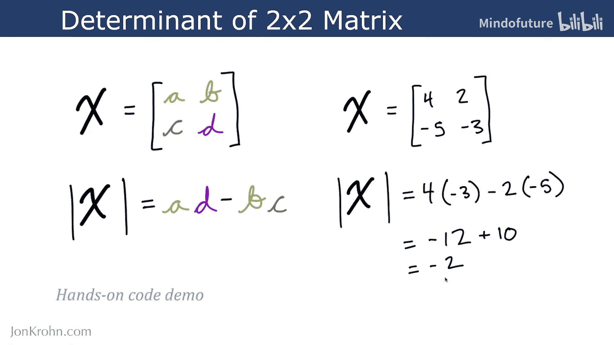
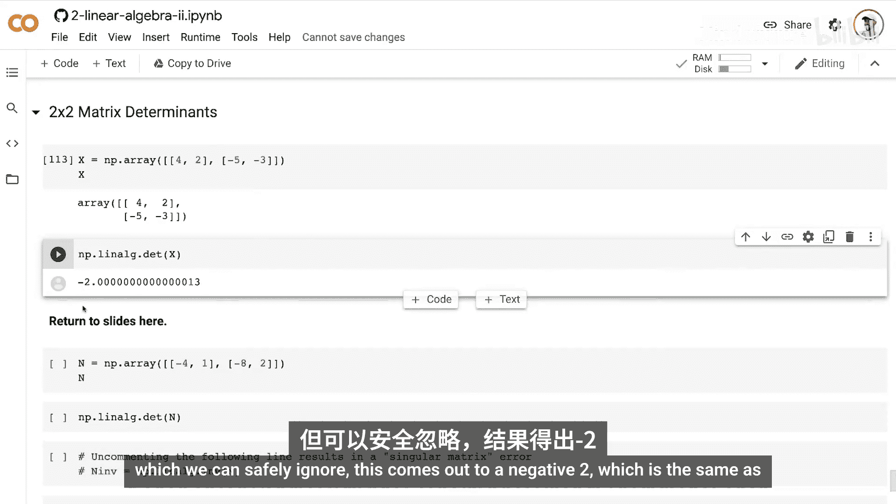
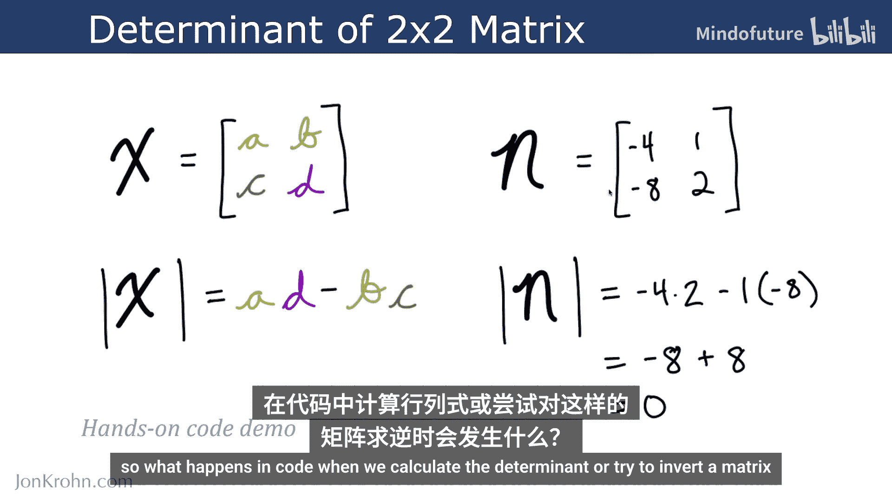
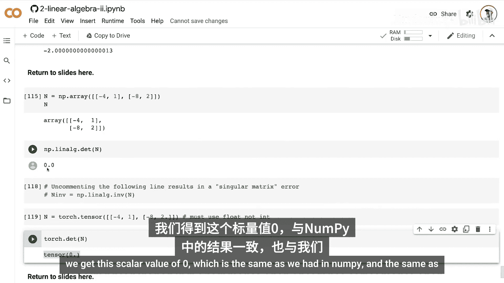

# 机器学习的线性代数及Python实现 ｜ Linear Algebra For Machine Learning p35 P35_矩阵行列式 — 主题29 -BV1L8nLz6E8C_p35-

A determinant is a special scalar value that we can calculate for any given matrix。

 It has a number of very useful properties， as well as an intimate relationship with eigenvalues that we'll explore later on。

😊，Matrix determinants map a square matrix to a single special scalar value。

 So the key here is that we do need to have square matrices in order to calculate their determinant。

But。It enables us to determine whether a matrix can be inverted。

 and you may recall from the end of the first subject in my machine learning Foundation series on the intro to linear algebra that in order to invert a matrix at all you do as a starting point need to have a square matrix。

 so that's part of why a matrix determinant maps a square matrix to a scale of value。However。

 this determinant allows us to go a step further。More on that in a second。 First of all。

 the notation。 So for any matrix X， we denote it as debt， open bracket X， close bracket。Here's where。

The determinant starts to show its special value I that if the determinant of x is equal to 0。

Then that means that even though x is a square matrix， we cannot invert it。

And the reason why we can't invert it。Is because。Of these kinds of situations here where either there is no solution or there's an infinite number of solutions because the lines don't cross or we have identical lines。

 So in either one of these cases， we have a singular matrix。And again。

 as you'll recall from earlier on matrix inversion， singular matrices cannot be inverted。

 We can't solve for the unknowns in either of these situations。

So we're getting a little bit technical here。 and probably the nitty gritty of this doesn't matter too much。

 but if we take the determinant of a matrix X and that comes out to 0。

Then the inverse of that matrix corresponds to the inverse of the determinant。

And the inverse of the determinant in this case where the determinant is equal to0 cannot be computed because we have a zero in the denominator。

And yes， so as I already mentioned， this indicates that the matrix X while square。

 suggesting it might be invertible。Is， in fact， singular。 It contains linearly dependent columns。

 We either have this situation here or this situation here。

 meaning that our square matrix cannot be inverted。Now， how do we actually calculate the determinant。

 Well， it's easiest to calculate for a2 by two matrix， so let's start there。

Let's say we have this matrix X here where all of the numbers are color coded letters。

 so here's our formula for calculating the determinant of this matrix X x。

The notation that we can use here is two vertical lines。 They look like absolute value bars。

 but we're applying them to a matrix and。So this determinant of our matrix x is equal to a times d minus B times C。

So each one of these elements is a scalar value， and so it's just simple arithmetic。

Let's look at some real numbers to get a sense of that。 So let's say this is our matrix X。

 Then the determinant is。Four times negative 3， a times D。Minus B times C。Minus2 times negative 5。

 so 4 times negative 3。Minus 2 times negative 5 is just the same as a times d minus B times C。

Simplifying here a bit， four times negative 3 is negative 12， negative 2 times negative 5 is 10。

 and negative 12 plus 10 is negative 2， so our determinant of this matrix is negative2。

Let's look at a hands on codedemo。

All right， so we're now in the two times2 matrix determinants section of our linear Albra 2 notebook。

And let's create the same matrix that we had on the slide。

And we can use the Numpy debt determinant method from the linear algebra module。

And that gives us notwithstanding some rounding error， which we can safely ignore。

 this comes out to a negative2， which is the same as we calculated on the slides。

All right， let's do one more example here now with this matrix n。

And so when we do a times D minus B times C， A times D minus B times C。We have negative four。Times 2。

 that comes up to negative8。 and then we have。1 times negative 8， but we have the minus sign here。

 so negative 1 times negative 8 comes out to positive 8 and then simplifying negative 8 plus 8 of course comes out to 0。

So this means that the matrix n is not invertible and actually you can see that by I， if you' looked。

 these two columns are not independent， we have dependent columns。

 so this first column is a multiple of the second column。

So it's if we take this second column and we multiply it by negative4， we'll get this column here。

 which means that we have two parallel lines represented by our matrix here。And therefore。

 they will never cross， and it's impossible to invert it。

 It would be impossible to solve for the unknowns to identify the point where these two lines cross over。

So what happens in code when we calculate the determinant or try to invert a matrix like this。

 let's have a look。

So here now we have our matrix n from the slides。When we calculate the determinant， we get a zero。

 just like we did calculating by hand。You're welcome to uncom this line of code here。

And try running it so you can try to invert the matrix N。And it will not work。

 The error that it throws back is a singular matrix error， exactly as we should expect。

 because we do not have independent columns。In that matrix。 So there you go。And。

Just so that you know how to calculate determinants in Pytorrch as well， Pytorrch being。

 I think is becoming clear a favorite library of mine。When we calculate the。

The determinant of it using the debt method from Pytorch。We get this scalar value of 0。

 which is the same as we had a numpy and the same as we calculated by hand。

Alright， so now we know how to calculate the determinant of a two by2 matrix。

 and it isn't too tricky up next I'll show you how to use recursion to calculate the determinant of larger matrices。

