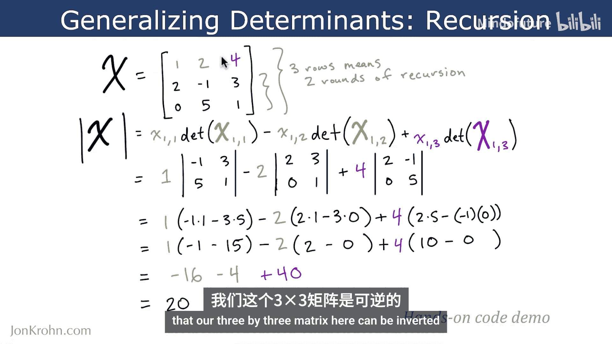
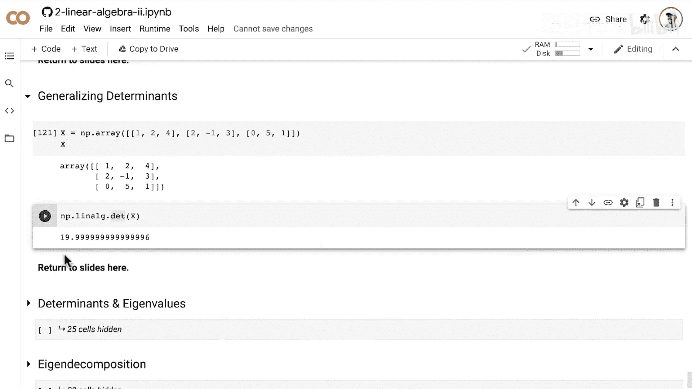

# 机器学习的线性代数及Python实现 ｜ Linear Algebra For Machine Learning p36 P36_大型矩阵的行列式 — 主题30 -BV1L8nLz6E8C_p36-

We've covered how to compute the determinant of a two by two matrix。

 But what if a matrix is larger than that， But Well， that's what this video is for。

 in it well use recursion to calculate the determinant of larger matrices。Okay。

 so we know how to calculate determinants for two by two matrices。

And now we can generalize that understanding and calculate determinants for larger matrices。

 such as this 5 by5 matrix， using recursion。What we'll do， I'll speak about it at a high level first。

 and then we'll dig into some numbers on the next slide。

So in order to find the determinant for a 5 by 5 matrix。

 we would need to perform  four rounds of recursion。

 So we would start off by calculating determinants for two by two matrices in this bottom two rows here。

And then once we have those results。We can use them to calculate determinants for the three by three matrices in the bottom three rows here。

And then we can， again， use those values to calculate 4 by four determinants。 And finally。

 with that in place， we can calculate the 5 by5 determinant。 So the formula。

 the general formula for calculating larger determinants。Is if we have our matrix X here。

 then the determinant of that matrix。Starting first， out at the highest level of recursion。

We calculate the product。 We multiply x1，1 shown in orange here times the determinant of the matrix x1。

1。 And what this means， this matrix x1，1， It's the4 by 4 matrix here。

That is not in any of the rows or columns that the scalar value x11 is in so。

The element x11 is in the first row and the first column。 That's y is11。And so。

We multiply that value by the determinant of the4 by four matrix。

 That is all of the elements that aren't in that first row or that first column。And then from that。

 we subtract。The product of x12 times the determinant of the matrix x12。 And here again。

 that matrix is a 4 by 4 matrix that consists of these 12 elements here。Plus。

 these four elements here。 So it's a concatenation of these 4 and these 12。

And that's because those 16 elements are outside the column and the row that that x12 value is in。

And then we add to that。The product of x1，3 and the determinant。Of all of the values。

 these 8 and these 8 that are not in the same column or row as x1，3。

And we continue onward for x14 and x15。Notice here that we alternate plus and minus signs。

 So we start off with a minus with subtraction， and then the next term is added。

 Then we subtract again， and then we add again and so on。

 So if we add a 7 by 7 matrix that we were calculating the determinant for。

 Then we would have another term that we subtract and then another term after that that we add。

All right， so that's at a high level what we do to recursively generalize the calculation of determinants。

To matrices that are larger than two by2。 Let's now tackle an example with real numbers。

So let's start small so that you don't have to do tons of arithmetic。

 Let's calculate the determinant of this3 by three matrix。

Now this 3 by3 matrix is going to require two rounds of recursion。

 so first with the two by two matrices and then finally with the full 3 by3 matrix。So。

The determinant of x following the formula that we just saw on the preceding slide is。X1。

1 times the determinant of the matrix x11 minus x1，2 times the determinant of the matrix x1。

2 plus x1，3 times the determinant of the matrix x 1，3。 So let's work through these terms1 by one。

So the value x11， Well， that's equal to 1， easy enough。

And then the determinant of the matrix x11 is this。

 we're working with this2 by 2 matrix here because this two by2 matrix is not in any of the rows or columns that x11 is in。

And so we can take these four values and put them in here。

 and we can use that to calculate the two by two determinant following the formula that we already know from an earlier video。

All right， so we'll do that in a second first， let's calculate our other terms here。

So the value X12 is this value 2 here。And then the matrix x12 is 2，0 and 3，1，2，0 and 31。

 because these are the elements that aren't in the same row or column as the2 x12。

And then our final term here is x13 is 4。Multiplied by this determinant。Of x1，3。 And again， x1。

3 is these four values because these four values aren't in the same row or column as the4。All right。

 so now we have our three terms。 we're ready to do the inner round of the determinants。

And so we can follow our formula A times D minus B times C。 So in this case。

 it's negative 1 times 1 minus3 times 5。Here it's 2 times 1 minus3 times 0。And finally。

2 times 5 minus negative1 times 0。Simplifying a bit here。 So negative1 times 1 is negative 1。

 negative 3 times 5 is negative 15，2 times 1 is 2，3 times 0 is 0，2 times 5 is 10。

 and negative1 times 0 is 0。All right， and then1 times negative 16。Is negative 16？

Two times 2 is negative 4 because of the negative sign here。 So negative2 times 2， I should say。

And then finally， 4 times 10 is 40。All right， and then simplifying negative 16 4 plus 40 comes out to 20。

Allright， so that does it If you had even more。If you had an even larger matrix， then you know。

 if we had a 4 by four matrix， you'd have to do three rounds of this style of recursion。

But hopefully， this gives you a sense of how this recursion works。

Let's jump to a hands on code demo to see this in code。 Oh， and I should mention that， of course。

 because this value isn't 0， it means that our3 by three matrix here can be inverted。

Al right， so in the generalizing determinants section of our linear Alge 2 notebook。

I'll use Ny to create the same3 by3 matrix as we had on the slide a moment ago。

 and we can use the Nmpy determinant method depth method from the linear algebra module to calculate that indeed the determinant of our matrix X is notwithstanding an extremely small amount of rounding error equal to 20。

Great， feeling confident that you could calculate determinants by hand on your own。

Up next are exercises to confirm your confidence。