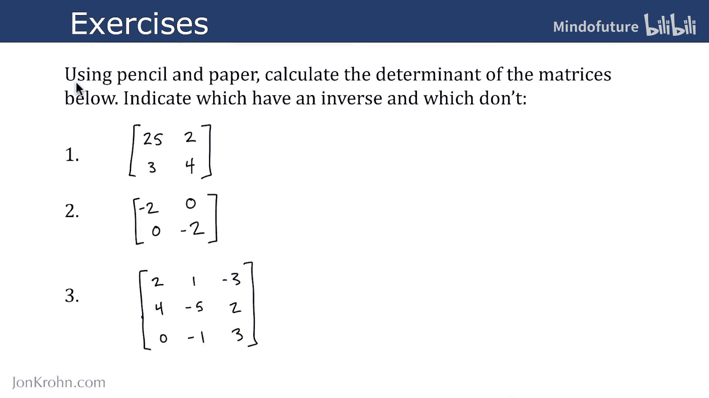
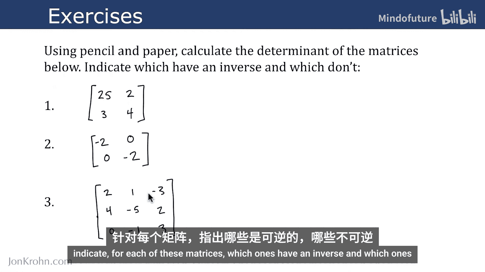
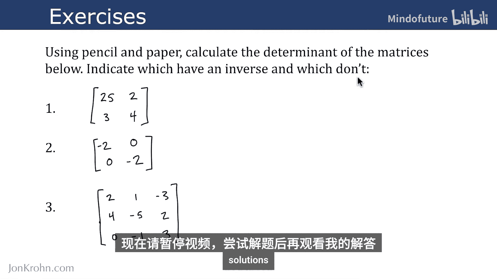
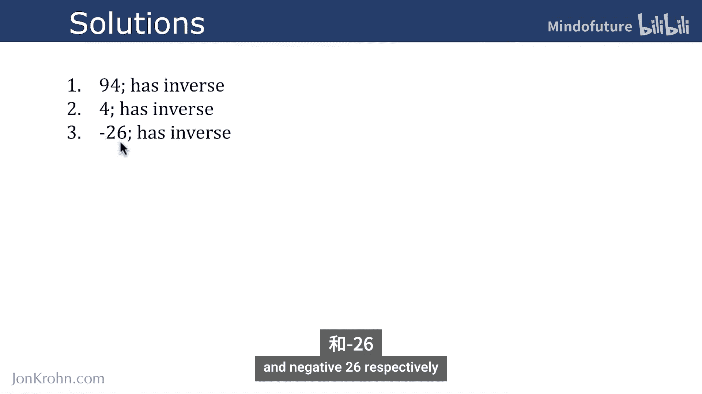
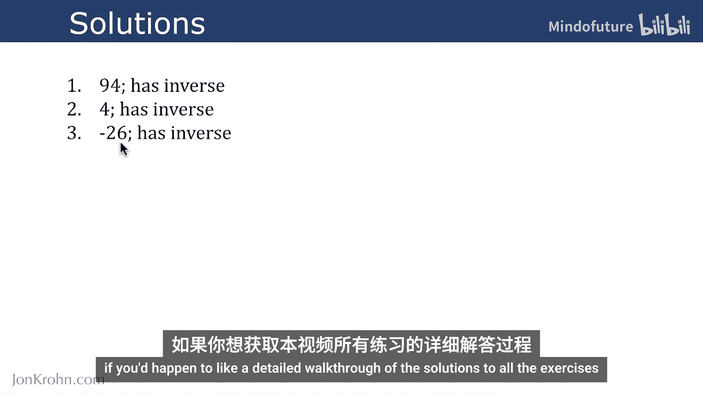
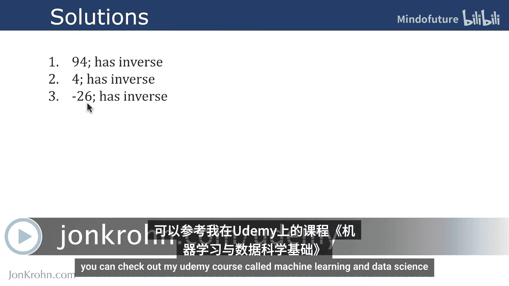

# 机器学习的线性代数及Python实现 ｜ Linear Algebra For Machine Learning p37 P37_行列式练习 — 主题31 -BV1L8nLz6E8C_p37-

All right， we've covered all the theory you need to calculate two by two determinants or larger determinants by hand。

 In this video， I have three exercises to test your comprehension of that theory。

Using pencil and paper， calculate the determinant of the matrices below。

Indicate for each of these matrices， which ones have an inverse and which ones don't。

All right， so pause the video here and take a shot at it before I show you the solutions。

So maybe a little bit of a trick question， all three of our matrices could be inverted。

 none of them couldn't be inverted。And the values that you should come to when you calculate the determinant of the three matrices are 94。

4 and negative 26 respectively。

And I should mention that if you'd happen to like a detailed walkthrough of the solutions to all the exercises in this video。

 you can check out my UMmy course called Machine Learning and Data Science Foundations。

Nice work。 In the next video， we'll examine the nifty relationship between the matrix determinants we've just learned about and the eigenvalues we learned about earlier on。

😊。