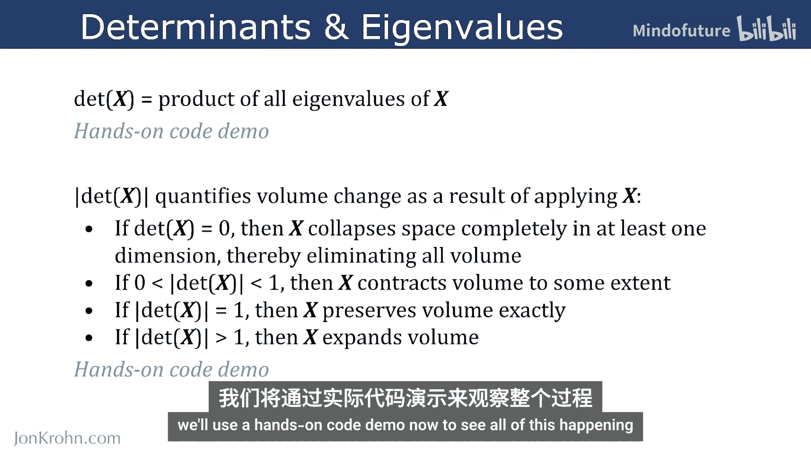
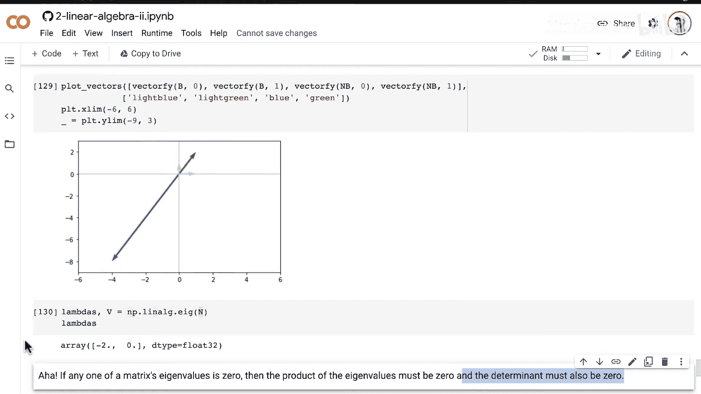
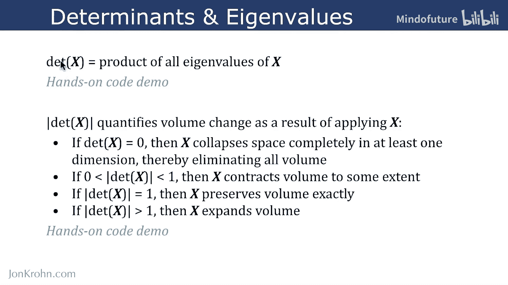
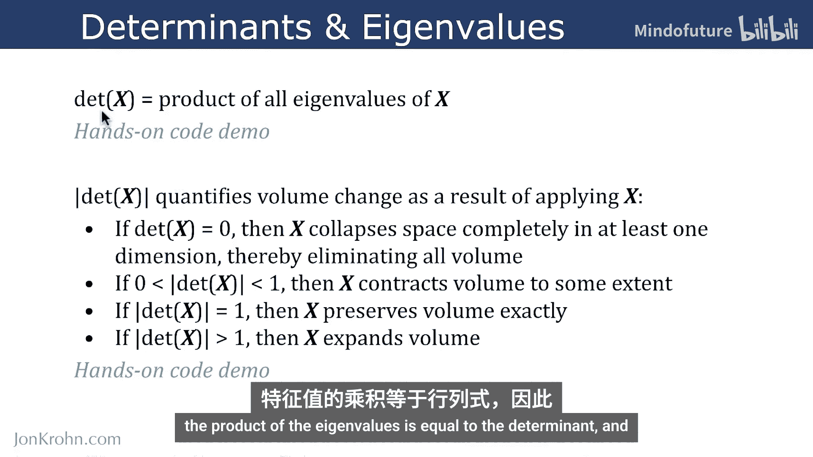
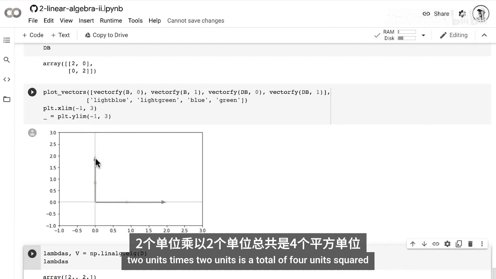

# 机器学习的线性代数及Python实现 ｜ Linear Algebra For Machine Learning p38 P38_行列式和特征值 — 主题32 -BV1L8nLz6E8C_p38-

With a focus on hands on code demos in Python to give you a working understanding of what's going on。

 this video illustrates the relationship between determinants and eigenvalues。

Or it may surprise you to learn this surprisingly simple relationship between determinants and eigenvalues。

So simply， but the determinant of some matrix x is equal to the product of all of the eigenvalues of x。

Let's jump to a hands on code demo to have a look at that。All right。

 we saw in the preceding video that the determinant of this3 by 3 matrix x is equal to 20。

So now that's one side of the equation I just showed you。

 The other side is to confirm that this 20 is the same number we get if we calculate the。

Eigenvalues of our matrix X。 In this case， I'm using the eig method to do that。

And then we calculate the product of all of the lambdas together。

 so multiplying each of these three values by each other。

 and we can do that with the Numpy product method。Andvoila， it does turn out negative 3， roughly。

Times the negative  one， roughly times 5 in a bit comes out to 20。Alright。

 so to help you develop a geometric intuition around why this relationship between determinants and eigenvalues exists。

 let's cover a bit more theory on the slides， and then we'll jump back to another hands on code demo so。

The absolute value of the deterrenmint of x quantifies the volume change is a result of applying x to some tensor。

So if the determinant of x is equal to 0。Not only does this mean that。

The matrix X is singular and can be inverted， but this also has a special impact on the tensors that we apply X to because X then collapses the space completely in at least one dimension of the tensor that we apply X to。

 thereby eliminating all volume。Of the tensor that we've applied X to。Following on from that。

 if the absolute value of the determinant of0 is somewhere between 0 and1。Then。

X will contract the volume to some extent of the tensor that it's applied to so。

If the value here is 0。5。Then X will have the impact of having the volume of the tensor that we apply x to。

If the absolute value of the determinant of x is equal to 1。

 then x will preserve the volume of the tensor that we apply x to exactly。And finally。

 and perhaps unsurprisingly， given the trend so far。

 if the absolute value of the determinant of x is greater than1。

 then x expands the volume of the tensor we apply x to。All right。

 If that didn't quite make sense if you couldn't picture that in your head and don't worry about it。

 we'll use a hands on co demo now to see all of this happening。

All right， so back in our linear Al 2 notebook in the determinants and eigenvalues section。

Here's the absolute value of the determinant of x in Nmpy。

 so we just pass x into that determinant function， and then we can use the Ny abs method to calculate the absolute value。

Now， of course， when we have 20 going in， a positive value is just going to come out as a positive through up of the values。

 but if it had been negative 20， then it also would have come out as positive 20。

And so what this means is that applying this matrix X。Will have the impact of increasing the volume。

Of the tensor we applied to by 20。Let's break this down， even more。Let's use a matrix B。

 which is composed of basis vectors to explore the impact of applying matrices with varying absolute values of determinant of x values。

That was a mouthful。 I just， we're going to play around with different kinds of matrices that have varying absolute values of their determinants of x and。

We will see how that impacts our matrix B， which is composed of basis vectors so。

It actually looks identical。 It is identical to an identity matrix。

 but here are the two base vectors。So we have one basis vector。

Running along the x axis to this point where x is equal to 1 and y is equal to 0。

 And then the other basis vector runs from the point where y is equal to 1 and x is equal to 0。

 So that's what the two columns here represent。And recall that basis vectors are not only orthogonal to each other。

But they also have unit norm。An L2 norm of one。And this means that they are ortho normalormal as well。

So just a bit of a theory refresh there。 So these basis vectors。

 because they're easy to remember what their shape is like。

 it's going to be easy to see how applying various matrices to these basis vectors impacts the basis vectors and how it impacts the volume that they represent。

 So you can imagine。Tracing a rectangle。In this space that these vectors point out。

 So you can imagine that there was another point here rounding out the rectangle。

 which in this case would be a square。 And that would mean that these two base vectors describe a square。

With an area of one unit squared。Let's see how that volume changes as we apply various matrices to our basis vectors。

Let's start off by applying the matrix n to our basis vectors。

 we're callinging from earlier that the matrix n is singular。

 so it's singular because the columns are not independent。

 this column is a multiple of the right column。 so if we were to multiply the right column by negative 4。

 we would get the left column which means that we have parallel lines。And therefore。

 and cannot be inverted。And it means that the determinant of n must be 0。

So when the determinant of a matrix is 0， as I mentioned on the slides。

 this means that it must collapse。The tensor that it's applied to in at least one dimension。

 getting rid of its volume。 So let's see that happen。 Let's apply。N2 B。And that gives us this result。

Let's have a look at it。Haha so。In went our basis vectors。And out came this perfectly flat line。

So these vectors are exactly opposite to each other。

And that means that there's no longer any volume described by the vectors。

 So when they were basis vectors， we had one unit squared。 but after applying the matrix N to them。

They've been squished and we now have yeah， just a straight line that has no volume。

So let's calculate the eigenvalues。And we see that the eigenvalues of n。

 there's an eigenvalue of 0 in there。And sovoila， there's the relationship between our eigenvalues and our determinants。

 If any one of a matrix's eigenvalues is a 0。Then the product， of course。

 of all of the eigenvalues must be 0 if one。Thing is zero in a bunch of things that we multiply by each other。

 the end result is going to be zero every time。And since we know that the determinant of a matrix is equal to the product of all the eigenvalues。

 If the product of all the eigenvalues is 0。The determinant must also be zero。

There is an embodiment of this relationship here。 So we're starting to see why geometrically this relationship happens。

All right， for a further example， now let's try applying the identity matrix I2 to our basis vectors。

So the identity matrix happens to be identical to the basis vector matrix， but no matter。

The determinant。Of I2 is 1，1 times 1 minus-0 times 0 is 1。And when we apply I to B。

 we of course get back B， which is the same as I。And so now， when we plot。

How our basis vectors have changed while they haven't at all。

 of course they haven't applied an identity matrix to them。

And so this is a yeah a bit of a boring example， but it goes to show how in a situation where our eigenvalues。

Are both ones。Then1 times 1 is equal to1， and the product of the eigenvalues。

Is equal to the determinant。

The product of the eigenvalues is equal to the determinant。And therefore， the vectors。

Retain the same volumes。That they described as before。 So they described one unit squared。

 And after applying a matrix with a determinant of one。Eenvalues of all one。

 We retain one unit squared described by those basis vectors。Alright。

 so I admit that applying an identity matrix isn't the most exciting operation in the world。

 So let's now apply this matrix to J， which is a bit more interesting。

 So there's more going on than the identity matrix。 and looks like this。😊，But negative 0。

5 times 2 minus0 times 0 comes out to negative 1。And the absolute value。Of negative one。

 So the absolute value of the matrix J's determinant is one。Now， let's apply J to B。And observe how。

 even though。The matrix J does。Transform。The basis vectors B， so it reflects and scales by half。

The blue basis vector。And it scales by2。The green basis vector。

And so we also see here that the basis vectorctors are， in fact， both eigenvectors of the matrix J。

 right， they remained on their spans。And given that they remained on their spans。

 they must be the two eigenvectors of the matrix J。

 And given that it should come as no surprise that the eigenvalues of our two eigenvectors here are negative 。

5 and 2。Because for this light blue vector， which it turns out must be the first eigenvector。

When we multiply it by negative 0。5， it is transformed like this。And our green eigenvector。

 our second eigenvector。It gets multiplied by the eigenvalue of  two， so it becomes twice as long。

 but maintains its direction。And。So， even though。The shape of the rectangle described by these two vectors is now definitely different。

It's still one unit squared。So negative 0。5 units times  two units comes out to an area of one unit squared。

So。These eigenvalues correspond。To a determinant， an absolute value of the determinant。Of one。

Because they retain the volume described by the vectors。Hopefully。

 it's starting to come together now。And， finally。Let's apply the matrix D。

Which scales vectors by doubling along both the X and y axes。

 So D is simply we can get it by multiplying our identity matrix by 2。

 So it has this structure here and the determinant of that matrix D is 4。

When we apply the matrix D to our basis vectors。Those vectors are skilled。By double。

 along both the X and the Y axis。And let's see what that looks like in a plot。Wellvoila。

The basis vectors have both doubled in length。And we see that。With our eigenvalues， because again。

 here， both of these basis vectorctors are the eigenvectors of our matrix D。

 We know that because after we apply the matrix D， they both remain on their span。And yeah。

 so the eigenvalues for both of them are two。 they both double and the area described by these vectors now is four units squared。

 two units times two units is a total of four units squared。

Al right， we've nearly wrapped up our tour of determinants and eigenvalues Up next is the only remaining new eigenvector related theory in which we formally study how a matrix can be wholly decomposed into eigenvectors and eigenvalues。

To be sure not to miss the next tutorial in this series， subscribe to my channel。

Thanks for taking part in the tutorial， I hope you enjoyed it。If you did， please like and comment。

To be sure not to miss any of my content， head to joChrome。com and sign up for my email newsletter。

You're also welcome to A me on LinkedIn， Simply mention that you're a reviewer of the Maine Learning Foundation series。

You can follow me on Twitter too if that's your social medium of choice。See you next time。

