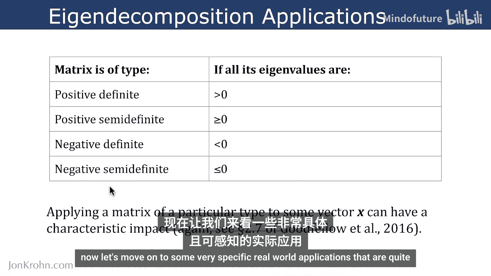
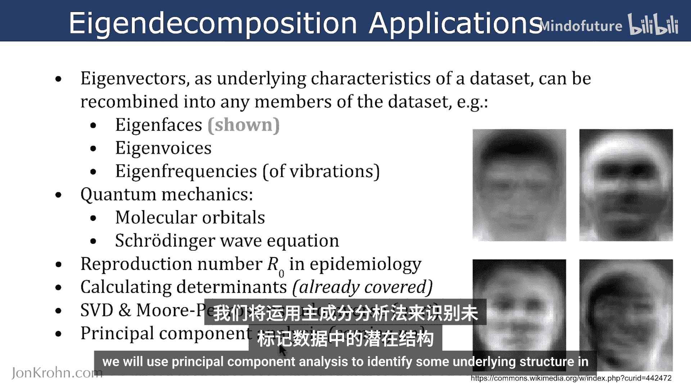
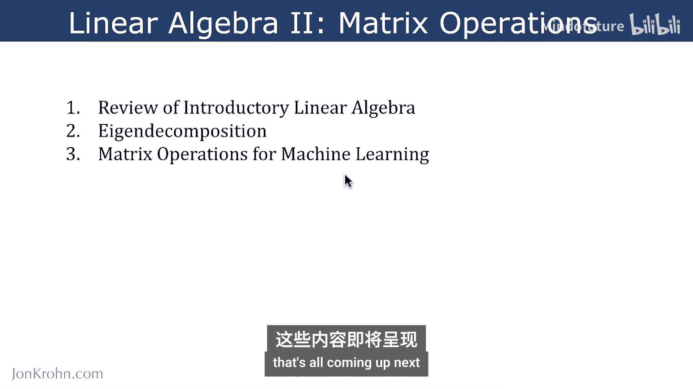
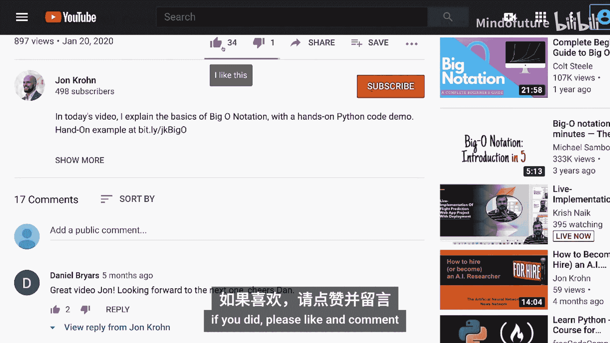

# 机器学习的线性代数及Python实现 ｜ Linear Algebra For Machine Learning p40 P40_特征向量和特征值应用 — 主题34 -BV1L8nLz6E8C_p40-

Hello， in this video， I'll show real world applications of eigenvectors and eigenvalues with special mention of applications that are directly relevant to machine learning。

Alright， let's start off with some relatively simple examples of eigen decomposition。

 so returning to a topic a fine transformations or 2D geometric transformations that we already talked about right at the beginning of this segment on eigen decompositions。

 so of all the videos that we've been talking about eigenvectors and eigenvalues in this machine learning foundation series。

 we started off by talking about a fine transformations like scaling and shearing。

And so we've come full circle now。And now， with you know。

 that understanding of of a fine transformations from a while ago， In the meantime。

 we've learned a lot about eigenvalues and eigenvectors。

 So now I can reveal to you that when we are performing some equal scaling。😊，On a 2D object。

 So we're scaling as much along the X axis as the y axis。 Then you use a matrix like this。

 I'm using the nuy or pi To Tensorflow double square bracket notation。

To annotate this two by two matrix here。And so we have ks along the main diagonal in the top left corner and in the bottom right corner of the two by two matrix。

And for equal scaling， the eigenvalues， both of them are equal to k to that scaling factor。

And the iigendvectors will end up being non zero。For unequal scaling。

 So where we are scaling more along one axis than the other。

So here we're scaling more along the vertical y axis than the horizontal X axis。In that case。

 then we will have a different K1 and K2 value。And the first eigenvector will correspond to one of those ks。

 and the second will correspond to the other one。And example。

 eigenvectors include these ones here in that kind of circumstance。And then finally。

 we have shearing here。 So in a early video in this segment we had the Mona Lisa and we were showing how she can be sheared。

 so this is the shearing operation， applied this is a horizontal shear specifically。

 I don't have an example of a vertical shear， but it would be a circumstance where the red vertical vectorctor was the eigenvector and so yeah there would be a shear where the blue vector is knocked off it span instead of the red vectorctor like we have here for the horizontal shear。

 So where Mona Lisa is being twisted sideways like left or right with a horizontal shear。

 the vertical shear would mean a shear vertically up and down instead of left to right。

And here are the matrices for carrying out a horizontal or vertical shear。

So you have a couple of ones and then a either in the top right corner for the horizontal shear or in the bottom left corner for the vertical shear。

And for the horizontal shear， we end up with all of our eigenvalues being equal to one。

And equal to 2 for the vertical shear。And here are some example eigenvectors。

Bored both of the circumstances。Okay， moving on now to some slightly more complex applications of how eigenvalues can be used。

 So there's this concept of types of matrices， which is。Largely beyond， in fact。

 other than us discussing it right now on this slide。

 we're not going to talk about this again in my machine learning foundation series。

But I wanted you to be aware of these terms because you might see them in the literature and so we have these four types of matrices。

 positive definite， which is a kind of matrix that has all eigenvalues being greater than 0。

 we have the positive semi definite type， where all the eigenvalues are greater than or equal to0。

 negative definite where all of the eigenvalues are less than 0。And negative semi definite。

 where they are less than or equal to0。So applying a matrix of one of these particular types to some vector x has a characteristic impact on that vector x。

And you can see Section 2。7 of a Good Flow at all， the book called Deep Learning。

 which was released in 2016 by MIT Press and is available free online。

And the reason why I say again here is that I referenced this same section in the same textbook in a video that is just little bit ahead of this one in my machine learning Foundation series if you're following them along sequentially。

As an example of the characteristic impact。That a matrix can have。

One that we've talked about a couple of times already in this machine learning foundation series is the situation。

At least one eigenvalue is 0， which is what we have in the semi definite case。

 whether it's positive or negative semi definite。And recall that， in that circumstance。

We end up with a determinant of 0， and then the matrix is not invertible。

It also means that the volume of the tensor that we apply a positive or negative semi deffinite matrix 2 will end up being collapsed in at least one dimension。

So we talked about that in earlier videos in a lot of detail。

 I'm not going to dig back into that a whole bunch right now。But I want you to be aware of these。

 and now let's move on to some very specific real world applications that are quite tangible。

So eigenvectors as underlying characteristics of a data。

Can be recombined into any members of that data。So for example， eigenphaases。

 so here we have four examples of eigenfaces。And when we have our eigenfaces。

 we can recombine these characteristic eigenfaces from the data set in order to recreate any of the members of this data set of faces that was used to create the eigenfaces。

We have a similar kind of concept for eigend Vos where you have these characteristic voices that can be recombined to recreate any of the voices in a given data set of voices。

Same kind of idea for eigen frequencies of say vibrations。And in quantum mechanics。

 we see eigen decomposition as being critical for understanding how molecular orbitals work。

The probability of electrons occurring in a given place around a molecule。

Which is a concept directly related to the Schrodinger wave equation of particle behavior。

At the time of recording these videos， I am under lockdown due to the coronavirus。

 which hopefully by the time you're viewing this video that is an epidemic that has long passed。

 but on the top of my mind is the reproduction number R0 from epidemiology。

 which is related to how contagious a virus is between people。

Top of my mind here and something that depends on eigen decomposition to calculate。Of course。

 as we've already seen， eigenvalue are directly related to determinant calculations。

 so we detailed that in the determinants and eigenvalues video from earlier in this machine learning Foundation series。

Another couple of applications of eigen decompositions that are directly related to machine learning are singular value decomposition and the more Penrose pseudoinverse。

 we are going to be covering these topics next in this machine learning Foundation series。

And then finally， we have principal component analysis。

 which is a machine learning algorithm that we will learn about after singular value decomposition and the more penosud inverse。

 so we will use singular value decomposition to compress the size of media files of data files。

We will use the more Penrose pseudo inverse to fit a regression line to points。

 and we will use principal component analysis to identify some underlying structure in unlabeled data。

Yes， we've made it。 That brings us to the end of segment2 on eigen decomposition。All right。

 so I hope you're excited about what's coming up next in the next segment segment three。

 including those topics， SVD， the More Panroose pseudoinverse and principal component analysis。

 to review what we covered in this segment that we just finished on eigen decomposition。

 we learned about applying matrices。We talked about a fine transformations。

 which is a specific kind of matrix application where we do the kinds of 2D geometric transforms that we reapppped early on in this video。

We talked about eigenvectors， of course， characteristic vectorctors of a matrix and eigenvalues。

 which are characteristic scalar values for the matrix that are tied to a particular eigenvector。

We talked about matrix determinants as well as their relationship to eigenvalues。

 and we developed a geometric intuition around the relationship between eigenvalues and matrix determinants。

 which also taught us about the behavior of eigenvalues and eigenvectors in general。

We talked about matrix decomposition into eigenvectors and eigenvalues and how we can do matrix multiplication of those decomposed eigenvectors and eigenvalues in order to reconstitute the original matrix。

And then in this video， we talked about applications of eigen decomposition。Alright。

 so with this video， we are now approaching the final segment of subject2 of my machine learning Foundation series。

 so that second subject is linear Algebra 2 matrix operations。

The subject began with a quick review of introductory linear algebra from the preceding subject。

And then we've just now finished that beefy eigen decomposition topic and coming up next。

 we've got a segment on matrix operations for machine learning。

 which includes lots of real world applications of linear algebra training a machine learning algorithm based on some linear algebra concepts。

 and we've already talked about some of those things， singular value decomposition。

 the more Penro pseudoinverse and principal component analysis， that's all coming up next。

 it's exciting。

I can't wait to tackle it with you。To be sure not to miss the next tutorial in this series。

 subscribe to my channel。Thanks for taking part in the tutorial， I hope you enjoyed it。If you did。

 please like and comment。

To be sure not to miss any of my content， head to JohnChrome。com and sign up for my email newsletter。

You're also welcome to add me on LinkedIn。Simply mention that your reviewer of the Machine Learning Foundation series。

You can follow me on Twitter too if that's your social medium of choice。

See you next time。