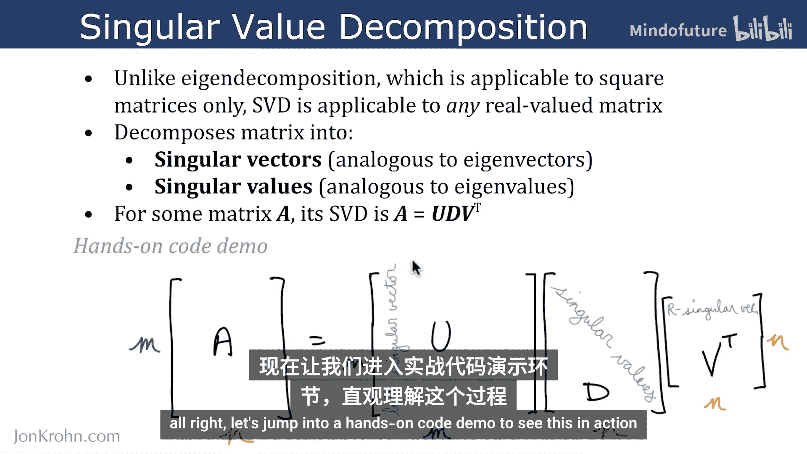
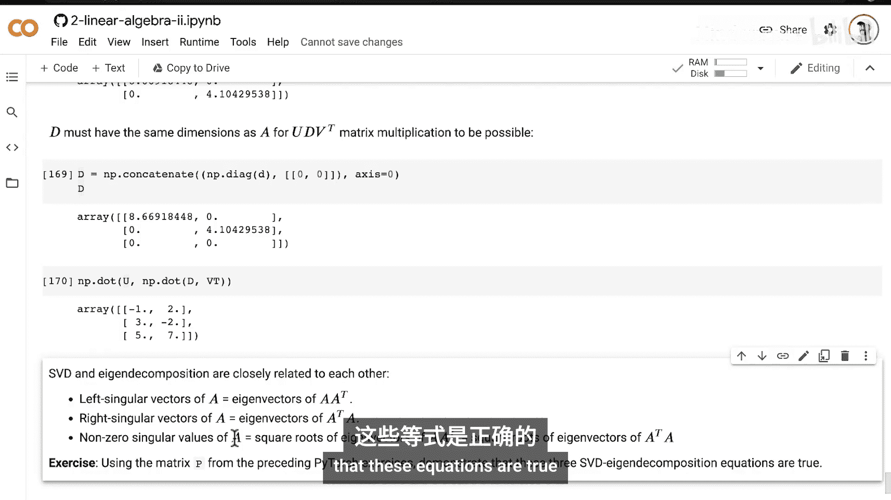

# 机器学习的线性代数及Python实现 ｜ Linear Algebra For Machine Learning p42 P42_奇异值分解 — 主题35 -BV1L8nLz6E8C_p42-

With a focus on hands on code demos in Python in this video。

 I'll introduce you to the theory and practice of singular value decomposition。

A common linear algebra operation in the field of machine learning。Unlike eigen decomposition。

 the focus of the preceding segment in my machine learning Foundation series。

Which is applicable to square matrices only。Singular value decomposition or SVD is applicable to any real valued matrix。

 so a matrix that is made up of real numbers， as opposed to say complex numbers。

SBD decomposes a matrix into singular vectors， which are analogous to eigenvectors。

 as well as singular valuess， which are analogous to eigenvalues。For some matrix A。

 its SD is given by this equation here。So if the matrix A has M rows and N columns。Then it's SVD。

Will consist of。These three matrices， UD and V transpose。With these particular dimensions。So， you。

As columns。That are singular vectors。Specifically， they are called left singular vectorctors。

 so where with eigenvectors， because of the matrix being square that we decompose with eigen decomposition。

 we can have one set of eigenvectors。However， with non square matrices and SD。

 we need left singular vectors as well as right singular vectors。

 And so these left singular vectors are the columns of this matrix U， which is M by M。

Reresponding to the number of rows A。And v transpose consists of singular vectors as rows。

 rate singular vectors as rows， and it has n by n dimensions corresponding to the number of columns of a。

And then， finally， our singular values。Are in this diagonal matrix D。

So the singular values are along the main diagonal and everything else in the matrix because it's diagonal is zeros。

 All right， let's jump into a hands on code demo to see this in action。

All right， in our linear Al 2 Jupiter notebook， we've now made our way to the final segment of the notebook。

Matrix operations for machine learning， and of course， we in the section of it。

 called singular value decomposition。As on the slides that I just had up。

The SVD of some matrix A is given by this equation here。U is an orthogonal M by M matrix。

Its columns are left singular vectors of a。V。Is an orthogonal N by N matrix。Again， where。

A has M rows and N columns。And these columns。Are the right singular vectors of a？

Or as we had it on the slides， B transpos rows are right singular vectors of a。D。Again。

 is a diagonal M by n matrix， and the elements along its diagonal are the singular values of a。

So let's use some arbitrary matrix a here that is non square。

 So we have this matrix A with three rows and two columns。

As with the particular theory of how to compute eigenvectors and eigenvalues when we eigen decompose a given matrix。

The theoretical specifics of how to compute。These left singular vectors and right singular vectors and singular values of the matrix A。

In a singular value decomposition， that's beyond the scope of this machine learning foundation series。

 but I will provide you resources at the end of this linear Alrop2 subject。

 you'd like to dig into this further and understand it even more intimately。

 but it would just take too long right now so I've decided to leave it out of scope and focus on applying SVD understanding。

What its decomposition is composed of and knowing how to make use of that decomposition。

But the actual math of going from a matrix A to its decomposition， yeah。

 we just don't have time for it。All right， so。We can use citizens we're just going to cheat。

And use code to calculate the singular vectors and singular values will'll use the Ny SvD method from the linear algebra module。

And that will create for us these three objects。 So we end up with a matrix U。

Which is the three left singular vectors of a。 So each column。Is a left singular vector， so one， two。

 and three left singular vectors。And then the SVD method in Numpy。

Creates V transpose right off the bat。 So this means that the rows correspond to right singular vectors because V is transposed here。

And recall that these dimensions come from the original matrix。

 so U is a3 by 3 matrix consisting of three left singular vectors。

 because a has three rows and v transpose is a two by two matrix consisting of two right singular vectors because a has two columns。

Our final tensor that came out of this operation is D， which is a vector。Of length too。

 So we have our first singular value and our second singular value。

 So in order to create this matrix D。We just have to go through a few steps to put。

This vector D along the main diagonal。So the first step。Is to use theumpy D method。

 but it puts those singular values right along the main diagonal。

But in order to be able to perform the U by D by v transpose matrix multiplication。

D must have the right dimensions。For that matrix multiplication to be possible。

So refer back to the matrix multiplication videos from much earlier in this machine Learning Foundation series if that didn't make sense to you。

But matrix multiplication can only occur if there are very specific dimensions lining up。

And so this two by two matrix needs to be inverted into a three row and two column matrix in order for the matrix multiplication in this equation or this step here。

To be carried out。So yeah， so we just add。To zeros in the bottom row。

 this is a common practice in diagonal matrices in order to facilitate matrix multiplication with other matrices。

All right， so did it work， We performed the matrix multiplication of D times v transpose。

 and then u times that product andvoila。We end up。With our original matrix A。So the equation is true。

I haven' LED you astray。All right， so singular value decomposition and eigen decomposition are clearly closely related to each other。

 if you go back up in the notebook and look at the eigen decomposition equations。

You can see they are quite similar looking。To。The singular value decomposition equations。

Except in the eigen decomposition case， we had the same matrix of eigenvectors either inverted or transposed。

And then we had a diagonal matrix with eigenvalues along the main diagonal。

But in the case of singular value decomposition， because of the asymmetry。

 because of the non square nature of the matrix A going into it。

We need to have two sets of singular vectors。And then we have those singular values that are analogous to the eigenvalues in that matrix to D。

So beyond that， SVD and eigen decomposition are even more closely related because the left singular vectors of the matrix A are actually equal to the eigenvectors of AA transpose。

And the right singular vectorctors of a are equal to the eigenvectors of a transposea。

And then the non zero singular values of a are equal to the square roots of the eigenvectors of Aa transpose。

 which are themselves equal to the square roots of the eigenvectors of a transpose a so。

As an exercise to help you come to grips with singular value decomposition。

 as well as the close relationship between Svd and eigen decomposition。

 I have an exercise here for you to use the matrix P from the preceding pytorrch exercises。

 Let's go find that matrix here。Here it is。So use this matrix P。

To demonstrate that these three SD eigen decomposition equations are true。

I'm going to leave that to you， you don't need me to go through the solutions because all of the theory as well as the code that you need is right here in this notebook。

 and you'll know that you have succeeded and found the right solution when you do prove that these equations are true。

Nice， now that we know what SVD is in the next video， we'll use it to dramatically compress data。

